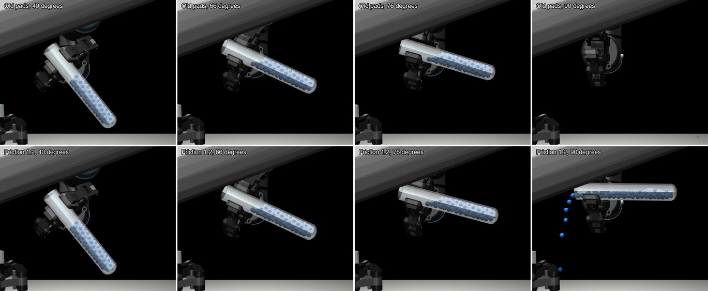
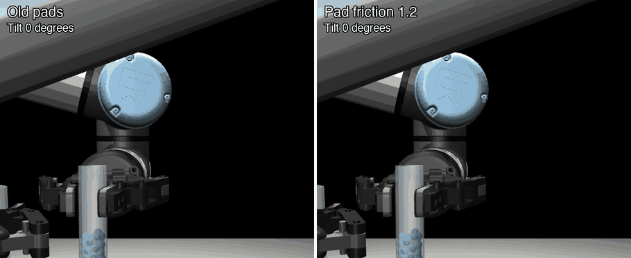
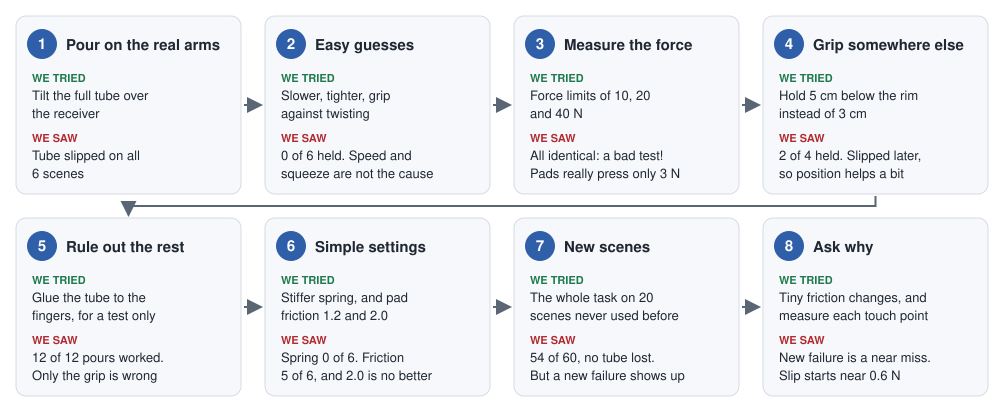
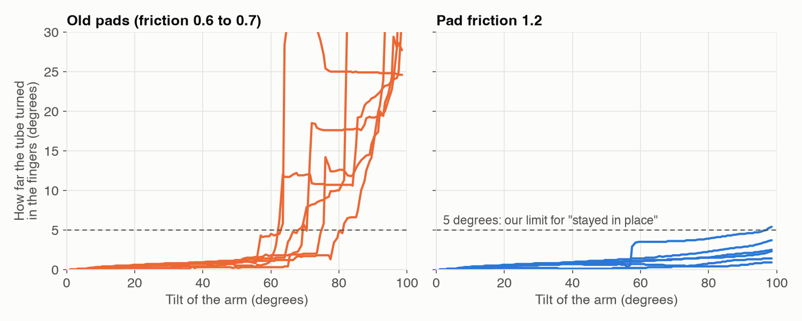
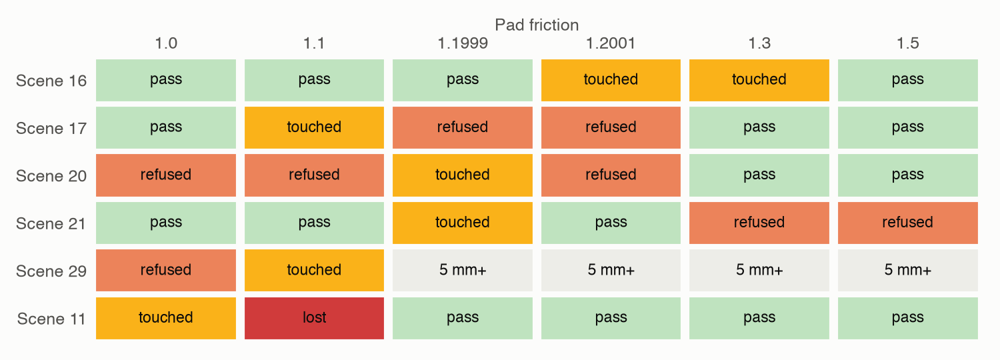
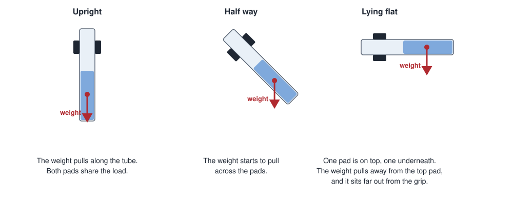
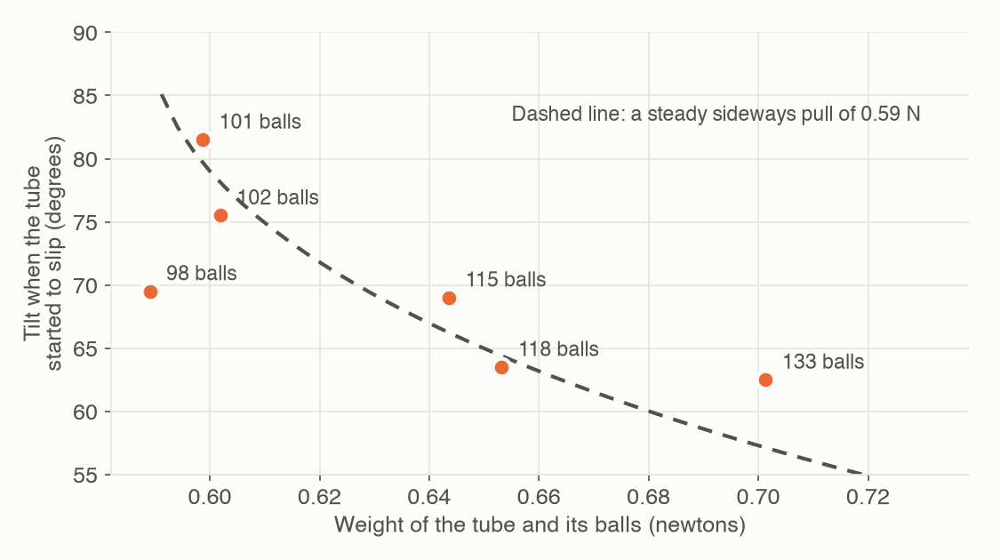
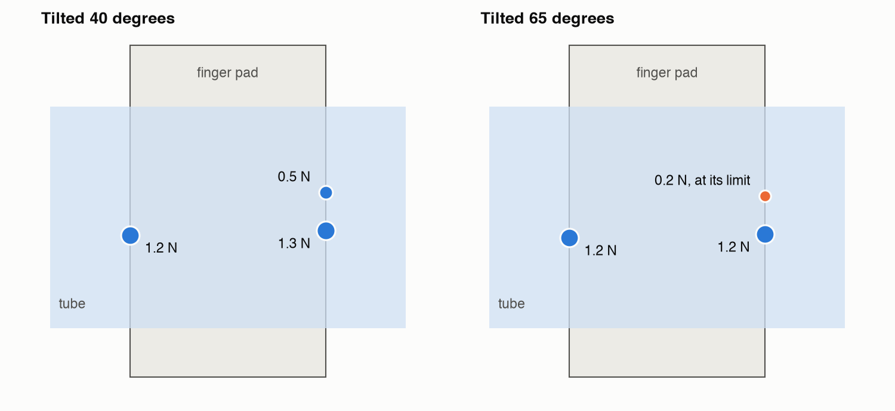

# When a Held Object Slips: How We Fixed It, and What to Do Next Time

The tube slipped out of the fingers when the arm tilted it to pour. This page tells the whole story in order:
what we saw, what we tried, what failed, and how we found the fix. The second half is a guide for the next time
something slips, turns, falls or breaks in a pick-and-place task.

The numbers behind the fix are in [step-2-pour-approaches.md](step-2-pour-approaches.md). This page explains how
we got there.

---

## In short

- **The problem:** the arm could carry a full tube, but tilting it past about 60 to 80 degrees made it slip.
- **The fix:** one setting. Finger pad friction went from 0.6 to 0.7 up to 1.2.
- **The surprise:** the grip was not too weak overall. It had about 6 times the force needed to hold the weight.
  The trouble was one small point of contact, pressed very lightly, that let go first.
- **The lesson:** do not guess. Make a quick test, change one thing at a time, measure the forces, then check the
  fix on scenes you have never used.

*The same scene and the same motion. Top row: the old pads. Bottom row: friction 1.2. The rows look the same up to
66 degrees. By 76 degrees the old tube has moved in the fingers, and by 90 degrees it is gone. With friction 1.2
the tube is in place and pouring.*

---

## Words used on this page

| Word | Meaning |
|---|---|
| **Pad** | the rubber part of a finger that touches the object |
| **Friction** | how much a surface resists sliding. Higher means grippier. Ice is low, rubber is high. |
| **Newton (N)** | a unit of force. 1 N is about the weight of a small apple. |
| **Scene** | one set-up of the task, with its own tube positions and liquid levels |
| **Pinning** | a test shortcut: the simulator glues the tube to the fingers |
| **Contact point** | a place where the simulator says two things touch |

---

## The whole search

Each round below shows what we thought, what we did, and what it taught us.

### Round 1: We saw the problem

**What we did.** We played a pour on the real simulated arms for the first time.

**What we saw.** On all 6 scenes the tube slipped. The receiver got 0 to 30 balls instead of 74, and 73 to 125
balls spilled. On 3 scenes the receiver was knocked out of its fingers too.

**What it taught us.** Step 1b never tilted the tube, so it could not have shown this. A grip that works in one
direction may fail in another.

### Round 2: We tried the easy guesses

**What we thought.** Maybe the tilt is too fast, or the fingers are too loose.

**What we did.** We built a small test: start from the saved end of a carry, then tilt the tube in empty air. That
tests only the grip, and it takes under a minute a run. We ran it on the same 6 scenes each time.

| Change | Tube stayed in place |
|---|---|
| Slower tilt | 0 of 6 |
| Squeeze harder, 6 mm or 8 mm | 0 of 6 |
| Grip against twisting (a simulator setting, `condim=4`) | 0 of 6 |

**What it taught us.** Neither speed nor squeeze was the answer. Squeezing harder even made it worse: at 8 mm the
slip started as early as 7 degrees.

### Round 3: We measured the force, and caught our own mistake

**What we thought.** The real gripper presses with at least 20 N, so maybe the simulated one is too weak.

**What we did.** We set force limits of 10, 20 and 40 N.

**What we saw.** All three gave exactly the same results, to the last decimal.

Real experiments never match that exactly, so we did not believe it. The test was wrong. The limit never did
anything, because the motor was only pushing with about 0.2 N. So we measured the force at the pads directly:
**about 3 N per finger**, and it comes from a small spring in the finger linkage, not from the motor.

**What it taught us.** Results that do not change at all usually mean the test is broken. Our result was useless,
but looking into it taught us how the fingers really work: they are told a position, not a force.

### Round 4: We tried a different height

**What we thought.** The weight is far below the fingers. Holding the tube lower might help.

| Where the fingers hold | Tube stayed in place | Note |
|---|---|---|
| 3 cm below the rim | 0 of 6 | the normal grip |
| 5 cm below the rim | 2 of 4 | the other 2 slipped later than before |
| Further out towards the fingertips | 2 of 6 | rims ended 7 to 12 mm off, and one tube was lost |

Only 4 of the 6 scenes could use the 5 cm grip. On the other 2, the arm's checks chose the 3 cm grip instead.

**What it taught us.** Where you hold matters. It helped, but it was not enough alone.

### Round 5: We removed the problem to see what else was wrong

**What we did.** We pinned the tube to the fingers, as a test only.

**What we saw.** All 12 of 12 pours worked, with 0 to 1 ball spilled and no arm contact.

**What it taught us.** The arm's motion was fine. Grip was the only thing stopping the pour. At this point we
recommended keeping the pin for now. That was the wrong call, as the next round shows, and we withdrew it.

### Round 6: We tried the simplest settings

Your question was what the easy solutions were, so we tried the smallest changes we could think of.

| Change | Tube stayed in place | Note |
|---|---|---|
| Stiffer finger spring, 5 times | 0 of 6 | pads pressed 16 to 20 N, and the tube still turned |
| Stiffer finger spring, 20 times | 0 of 6 | the tube was squeezed right out |
| **Pad friction 1.2** | **5 of 6** | worst turn about 6 degrees |
| Pad friction 2.0 | 5 of 6 | no better than 1.2 |
| Stiffer spring and friction 1.2 | 6 of 6 | held best here, but spilled up to 16 balls in real pours |

**What it taught us.** More force did not help, and friction did. That was the opposite of what we expected. We
chose 1.2 because it is the smallest value that worked, and going to 2.0 gained nothing.

The chart shows how far the tube turned in the fingers on the 6 scenes. On the old pads it suddenly jumps. With
friction 1.2 it stays close to the bottom.

### Round 7: We tested on scenes we had never used

A fix chosen on 10 scenes might only suit those 10. So we ran the whole Step 1b task on 20 new scenes, with both
frictions, on the same scenes.

| | Old pads | Friction 1.2 |
|---|---|---|
| Successful runs | 41 of 60 | **54 of 60** |
| Balls lost | 613 | **0** |
| Tube lost, or 20 mm or more out of place | 11 | **0** |

**A new worry.** Three runs that passed on the old pads now failed, because a finger touched a neighbouring tube or
would have touched it.
A plain count of 54 hid this, and we only saw it by comparing the two runs scene by scene.

### Round 8: We asked why

**Was friction causing the new failures?** We repeated those scenes at six friction values, including 1.1999 and
1.2001. No real force could change between those two.

There is no pattern. Scene 16 passes at 1.1999 and touches at 1.2001. Scene 21 does the opposite. So these are
near misses: the fingers pass the neighbouring tube with almost no room, and tiny differences decide the result.
Friction did not cause them. They are a separate Step 1b problem, and they are not fixed yet.

One result needs care: at friction 1.1, scene 11 lost its tube. That is one run and we did not find out why, so
we do not know how much lower than 1.2 is safe.

**Why did friction work when force did not?** That is the next section.

---

## Why the tube really slipped

We first said that grip is friction times force. The stiffer spring proved that was too simple: 5 times the force
did not help. So we measured what each contact point was doing.

### Step 1: Tilting changes where the weight pulls

Upright, the weight pulls straight along the tube, and both pads share it. As the tube tilts, the weight pulls
more and more across the pads. Flat, one pad is on top and the other underneath, so the weight pulls away from
the top pad. We measured this on one scene: the top finger's press fell from 3.2 N to 2.6 N.

### Step 2: There is a tipping point

The tube started to slip when the sideways pull of its weight reached **about 0.6 N** (0.55 to 0.62 N on the 6
scenes). This is why fuller tubes tend to slip sooner, at a smaller tilt.

Treat this as a rough guide. It comes from 6 scenes, and one of them (98 balls) sits away from the line.

### Step 3: The fingers do not hold with the whole pad

This was the surprise. A straight tube lying across a flat pad touches along a thin line, and the simulator keeps
only the ends of that line. So each finger holds the tube at just a few tiny points, usually 2 to 4, at the very
edges of the pad, and these points do not share the force equally.

*The top finger on one scene, with the old pads, drawn to scale. A bigger dot means a harder press.*

As the tube tilts, the lightest point gets lighter still, from 0.5 N to 0.2 N. Friction at a point is limited by how
hard that point is pressed, so this one reaches its limit first. Once it lets go, the tube rocks onto the other edge
of the pad, and the rest let go too.

We checked this on 2 scenes. On both, points reached their friction limit just as the tube began to move, at about
60 to 69 degrees on one and 78 degrees on the other.

### Step 4: Why friction helped and force did not

- **Friction helps every point,** even one that is barely pressed. At 1.2 the same light point had room to spare
  at 65 degrees (about 60% of its limit, against 100% on the old pads).
- **Force was never the shortage.** The grip as a whole had about 6 times what the weight needed.
- **The stiffer spring made the tube start slipping much earlier,** as early as 16 degrees. It looks like a wet bar
  of soap squeezed out of your hand. **This is our best explanation, not something we measured.**
- **2.0 is no better than 1.2,** so once no point is reaching its limit, more friction has nothing left to fix.

### How much of this is real?

A real rubber pad squashes and touches the tube over an area, not at a few points. So this weakness is partly the
simulator's. Friction 1.2 is a sensible way to get a realistic grip **in this simulation**. It is not a number to
copy to a real robot. There, you would set the grip force and choose the pad material.

---

## What we still do not know

- **Only the medium tube was tilt-tested.** The tall tube is heavier and its weight sits further out, so check it
  before pouring from it. Step 1b's result of 28 of 28 on large tubes does not include tilting.
- **How low friction can safely go.** See scene 11 above.
- **Why the stiffer spring failed.** We have an explanation, but we did not measure it.
- **The neighbouring-tube near misses** (5 of 60 runs) are still there.

The tilt tests were quick throwaway scripts and are not in the project. Only the fix and its test are.

---

## Guide: what to do next time

### The method

This is what worked, as a list you can follow for any new problem.

1. **Say exactly what happens.** Does it slide, turn, roll, jump or break? At what moment? "It falls" is not enough.
   "It turns in the fingers at 70 degrees of tilt" tells you where to look.
2. **Build a small, fast test.** Save the simulation just before the problem, and run only that part. Ours took
   under a minute instead of two, and left out everything except the grip.
3. **Use the same scenes every time.** Otherwise you cannot tell a real change from luck.
4. **Change one thing at a time.** Otherwise you will not know what worked.
5. **Distrust perfect or identical results.** If nothing changes at all, check the test before you trust it.
6. **Measure, do not assume.** We assumed the force was too low. Measuring showed it was not the shortage.
7. **Remove the problem for a moment.** Pinning showed that nothing else was broken, so we knew where to look.
8. **Try the simplest fix first,** and try a few values. If 2.0 is no better than 1.2, use 1.2.
9. **Test the whole task.** A fix for one step can break another.
10. **Test on new scenes,** with and without the fix, on the same scenes.
11. **Read failures by cause, not only the total.** 54 of 60 looked like a clean win and hid a new kind of failure.
12. **Ask why it worked.** A fix you do not understand may fail on the next object. Write down what you still
    do not know.

### What are you seeing?

Find what the object does, then start with the first fix.

| What you see | Likely cause | Try first | Then try |
|---|---|---|---|
| **Slides straight down** through the fingers | not enough grip for the weight | more friction, or more force | larger or softer pads |
| **Turns in the fingers,** like a see-saw | the weight is far from the grip | hold closer to the middle of the weight | longer pads, or keep the object more upright |
| **Rolls or is squeezed out** | round object, squeezed too hard | squeeze less, and hold it at the centre of the pads | curved or V-shaped fingers |
| **Slips only when tilted** | gravity now pulls in a new direction | test at the worst angle, then raise friction | hold nearer the weight, or tilt less |
| **Falls only when the arm moves fast** | starting and stopping add force | slower starts and stops | a firmer grip |
| **Jumps or flies when the fingers close** | too much squeeze, or fingers not centred | squeeze less, and close slowly | check the object is centred first |
| **Fails only on fuller or heavier objects** | close to the limit | find the heaviest case and test it | a bigger safety margin |
| **Fails only sometimes** | a near miss, not a real cause | test many scenes and repeat with tiny changes | make more room |
| **Fingers hit nearby things** | no room on the way in or out | another direction or grip height | open the fingers less, or space things out |
| **Object breaks or is crushed** (real robots) | too much force | limit the force, and use softer pads | spread the force over more area, or add a touch sensor |

A simulator will not show breaking by itself. Log the contact force, and compare it with what the object can take.

### All the options

The first group are the changes we tried. The rest are general good practice that **we have not tested here**.

| Group | Option | Tested here? |
|---|---|---|
| **Pads** | Higher friction | Yes: this was the fix |
| | Softer pads that touch over a bigger area | No |
| | Curved or V-shaped fingers for round objects | No |
| **Grip force** | Tighter squeeze | Yes: it made things worse |
| | Stiffer finger spring | Yes: it did not help alone |
| | Real force control, so the fingers press with a set force | No |
| **Where to hold** | Closer to the weight | Yes: it helped, but not enough alone |
| | Further along the fingers | Yes: it was worse |
| | A different direction, so gravity pulls along the pads | No |
| **How to move** | Slower motion | Yes: it did not help this slip |
| | Tilting less, or tilting around the grip point | No |
| | Gentler starts and stops | No |
| **Sensors** | A touch sensor in the pads, to feel slip and tighten | No |
| | A camera or force reading to catch a slip early | No |
| **Other hardware** | Custom fingers, a clamp or tube holder, or a suction cup | No |
| **Simulator only** | Contact and solver settings, such as `condim` | Yes: `condim=4` made it worse |

### Simulator or real robot?

| | In simulation | On a real robot |
|---|---|---|
| **Changing grip** | change a number | change the pad material, or the force setting |
| **Cost of a failure** | none | a broken tube, or spilled liquid |
| **Main risk** | a result that comes from the simulator, not from physics | wear, dirt and wet surfaces change the grip |
| **Finger force** | here, a position command with a small spring force | usually set directly as a force |

The first question in a simulator is always: **is this real, or is it the simulator?** Here it was a little of both.
