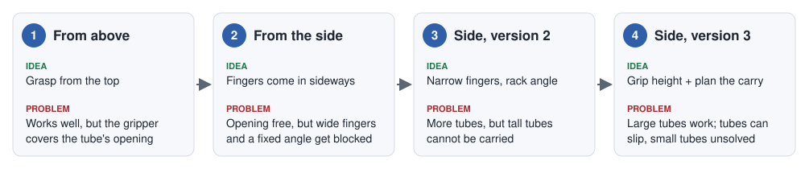
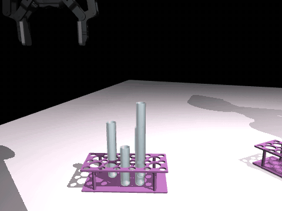
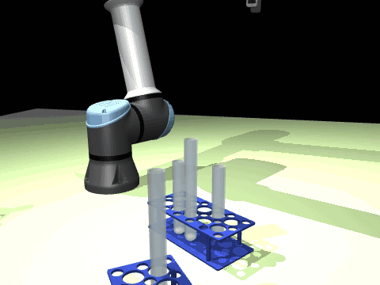
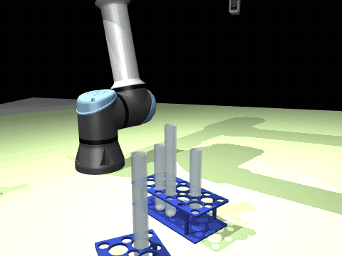
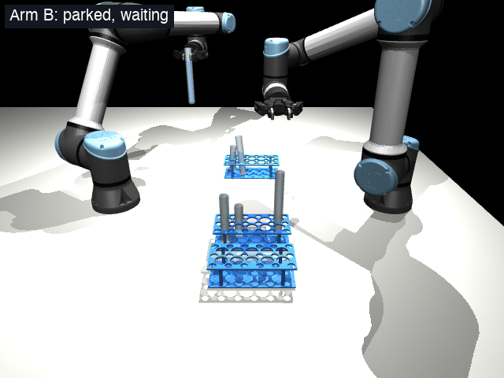
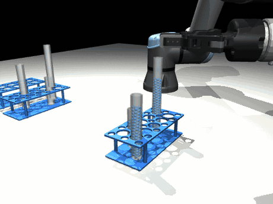
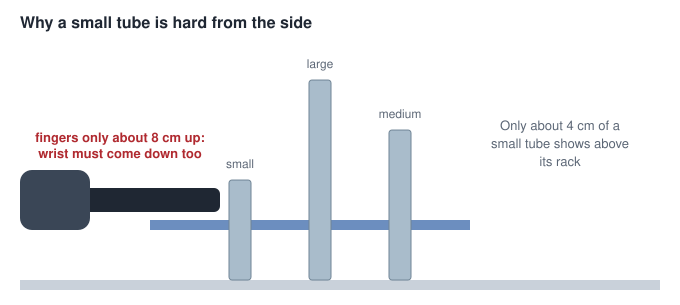

# Step 1: Grasp a Tube

**The job:** two robot arms must pick up test tubes from crowded racks and hold them so one tube can pour
into the other. This page tells the story of how we taught them to grasp: four approaches, what each one
tried, why it was not enough, and how that led to the next.

It follows the [problem statement](../problem-statement/problem-statement.md) and the
[list of steps](steps.md). It stays high level; each approach links to its own detail.

| Word | What it means |
|---|---|
| **Grasp** | where the fingers close on a tube, and from which way they come |
| **Grasp model** | a neural network that looks at a depth picture (how high everything is) and scores which grasps are clear |
| **Boxed in** | no grasp fits: the right answer is to leave this tube and take another |
| **Rim** | the top edge of the tube, around its opening |
| **Full physics** | the simulated arm really moves, closes and lifts, instead of a quick "does it touch?" check |

---

## Approach 1: Grasp from above

**The idea.** The simplest grasp there is: go over the tube, straight down, close, straight up. The tubes
stand upright, so a camera above shows everything the fingers could hit. We trained a model to choose the
best turn of the fingers, so that neither finger lands on a neighbouring tube.

*From above: over the tube, down, close, up.*

**It worked well:** the model beat a hand-written rule, and in full physics it lifted 38 of 41 tubes that had
a clear grasp.

### The problem: it cannot pour

Look at where the gripper ends up. It sits right over the tube's opening.

*Left: held from above, the gripper is over the opening. Right: held from the side, the opening is free.*

Only a 14 mm slot is left above the opening. **Picking worked, but the whole point of picking is to pour.** A
grasp has to be judged by the full task, not only by the lift.

**What we did next:** come in from the side.

*More: [top-down approach](../../step-1-grasp/docs/top-down/approach.md) and
[results](../../step-1-grasp/docs/top-down/results.md).*

---

## Approach 2: Grasp from the side

**The idea.** The gripper comes in level, from beside the tube, and the opening stays free. Now the way in
matters: the gripper's body and the arm's wrist travel through the space around the tube. So the model
scores **24 directions** around each tube, 15 degrees apart.

*From the side: down beside the tube, straight in, close, up. The opening stays free.*

### The problem: most tubes were blocked

Only **40%** of test tubes had a clear way in. Two simple causes:

1. **The fingers came in fully open.** Tubes in a row stand only 36 mm apart, with 11 mm of air between them,
   so open fingers land on the tubes beside the target.
2. **The directions were counted from the table, not the rack.** Racks stand at random angles, so "straight
   out of the rack" often fell between two of the 24 directions. Being 7 degrees off is enough to touch
   something in an 11 mm gap.

*Seen from above. Left: fully open, the pads land on the neighbours. Right: nearly closed, they fit.*

And when the arm tried for real, some grasps failed:

*A real failure: the tube comes up, but on the way in the arm hit a neighbouring tube and the rack.*

**What we did next:** make the gripper narrower and line the directions up with the rack.

*More: [version 1 page](../../step-1-grasp/docs/side/version1.md) and
[results](../../step-1-grasp/docs/side/results.md).*

---

## Approach 3: Side grasp, version 2

**The idea.** Three small, cheap changes, and a new round of training:

| Change | Why |
|---|---|
| Open the fingers only **35 mm** before going in | the tube is 25 mm wide, so they fit around it and between its neighbours |
| Count the directions **from the rack** | four of the 24 now point exactly straight out of the rack |
| Mix each direction's score with its neighbours' | the arm aims at the middle of a clear range, not its edge |

*Left: the rack's sides (yellow) fall between the directions (grey). Right: the picture is turned to the rack,
and they line up.*

*The same tube as the failure above, seen from the same camera: version 2 lifts it cleanly.*

**It worked:** tubes with a clear way in went from 40% to **62%**, and in full physics 18 of 20 grasps the arm
could reach lifted cleanly.

### The problem: tall tubes could not be carried

Every side grasp so far gripped 3 cm under the rim, which is the best height for *picking*. When the two-arm
task ([Step 1b](step-1b-pick-and-carry.md)) tried it, **none of the 12 large-tube runs got through**.

A tall tube gripped near its top hangs 17 cm below the fingers. To clear every rim on the table, the fingers
must travel about 42 cm up, held level and far from the arm's base.

*How high a tall tube has to be carried (top left).*

Up there the arm is close to an awkward pose: a tiny move of the fingers needs a huge turn of a wrist joint,
about 150 degrees. The arm cannot follow that, so its planner refused the move and the run stopped.

There was a smaller problem too. With so little room, being 1 or 2 mm off could clip a neighbour, and the model
became less sure which tubes were boxed in.

**What we did next:** let the grip height change, and judge a grasp by the whole carry.

*More: [version 2 page](../../step-1-grasp/docs/side/version2.md).*

---

## Approach 4: Side grasp, version 3

**The idea.** We tried gripping lower on large tubes, with nothing else changed, and 5 cm under the rim got 7 of
10 runs through. So there were two changes:

1. **The model also scores the grip height:** each of the 24 directions at 3, 5 and 7 cm under the rim.
2. **Plan the whole trip before choosing.** Step 1b now tries the model's options one by one, and rehearses the
   pick and the entire carry on a copy of the simulation. It takes the first option that passes all of it.

*The full task with large tubes, sped up: Arm B picks the source and parks it, Arm A brings the receiver to the
pouring point, and Arm B comes in beside it.*

**It worked:** large tubes went from 0 of 12 runs to **7 of 12**, and all runs from 14 of 30 to **21 of 30**.

**An honest note:** every one of those successes still gripped 3 cm under the rim. Planning ahead is what made
the difference, by finding a direction the arm can carry from. The lower grips are there as a fallback, and
these 10 scenes did not need them.

### Problem 1: tubes slip out of the fingers

This is now the biggest cause of lost runs: in 6 of 30, a tube comes loose or falls. Two fingers hold a round
tube along one thin line, so it can swing like a door on its hinges.

*A real failure: the fingers close in the right place, the arm lifts, and the tube drops back into the rack. The
label still says "source picked": the arm has no way yet to notice that its fingers are empty.*

### Problem 2: small tubes

In 9 of 10 runs that asked for small tubes, no grasp passed the arm's checks, so the medium pair was taken
instead.

A small tube is gripped very low, and with level fingers the wrist has to come down with them. In a quick test
of 36 small-tube grasps the model rated as good, the arm could not get there for 23, 12 lifted cleanly and 1
did not lift. So the main limit is what the arm can reach, not the model. **We are leaving small tubes for now.**

*More: [version 3 page](../../step-1-grasp/docs/side/version3.md) and
[Step 1b results](../../step-1b-pick-and-carry/docs/results.md).*

---

## The journey at a glance

| | Approach | Learned from the last one | What stopped it |
|---|---|---|---|
| 1 | From above | | the gripper covers the opening |
| 2 | From the side | a grasp must leave the opening free | wide fingers, directions not lined up with the rack |
| 3 | Side, version 2 | fit the fingers and the directions to the rack | tall tubes cannot be carried |
| 4 | **Side, version 3 (in use)** | a grasp must work for the whole carry | tubes slip; small tubes not solved |

## Where we are now

- **Working:** version 3 picks medium and large tubes, and both arms bring them to the pouring point in 21 of 30
  runs.
- **Not yet measured:** the model's score on only the tubes a real arm can reach. Today's scores also count tubes
  the arm cannot get to.
- **To confirm:** those 30 runs use the same 10 scenes we tuned on, so new scenes may score lower.

## What is next

1. Make the grip hold, so tubes stop slipping.
2. Move on to [Step 2, the pour](step-2-pour.md), with medium and large tubes.
3. Come back to small tubes later.
