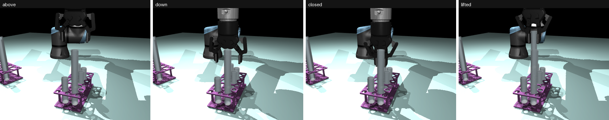
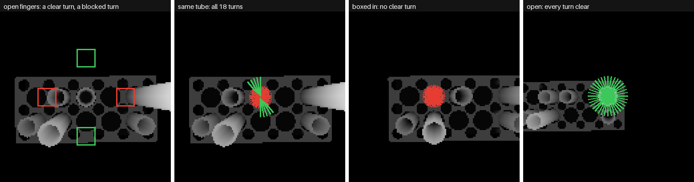

# Step 1: Grasp a Tube

The first part of Step 1 from the [list of steps](steps.md): an arm takes a tube out of its rack.
Carrying it to the centre comes next.
It follows the [problem statement](../problem-statement/problem-statement.md).

The code is in [`step-1-grasp/`](../../step-1-grasp/). It has **two grasp models**, each with its own
two pages that go deeper:

| | From above (top-down) | From the side |
|---|---|---|
| Used for | the first model; carrying | **the one Step 1b uses**: the opening stays free for pouring |
| Every setting, and why | [top-down/approach.md](../../step-1-grasp/docs/top-down/approach.md) | [side/approach.md](../../step-1-grasp/docs/side/approach.md) |
| How well it works | [top-down/results.md](../../step-1-grasp/docs/top-down/results.md) | [side/results.md](../../step-1-grasp/docs/side/results.md) |
| Second version | | [side/improved.md](../../step-1-grasp/docs/side/improved.md) |



*The top-down grasp: over the tube, straight down, close, straight up. The gripper ends up over the
tube's opening.*


*The side grasp: down beside the tube, straight in sideways, close, up. The opening stays free.*

---

## Goal

Step 0 says where each tube stands and how high its rim is. To take a tube, the arm still needs:

- **where exactly to close the fingers**, on the table (Step 0 is a centimetre off now and then),
- **at which turn**: the direction the two fingers open along, seen from above, so that
  neither finger lands on a neighbour,
- **how high**, and **how hard to squeeze**,
- or to know that a tube is **boxed in** (no turn fits) and take another one instead.

The sections up to "A second model" are about the **top-down** grasp. Its pick is always the same:
over the tube, straight down, close, straight up 10 cm.

```
          over the tube            down                  closed                lifted
              |  |                 |  |                    ||                    ||
          ┌───┘  └───┐         ┌───┘  └───┐            ┌───┘└───┐            ┌───┘└───┐
          │          │         │   ┌──┐   │            │  ┌──┐  │            │  ┌──┐  │
                               │   │  │   │            │  │  │  │            │  │  │  │
             ┌──┐                  │  │                   │  │               │  │
             │  │                  │  │                   │  │               └──┘
   ══════════╡  ╞══════    ════════╡  ╞════════   ════════╡  ╞════════   ════════════════
    rack     └──┘                  └──┘                   └──┘               rack
```

## What is worked out, and what is learned

| Part | How | Why |
|---|---|---|
| Where to look | above the tube Step 0 found | |
| **Where the fingers close, and at which turn** | **learned** (or the programmed rule, to compare) | this is where the neighbours matter |
| Grip height | 3 cm below the rim, never lower than 3 cm above the rack's top | keeps the opening clear and the pads off the rack |
| Squeeze | fingers told to close 4 mm under the tube's 25 mm | the simulation's tested setting |
| The movement | over, down, close, up | the same for every tube |

## Two ways to choose the turn

### The programmed rule (no training)

It uses only Step 0's list of tubes. Seen from above, the open fingers are a rectangle around the
tube. For each of the 18 turns (10 degrees apart), it checks how close the nearest neighbour comes
to that rectangle, and takes the turn with the most room. If every turn has a neighbour inside the
rectangle, it says "boxed in". The rectangle's size was fitted on the training scenes.

Its weak points: it can only aim where Step 0 said the tube is, and it does not know about tubes
Step 0 missed.

### The grasp network (our model)

The arm first moves its camera **25 cm above the tube** and takes a close-up depth picture: how
high everything is, pixel by pixel. That shows exactly where the tube's rim is and how tall each
neighbour is, which the overhead picture of Step 0 cannot.

```
 close-up depth picture  ──►  grasp network  ──►  18 score maps, one per turn
     128 x 128                (GR-ConvNet style)   score at each pixel: 0 = blocked, 1 = clear

                              best pixel near the middle + best turn
                                        │
                              under 0.25? ── yes ──► "boxed in", take another tube
                                        │ no
                                        ▼
                         where on the table, at which turn, rim height
```

**What it predicts:** for every pixel and each of the 18 turns, a score from 0 to 1 for "if the
fingers close centred here, at this turn, they touch nothing else". The arm takes the best pixel
near the middle of the picture and the best turn there.

## Which model, and why

| Model | What it is | Verdict |
|---|---|---|
| **GR-ConvNet / GG-CNN** | one picture from above in; for every pixel a grasp score, an angle and a width out | **chosen**: our grasps are from above, tubes stand upright; small, trains from scratch in minutes |
| Dex-Net (GQ-CNN) | proposes many grasps, a CNN scores each | same idea of scoring, but slower and needs a separate proposer |
| Contact-GraspNet, AnyGrasp | full 3D grasps from any side, from a 3D point cloud | built for messy real-world piles; heavy; we only need one direction |
| Reinforcement learning | learns by trying many full grasps | very slow to train; little to gain for a known shape |

**Our one change to GR-ConvNet:** it gives one angle per pixel, but a tube often has several good
turns (say 0 to 40 degrees and 120 to 170), and one angle would average them into a bad one in
between. So ours gives **a score for each of the 18 turns**. The width output is dropped: every
tube is 25 mm.

## How the training data is made

The simulator labels every grasp by **trying it**. In crowded random scenes (racks anywhere, tubes in
touching cells and corners), for every tube and every turn, the gripper is put on its way down and
then closing, and MuJoCo checks whether it touches anything but the target. This takes under a
millisecond per test, so 18 turns for every tube in 550 scenes takes a few minutes.

| Split | Scenes | Pictures | Used for |
|---|---|---|---|
| Train | 400 | 4,660 | learning |
| Validation | 50 | 558 | choosing the best epoch and the 0.25 cut-off |
| Test | 100 | 1,151 | the final grade; never seen in training |

Training takes **15 minutes** on the Mac. To be sure this fast check tells the truth, it was
compared with full physics (the real arm, really closing and lifting) on 60 random grasps: they
agree on 97%.

## The force

Two fingers hold a tube by friction. The heaviest tube (a full 200 mm source) weighs up to about 1 N; with
the pads' friction (0.7) and room for the arm speeding up and slowing down, **about 2 N of squeeze
is enough**.

The gripper is told a finger position, not a force. Measured in physics on full tubes:

| Fingers told to close | Squeeze | Lifted | Slip |
|---|---|---|---|
| 0.5 mm under the tube's width | 12 N | yes | under 0.5 mm |
| 1 mm under | 17 N | yes | under 0.5 mm |
| **4 mm under (used now)** | **47 N** | yes | under 0.5 mm |

So the grip never slips on a straight lift; it just squeezes much harder than needed. 1 mm under
would be gentler on the glass. The pour (Step 2) twists the tube in the fingers and needs its own test
before the squeeze is lowered.

## Result in short

| | Programmed rule | Grasp network |
|---|---|---|
| Good grasp, of tubes that have a clear turn | 80.0% | **93.9%** |
| Rightly refused, of boxed-in tubes | 62.3% | **93.2%** |
| Fingers within 5 mm of the tube's axis | 90.0% | **100%** |
| Full physics: lifted cleanly, of 41 graspable tubes | 34 | **38** |
| Full physics: right overall, of 60 tubes | 73% | **92%** |
| Training | none | 15 min |

The network wins on both halves of the job: it aims at where the tube really is (the rule inherits
Step 0's occasional centimetre miss), and it sees which neighbours are in the way, so it refuses
boxed-in tubes instead of bumping them. In physics, a bump often knocks the neighbour clean out of
its rack. Short tubes are the hard case for both: half of them are boxed in by taller neighbours.

The first try had three mistakes that made the network look worse than the rule in physics. They
were found by comparing with full physics, and fixed; [results.md](../../step-1-grasp/docs/top-down/results.md)
tells the story.



*Top-down labels: the open fingers seen from above at a clear (green) and a blocked (red) turn, and
all 18 turns for three tubes (long green = clear, short red = blocked).*

## A second model: side grasps, for pouring

A top-down grasp is good for carrying, but useless for pouring: the tube's rim ends up 2.5 cm under
the gripper's base, and the finger links leave only a 14 mm slot above the opening, too narrow for the
7 mm balls. So Step 1 has a **second network for side grasps**, used by both arms in Step 1b. The
top-down one above stays as it is.

| | Top-down network | Side-grasp network |
|---|---|---|
| The gripper comes | from above, fingers down | from the side, fingers level, body beside the tube |
| What it chooses | one of 18 turns (0 to 170 degrees) | one of **24 directions** (0 to 345 degrees: the body is on one side, so it is not the same turned half round) |
| The tube's opening | under the gripper | **free** |
| The close-up | 25 cm above the rim | **35 cm** above the rim, so the picture covers the gripper's whole way in |
| What the check covers | the gripper | the gripper, and the arm's **wrist behind it** (a rod standing in for it), which comes in at the same height |
| Network | the same GR-ConvNet style, 18 outputs | the same, 24 outputs |

**Why the picture is still taken from above:** everything on the table is an upright tube or a flat rack,
so a height map from above shows where every object stands and how tall it is, which is all that decides
whether a sideways approach at a given height hits something. A camera from the side would see only the
nearest tube, with everything behind it hidden.

**The way in:** come down beside the tube, 6 cm out from it; move straight in; close. The pinch point goes
11.5 mm past the tube's axis, because the Robotiq pads close that far behind it on a 25 mm tube.

```
   side view                                   seen from above

   1. down beside      2. straight in               gripper coming in from the bottom
      ════[██]╗           ════[██]╗                     ( O )  ( O )  ( O )   <- outer row
          ↓   ║  │ │             ═╬═│ │                         ↑   ↑
              ║  │ │              ║ │ │                     one finger in each 11 mm gap
             ═╩═ │ │                │ │                     beside the target
   ═══════════════╡ ╞═══     ═══════╡ ╞═══
              rack                  rack
```

| Side-grasp network | |
|---|---|
| Training | 4,660 pictures, 16 epochs, 25 minutes |
| Test tubes with at least one clear side direction | 40% (crowded racks block most sideways approaches) |
| Good grasp, of those | **79.6%** |
| Rightly refused, of boxed-in tubes | **98.4%** |
| Fingers from the tube's axis | median 1.7 mm, 95% under 2.9 mm |
| Fast check vs full physics | agree 90%, and never called a grasp clear that then failed |

In full physics, 6 of the 9 side grasps the nearer arm could reach on its fixed route succeeded. Of the
other 3, 2 touched something with a part of the arm further back than the wrist, and 1 did not lift.
The network judges only the gripper and the wrist; Step 1b's coordinator checks the whole arm and takes
the network's next-best direction when needed. Details: [side/results.md](../../step-1-grasp/docs/side/results.md).

### Why only 40% of tubes can be taken from the side

The way in is already sideways, so a tube on the outer row with nothing behind it looks easy. It is not:
**the fingers come in fully open, 93 mm apart, but the tubes in a row are only 36 mm apart.** Each pad
lands on the tube beside the target. Between two tubes in a row there is only 11 mm of air, and each
finger has to slide into that gap.


*Seen from above, the gripper come straight in from outside the rack. Left: fully open, as now; the pads
hit the row neighbours. Right: nearly closed before going in; the pads fit.*

Measured with the fast check on 169 test tubes:

| Setting | Graspable from the side |
|---|---|
| Now: fingers fully open, 24 fixed directions | 46% |
| Fingers nearly closed | 54% |
| **Fingers nearly closed, plus the 4 directions lined up with the rack** | **64%** |

The racks stand at random angles, so the straight-out direction is often not one of the 24, and 7 degrees
off is enough to hit a neighbour in an 11 mm gap. The rest is the Robotiq finger itself, about as thick
as the gap: short tubes (gripped just above the rack) stay hard. The next run makes the labels again with
these two changes and trains the side network again.

### Version 2 of the side network

[side/improved.md](../../step-1-grasp/docs/side/improved.md) makes three changes: the fingers come in
opened 35 mm (just wider than the 25 mm tube), the 24 directions are counted from the rack (the close-up
is turned to it), and each direction's score is mixed with its neighbours' before choosing.

| On the same 1,151 test tubes | Version 1 | Version 2 |
|---|---|---|
| Pickable from the side | 40% | **62%** |
| Good grasps | 364 | **531** |
| Wrong direction, of pickable | 20% | **13%** |
| Boxed-in tubes refused | **98%** | 80% |
| Full physics, reachable pickable tubes lifted cleanly | 6 of 9 | **18 of 20** |

The fingers now pass within a millimetre or two of the row neighbours, so a small aim error can clip
one, and the network is less sure which tubes are boxed in. The next version labels a direction clear
only if it has 2 mm to spare either side. Step 1b still uses version 1.

## Simplifications

- **The camera** is placed on the gripper's axis, looking straight down. The real wrist camera
  is on the side of the wrist and tilted; its picture would be turned into this view once.
- **The tubes are empty in Step 1.** Full of the simulation's stiff balls, tubes rattle and keep
  leaning, so the scene never comes to rest. Liquid only adds weight, so the squeeze was tested
  separately with full tubes.
- **Step 0's errors are made up** to match its measured results, rather than running Step 0 itself.

## What is next

- **Step 1b, the movement:** the one grasp both methods failed for a reason other than a graze was
  the arm sweeping through a rack on its way. The route has to go around things.
- Then both arms carry their tubes to the pouring point.
