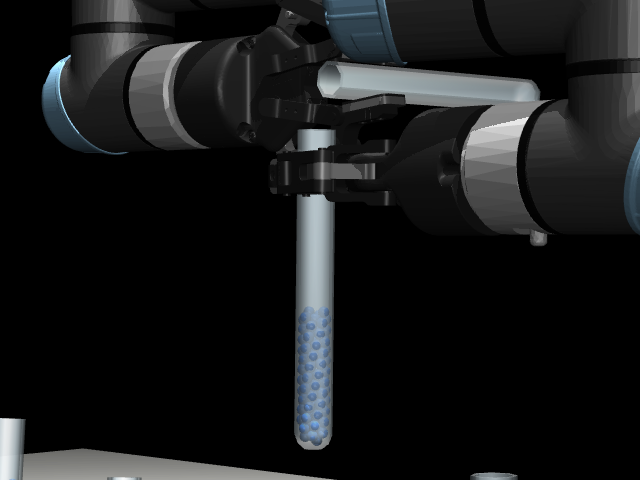
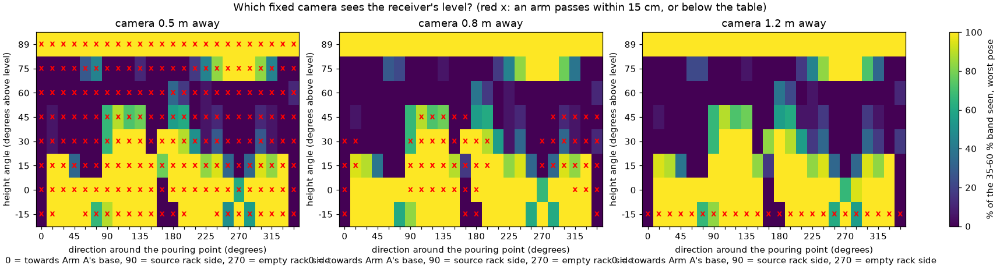
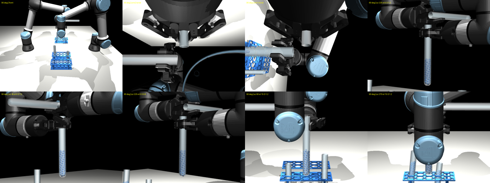
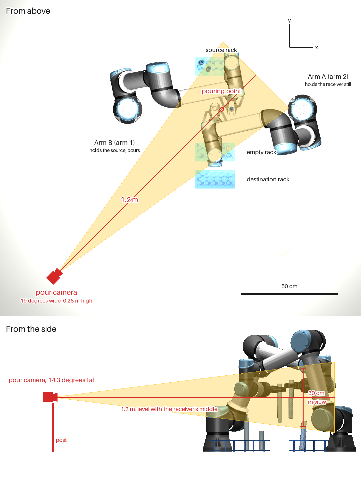
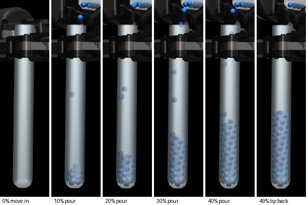

# Step 2: Where the Camera Goes to Watch the Pour

The level network (see [step-2-pour-approaches.md](step-2-pour-approaches.md)) reads how full the receiver is from a
picture. This page records how the camera for that picture was chosen. The choice was tested before anything was
built on it.

---

## In short

- **The front camera cannot see the receiver during the pour.** Arm A holds the receiver from the front, so its
  own wrist hangs right in front of the tube. It covered the receiver in every pose tested.
- **The wrist cameras are no good either.** Arm A's looks down along its own gripper. Arm B's has the receiver in
  view only about half the time, and it moves as the source tips.
- **A third arm carrying a camera is not needed.** The receiver is always held at the same place (the pouring
  point, within about 2 mm), so a camera that does not move can always look at the right spot.
- **The new `pour` camera** stands 1.2 m from the pouring point, level with the receiver, at the corner between
  the empty rack and Arm B. It saw the receiver's 35 to 60 % band in **every pose of all 19 runs**, and no arm came
  within about **75 cm** of it or its post.
- **Far away does not mean blurry.** With a narrow lens (14 degrees, so 30 cm of view at the receiver) it sees
  about **0.6 mm per pixel**. The front camera, with its wide lens, sees 2.4 mm per pixel, too coarse for the
  48 to 52 % window (about ±3 to ±4 mm of level).

---

## What the words mean

| Word | Meaning |
|---|---|
| **Pose** | where both arms and both tubes are at one moment |
| **Line of sight** | a straight line from the camera to a point. If anything is in the way, the camera cannot see the point |
| **Direction** | where the camera stands around the pouring point, seen from above: 0 degrees is towards Arm A's base, 90 the source rack's side, 180 Arm B's base, 270 the empty rack's side (the front) |
| **Height angle** | how far above the receiver the camera looks from: 0 is level with it, 90 straight down |
| **Clearance** | the closest any arm (or a tube it holds) came to the camera, over whole runs |
| **mm per pixel** | how much of the real tube one pixel of the picture covers. Smaller is sharper |

---

## The options

| Option | For | Against |
|---|---|---|
| The front camera, as it is | already there | measured below: blocked |
| A wrist camera | moves with the arm, close | Arm A's looks along its own fingers; Arm B's moves while tipping |
| A fixed camera close to the pouring point | sharp picture | the arms swing through the middle of the table, and could hit it |
| A third arm with a camera | can come close after the others are in place | a whole new arm to plan and keep clear of the other two |
| **A fixed camera further out, with a narrow lens** | out of the arms' way, still sharp | needs a direction where nothing is in front of the receiver: measured below |

---

## How it was tested

1. **Real runs.** Step 1b was run on 20 scenes (seeds 10 to 19, medium and large). 19 reached the pouring point
   (5 medium, 14 large). Everywhere the arms went was saved, every 50 ms.
2. **The pour.** In each, the source was tipped to 78, 85, 90 and 95 degrees, its lip 15 mm from the receiver's
   centre and 20 mm above its rim, as in the approaches page. These tilts were set by calculating the arm's joints,
   not simulated. With the end of Step 1b, that is 5 poses per run, 95 in all.
3. **576 camera places**: 24 directions, 8 height angles (from 15 degrees below to straight down) and 3 distances
   (0.5, 0.8 and 1.2 m), all pointed at the receiver's middle.
4. **Lines of sight.** From each place, 39 lines to points inside the receiver, from 5 to 65 % of its height. A point
   counts as seen if nothing but the receiver's own glass is in the way. The 35 to 60 % band is where the level
   must be read well.
5. **Clearance.** For each place, the closest any arm came to it, and to a post down to the table (or a hanger up
   to the ceiling) holding it.

A place **passed** if, in every one of the 95 poses, it saw at least 95 % of the band and 90 % of the whole tube,
and no arm came within 15 cm of it or its post. Straight-down views were left out: from above the level cannot be
read, only the top of the balls. So were places below the table.

---

## Results

*Each square is one place: yellow sees the whole band in the worst pose, dark sees none of it. A red x means an arm
passes within 15 cm, or the place is below the table.*

**62 of the 576 places passed.** They are mostly level with the receiver or a little above, and not straight in front
or behind:

| Camera | Band seen (worst pose / average) | Why |
|---|---|---|
| `front` (as it is) | 0 % / 0 % | Arm A's wrist is in the way |
| `arm2/wrist` (Arm A) | 0 % / 0 % | it looks down along its own gripper |
| `arm1/wrist` (Arm B) | 0 % / 63 % | the receiver is in its view only half the time |
| 1.2 m, level, from the front (270 degrees) | 67 % | Arm A's wrist again |
| 1.2 m, level, from Arm A's side (0 degrees) | 0 % | Arm A and the tipped source |
| **1.2 m, level, 225 degrees (chosen)** | **100 % / 100 %** | nothing in the way; nearest arm 78 cm |
| 1.2 m, level, 240 degrees | 100 % / 100 % | nearest arm 74 cm |
| 0.8 m, level, 225 degrees | 100 % / 100 % | nearest arm 40 cm |

*Top row: the front camera, Arm A's wrist, Arm B's wrist, and the chosen camera. Bottom row: 1.2 m level from 45
degrees; 0.8 m level from 225 degrees; 1.2 m from 90 degrees, 15 up (Arm B's wrist covers the top of the tube, the
band is still seen); and from the front, 15 up (Arm A's wrist covers the receiver).*

The chosen place is the best one with a wide margin: its neighbours (210 and 240 degrees, and 0.8 m out) also pass,
so a camera put a few centimetres off still works.

---

## The camera

| Setting | Value |
|---|---|
| Name | `pour` (in `simulation-environment/lab_scene/settings.py`, `POUR_CAMERA`) |
| Place | x -0.40, y -0.85, z 0.28 m: 1.2 m from the pouring point, level with the receiver's middle |
| Points at | x 0.45, y 0, z 0.28 m: the receiver's middle as Step 1b holds it (rim at 0.35 m) |
| Lens | 14.3 degrees from top to bottom of the picture: 30 cm of view at the receiver |
| Picture | 640 x 480, about 0.6 mm per pixel at the receiver |

*The whole scene at the end of Step 1b (test scene 150, large tubes), both views to scale. **From above:** the arms'
bases are 0.9 m apart, and Arm A and Arm B hold the two tubes at the pouring point (red circle) between them. The
camera stands at the table's corner, between the empty rack and Arm B, 1.2 m from the pouring point. The yellow
wedge is what it sees. From above the wedge is 19 degrees wide, wider than the 14.3 degrees from top to bottom,
because the picture is wider (640) than it is tall (480). **From the side**, looking across the camera's line of
sight: the camera is level with the receiver's middle (0.28 m above the table), and at the receiver its view is
30 cm tall, enough for a whole large tube and the lip above it.*

A real camera like this is a machine-vision camera with a narrow (telephoto) lens, on a short post at the table's
corner.

**What the level network gets.** The receiver is always in the same place in the picture, so each picture is cut
down to a strip around it: 96 pixels wide and 384 tall, from 3 cm above the rim (the lip and the falling balls) to
21 cm below it (the bottom of a large tube).

---

## Limits

- The source's tilts here were calculated, not simulated. The real programmed pour (Step 2) follows the same
  positions; its pictures show the same clear view.
- In all 19 runs Arm A gripped 3 cm below the rim. Gripped lower, its fingers cover more of the top of the tube,
  but the band (35 to 60 %) is still below them.
- The simulated glass does not bend light. A real tube would distort the balls behind it a little.
- Small tubes were not tested.

---

## Running it again

From `step-2-pour/`: `make camera-study` (about 15 minutes). The scripts are in `step-2-pour/camera_study/`:
`record.py` (the Step 1b runs), `analyse.py` (lines of sight and clearance), `plot.py` (the map) and `render.py`
(pictures from chosen places). The picture of where the camera stands comes from `placement.py`:
`pixi run python -m camera_study.placement --out camera-placement.png` (it needs a saved start from `make starts`).
