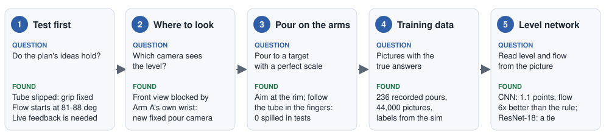
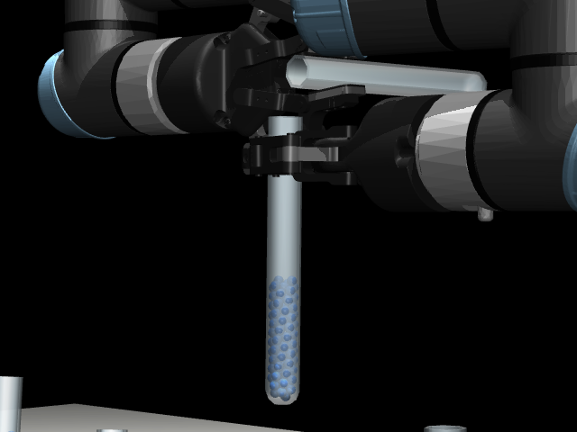
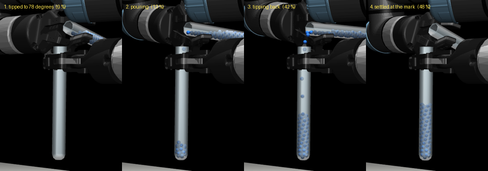
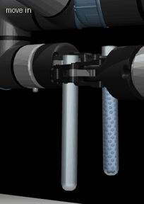
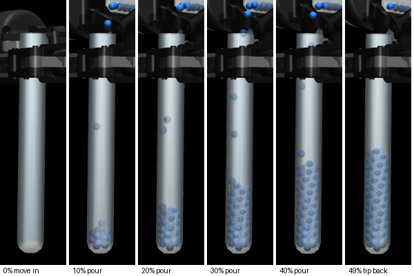
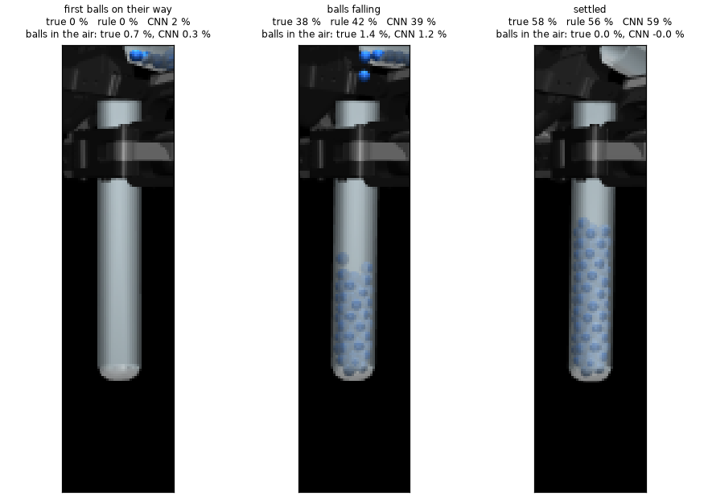

# Step 2: Pour Until the Receiver Is 50% Full

Step 2 from the [list of steps](steps.md). It starts where [Step 1b](step-1b-pick-and-carry.md) ends: Arm A holds
the empty receiver still at the pouring point, and Arm B holds the full source beside it. Arm B now tips the
source until the receiver is half full.

This page tells the story in six parts (the picture shows the first five) and stays high level. The code is in
[`step-2-pour/`](../../step-2-pour/). Four more pages go deeper:

- [step-2-pour-approaches.md](step-2-pour-approaches.md): the tests run before anything was built.
- [step-2-pour-camera.md](step-2-pour-camera.md): how the camera that watches the pour was chosen.
- [approach.md](../../step-2-pour/docs/approach.md): every setting, and why.
- [results.md](../../step-2-pour/docs/results.md): how well it works.

| Word | What it means |
|---|---|
| **Source** | the full tube, held by Arm B (arm 1) |
| **Receiver** | the empty tube, held by Arm A (arm 2), to be filled to 50% |
| **Lip** | the point of the source's rim nearest the receiver, where the balls leave |
| **Tilt** | how far the source is turned from upright: 0 degrees is upright, 90 is lying flat |
| **Level** | how full the receiver is, as a % of its height. 50% is the mark |
| **Flow** | how fast the level rises, in % per second |
| **In the air** | balls that have left the source but not landed yet. They still land if the arm tips back now |
| **Points** | the difference between two levels: 52% is 2 points above 50% |

---

## Goal

Fill the receiver to **50%, within 2 points** (48 to 52%), without spilling.

| Receiver | 50% mark | 2 points is |
|---|---|---|
| medium, 150 mm | 74 balls | 3 balls |
| large, 200 mm | 103 balls | 4 balls |

Small tubes are left out for now: Step 1b rarely brings them to the pouring point.

---

## 1. Test first

Before writing the pour, short tests checked the plan ([step-2-pour-approaches.md](step-2-pour-approaches.md)):

- **The tube slipped in the fingers** once tipped past 60 to 80 degrees. Raising the pads' friction to 1.2 fixed it.
- **The balls are not water.** They only start to flow at 81 to 88 degrees, whatever the size or fill.
- **A recorded motion fails** (about 1 pour in 6 hits the target), because every source starts at a different
  level. **Watching the receiver while pouring works.**

So the pour needs a live reading of the receiver. A camera can give that, which raised the next question.

---

## 2. Where to look

The front camera cannot see the receiver during the pour: Arm A holds it from the front, so its own wrist hangs
in front of the tube. Testing 576 camera places found a clear view: a new fixed **pour camera**, 1.2 m away and
level with the receiver, with a narrow lens. Nothing covered the receiver in any pose, and no arm comes near it.
Details: [step-2-pour-camera.md](step-2-pour-camera.md).

---

## 3. The pour on the real arms

To train a network that reads the level, we first need pours with the right answers. So the first pour is
**programmed**: it reads the true number of balls in the receiver, like a perfect scale under it.

*A large pour from a test scene: tip to 78 degrees (no flow yet), tip slowly while the balls flow, tip back early
because the balls in the air still land, then wait and top up if short.*

Building it on the real arms turned up two problems:

| Problem | What happened | Fix |
|---|---|---|
| **The receiver leans** | It leans a few degrees in Arm A's fingers, so its rim is about 5 mm to the side of its base. Aimed at the base, 15 of 90 balls missed | Aim the lip at the **rim**: 0 spilled |
| **The tube turns in the fingers** | A full large tube turns up to 19 degrees in Arm B's fingers as it tips. The lip swung 14 mm sideways; 106 of 146 balls missed | Each step, measure where the tube sits in the fingers and aim with that: 0 spilled |

**Result:** 227 of 236 pours ended within 2 points of their target, mostly with nothing spilled.

---

## 4. Pictures with the right answers

Every pour saves the pour camera's picture of the receiver every 0.1 s, with what the simulation knows at that
moment: the level, the balls in the air, and the tilt. Each pour gets a different target (35 to 65%) and speed,
so the pictures cover every level and many flows.

| | Train | Validation | Test |
|---|---|---|---|
| Scenes (seeds) | 100 to 139 | 140 to 149 | 150 to 159 |
| Pours | 160 | 34 | 40 |
| Pictures | 30,014 | 6,288 | 7,696 |

No scene appears in two sets, so the test shows how the network does on scenes it has never seen.

---

## 5. The level network

The network looks at **three pictures 0.1 s apart** (so it can see movement) and says three things: the level,
the flow, and the balls in the air. As in the earlier steps, three methods were graded on the same test
pictures:

- **a programmed rule:** find the blue balls and read how high they reach;
- **a small CNN** trained from scratch (0.86 million weights);
- **ResNet-18**, a well-known network pretrained on millions of photos (12.8 million weights).

| On the test pictures | Rule | **Custom CNN** | ResNet-18 |
|---|---|---|---|
| Level error, 20 to 65% full | 1.17 points | **1.06** | **1.06** |
| Pictures within 2 points | 83% | 86% | **88%** |
| Worst level error | 29 points | **4.1** | 4.9 |
| Flow error (% per second) | 6.4 | **1.1** | **1.1** |
| Balls in the air | cannot tell | **yes** | **yes** |

- **The networks beat the rule** most where it matters for stopping: the flow is about 6 times more accurate, they
  see the balls in the air, and they never read wildly wrong.
- **Pretraining did not help here.** The pictures are simple (blue balls behind clear glass, always in the same
  place), so the small CNN learns them as well as the big pretrained one. We keep the **custom CNN**: as good,
  15 times smaller and faster.

More: [results.md](../../step-2-pour/docs/results.md).

---

## 6. Pouring with the network

Now the same pour reads the **custom CNN** instead of the true count. Every 0.1 s the pour camera's picture goes
to the network; its level, flow and balls in the air drive the pour exactly as the true count did: tip slowly
until the first balls land (the network reads 2%), pour, tip back when level + flow x 0.6 s reaches 50%, settle,
top up if short.

On the **17 different test starts** (scenes the network never trained on), each graded by the true count:

| | True count (a perfect scale) | **Custom CNN** |
|---|---|---|
| Within 48 to 52% | 17 of 17 | **12 of 17** |
| medium / large | 7 of 7 / 10 of 10 | 4 of 7 / 8 of 10 |
| Error, mean / worst | 0.9 / 2.0 points | 1.4 / 3.5 points |
| Balls spilled | 0 | 2 |

- **The CNN pours to 50% most of the time**, and misses by little: the 5 misses end between 46.5 and 53.5%.
- **The misses come from the final reading**: at the end the CNN is off by about 1 point on average, up to 2.4,
  as often high as low, so the top-up aims at the wrong level. Medium tubes are read less well.
- **A second rule was tried**: tip back when the level plus the CNN's *balls in the air* reaches 50%. It
  overshoots 15 times in 17, because it misses the balls that still leave while the source tips back. The flow
  rule is kept.

A whole run, with this pour and both tubes then put back in racks, is in
[step-3-put-back.md](step-3-put-back.md). Details: [results.md](../../step-2-pour/docs/results.md), section 4.

---

## Simplifications

- **The receiver's rim and the tube's place in Arm B's fingers come from the simulator.** A real robot would
  measure them, for example with the camera.
- **The programmed pour counts the balls exactly**, as a perfect scale would. A real wrist sensor is far too
  coarse for this (see the approaches page). It made the training pictures; the pour with the network (part 6)
  reads only the camera.
- **The balls are not water**, so what is learned here would not carry over to a real liquid unchanged.

## What is next

- **A more exact final reading**, so the CNN pour lands in the window more often than 12 times in 17: more medium
  pours in the training data (only 30% of the pictures are medium); a longer settle with more readings averaged
  before the top-up; stopping a little short and topping up in smaller steps.
- **Keep the grippers apart in medium pours**: they end the pour touching lightly (found in Step 3). The checks
  cover the way in, not the tipping.
- **Small tubes**, once Step 1b brings them.
