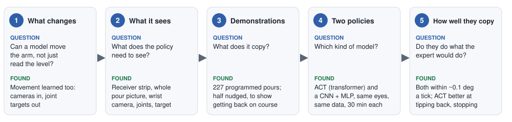
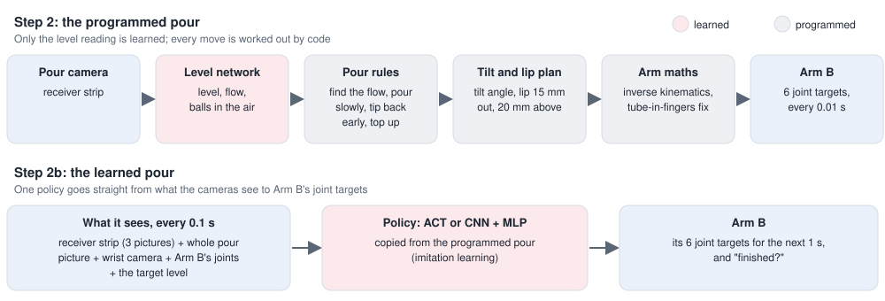
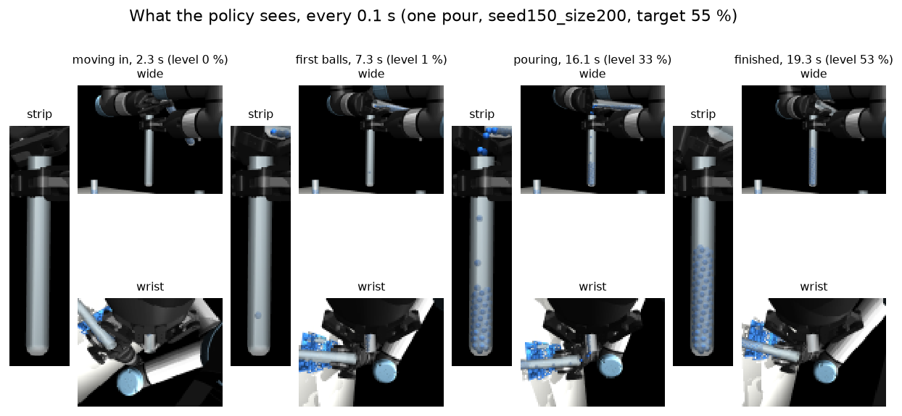
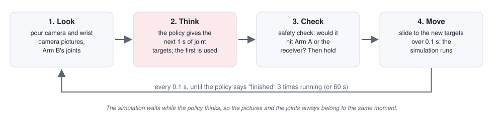
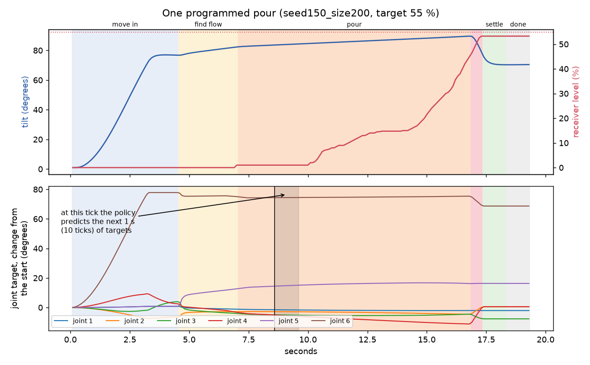
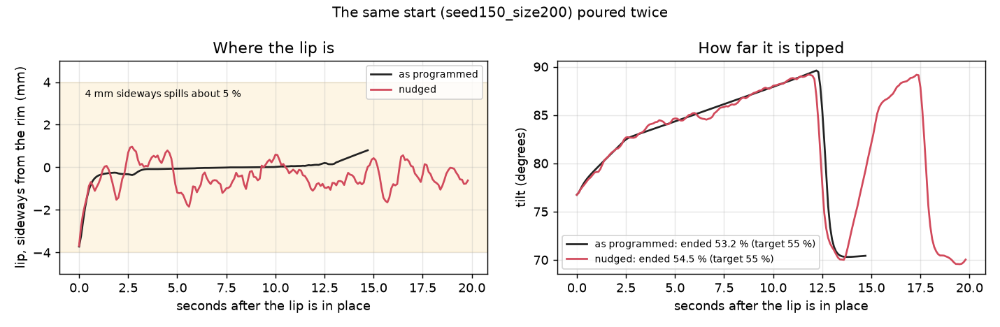
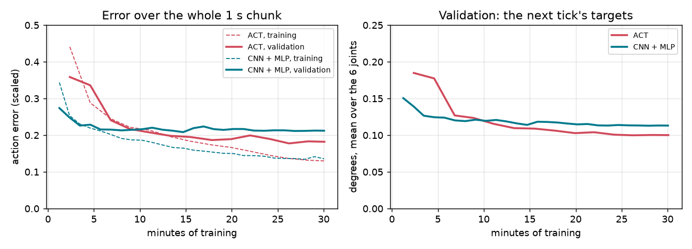
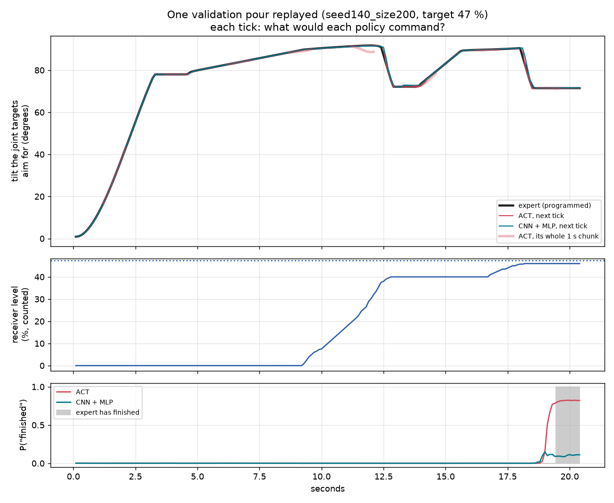

# Step 2b: A Learned Pour (ACT)

Step 2b is a second way to do [Step 2](step-2-pour.md), the pour. In Step 2, a network reads how full the
receiver is, and **code** decides every movement of the arm. In Step 2b, a network decides the
**movement** as well: it looks at the cameras and gives Arm B's joint targets directly. It learns this by
copying Step 2's programmed pour. Learning by copying an expert is called **imitation learning**.

Two kinds of network were trained to do it, on the same data and for the same time:

- **ACT** (Action Chunking with Transformers), a standard method for robot arms learning from
  demonstrations;
- a simpler **CNN + MLP**, to compare it with.

This page tells the story in five parts and stays high level. The code is in
[`step-2b-pour-act/`](../../step-2b-pour-act/). Two more pages go deeper:

- [approach.md](../../step-2b-pour-act/docs/approach.md): every setting, and why.
- [results.md](../../step-2b-pour-act/docs/results.md): how well it works.

**Where it stands.** Both networks are trained, and they have been graded on how closely they copy the
expert, one moment at a time. They have **not** yet poured on their own, with the network driving the arm
from start to finish. That test (the "closed loop") is built and ready, but not run. Part 5 explains the
difference.

| Word | What it means |
|---|---|
| **Source, receiver** | the full tube Arm B holds, and the empty one Arm A holds, as in Step 2 |
| **Tilt** | how far the source is tipped from upright: 0 degrees upright, 90 lying flat |
| **Level** | how full the receiver is, as a % of its height. The target is usually 50 % |
| **Window** | 48 to 52 %: within 2 points of 50 %. On a medium tube that is only 3 balls each way |
| **Joint target** | the angle Arm B is told to turn one of its six joints to. The arm's motors then move there |
| **Expert** | Step 2's programmed pour. It counts the balls exactly (a perfect scale), so it pours well |
| **Demonstration** | one recorded pour by the expert, used as an example to copy |
| **Policy** | the network that decides what the arm does: pictures in, joint targets out |
| **Tick** | 0.1 s. Every tick the policy looks once and decides once |
| **Chunk** | the next 10 ticks (1 s) of joint targets, which the policy predicts all at once |
| **Nudge** | a small, slowly wandering push added to the expert's movement while recording, so the examples also show how to get back on course |
| **Offline grading** | showing the policy a recorded moment and checking what it would do, without letting it move anything |
| **Closed loop** | the policy really drives the arm, sees the result, and decides again, until the pour ends |

---

## 1. What changes

In Step 2, only one thing is learned: the **level network** reads the level, the flow and the balls still
falling from the pour camera's picture. Everything else is code written by hand:

- the pour rules (tip slowly until the first balls fall, then slower, tip back early, top up if short);
- the plan of where the source's lip must be (15 mm out from the receiver's middle, 20 mm above its rim);
- the arm maths that turns that plan into six joint angles (inverse kinematics), with a correction for the
  tube turning in Arm B's fingers.

Step 2b replaces **all of that** with one policy. It is shown what the cameras see and where Arm B's
joints are, and it gives the joint targets. Nothing about tilts, lips or ball counts is written into it;
it must learn them all from the examples.

**Why do this, when the programmed pour already works?** The project's aim is to learn the learning
methods, and this is how much of robot learning is done today. Imitation learning from demonstrations,
with ACT or similar models, is the usual way to teach an arm a skill that is hard to program, such as
pouring a real liquid. Here the programmed pour is a perfect teacher, so it is a clean place to see what
such a model can and cannot copy.

---

## 2. What the policy sees, and what it does

Every tick (0.1 s) the policy gets three pictures and a few numbers:

| Input | What it shows |
|---|---|
| **Receiver strip** (the newest 3, 0.1 s apart) | the receiver close up, from Step 2's pour camera: the level, the balls falling, the source's lip at the top. This is exactly what Step 2's level network reads |
| **Whole pour picture** (shrunk) | both tubes and both grippers, and how far the source is tipped |
| **Wrist camera** on Arm B | the source in the fingers, from another side |
| **Arm B's joints** | its six joint angles now, and the six targets it is being given |
| **Target level** | where to stop, for example 50 % |

From these it gives Arm B's joint targets for the **next 10 ticks (1 s)**, and for each of them whether the
pour has **finished**. Only the first tick's targets are used; a tick later it looks again and decides
again. Predicting a whole second at once makes the movement smoother and more consistent (this is ACT's
"action chunking"); deciding again every tick keeps it quick to react, which matters when it must tip back.

The **safety check** is the only code left in the loop. It refuses a move that would put Arm B or its tube
into Arm A or the receiver, and limits how far a joint may move in one tick. A real robot would have the
same kind of check.

**Keeping the camera and the movement in step.** The simulation pauses while the policy thinks, so the
pictures and the joint angles always belong to the same moment. The new targets are then reached smoothly
over the next 0.1 s, while the arm's motors follow them. This is the usual set-up: the policy decides
slowly (here 10 times a second), and the motors follow quickly.

---

## 3. The demonstrations: what it copies

The policy learns from **recorded pours by the expert**. Every pour starts where Step 1b ends (both tubes
held at the pouring point), from the same 118 saved starts as Step 2, and each is poured to its own target
between 40 and 60 %.

Every tick, the recording saves what the policy will see (the pictures and joints above) and what the
expert did: Arm B's six joint targets.

*Top: the source tips to 78 degrees while it moves in, then slowly on until the balls flow (the receiver
fills), tips back early, waits, and finishes. Bottom: the six joint targets that do this. The grey band is
one chunk: at the line, the policy must predict the next second of all six.*

### The nudge: teaching it to get back on course

A copied policy never copies perfectly. Its small mistakes take the arm to places the expert never went,
and there it has no example to follow, so the mistakes grow. The usual remedy is to add small mistakes
**while recording**: the expert's movement is nudged by a slowly wandering error, but what is saved is
what the expert *meant* to do, without the nudge. The examples then show how to get back on course. (This
method is called DART.)

*The same start poured twice. Nudged (red), the lip wanders about 1 mm either side and the tilt by about
half a degree. The expert keeps pouring well: this pour ended at 54.5 % against a target of 55 %.*

**The first nudge was too strong.** It also pushed the lip up and down, by 1.5 mm. Pushed down, Arm B's
gripper ran into Arm A's: they are only about 20 mm apart at this tilt. 20 of 118 nudged pours jammed or
ran away, and the rest spilled 663 balls between them. Those pours were thrown away. The nudge was made
smaller (half a degree, 1 mm, never up or down), and a pour in which the arm stays stuck is now stopped
and left out.

| | Pours kept | Ended in the window | Pours with any spill | Balls spilled |
|---|---|---|---|---|
| As programmed | 117 | 116 | 6 | 12 |
| Nudged | 110 | 105 | 22 | 35 |

227 pours in all, split by scene so that no scene is in two sets:

| | Train | Validation | Test |
|---|---|---|---|
| Scenes (seeds) | 100 to 139 | 140 to 149 | 150 to 159 |
| Pours (of them nudged) | 158 (78) | 33 (16) | 36 (16) |
| Ticks | 32,447 | 6,532 | 7,198 |

Recording them took about 75 minutes on 4 processor cores, counting the nudged pours recorded twice.

---

## 4. Two policies

Both are given the same inputs, give the same outputs, use the same "eyes" for the receiver strip, and
were trained on the same examples for the same **30 minutes** on the Mac's GPU.

**The eyes.** The receiver strip is read by **Step 2's custom level network**, kept exactly as it was
trained (frozen). It already knows how to read the level, the flow and the falling balls from these very
pictures. The whole picture and the wrist picture each get a small CNN of the same kind, trained from
nothing.

| | **ACT** | **CNN + MLP** |
|---|---|---|
| Idea | every part of every picture becomes a "token"; a **transformer** works out which tokens matter and how they relate, then answers 10 questions, one per coming tick | each picture is boiled down to a list of numbers; all are joined and two plain layers give all 10 ticks at once |
| Size | 10.9 million weights | 5.0 million |
| Extra | while training, a "style" part sees the expert's real next second, so that varied examples do not get averaged into a blur (the CVAE). When pouring it is switched off | none |
| Used for | the usual model for arms learning from demonstrations (2023) | the simplest standard network for the same job ("behaviour cloning") |

Their full layouts are in [approach.md](../../step-2b-pour-act/docs/approach.md).

---

## 5. How well they copy

Each policy was shown every tick of the validation and test pours, and what it would command was compared
with what the expert commanded. It never moves the arm here, so this measures **copying, not pouring**.

*The CNN + MLP learns fastest at first but stops improving after about 15 minutes. ACT keeps improving for
the whole 30 minutes and ends lower. Both do better on the examples they train on than on new ones, so
more pours would help more than more time.*

On the 36 test pours (never used for training or for choosing anything):

| | Hold still | ACT | CNN + MLP |
|---|---|---|---|
| Next tick's joint targets, error (degrees per joint) | 0.25 | **0.11** | 0.12 |
| The whole next second, error | 1.06 | **0.33** | 0.37 |
| After the pour has finished: says "finished" | never | **72 %** of ticks | 49 % |

"**Hold still**" is the simplest possible guess, keeping every joint where it is told now. It is there
so the other numbers mean something.

*One validation pour, tick by tick. Top: the tilt each policy's joint targets aim for, against the
expert's (black). Both follow it closely, through moving in, pouring, tipping back and topping up. The thick
pale red lines are ACT's whole 1 s predictions: it sees the tip-back coming. Bottom: how sure each is that
the pour has finished. ACT says so when the expert does; the CNN + MLP hardly ever does.*

What this shows:

- **Both have learned the shape of a pour.** Moving in, tipping slowly, tipping back, topping up: they
  follow the expert closely, far better than holding still.
- **ACT is the better copy** where it matters most: tipping back (half the CNN + MLP's error) and saying
  "finished". The CNN + MLP rarely says "finished", so on its own it would likely never stop.
- **Neither undoes the nudge.** On the nudged pours, while pouring slowly, both are no better than holding
  still: a nudge of 1 mm or half a degree is hard to see in these pictures.
- **Not yet answered: can they pour?** Copying one tick well is not the same as pouring well. Driving the
  arm, small errors build up, and the window is only 3 balls on a medium tube. Only the closed loop shows
  whether they land in it.

Details, phase by phase: [results.md](../../step-2b-pour-act/docs/results.md).

---

## Simplifications

- **The expert counts the balls exactly**, as in Step 2. The policy never sees the count: it only sees
  pictures. But the examples it copies were made with perfect knowledge.
- **Where the receiver strip is cut from** the pour camera's picture comes from the simulator (the
  receiver's rim at the start), as in Step 2. The safety check also uses the simulator's positions.
- **Only Arm B is learned.** Arm A holds the receiver still, as in Step 2, and the move to the pouring
  point (Step 1b) is not part of it.
- **The balls are not water.** What is learned here is how to pour these balls, not a real liquid.

## What is next

- **The closed loop**: each policy pours from the 20 test starts on its own, graded against the programmed
  pour (with the true count, and with the level network). Built (`make evaluate`), about 25 minutes.
- **If it drifts**: more nudged pours, or DAgger (letting the policy pour, asking the expert what it should
  have done, and training on that). The expert can answer for any moment, because it is a program.
- **If the stop is late**: a shorter chunk near the end, or giving it the level network's reading as an
  extra input.
