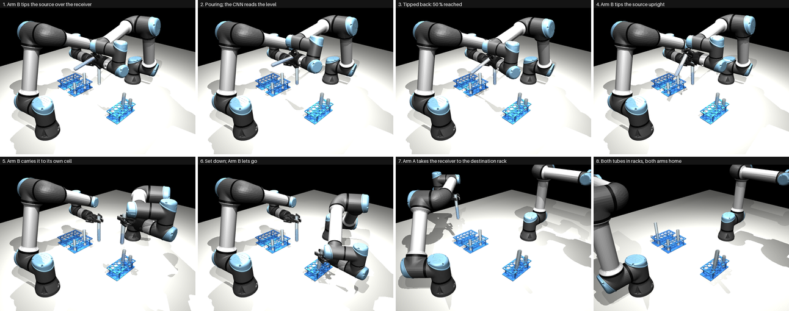
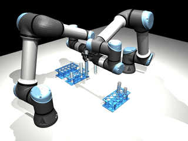
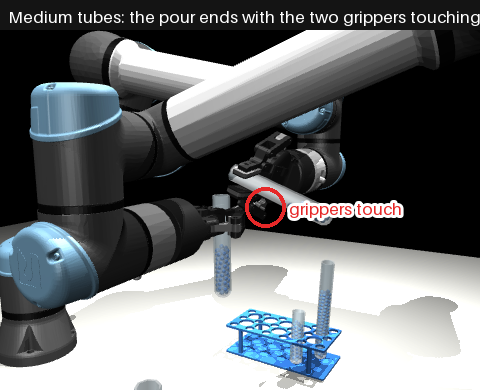
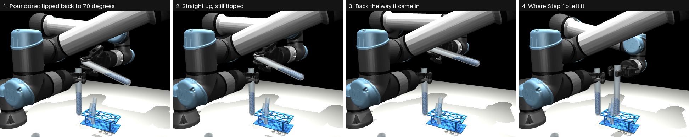
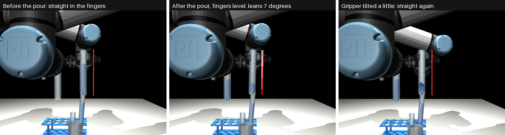
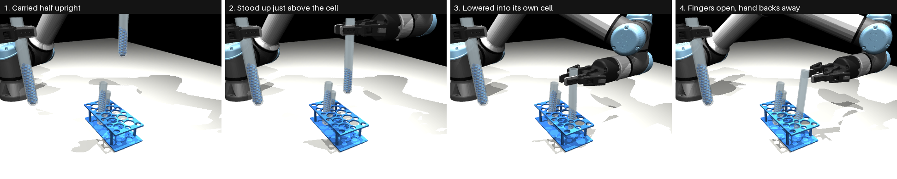
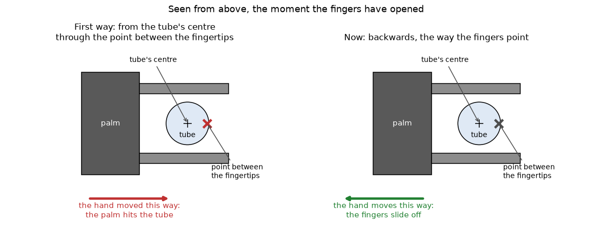
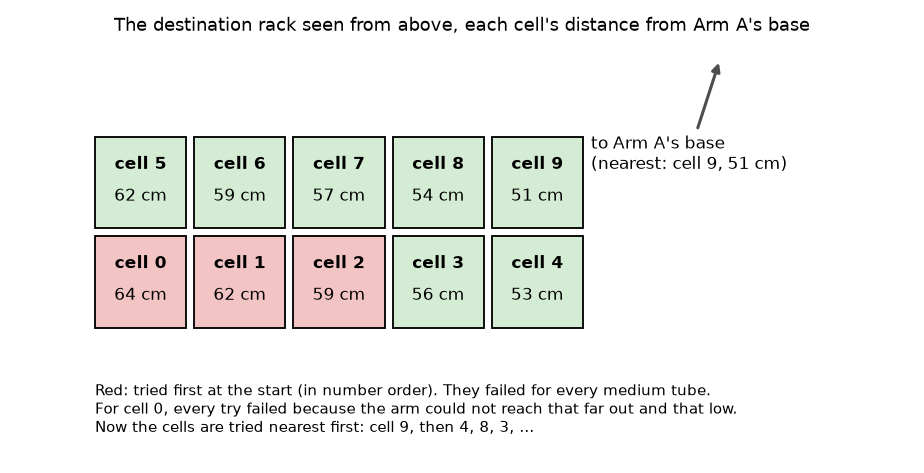

# Steps 3 to 5: Put Both Tubes Back, and Check the Whole Run

Steps 3, 4 and 5 from the [list of steps](steps.md). They start where [Step 2](step-2-pour.md) ends: the
receiver is half full in Arm A's hand, and Arm B still holds the source, tipped over it.

- **Step 3:** Arm B puts the source back in **its own cell** of the source rack.
- **Step 4:** Arm A puts the filled receiver in a cell of the **destination rack**.
- **Step 5:** the result is checked.

This is also the first time the **whole task runs from start to end with the level network pouring**: Step 0
finds the racks and tubes, Step 1b picks up both tubes, the custom CNN watches the receiver while Arm B pours, and
both tubes go back into racks.

The code is in [`step-3-put-back/`](../../step-3-put-back/). Two more pages go deeper:

- [approach.md](../../step-3-put-back/docs/approach.md): every move, every number, and why.
- [results.md](../../step-3-put-back/docs/results.md): the 6 test scenes one by one.



*Test scene 150, large tubes. The camera looks from above the corner of the table next to Arm A and the source
rack, so Arm A is the arm nearest to you, and the source rack is the rack nearest to you. 1 to 3: the pour, read
by the CNN, ends at 50.5%. 4 to 6: Arm B tips the source back up, carries it to its own cell and lets go. 7: Arm A
takes the receiver to the destination rack. 8: both tubes are in racks, both arms are home.*



| Word | In plain words |
|---|---|
| **Cell** | one hole of a rack (10 per rack). A cell is 30 mm wide and a tube 25 mm, so there are only 2.5 mm to spare on each side |
| **Own cell** | the cell the source stood in before Step 1b picked it up |
| **Lean** | how far a tube is from standing straight up, in degrees |
| **Planning a move** | before the arm moves, the program works out the arm's joint angles for every 5 mm of the way and checks, on a copy of the scene, that nothing would touch |

---

## What happens, in order

```
 STEP 0   the overhead camera finds the racks; the cells follow from the rack's known shape
 STEP 1b  both tubes are picked up and brought together (from a saved run)
 STEP 2   Arm B pours; the CNN reads the receiver every 0.1 s; tip back at 50 %
 STEP 3   Arm B: straight up, back the way it came, carry the source over its own cell,
          stand it straight, lower it in, let go, back away, go home
 STEP 4   Arm A: the same with the receiver, into the destination rack cell nearest to it
 STEP 5   the check: level, spill, each tube in its cell, anything touched
```

Only one arm moves at a time. Every move is planned and checked before the arm makes it.

## Result in short

On **6 test scenes** (3 with medium tubes, 3 with large), scenes the CNN never saw in training:

| | |
|---|---|
| Source back in its own cell, standing | **6 of 6** |
| Receiver in the destination rack, standing | **6 of 6** |
| Receiver filled to between 48 and 52% | **4 of 6** (one ended at 47.5%, one at 52.5%) |
| Balls lost while putting the tubes back | **0** |
| Anything bumped while putting the tubes back | **nothing** |
| **Whole run passed** | **4 of 6** |

**Putting the tubes back worked every time. The two failures are the pour:** at the end, the CNN read those two
receivers about 2 points wrong, so the pour stopped a little too early in one and a little too late in the other.

---

## The problems, and how each was fixed

Putting a tube back sounds like Step 1b backwards. On the first try it was not: in only 2 of the 6 scenes did
both tubes get back. Each problem below was found, measured and fixed, and then all 6 scenes were run again.

### 1. Turning the source back upright made the hand jump

**What we wanted.** After the pour the source is still tipped at 70 degrees over the receiver. Arm B should
bring it upright and away.

**What went wrong.** The first version turned it upright directly from where it was. To do that, the program
works out the hand's angle from where the tube sits in the fingers *now*. But during the pour the tube twists a
little in the fingers (problem 2). So the new hand angle did not match the old one, and at the start of the move
the hand **jumped** a few millimetres, towards Arm A's hand. With medium tubes the two hands are very close at
the end of the pour: Arm B's hand hit Arm A's hand, and in one scene the source was knocked out of the fingers.



**What we changed.** Two simple moves instead of one:

1. **Straight up 6 cm**, without changing the hand's angle at all. At 70 degrees nothing pours.
2. Then **back the same way it came in** before the pour, joint for joint, to where Step 1b left it.



**Found on the way:** with medium tubes, the two hands are *already* touching when the pour ends, very lightly
(less than 0.1 mm). That comes from Step 2, whose checks look at the way in but not at the tipping. The lift is
allowed to start touching, as long as the touch never gets harder and is gone by the end of the lift. It always
was.

### 2. After the pour the tube is not quite straight

**What we wanted.** Carry the source to its own cell and lower it in.

**What went wrong.** While the source is tipped, the weight of the balls twists the tube a little between the
finger pads, and it stays that way. Held the way Step 1b holds a tube (fingers level), the source then leans
**1 to 8 degrees**. A cell has only 2.5 mm to spare on each side, so a leaning tube hits the edge of the cell.



*White line: straight up. Red line: the tube. Left: before the pour. Middle: after the pour, fingers level, it
leans 7 degrees. Right: the hand tilted a little, and the tube is straight again.*

**What we changed.** Every move is now planned **for the tube, not for the hand**: the program says where the
tube's bottom must go and that the tube must be straight, and the hand tilts as much as that needs. The tube is
made perfectly straight **just above its cell**, then lowered in.



**A side effect we also handled.** With the first way of tipping back (problem 1), making the tube fully straight
right next to the receiver made Arm B's wrist bend so far that it pressed on its own forearm. A real arm cannot
do that. So the tube is carried only *half* straight on the way, and made fully straight just above the cell.
With the new way of tipping back this no longer happens, so the "half straight" part is probably not needed any
more; it stays because it is what was tested.

### 3. The hand pushed the tube over after letting go

**What we wanted.** Open the fingers and move the hand away, leaving the tube standing in its cell.

**What went wrong.** In scene 154 the receiver tipped over in its cell and **dragged the whole rack 19 mm**. We first thought
the fingers were rubbing the tube and opened them wider: that did not help. Then the program listed which part
of the hand touched the tube: it was the **palm**. The hand was backing away in the wrong direction. The program
moved it "away from the tube's centre, through the point between the fingertips". But the fingertips reach past
the tube, so that point is on the far side of the tube's centre, and that direction moves the palm *into* the
tube (left drawing).



**What we changed.** The hand now backs away **the way the fingers point, backwards** (right drawing), so the
fingers just slide off the tube (picture 4 of "How a tube goes into its cell", above).

### 4. The far cells were out of reach

**What went wrong.** The destination rack's cells were tried in number order. Cell 0 is the far corner, 64 cm
from Arm A's base. A medium tube is short, so the hand must go low to put it in, and that far out and that low,
Arm A cannot reach. The program spent 8 to 11 minutes trying the far cells.



**What we changed.** The cells **nearest to Arm A are tried first**. Planning now takes about 1 second.

---

## What is simplified

- **Step 1b is not run again.** Each scene starts from a saved Step 1b run. Step 0 is run again on the scene from
  before anything moved, which gives the same list of racks and tubes Step 1b used.
- **Which tube Step 1b picked** is matched by the simulator's name for it (the saved run kept only the name). A
  real robot would simply remember it.
- **Where the tube sits in the fingers** comes from the simulator, as in Step 2. A real robot would have to
  measure it, for example with the wrist camera.
- **The check (Step 5)** counts balls and reads positions in the simulator. The arms never see these.

## What is next

- **Pour more exactly with the CNN.** Here 2 of 6 missed the 48 to 52% window by about half a point. See
  [step-2-pour.md](step-2-pour.md), part 6.
- **Keep the two hands apart in medium pours** (problem 1), and check the tipping for collisions, not only the
  way in.
- **Run Step 1b in the same go**, on new scenes, so the whole task runs from the first camera picture to the last
  check without stopping.
- **Small tubes**, once Step 1b can bring them.
