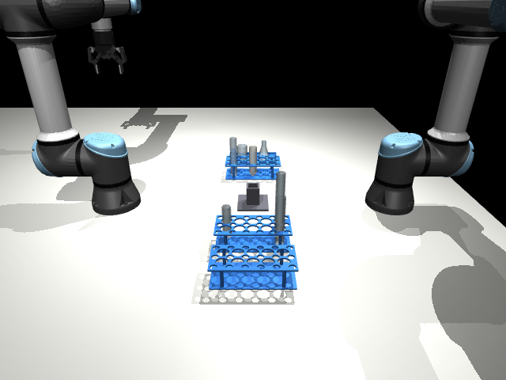
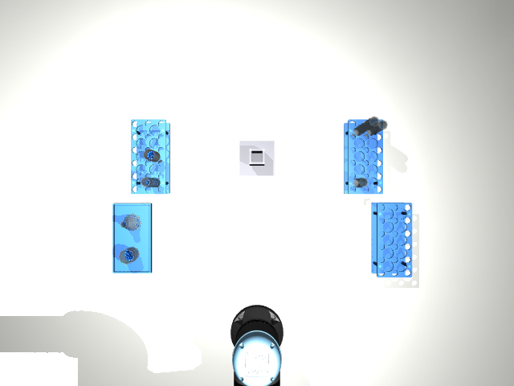
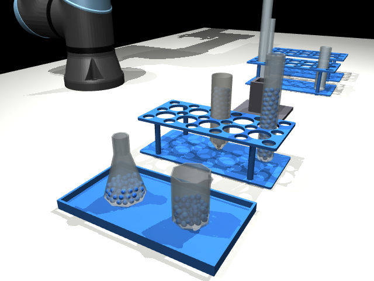
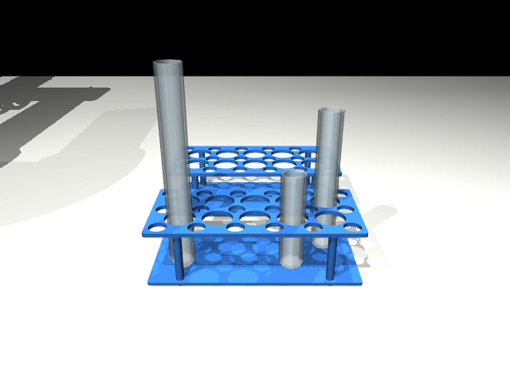
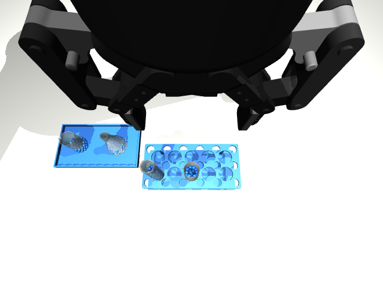

# Objects in the Scene

Everything on the table, what it is for, and how big and heavy it is.
All sizes and weights are like the real lab objects. Every number is in `lab_scene/settings.py`.



## The layout

Two arms face each other across the table, 0.9 m apart. Everything they work on stands
in one row halfway between them, so **both arms can reach everything**:

```
             arm 2 (x = 0.90 m)
                   │
 source rack  pouring point  empty rack  destination rack   ← all at x = 0.45 m
                   │
             arm 1 (x = 0, the origin)
```

The **pouring point** is the empty middle of the row, 0.25 m above the table
(`LAYOUT.pour_point`). Nothing stands there: the two arms bring their tubes to it
and the source is tilted over the receiver in the air.



## The arms

| Object | What it is | Where from |
|---|---|---|
| **Arm 1, Arm 2** | Two UR5e robot arms (6 joints each, reach 850 mm) | MuJoCo Menagerie |
| **Grippers** | One Robotiq 2F-85 on each arm: two fingers that open up to 85 mm | MuJoCo Menagerie |

Names in the code start with the arm's name, for example `arm1/shoulder_pan_joint` or `arm2/gripper/pinch`
(the pinch point is the spot halfway between the fingertips).

## The sources (liquid to pour from)



| Object | Name in the code | Shape | Size (width x height) | Holds | Weight | Where from |
|---|---|---|---|---|---|---|
| **Short tube** | `source_tube_100` | glass, round bottom | 25 x 100 mm | 33 ml | 19 g | CC0 Lab Assets pack |
| **Middle tube** | `source_tube_150` | glass, round bottom | 25 x 150 mm | 50 ml | 28 g | CC0 Lab Assets pack |
| **Tall tube** | `source_tube_200` | glass, round bottom | 25 x 200 mm | 68 ml | 38 g | CC0 Lab Assets pack |

- Each source starts filled to a random level between **60 % and 90 %** of its height,
  so it always holds more than the receiver of the same size needs for 50 % (with some to spare for spills).
- All three stand in the source rack, in cells chosen by the seed. They cannot stand on the table by themselves (round bottom).
- They are the same tubes as the receivers; only the liquid tells them apart.
- Three sources for three receivers, one of each size: each pour goes from a source to the receiver of the same size.

## The receivers (tubes to fill)



| Object | Size | Holds | 50 % mark | Weight |
|---|---|---|---|---|
| **Short tube** | 25 x 100 mm | 33 ml | 44 balls | 19 g |
| **Middle tube** | 25 x 150 mm | 50 ml | 74 balls | 28 g |
| **Tall tube** | 25 x 200 mm | 68 ml | 103 balls | 38 g |

All three are glass test tubes with round bottoms. They start empty, in the empty rack.
Which cells they stand in changes with the seed.

## Racks

| Object | What it is for | Size | Weight | Where from |
|---|---|---|---|---|
| **Source rack** | holds the source tubes; each source goes back here after the pour | 205 x 96 x 60 mm, 10 cells (2 rows of 5), each 30 mm wide | 150 g | AutoBio |
| **Empty rack** | holds the receivers before filling | same | 150 g | AutoBio |
| **Destination rack** | where filled receivers go; starts empty | same | 150 g | AutoBio |

The racks are loose: if an arm bumps them, they move.

Tubes never stand side by side. Open, the fingers reach about 60 mm to either
side along a row, so two tubes in one row are at least three cells (108 mm) apart, and
tubes in different rows are never in the same column. With tubes one cell apart the open
fingers hit the next tube on the way down.

## The liquid

Small blue balls, **7 mm across**, with no friction (they slide like a liquid).
**1 ml of liquid weighs 1 g**, like water, so a full source feels as heavy as a real one.
About 300 to 450 balls in total, depending on the seed.

## The cameras

| Camera | Where | Used for |
|---|---|---|
| `overhead` | 1.2 m above the table, looking straight down | finding the racks and tubes (Step 0) |
| `front` | on the long side of the table, between the arms | people watching |
| `arm1/wrist`, `arm2/wrist` | on each gripper, looking along the fingers | close-up looks before gripping |


