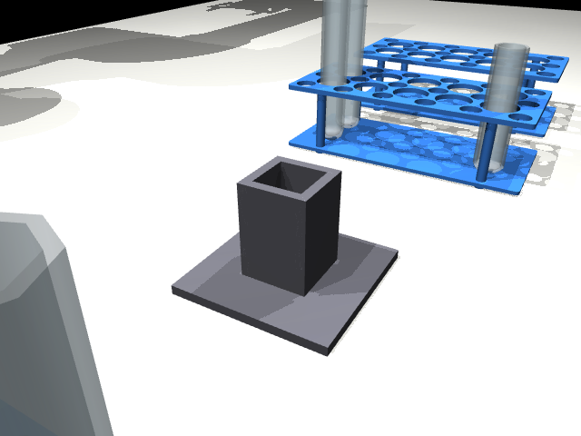

# Objects in the Scene

Everything on the table, what it is for, and how big and heavy it is.
All sizes and weights are like the real lab objects. Every number is in `lab_scene/settings.py`.


## The layout

Two arms face each other across the table, 0.9 m apart. Everything they work on stands
in one row halfway between them, so **both arms can reach everything**:

```
        arm 2 (x = 0.90 m)
              │
 tray  source rack  stand  empty rack  filled rack      ← all at x = 0.45 m
              │
        arm 1 (x = 0, the origin)
```


## The arms

| Object | What it is | Where from |
|---|---|---|
| **Arm 1, Arm 2** | Two UR5e robot arms (6 joints each, reach 850 mm) | MuJoCo Menagerie |
| **Grippers** | One Robotiq 2F-85 on each arm: two fingers that open up to 85 mm | MuJoCo Menagerie |

Names in the code start with the arm's name, for example `arm1/shoulder_pan_joint` or `arm2/gripper/pinch`
(the pinch point is the spot halfway between the fingertips).

## The sources (liquid to pour from)


| Object | Shape | Size (width x height) | Holds | Weight | Where from |
|---|---|---|---|---|---|
| **Test tube** | glass, round bottom | 25 x 150 mm | 50 ml | 28 g | CC0 Lab Assets pack |
| **Centrifuge tube** | plastic, cone-shaped tip | 29 x 115 mm | 51 ml | 13 g | AutoBio |
| **Beaker** | glass, wide and short, flat bottom | 42 x 60 mm | 66 ml | 35 g | CC0 Lab Assets pack |
| **Erlenmeyer flask** | glass, wide flat base, narrow neck (22 mm) | 51 x 80 mm | 62 ml | 45 g | CC0 Lab Assets pack |

- Each source starts filled to a random level between **20 % and 90 %** of its height.
- The two tubes stand in the source rack. They cannot stand on the table by themselves (round or pointed bottom).
- The beaker and the flask stand on the tray.

## The receivers (tubes to fill)


| Object | Size | Holds | 50 % mark | Weight |
|---|---|---|---|---|
| **Short tube** | 25 x 100 mm | 33 ml | 44 balls | 19 g |
| **Middle tube** | 25 x 150 mm | 50 ml | 74 balls | 28 g |
| **Tall tube** | 25 x 200 mm | 68 ml | 103 balls | 38 g |

All three are glass test tubes with round bottoms. They start empty, in the empty rack.
Which cells they stand in changes with the seed.

## Racks, tray and stand



| Object | What it is for | Size | Weight | Where from |
|---|---|---|---|---|
| **Source rack** | holds the two source tubes | 205 x 96 x 60 mm, 10 cells (2 rows of 5), each 30 mm wide | 150 g | AutoBio |
| **Empty rack** | holds the receivers before filling | same | 150 g | AutoBio |
| **Filled rack** | where filled receivers go; starts empty | same | 150 g | AutoBio |
| **Tray** | holds the beaker and the flask | 200 x 110 mm, 12 mm rim | about 100 g | made here |
| **Pouring stand** | holds a receiver while it is filled | one 30 mm cell, 60 mm deep, on a base | fixed to the table | made here |

The racks and the tray are loose: if an arm bumps them, they move. The stand is bolted down.

## The liquid

Small blue balls, **7 mm across**, with no friction (they slide like a liquid).
**1 ml of liquid weighs 1 g**, like water, so a full source feels as heavy as a real one.
About 400 balls in total, depending on the seed.

## The cameras

| Camera | Where | Used for |
|---|---|---|
| `overhead` | 1.2 m above the table, looking straight down | finding objects (Step 0) |
| `front` | on the long side of the table, between the arms | people watching |
| `arm1/wrist`, `arm2/wrist` | on each gripper, looking along the fingers | close-up looks before gripping |


