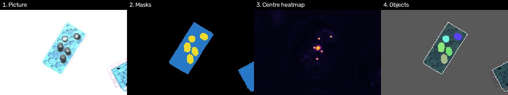

# Step 0 Approach: YOLO11-seg and the Custom CNN

The overview of Step 0 is in [step-0-detect-and-classify.md](../../docs/solutions/step-0-detect-and-classify.md).
This page says exactly which two models we used, with which settings, and why.
How well they did is in [results.md](results.md).

Both models do the same job: look at the overhead colour picture (1280 x 960) and draw an
outline around every `rack` and `test_tube`, with its class. Positions then come from the depth
picture, the same way for both (see the overview). Both train on the same 800 pictures and labels,
and are graded on the same 300 test pictures by the same script.

---

## 1. YOLO11-seg

### The model

| | |
|---|---|
| Model | **YOLO11s-seg**: YOLO11, size "small" (`s`), with masks (`-seg`) |
| Library | Ultralytics 8.4.123 |
| Size | 10.1 million parameters, 33 billion operations per picture (at 640) |
| Start point | weights already trained on COCO (everyday photos, 80 classes); its last layer is replaced for our 2 classes |
| Licence | AGPL-3.0 (fine for research; matters if this ships in a product) |

**How it works, in short.** YOLO is a "one-stage" detector: one pass over the picture gives, for
every object, a box, a class, a confidence and an outline. For the outlines it predicts 32 small
"prototype" masks for the whole picture, and each object mixes them in its own way. The
prototypes are a quarter of the input size: with the picture shrunk to 640 x 480, that is
160 x 120, so a 25 mm tube is about 5 prototype pixels wide.

**Why YOLO11s-seg:**
- YOLO11 is newer than YOLOv8 and more accurate for its size, with the same code and tools.
- `s` is the middle ground: nano (`n`) is less accurate, medium (`m`) is slower to train on the Mac.
- Starting from COCO weights, it needs far less data and time than learning from nothing.

### Training settings

| Setting | Value | Why |
|---|---|---|
| Picture size (`imgsz`) | 640 (pictures shrunk from 1280 x 960 to 640 x 480) | 1280 needed more memory than the Mac has |
| Batch | 8 pictures | fits in 5.4 GB of GPU memory |
| Epochs | 8 (one epoch = one pass over the 800 pictures) | about 18 minutes, our time budget |
| Optimizer | AdamW, rate 0.0017, chosen by Ultralytics (`optimizer=auto`) | |
| Weight decay | 0.0005 | Ultralytics default |
| Warm-up | 3 epochs | Ultralytics default |
| Colour changes (`hsv_h`, `hsv_s`, `hsv_v`) | 0.5, 0.7, 0.4 (default 0.015, 0.7, 0.4) | strong changes, so it learns shapes, not colours |
| Flips (`fliplr`, `flipud`) | 0.5, 0.5 (default up-down flip is 0) | a straight-down camera has no up or down |
| Mosaic | on for the whole run | Ultralytics default: four pictures stitched into one |
| Scale / move | ±50% / ±10% | Ultralytics defaults |
| Seed | 0, deterministic | so the run can be repeated |
| Device | Apple M5 GPU (`mps`) | |

### At test time

- A detection is kept if its confidence is at least **0.5**.
- Outlines are drawn at the full picture size (`retina_masks=True`).

---

## 2. The Custom CNN

### What it had to beat

YOLO's mistakes (see [results.md](results.md)) are almost all about **tubes standing close
together**: two touching tubes drawn as one outline, a short tube swallowed by a tall neighbour's
outline, an outline straying onto the next tube. Racks and classes were already near perfect.
So the custom CNN is designed around one question: **how do we keep touching tubes apart?**

### The idea: find centres first, then outlines

YOLO draws each object's outline as one shape. When two tubes touch, one shape can easily cover
both. The custom CNN works the other way round ("bottom-up", as in the published models
Panoptic-DeepLab and CenterNet). For every pixel of the picture it predicts three things:

| Output | Per pixel | Channels |
|---|---|---|
| **Masks** | is this pixel part of a rack? part of a tube? (two separate yes/no answers, because a rack's outline covers the tubes standing in it) | 2 |
| **Centre heatmap** | how likely is this pixel to be the centre of a rack / of a tube? | 2 |
| **Centre offsets** | an arrow from this pixel to the centre of the object it belongs to (x and y, for each class) | 4 |

Then, without any learning:

1. Every peak in a heatmap is one object.
2. Every pixel inside a mask follows its arrow and joins the nearest centre.
3. An object's outline is all the pixels that joined its centre.

Tubes in touching rack cells stand 36 mm apart, about 15 output pixels. Their centres are
always separate peaks, even where the tubes' outlines touch, so each pixel goes to its own tube.

*A rack with five tubes, from a test picture. From left to right: the picture; the predicted
masks (racks blue, tubes yellow), where touching tubes run together; the centre heatmap (bright =
centre), with five separate peaks; and the final objects, five tubes, each in its own colour.*

### The network

A small **U-Net**: an encoder that shrinks the picture step by step to understand it, and a
decoder that grows it back to draw fine detail, with shortcuts from each encoder level to the
decoder level of the same size.

| Part | What it is |
|---|---|
| Input | the full colour picture, 1280 x 960 (not shrunk) |
| Encoder | 5 levels, each half the size of the last: 1/2, 1/4, 1/8, 1/16 and 1/32 of the picture, with 32, 48, 96, 160 and 256 channels. Each level has two residual blocks (two 3x3 convolutions with a shortcut, batch norm, ReLU) |
| Context | two more residual blocks at 1/32 with dilated convolutions (spacing 2 and 4), so a pixel at one end of a 20 cm rack can still "see" the rack's middle |
| Decoder | 4 levels back up to 1/2, each joining the matching encoder level |
| Heads | three small heads (3x3 then 1x1 convolution) for the masks, the heatmap and the offsets |
| Output | 640 x 480, half the picture's size |
| Size | 7.2 million parameters, no pretrained weights (trained from scratch) |

### Why each choice, to beat YOLO

| Choice | Why |
|---|---|
| **Centres and offsets** instead of whole outlines | keeps touching tubes apart: the main weakness of YOLO |
| **Full-size input, output at half size** | a tube is about 11 output pixels wide, against about 5 in YOLO's prototypes. More detail where tubes meet |
| **Separate rack and tube masks** | a rack's true outline includes the tubes in it; one shared mask would have to pick one |
| **No scale changes in training** | the camera is fixed, so a tube is always about the same size in pixels. A general detector must handle every size; ours does not have to |
| **One centre-peak size per class** | for the same reason: tubes and racks each have a known size (peak spread 2 output pixels for tubes, 6 for racks) |
| **Dilated convolutions at the bottom** | a rack is long; the pixels at its ends must point to its middle |
| **Small network, trained from scratch** | only two classes and one kind of scene; no need for a big network or for knowledge of everyday photos |

### Training settings

| Setting | Value | Why |
|---|---|---|
| Training pictures | 640 x 480 crops of the full-size picture, centred near a random rack (±200 pixels) | a quarter of the work per step. Because objects are always the same size and the network has no fixed input size, it then runs on whole pictures unchanged. Centring on racks keeps the tubes in view |
| Flips | left-right and up-down, each half the time | as YOLO |
| Colour changes | hue turned anywhere round the colour wheel, saturation ×0.3 to ×1.7, contrast ×0.7 to ×1.3, brightness ±0.25 | as strong as YOLO's: learn shapes, not colours |
| Batch | 8 crops | |
| Optimizer | AdamW, rate 0.002, weight decay 0.0001 | a common, robust choice for training from scratch |
| Learning-rate schedule | 300 steps of warm-up, then a cosine curve down to 1% of the rate | steady start, fine tuning at the end |
| Gradient clipping | at 10 | guards against a bad step early on |
| Epochs | 40 | from scratch it needs more passes than YOLO, which starts pretrained |
| Model kept | the epoch with the best tube score (F1) on the validation pictures: epoch 39 | |
| Time | 57.5 minutes on the Apple M5 GPU (about 1.4 minutes per epoch) | |

**What it learns from (losses):**

| Output | Loss | Why |
|---|---|---|
| Masks | cross-entropy + Dice | cross-entropy for every pixel; Dice so small tubes count as much as big racks |
| Centre heatmap | CenterNet's focal loss | almost every pixel is "not a centre"; this loss keeps the few centres from being drowned out |
| Centre offsets | smooth L1, only on pixels that belong to an object | arrows only matter inside objects |

### At test time

| Setting | Value |
|---|---|
| Centre peak cut-off | 0.3 |
| Peak window (a peak must be the highest point within it) | 5 output pixels for tubes, 15 for racks |
| Farthest a pixel's arrow may land from a centre and still join it | 10 output pixels for tubes, 60 for racks |
| Smallest object kept | 15 output pixels for tubes, 300 for racks |

The outlines are then scaled up to the full picture size, and graded exactly like YOLO's.

---

## Side by side

| | YOLO11s-seg | Custom CNN |
|---|---|---|
| Kind | general detector, one-stage | built for this setup, bottom-up (centres + offsets) |
| Parameters | 10.1 M | 7.2 M |
| Start | pretrained on COCO | from scratch |
| Picture it sees | shrunk to 640 x 480 | full 1280 x 960 (crops in training) |
| Outline detail | 160 x 120 prototypes | 640 x 480 |
| Touching tubes | one outline per object, can cover two | one centre per object, pixels vote |
| Training | 8 epochs, 18 min | 40 epochs, 58 min |

## Files

| File | What it is |
|---|---|
| `detect_classify/train.py` | trains YOLO11s-seg (`make train`) |
| `detect_classify/custom_net.py` | the custom CNN: targets, network, losses, turning outputs into objects |
| `detect_classify/train_custom.py` | trains the custom CNN (`make train-custom`) |
| `detect_classify/evaluate.py` | grades either model on the test pictures (`make evaluate`, `make evaluate-custom`) |
