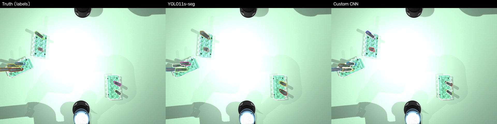
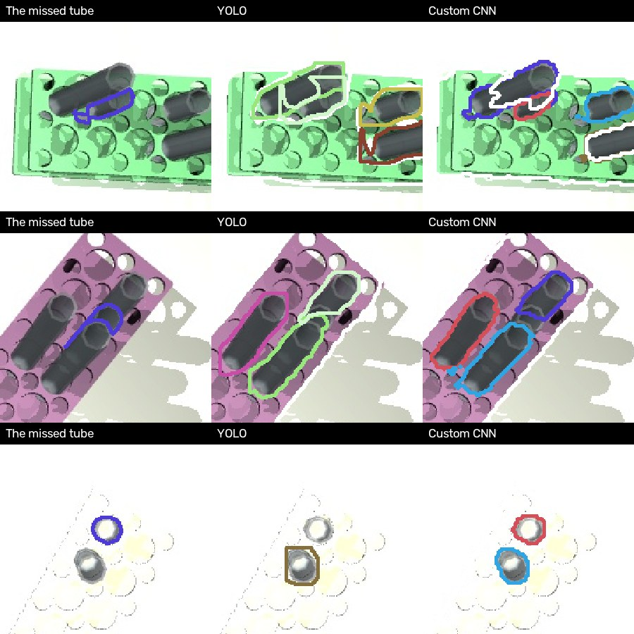
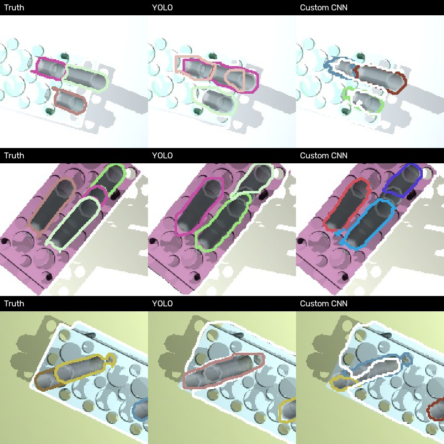
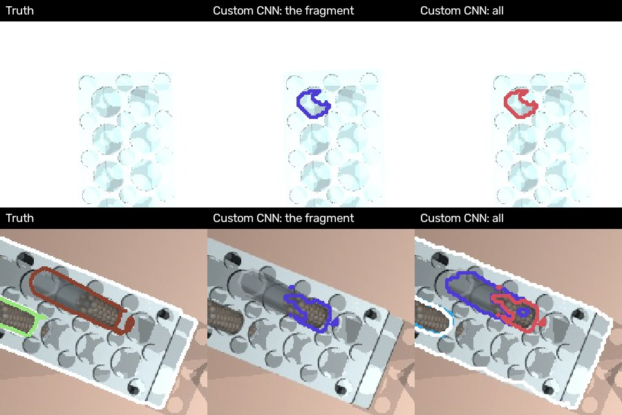
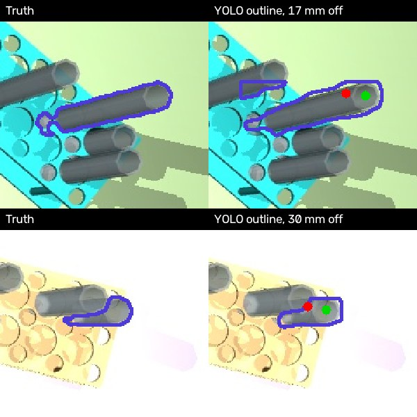

# Step 0 Results: YOLO11-seg vs the Custom CNN

What the two models are and how they were trained is in [approach.md](approach.md).
This page is only about how well they work, and how they compare.

Both models were trained on the same 800 pictures and graded on the same **300 test pictures**
that neither had ever seen, by the same script. Those 300 pictures hold **2,844 real objects:
1,944 tubes and 900 racks.**

---

## What the words mean

| Word | Meaning |
|---|---|
| **Detection** | one object the model says it sees: an outline plus a class (`rack` or `test_tube`) |
| **Found** | a real object counts as found when one of the model's outlines covers it well: the two outlines overlap by at least half (the shared area is at least half of the two areas together) |
| **Missed** | a real object that no outline covers well |
| **Detection matching nothing** (a **wrong detection**) | an outline the model drew that does not cover any real object well. For example, one outline drawn around two touching tubes, or an outline around only a small piece of a tube. The robot would think there is an object there that is not really there (or not really that shape) |
| **Right class** | of the found objects, how many were called the right thing (a tube a tube, a rack a rack) |
| **Position error** | the distance on the table between where we computed an object stands and where it really stands |
| **Within 1 cm** | position error under 1 cm: close enough for the gripper to take the object |
| **Median** | the middle value: half the objects are better than this, half worse |
| **95% under** | 95 out of 100 objects are better than this; it shows how bad the worst few are |
| **Neighbour** | another tube in a touching cell of the same rack, side by side or corner to corner |

---

## The result in one table

| | YOLO11-seg | Custom CNN | Better |
|---|---|---|---|
| Tubes found | 1,887 of 1,944 (97.1%) | 1,898 of 1,944 (97.6%) | Custom |
| Racks found | 900 of 900 (100%) | 900 of 900 (100%) | same |
| Right class | 100% | 100% | same |
| Detections matching nothing | 48 (about 1 in 6 pictures) | 31 (about 1 in 10 pictures) | Custom |
| Tubes within 1 cm | 95.1% | 94.7% | YOLO |
| Tube position error, median | 0.8 mm | 0.9 mm | about the same |
| Tube position error, 95% under | 9.2 mm | 10.7 mm | YOLO |
| Racks within 1 cm | 98.4% | 97.6% | YOLO |
| Time to train | 18 min | 58 min | YOLO |

**In short: the two are about level.** The custom CNN finds a few more tubes and makes fewer
wrong detections. YOLO places tubes a little more exactly and trains three times faster.
Neither ever confuses a tube with a rack.

The same test picture, three ways (each object outlined in its own colour; racks in white):



Seen from this far, both look right. The differences are in the details below.

---

## 1. Finding objects

**Racks are never missed** by either model. All the misses are tubes:

| | YOLO11-seg | Custom CNN |
|---|---|---|
| Tubes missed | 57 | 46 |
| ... of them short (100 mm) tubes | 40 | 27 |

**Almost every missed tube stands next to other tubes.** A tube with no neighbour is nearly
never missed; the more neighbours, the more often it is:

| A tube with ... neighbours | 0 | 1 | 2 | 3 or more |
|---|---|---|---|---|
| Tubes in the test pictures | 634 | 773 | 420 | 117 |
| Missed by YOLO | 1 (0.2%) | 26 (3.4%) | 22 (5.2%) | 8 (6.8%) |
| Missed by the custom CNN | 1 (0.2%) | 16 (2.1%) | 20 (4.8%) | 9 (7.7%) |

**Why short tubes next to tall ones are hard.** The camera is 1.2 m above the table. A tube
that is not right under the camera is seen a little from the side, so in the picture a tall
tube leans over its neighbours, and can hide much of a short one. A missed tube shows about half
as many pixels as an average tube.

Some tubes YOLO missed, and what each model drew there:



*Top two rows: the missed tube is half hidden by its neighbours. YOLO stretches a neighbour's
outline over it, or leaves it out. Bottom row: a clear, empty tube on a pale rack, seen almost
straight down, is only a faint ring. Here the custom CNN finds it.*

**Touching tubes: where the two models differ most.** YOLO sometimes draws one outline around
two touching tubes. Then neither tube counts as found, and the outline is a wrong detection. The
custom CNN finds each object's centre first, so two touching tubes stay two objects:



*In each row, YOLO's outline runs over two tubes (top: pink and peach; middle: green; bottom:
brown). The custom CNN keeps them apart, though its outlines are rougher at the edges.*

---

## 2. Detections matching nothing

None of them is on the table, an arm or a shadow. All of YOLO's are on real tubes; 26 of the
custom CNN's 31 are on real tubes, and its other 5 are on an empty part of a rack. They are of
three kinds:

| Kind | YOLO11-seg | Custom CNN |
|---|---|---|
| One outline around **two** touching tubes | 22 | 2 |
| One tube outlined badly: only part of it, or a second outline on a tube that already has one | 26 | 13 |
| A small **fragment**, less than a third of a tube (5 of the 16 on an empty part of a rack, with no tube there) | 0 | 16 |
| **Total** | **48** | **31** |

The custom CNN almost never merges two tubes (2 against 22). Its own kind of mistake is the
small fragment: a few pixels of a tube that point to a centre of their own, and become a tiny
extra object:



*Top: a fragment on an empty rack, where there is no tube at all: a round hole of the rack
taken for a tube's rim. Bottom: a piece of a tube split off as its own object.*

These fragments are small and could be removed with a minimum-size rule, but we did not tune
anything on the test pictures, to keep the comparison fair.

---

## 3. Placing objects

The position comes from the depth picture, inside the model's outline, the same way for both
models. So a better outline gives a better position.

**How good can it get?** With the *true* outlines in place of a model, the same geometry puts
**99.2% of tubes and 100% of racks within 1 cm** (median error 0.7 mm). So the geometry is sound,
and what is lost below comes from the outlines.

| | YOLO11-seg | Custom CNN | Perfect outlines |
|---|---|---|---|
| Tubes within 1 cm | 95.1% | 94.7% | 99.2% |
| Tubes found but more than 1 cm off | 92 | 101 | |
| ... of them with an outline running onto another tube | 11 | 2 | |
| Racks within 1 cm | 98.4% | 97.6% | 100% |

**Why a tube ends up more than 1 cm off.** The position is the middle of the highest points
inside the outline, which should be the tube's rim. If the outline is off, the highest points
are somewhere else: the wrong part of the tube, or the rim of a taller neighbour the outline
strays onto. Then the computed position jumps by a centimetre or more:



*Green dot: where the tube really stands. Red dot: where its outline put it. The outline
covers the wrong part of the tube, so the highest points it finds are not the rim.*

Almost all of these (88 of YOLO's 92) are again tubes with neighbours. The custom CNN's outlines
rarely run onto another tube (2 against 11), but they are a little rougher at the edges: they are
drawn at half the picture's size and then scaled up. That is why it places slightly fewer tubes
within 1 cm, even though it keeps tubes apart better.

---

## 4. Training

How each model improved, checked on the 150 validation pictures after every epoch (one pass
over the 800 training pictures):

**YOLO** (score for outlines, mAP50: 1.0 is perfect; it is high when most objects are found
with good outlines and few wrong detections):

| Epoch | 1 | 2 | 3 | 4 | 5 | 6 | 7 | 8 |
|---|---|---|---|---|---|---|---|---|
| mAP50 | .910 | .969 | .972 | .964 | .977 | .969 | .982 | .980 |

**Custom CNN** (share of tubes found, and number of wrong tube detections):

| Epoch | 1 | 5 | 10 | 15 | 20 | 25 | 30 | 35 | 39 (kept) |
|---|---|---|---|---|---|---|---|---|---|
| Tubes found | 32% | 87% | 86% | 92% | 93% | 96% | 97% | 97% | 98% |
| Wrong tube detections | 275 | 218 | 75 | 24 | 66 | 24 | 9 | 8 | 7 |

YOLO starts from a model that already knows everyday photos, so it is good after one epoch.
The custom CNN starts from nothing: it needs about 25 epochs to reach the same level. Neither
had fully stopped improving at the end.

| | YOLO11-seg | Custom CNN |
|---|---|---|
| Epochs | 8 | 40 |
| Time per epoch | about 2.2 min | about 1.4 min |
| Total | 18 min | 58 min |
| Time to find objects in one picture | about 20 ms | about 15 ms |

(Measured on an Apple M5 Mac.)

---

## What we learn

1. **Racks and classes are solved.** Both models find every rack and never confuse a tube
   with a rack.
2. **The hard case is tubes standing close together**, worst for a short tube next to tall
   ones. All the misses, nearly all the wrong detections and nearly all the bad positions are there.
3. **Finding centres first (the custom CNN) keeps touching tubes apart:** 2 merged pairs
   instead of 22, and 46 missed tubes instead of 57.
4. **But exact outlines matter for the position**, and there YOLO is still a little better.
5. **Overall the two are level.** YOLO gets there with a ready-made model and a third of the
   training time, which makes it the simpler choice today. The custom CNN has room to grow
   (sharper outlines, or using the depth picture as an extra input), which YOLO cannot easily do.
   The ways to improve it are in [improvements.md](improvements.md).

---

## How to repeat this

From `step-0-detect-and-classify/`:

```
make data                         # render the 800 / 150 / 300 pictures with labels
make train                        # YOLO11s-seg, 8 epochs, about 18 minutes
make evaluate                     # grade YOLO on the 300 test pictures
make train-custom                 # the custom CNN, 40 epochs, about an hour
make evaluate-custom              # grade the custom CNN the same way
make oracle                       # grade with the true outlines (the geometry alone)
```

| | YOLO11-seg | Custom CNN |
|---|---|---|
| Weights | `runs/yolo11s_640_800/weights/best.pt` | `runs/custom_rgb/weights/best.pt` |
| Scores per epoch | `runs/yolo11s_640_800/results.csv` | `runs/custom_rgb/results.csv` |
| Training log | `train_yolo11s_640_800.log` | `train_custom_rgb.log` |
| Test grade | `runs/yolo11s_640_800/step0_results.json` | `runs/custom_rgb/step0_results.json` |
