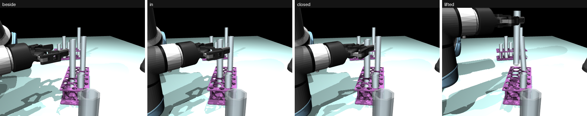

# Step 1 Results (Side Grasps): the Side-Grasp Network

How it works is in [approach.md](approach.md). This page is only about how well it works, and why
most tubes cannot be taken from the side yet. The top-down network's results are in
[top-down/results.md](../top-down/results.md).

> **A second version exists:** [improved.md](improved.md) makes the changes suggested at the end of this
> page and compares the two. This page is about version 1 (`runs/side_grconv`) and stays as it was.

Graded on **1,151 test targets** (one per tube, in 100 crowded scenes the network had not seen).
**Only 457 of them (40%) have at least one clear side direction**, against 76% for top-down grasps.
That low number is the real problem, and the main part of this page explains it.

---

## What the words mean

| Word | Meaning |
|---|---|
| **Direction** | where the gripper comes from, seen from above; 24 of them, 15 degrees apart, all the way round |
| **Clear** | the gripper comes down beside the tube, moves in and closes without touching anything but the target (the fast check) |
| **Good grasp** | clear, **and** the pinch point within 5 mm of the tube's axis |
| **Graspable** | the tube has at least one clear direction |
| **Boxed in** | no direction is clear: the arm should take another tube |
| **Row neighbour** | the tube in the next cell along the same row of the rack, 36 mm away (centre to centre) |
| **Pad** | the rubber tip of each finger, which presses on the tube |

---

## The result in one table

| | Side-grasp network |
|---|---|
| Test tubes graspable from the side | **40%** (457 of 1,151) |
| Good grasp, of the 457 graspable | **79.6%** |
| Refused, of the graspable (missed chances) | 0% |
| Refused, of the 694 boxed in (right answers) | **98.4%** |
| Position error, median / 95% under | 1.7 mm / 2.9 mm |
| Graspable / good grasp, short tubes (100 mm) | 20% / 77.8% |
| Graspable / good grasp, middle tubes (150 mm) | 37% / 84.7% |
| Graspable / good grasp, tall tubes (200 mm) | 61% / 77.2% |
| Full physics: succeeded, of the 9 the nearer arm could reach | **6** |
| Full physics: boxed-in tubes refused | 41 of 41 |
| Fast check vs physics (29 random directions) | agree 90%; never called a direction clear that then failed |
| Time to train | 25 min |

**In short: the network does its job. It finds the clear directions that exist, aims within 2 to 3 mm,
and almost never tries a boxed-in tube. The trouble is that too few clear directions exist, because of
how the gripper comes in, not because of the network.** That is fixed in the labels and the way in,
and then the network is trained again.

---

## 1. What the network says


*Top: the truth. Each line is one direction (long green = clear, short red = blocked). Bottom: the
network's score for each direction at its chosen pixel (longer and greener = higher), its choice in
yellow. Left: a tube clear only from outside its rack; the network picks one of those directions.
Right: a boxed-in tube; every score is low, and the network refuses.*


*Right: the network's best score over all directions, at every pixel (yellow is high). Of the five tubes
in this rack, only one (green circle) has a clear direction, and only there does the score light up.*

---

## 2. Why most tubes are blocked

The way in is already the sideways one: come down **beside** the tube, 6 cm out, then move **straight
in**, horizontally, and close. So a tube on the outer row of a rack, with an empty space behind it,
looks like it should be easy from outside. It mostly is not, and here is why.


*A tube on the outer row of its rack, the gripper come straight in from outside, seen from above. Left:
fingers fully open, as now. The pads are 93 mm apart, but the tubes in a row are only 36 mm apart, so
each pad lands on the row neighbour on its side. Right: the same, with the fingers nearly closed before
coming in. The pads fit.*

**The rack is tight.** Its cells are 36 mm apart and the tubes are 25 mm across, so between a tube and
its row neighbour there is only **11 mm of air**. Coming in from outside the rack, each finger has to
slide into that 11 mm gap, beside the target, all the way past its middle.

```
   seen from above, gripper coming in from the bottom (outside the rack)

     row neighbour     target     row neighbour
        ( O )   11mm   ( O )   11mm   ( O )          <- outer row of the rack
                  ↑               ↑
               finger           finger       nearly closed: each finger in its gap  -> fits
         ↑                                ↑
       finger                           finger      fully open (now): 93 mm apart   -> pads on the neighbours
```

**What blocks the first point of contact**, measured on 110 tubes (10 test scenes), gripper coming
straight in from outside the rack, along the rack's own direction:

| What touches first | Fingers fully open (now) | Fingers nearly closed |
|---|---|---|
| nothing: **clear** | 36 | **55** |
| a pad on a row neighbour, moving in | 35 | 8 |
| the inner finger link on a row neighbour, moving in | 7 | 27 |
| the wrist behind the gripper, on a neighbouring rack, tube or arm, on the way down | 19 | 19 |
| another part of the gripper on a tube, on the way down | 1 | 1 |
| the closing fingers on a neighbour | 12 | 0 |

So, in plain words, there are three reasons:

1. **The fingers come in fully open (the main one).** Only a row neighbour shorter than the grip height
   lets them pass. With the fingers nearly closed (90% of the way to the tube), the pads fit in the gaps.
2. **The 24 fixed directions do not line up with the racks.** Racks stand at random angles on the table.
   With 11 mm of room, 7 degrees off (the most the nearest of 24 directions can be) is enough to put a
   finger on a neighbour. The straight-out direction of the rack is often not among the 24.
3. **The finger is about as thick as the gap.** Even nearly closed, the inner finger link brushes a row
   neighbour in about a quarter of the tubes. This is the Robotiq gripper on this rack, and only a
   different gripper (thinner fingers) or a rack with more room would change it. Short tubes suffer the
   most: they are gripped just above the rack, where every neighbour is in the way.

**The same check over every direction**, on 169 tubes (15 test scenes): the share of tubes that have at
least one clear direction.

| Setting | Graspable from the side |
|---|---|
| Now: fingers fully open, 24 directions | 46% |
| Fingers nearly closed, 24 directions | 54% |
| **Fingers nearly closed, 24 directions + 4 lined up with the rack** | **64%** |

With both changes, by tube size: short 25 of 61 (41%), middle 39 of 51 (76%), tall 45 of 57 (79%).

These numbers come from the fast check only. Physics and the network come after the change.

---

## 3. Full physics

**60 random targets** (19 graspable): the network refused all 41 boxed-in ones. Of the 19 graspable,
the nearer arm could reach 9 on its fixed route; **6 of those 9 succeeded**. Of the 3 failures, 2 touched
something on the way in (a rack, a neighbour) with a part of the arm further back than the wrist rod,
which the network does not judge; 1 did not lift, without touching anything. Step 1b handles the first
kind: its coordinator checks the whole arm along the way and takes the network's next-best direction when
needed.



*One of the network's grasps with the real arm: down beside the tube, in, closed, lifted. The tube's
opening is free for pouring.*

## 4. Can the fast check be trusted?

29 random directions the arm could reach, tried in full physics: the fast check agreed 26 times (90%).
It never called a direction clear that then failed; 3 times it called one blocked that physics took
cleanly. So it errs on the safe side.

---

## The first try, and what it taught

The first grading had only 7 successes in 14. Those failures came from the physics harness, not the
network: it had neither the jump check nor the wait-to-arrive (see [approach.md](approach.md)), so on
some grasps the arm closed its fingers before it got there.

## What we learn

- **The network is not the weak link; the way in is.** It finds the clear directions well. There are just
  too few, because the fingers come in fully open.
- **A side grasp needs the fingers shaped before going in.** People do this without thinking: the hand is
  half-closed before it reaches a glass on a crowded shelf.
- **Directions should follow the rack.** A fixed set of 24 misses the one direction that matters most,
  straight out of the rack.

## What is next

1. Come in with the fingers nearly closed (pads about 40 mm apart, not 93), in both the fast check and
   the real arm, and check in physics that the tube still slides between the pads.
2. Add the rack's own four directions to the 24 (or give the network the rack's angle and let it
   choose finer).
3. Make the labels again, train again (about 25 minutes), grade again. Expect about 64% of tubes
   graspable instead of 40%.

## How to repeat this

From `step-1-grasp/`:

```
make data-side       # about 5 minutes: 400 + 50 + 100 scenes, all 24 directions labelled
make train-side      # about 25 minutes on the Mac
make evaluate-side   # fast check on every test target, 60 physics targets
make figures-side    # the pictures on this page
```

## Log of runs

| Run | Date | What | Validation: clear direction found / boxed-in refused | Test: good grasp | Physics |
|---|---|---|---|---|---|
| `side_grconv` | 2026-10-28 | the side-grasp network (24 directions, fingers fully open on the way in), 16 epochs | 80.4% / 99.4% | 79.6% of the 40% graspable | 6 of 9 reachable |
