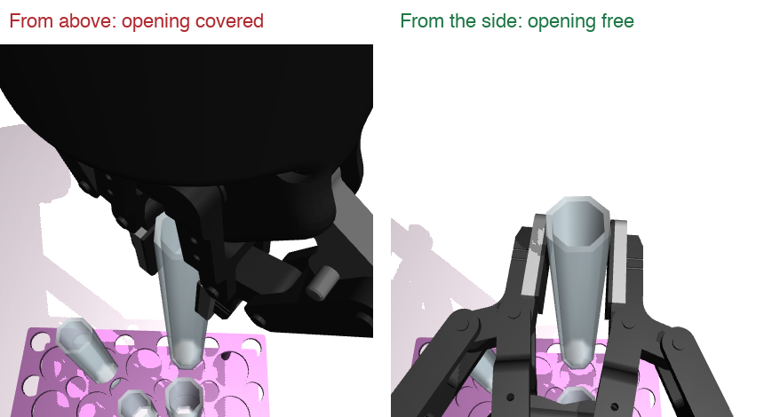
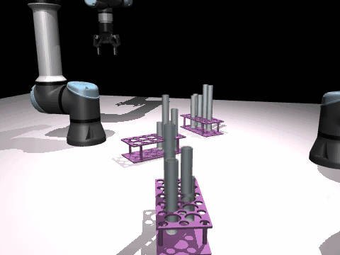
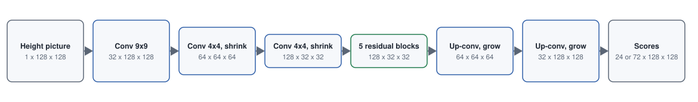
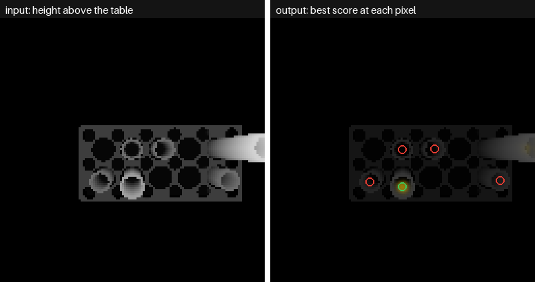
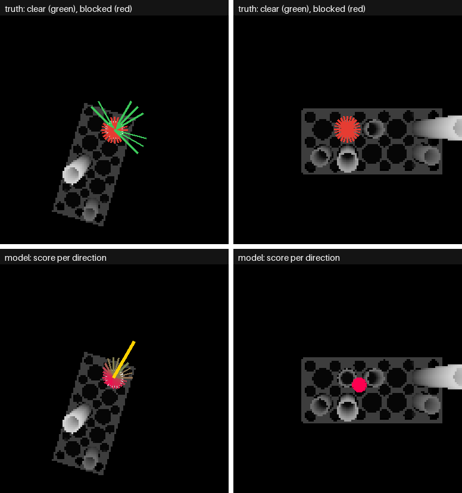
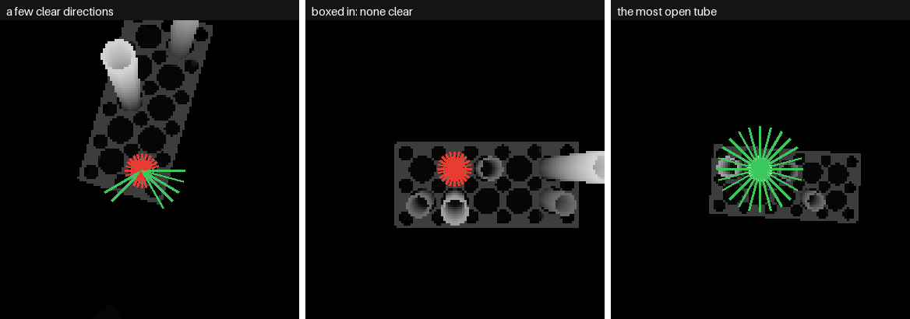
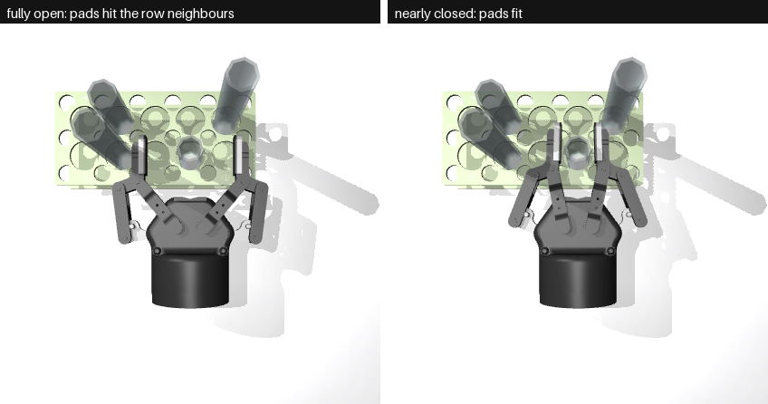

# Side Grasps, Version 1: Taking a Tube from the Side

[Version 1](version1.md) · [Version 2](version2.md) · [Version 3](version3.md) · [All results](results.md) ·
[Overview](../../../docs/solutions/step-1-grasp.md)

**In one line:** a network looks at a depth picture from above and scores 24 directions the gripper could
come from, so the arm can hold a tube without covering its opening.

---

## Why this version

The first network grasps from above ([top-down/approach.md](../top-down/approach.md)). That works for
lifting, but not for pouring: the tube's rim ends up 2.5 cm under the gripper's base, with only a 14 mm slot
above it, and that is too tight for the 7 mm balls that stand in for the liquid.



From the side, the gripper's body is beside the tube and the opening is free.

## What the words mean

| Word | Meaning |
|---|---|
| **Direction** | where the gripper comes from, seen from above: 24 of them, 15 degrees apart, all the way round |
| **Pinch point** | the spot between the two fingertips where they close |
| **Height picture** | a depth picture turned into "how high is each pixel above the table" |
| **Clear** | the gripper comes down, moves in and closes touching nothing but the target |
| **Fast check** | testing a grasp with collision tests only, no physics: a spare gripper is placed by hand at each point of the way in |
| **Boxed in** | no direction is clear, so the arm should take another tube |
| **Cut-off** | the score below which the network says "no clear direction" |

## The whole pick

```
 1. LOOK     close-up camera 35 cm above the rim, looking straight down: a 128 x 128 height picture
 2. CHOOSE   the network scores 24 directions at every pixel
             best pixel near the middle + best direction = where, and from which side
             best score under the cut-off = "no clear direction", take another tube
 3. MOVE     turn the fingers level, come down beside the tube 6 cm out, go straight in, close, lift 10 cm
```



---

## The model

**Family:** GR-ConvNet style. GR-ConvNet is a small network made for grasping: a picture goes in, and a map
of scores comes out at the same size, so every pixel gets its own answer. We chose it because our tubes stand
upright, it is small, and it trains from scratch in minutes.

**Our change:** GR-ConvNet gives one angle per pixel. A tube often has several clear directions, and one angle
would average them into a wrong one, so ours gives **a score for every direction**.

### Input

One 128 x 128 height picture, 2.3 mm a pixel, from 35 cm above the rim.

**Why from above, when the grasp is from the side?** Everything on the table is an upright tube or a flat rack,
so a height map shows where each object stands and how tall it is. That is all that decides whether a sideways
path hits something. A camera at the side would only see the nearest tube.

### Network



*Sizes are channels x height x width. It shrinks the picture to see the area around the tube, then grows back
to full size. Version 1 ends in 24 score maps. 1.82 million weights.*

### Output

**24 maps of 128 x 128 scores**, one map per direction, from 0 (blocked) to 1 (clear). The score at a pixel means:
"a grasp centred here, from this direction, is clear."



*Left: the input. Right: the best score at each pixel. Of the five tubes here, only the one with the green
circle has a clear direction, and only there does the score light up.*



*Top: the truth (long green = clear, short red = blocked). Bottom: the network's score for each direction at its
chosen pixel, its choice in yellow. Left: a tube clear only from outside its rack. Right: a boxed-in tube,
refused.*

---

## The training data

**Where it comes from:** nobody labels anything by hand. The simulator makes crowded random scenes, and the
fast check tries every grasp.

**One training example:**

1. Step 0's answer for a tube is simulated: the true place plus Step 0's usual errors.
2. The close-up camera looks down from there.
3. For **every tube in view**, the fast check tries all 24 directions: the whole way in, then closing.
4. Each clear direction becomes a small bump (about 1.5 pixels wide) on that direction's target map, at the
   tube's centre. Everywhere else the target is 0.



*Each line is one direction (long green = clear, short red = blocked). Left: a tube clear only from outside its
rack. Middle: boxed in. Right: a tube with no neighbours, clear from every side.*

| Split | Scenes | Pictures | Used for |
|---|---|---|---|
| Train | 400 | 4,660 | learning |
| Validation | 50 | 558 | choosing the best epoch and the cut-off |
| Test | 100 | 1,151 | the final grade, never seen in training |

About 5 tubes are labelled in each picture. Only **18%** of directions are clear, and 40% of tubes have at least
one.

**More pictures for free:** each training picture is turned by a random quarter turn and sometimes mirrored, and
its directions are turned with it. About 1 mm of depth noise is added.

## Training

| | Value | Why |
|---|---|---|
| Loss | binary cross-entropy at every pixel and direction | each direction is its own yes or no |
| Weighting | pixels within 4 of a tube's centre count 20 times more | that is where the answer is read; most of the picture is empty |
| Optimiser | AdamW, learning rate 0.001, one-cycle schedule | |
| Length | 16 epochs, batch 32, about 25 minutes on the Mac | |
| Kept | the epoch with the most validation tubes answered right | |
| Cut-off | 0.10, chosen on validation (92.3% right) | |

---

## Settings for the grasp

| | Value | Why |
|---|---|---|
| Grip height | 3 cm under the rim, never under rack top + 2 cm | the finger links reach 2 cm above and below the pinch point, so the opening stays clear |
| Way in | down beside the tube, 6 cm out from its axis, then straight in | |
| Fingers on the way in | **fully open**: 85 mm between the pads (93 mm between their centres) | as for top-down grasps; this turned out to be the main problem |
| Depth | the pinch point goes 11.5 mm past the tube's axis | closed on a 25 mm tube, the pads sit that far behind the pinch point |
| Closing check | 25 to 100% closed, shifted 3 mm either way | as for top-down grasps |
| The wrist | a rod 20 cm long and 4.5 cm thick behind the spare gripper | coming in level, the wrist is right behind the gripper at the same height |

## Making it work on the real arm

- **Elbow up:** with level fingers the arm can also fold its forearm low across the racks, so the search keeps the
  pose with the highest elbow.
- **No folding onto itself:** poses where a link touches the arm's own gripper or the table are refused.
- **The level roll nearest to now:** otherwise the wrist flips at every step.
- **Joints in range, nearest to now:** a joint past its limit stops there, and the arm drifted 11 cm off its path.
- **No jumps:** near an awkward pose, 2 cm of the fingers can need half a turn of a wrist, so such a move is refused.
- **Arrive before closing:** the arm is given time to catch up with its targets.

---

## What limited this version

Only **40%** of test tubes had a clear way in. The network was not the weak link: the fully open fingers and
directions that ignored the rack's angle were.



*Seen from above. Left: fully open, the pads land on the row neighbours. Right: nearly closed, they fit.*

Full analysis: [results.md](results.md#why-most-tubes-were-blocked-in-version-1). This led to
[version 2](version2.md).

## How to repeat this

From `step-1-grasp/`:

```
make data-side       # about 5 minutes
make train-side      # about 25 minutes
make evaluate-side   # fast check on every test tube, 60 in physics
make figures-side    # the pictures on this page
```

## Files

| File | What it does |
|---|---|
| `grasp/side.py` | the directions, the way in, the fast check (`SideChecker`), the real arm's side grasp |
| `grasp/net.py` | the network, the target maps, the loss |
| `grasp/generate_data.py --kind side` | pictures and labels, into `data_side/` |
| `grasp/train.py --kind side` | training |
| `grasp/evaluate_side.py` | the grading |
| `grasp/figures_side.py` | the pictures, into `docs/side/images/` |
