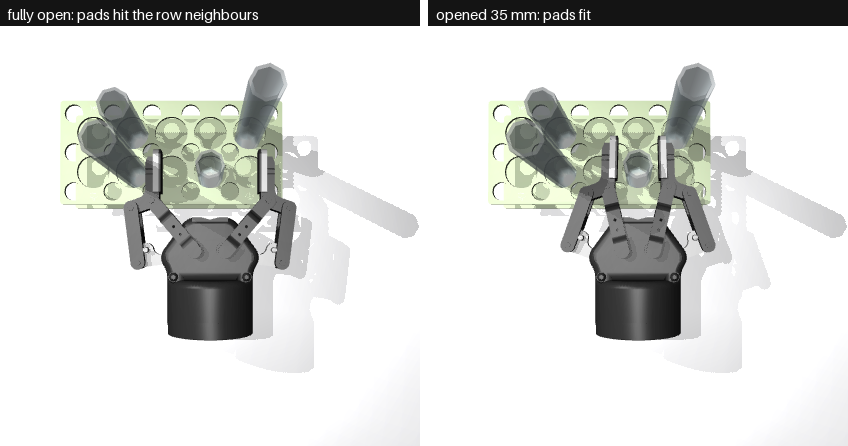
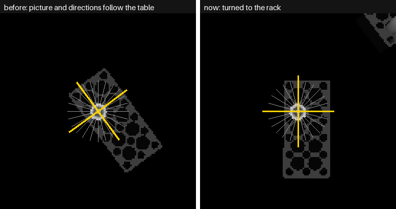
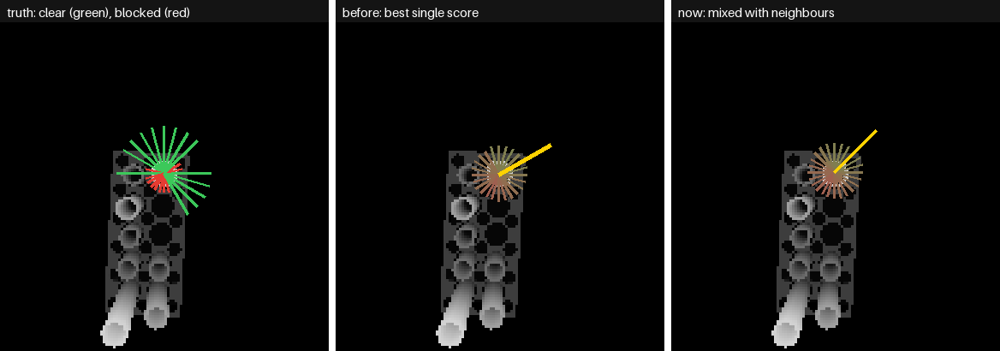
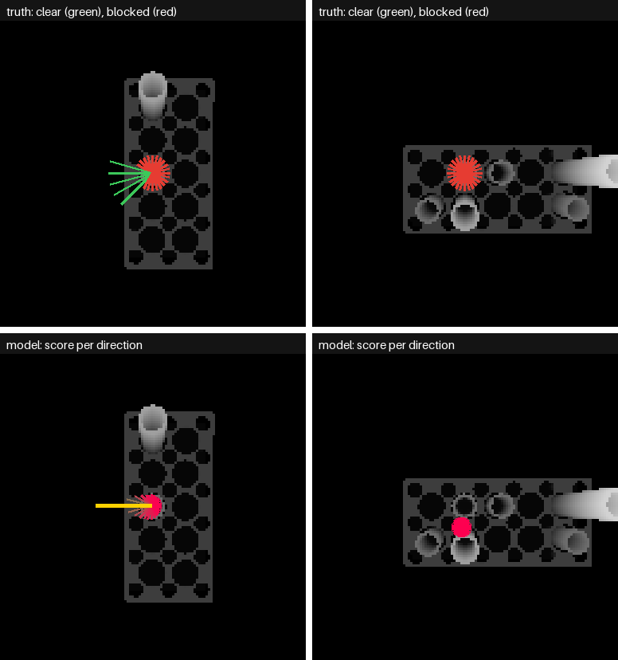
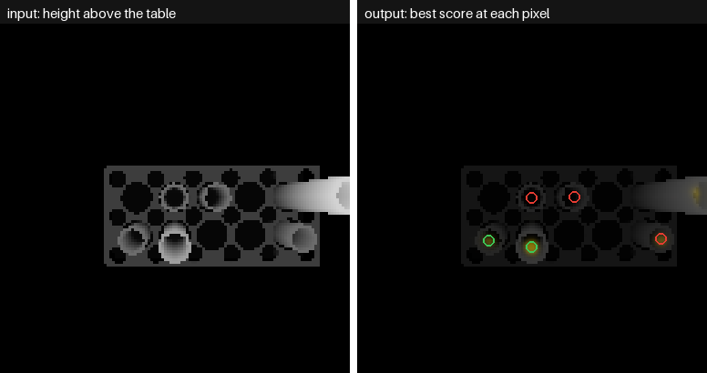
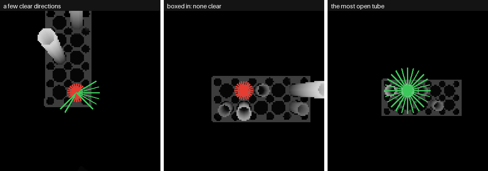
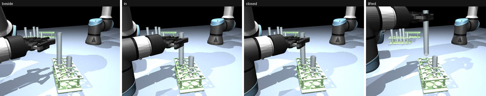

# Side Grasps, Version 2: Fitting the Fingers and Directions to the Rack

[Version 1](version1.md) · [Version 2](version2.md) · [Version 3](version3.md) · [All results](results.md) ·
[Overview](../../../docs/solutions/step-1-grasp.md)

**In one line:** the same network, with data made a smarter way: the fingers come in narrow, and the directions
follow the rack. Tubes with a clear way in went from 40% to 62%.

---

## Why this version

In [version 1](version1.md), only 40% of tubes had a clear way in, because of how the gripper came in rather
than because of the network. Racks are tight: tubes in a row are 36 mm apart, with 11 mm of air between them. So
this version changes the grasp and the data, then trains the same network again.

## What the words mean

| Word | Meaning |
|---|---|
| **Row neighbour** | the tube in the next cell along the same row: 36 mm away, centre to centre |
| **Pad** | the rubber tip of each finger |
| **Shove** | in the fast check, the closing fingers are also tried 3 mm to either side |
| **Good grasp** | the network's choice is clear, and the pinch point is within 5 mm of the tube's axis |
| **Aim off** | the direction was right, but the fingers were 1 or 2 mm off, and there they touch a neighbour |

---

## The three changes

### 1. The fingers come in opened just wider than the tube

Fully open, the pads are 85 mm apart. We know the tube is 25 mm wide, so the fingers now open to **35 mm** before
going in: 5 mm of room each side.



*Seen from above, the gripper coming straight in from outside the rack. Left: fully open, the pads sit on the
tubes beside the target. Right: opened 35 mm, they fit in the gaps.*

**Tried in physics first:** on 26 tubes the arm could reach, the tube slid between the pads and lifted cleanly
every time. The same runs showed the 3 mm shove was too cautious here: 12 of 12 grasps that only the shove had
called blocked lifted cleanly. So version 2 labels without the shove.

### 2. The directions are counted from the rack

Racks stand at random angles. Version 1's directions were counted from the table, so "straight out of the rack"
often fell between two of them, and 7 degrees off is enough to touch something in an 11 mm gap. Version 2 turns
the camera to line up with the rack, so four of the 24 point exactly straight out of its sides.



*Grey lines: the 24 directions. Yellow: the rack's sides. Left: version 1, yellow falls between grey. Right:
version 2, they line up.*

**How the rack's angle is found, with no training:** the camera takes the close-up as before. The rack's top plate
is a flat rectangle at a known height (6 cm), so those pixels are picked out, the holes filled, and the narrowest
rectangle that fits gives the angle. The picture is then taken again, turned by that angle. Against the truth on
236 tubes, it is off by 0.2 degrees half the time, and under 1.4 degrees for 95 of 100.

### 3. Aim at the middle of a run of clear directions

In version 1, most wrong directions (74 of 92) were one step next to a clear one: the network picked the edge of
a run. Version 2 mixes each score with its two neighbours' before choosing (half its own, a quarter each
neighbour's). No training is needed for this part.



*Left: the truth. Middle: the best single score, at the edge of the run, is blocked. Right: mixed with its
neighbours, the choice moves into the run.*

---

## The model

The network is **the same as version 1**: GR-ConvNet style, 24 outputs, 1.82 million weights.


| | Version 1 | Version 2 |
|---|---|---|
| Input | 128 x 128 height picture, unturned | the same, **turned to the rack** |
| Output | 24 score maps, counted from the table | 24 score maps, **counted from the rack** |
| Choosing | best single score | **score mixed with its neighbours** |



*Top: the truth, in the picture turned to the rack. Bottom: the mixed score per direction and the choice (yellow).
Left: a pickable tube. Right: a boxed-in tube, refused.*



*Left: the input. Right: the best score at each pixel.*

## The training data

Made the same way as [version 1](version1.md#the-training-data), with three differences: every picture is turned
to its rack, each is labelled in its own directions, and the labels use the 35 mm opening without the shove.



| | Version 1 | Version 2 |
|---|---|---|
| Scenes, train / val / test | 400 / 50 / 100 | the same |
| Pictures, train / val / test | 4,660 / 558 / 1,151 | the same |
| Tubes with a clear direction | 39% / 42% / 40% | **63% / 63% / 62%** |
| Directions that are clear | 18% | 22% |
| Making the data | about 5 minutes | about 20 minutes |

## Training

As for version 1, about 16 minutes. The cut-off, chosen on validation, is **0.15** (85.5% right).



*Fingers already opened 35 mm: down beside the tube, in, closed, lifted.*

---

## What limited this version

**1. Tall tubes cannot be carried.** Every grasp is 3 cm under the rim. Held there, a tall tube hangs 17 cm below
the fingers and must be carried about 42 cm up, near an awkward pose of the arm. In Step 1b (then still using
version 1 and the same 3 cm grip), none of the 12 large-tube runs got through.

**2. Margins of a millimetre.** With the fingers opened only 35 mm, each pad passes within 1 to 2 mm of a row
neighbour. The network aims within 1.4 mm (median), so on 85 tubes it clipped one. Many tubes are now clear or
blocked by less than a pixel (2.3 mm), so it is also less sure which are boxed in: it refuses 80%, against 98%
in version 1.

Numbers: [results.md](results.md). This led to [version 3](version3.md).

## How to repeat this

From `step-1-grasp/`:

```
make data-side2       # about 20 minutes
make train-side2      # about 16 minutes
make evaluate-side2   # version 1 with mixing only, then version 2
make figures-side2    # the pictures on this page
```

## Files changed

| File | What changed |
|---|---|
| `grasp/side.py` | `PRESHAPE_GAP`, `SideChecker(preshape=True)`, `labels(frame_yaw=...)`, `rack_yaw`, `smoothed`, `run(preshape=True)` |
| `grasp/scenes.py` | the close-up camera can be turned (`look(yaw=...)`) |
| `grasp/generate_data.py`, `grasp/train.py` | `--kind side2` |
| `grasp/evaluate_side.py` | `--version 2`, `--smooth`, `--out`; pickable tubes split into good / wrong direction / aim off / wrongly refused |
| `grasp/figures_side.py` | `--version 2`, into `docs/side/images/v2/` |
