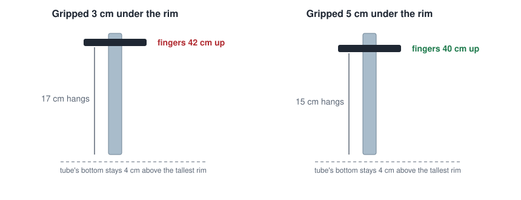
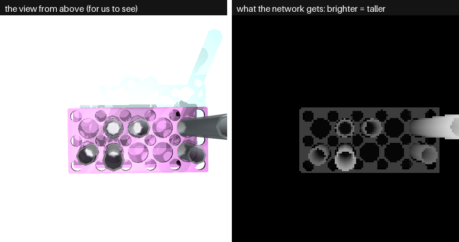
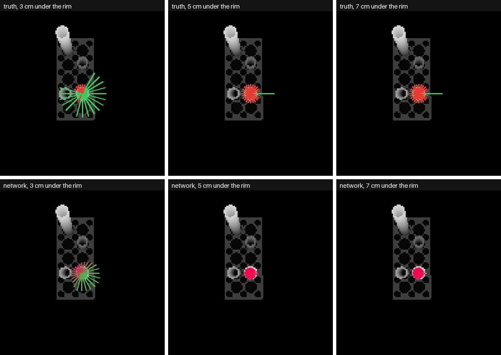
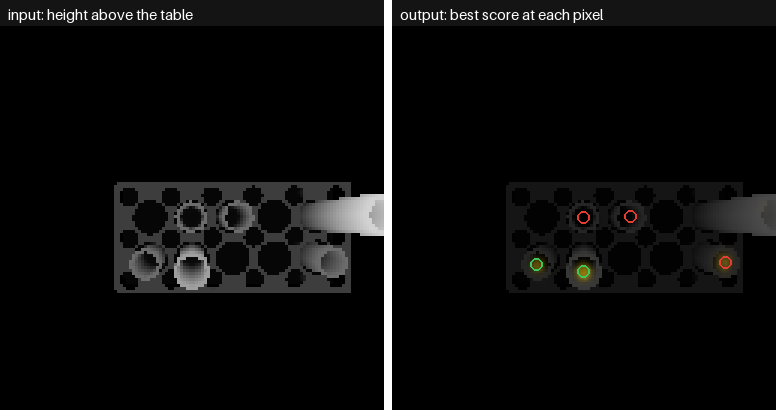
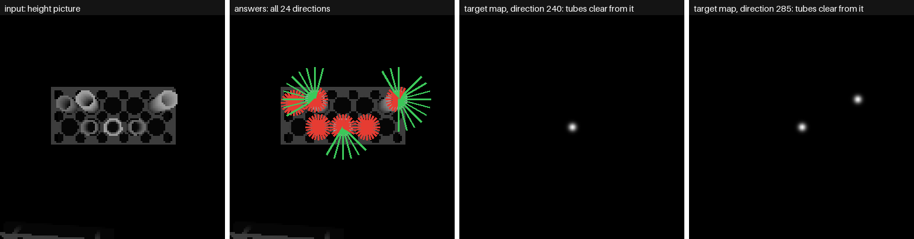
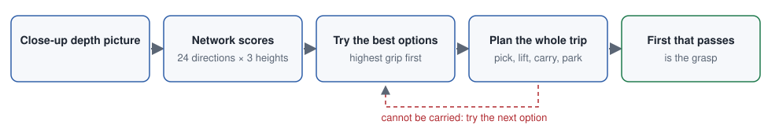
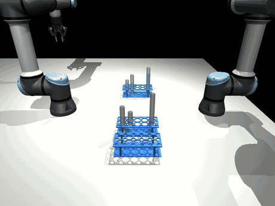

# Side Grasps, Version 3: Choosing the Grip Height Too

[Version 1](version1.md) · [Version 2](version2.md) · [Version 3](version3.md) · [All results](results.md) ·
[Overview](../../../docs/solutions/step-1-grasp.md)

**In one line:** the network also says **how low** the fingers can grip, and Step 1b plans the whole carry before
choosing a grasp. This is the version in use.

---

## Why this version

[Versions 1 and 2](version2.md) always gripped 3 cm under the rim. That is right for picking and wrong for
carrying a tall tube. The grasp has to suit what comes after the pick.



Held 3 cm under its rim, a tall tube hangs 17 cm below the fingers. To clear every rim on the table, the fingers
travel about 42 cm up, level and far from the arm's base. There the UR5e is near an awkward pose, and the arm
would have to swing a wrist joint by about 150 degrees.

## What the words mean

| Word | Meaning |
|---|---|
| **Grip height** | how far under the rim the fingers close: 3, 5 or 7 cm |
| **Hang** | how much of a held tube is below the fingers |
| **Carry height** | how high the fingers travel carrying: the tube's bottom stays 4 cm above the tallest rim on the table |
| **Awkward pose** | a pose where two wrist joints line up: a tiny move of the fingers needs a huge turn of a wrist |
| **Planning the carry ahead** | trying every move of the carry on a copy of the simulation before choosing a grasp |
| **Task-oriented grasping** | choosing the grasp that works for the whole task, not only the pick |

## What was measured first

**Does a lower grip make picking easier?** No. On 169 test tubes, the share that can be picked from at least one
direction:

| Tube | 3 cm | 5 cm | 7 cm | 9 cm | 11 cm |
|---|---|---|---|---|---|
| middle (150 mm) | **59%** | 31% | 31% | | |
| tall (200 mm) | **70%** | 51% | 49% | 32% | 30% |

A lower grip never made a tube pickable that was not already pickable at 3 cm: the fingers go further down among
the neighbours. A short tube has no choice at all: its grip is held 2 cm above the rack.

**Does a lower grip help carrying?** Yes. The 10 large-tube runs of Step 1b, changing only the grip height:

| Grip under the rim | Large tubes that reached the pouring point |
|---|---|
| 3 cm | 0 of 10 |
| **5 cm** | **7 of 10** |
| 7 cm | 4 of 10 (more tube above the fingers hits the arm's own forearm) |

So the best grip depends on what comes after the pick, and it differs from tube to tube.

---

## The model

The same GR-ConvNet-style network. Only the last layer changes: **72 outputs instead of 24** (1.83 million weights).


### Input

The same as version 2: a 128 x 128 height picture from above, turned to the rack.



*Left: the view from above, for us to see. Right: what the network gets. Brighter is taller, so a tube that leans
out at the edge of the picture is only the camera's perspective.*

### Output

**72 maps of 128 x 128 scores:** the 24 directions at 3 cm, then at 5 cm, then at 7 cm. Scores are mixed with
neighbouring directions within each height.



*One tall tube. Top: the truth at each height (long green = clear, short red = blocked). Bottom: the network's
scores. At 3 cm it has many clear directions; at 5 and 7 cm only one. The network sees that too, and at the lower
heights its scores nearly vanish. It misses that one direction, a real weakness of a score-based choice.*



*Left: the input. Right: the best score over all 72 outputs at each pixel, with a circle on each tube.*

## The training data

Made as in [version 2](version2.md#the-training-data): the same scenes, with 72 labels a tube instead of 24.



*One training example. From left: the input; the answers for every tube in view at 3 cm; and two of the 72 target
maps. A target map has a small bump at each tube that is clear from that direction, and is black elsewhere. The
network learns to draw all 72.*

| | Version 2 | Version 3 |
|---|---|---|
| Pictures, train / val / test | 4,660 / 558 / 1,151 | the same |
| Labels for each tube | 24 | **72** |
| Tubes with a clear direction | 62% | 62% |
| Options that are clear | 22% | 16% |
| Making the data | about 20 minutes | about 35 minutes |

**A shortcut:** a direction blocked at one height is taken as blocked at every lower one, without checking. Tested
against the full check on 15 scenes, 6 of 12,168 labels differ (0.05%).

## Training

As before: 16 epochs, about 20 minutes. Turning and mirroring turn each height's 24 directions on their own. The
cut-off, chosen on validation, is **0.25** (86.2% right).

---

## Choosing the grasp

The network says which options are clear. It does not know if the arm can carry the tube. So Step 1b decides.



Options are tried **highest grip first**, and a lower grip is used only when a higher one cannot be carried.



**An honest note:** in Step 1b's 30 runs, every success still gripped 3 cm under the rim. Planning ahead found a
direction that could be carried from there. Without planning ahead, a 5 cm grip was what fixed 7 of 10. Both help,
and planning ahead is the one that made the difference in these scenes.

## What limits this version

- **Tubes slip after gripping:** 6 of 30 runs. See
  [Step 1b's results](../../../step-1b-pick-and-carry/docs/results.md).
- **Small tubes:** in 9 of 10 runs asking for them, no grasp passed the arm's checks.
- **The model does not know the arm:** it only judges the gripper and wrist, so it can choose a grasp the arm
  cannot reach.

Numbers: [results.md](results.md).

## How to repeat this

From `step-1-grasp/`:

```
make data-side3       # about 35 minutes
make train-side3      # about 20 minutes
make evaluate-side3   # fast check on every test tube, 60 in physics
make figures-side3    # the pictures on this page
```

## Files changed

| File | What changed |
|---|---|
| `grasp/side.py` | `HEIGHTS`; `grip_height`, `pinch_at`, `way_in`, `SideChecker.clear` and `run` take a grip height; `labels(heights=True)`; `smoothed` works within each height; `closing_for_gap` shared with Step 1b |
| `grasp/net.py` | turning and mirroring a picture turns each height's 24 directions on their own |
| `grasp/generate_data.py`, `grasp/train.py` | `--kind side3` |
| `grasp/evaluate_side.py` | `--version 3`: the chosen output gives the direction and the grip height |
| `grasp/figures_side.py` | `--version 3`, into `docs/side/images/v3/` |
| `tests/test_side.py` | labels at each height, the grip height's limit, smoothing and turning within each height |
