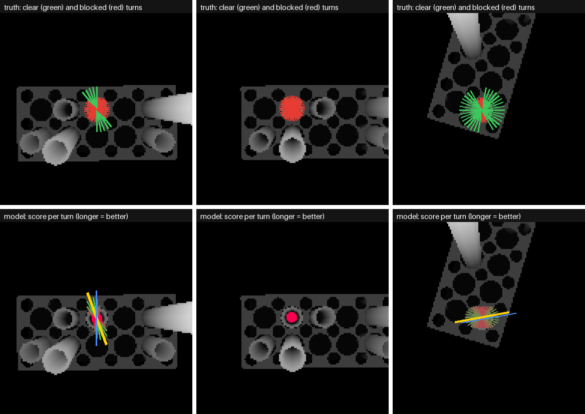
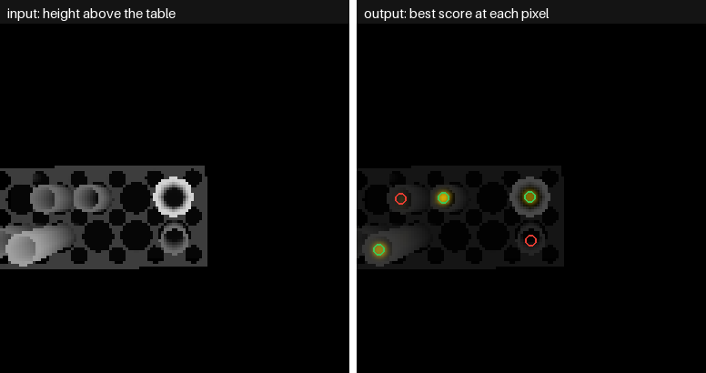

# Step 1 Results (Top-Down Grasps): the Programmed Rule vs the Grasp Network

What the two methods are and how they were built is in [approach.md](approach.md).
Side grasps, the second model, have their own pages: [side/results.md](../side/results.md).
This page is only about how well they work, and how they compare.

Both were graded on the same **1,151 test targets** (one per tube, in 100 crowded scenes that
neither had seen). **870 of them (76%) have at least one clear turn; 281 are boxed in**, with no
way for the gripper to get down and close without touching a neighbour.

---

## What the words mean

| Word | Meaning |
|---|---|
| **Turn** | the direction the two fingers open along, seen from above; 18 of them, 10 degrees apart |
| **Clear** | the gripper gets down to the grip height and closes without touching anything but the target (the fast check, see approach.md) |
| **Good grasp** | clear, **and** the pinch point within 5 mm of the tube's axis |
| **Graspable** | the tube has at least one clear turn |
| **Boxed in** | no turn is clear: the arm should leave this tube and take another |
| **Refused** | the method says "no clear turn". Right for a boxed-in tube, a missed chance for a graspable one |
| **Physics success** | with the real arm and full physics, the tube came up 8 cm, stayed upright, and the arm touched nothing else |
| **Position error** | the distance between where a method put the pinch point and the tube's true axis |
| **Median / 95% under** | half the targets are better than the median; 95 out of 100 are better than the "95% under" value |

---

## The result in one table

| | Programmed rule | Grasp network | Better |
|---|---|---|---|
| **Fast check, all 1,151 targets** | | | |
| Good grasp, of the 870 graspable | 80.0% | **93.9%** | network |
| Refused, of the 870 graspable (missed chances) | 6.8% | **1.7%** | network |
| Refused, of the 281 boxed in (right answers) | 62.3% | **93.2%** | network |
| Position error, median | **1.0 mm** | 1.1 mm | about the same |
| Position error, 95% under | 7.9 mm | **2.2 mm** | network |
| **Full physics, 60 random targets** | | | |
| Lifted cleanly, of 41 graspable | 34 (83%) | **38 (93%)** | network |
| Refused, of 19 boxed in | 10 | **17** | network |
| Right overall (clean lift, or refused when boxed in) | 44 of 60 (73%) | **55 of 60 (92%)** | network |
| Time to train | none (2 sizes fitted in seconds) | 15 min | rule |

**In short: the network is better at both halves of the job.** It knows where the tube really is
(it sees it close up, so Step 0's occasional centimetre misses do not carry over), and it sees which
neighbours are in the way and how tall they are (so it refuses boxed-in tubes instead of trying
and bumping them). The rule never touches a picture, needs no training, and is right most of the
time; its trouble is the tubes Step 0 placed badly or missed, and the tubes that are boxed in.


*One of the network's grasps with the real arm and full physics: over the tube, down, closed,
lifted 10 cm. The neighbours are untouched.*

---

## 1. Choosing a turn

On the 870 graspable targets, both methods pick a turn that is in fact blocked equally often (38
times each, 4.4%). The difference is everything else:

| Of the 870 graspable | Programmed rule | Grasp network |
|---|---|---|
| Good grasp | 696 (80.0%) | **817 (93.9%)** |
| Clear, but more than 5 mm off the axis | 77 (8.9%) | 0 |
| Turn blocked | 38 (4.4%) | 38 (4.4%) |
| Refused | 59 (6.8%) | **15 (1.7%)** |

And on the 281 boxed-in targets, the rule tries 106 of them anyway (38%), the network only 19 (7%).
In the physics sample (section 3), every such try touched a neighbour.

**By tube size**, good grasps of the graspable targets:

| Tube | Share graspable | Programmed rule | Grasp network |
|---|---|---|---|
| short (100 mm) | 50% | 76.0% | **88.8%** |
| middle (150 mm) | 82% | 78.4% | **93.8%** |
| tall (200 mm) | 92% | 83.4% | **96.5%** |

Short tubes are the hard case for both: their grip height sits under the rims of taller
neighbours, so half of them are boxed in, and the ones that are not have few clear turns.



*Top: the truth for three test tubes (long green lines are clear turns, short red ones blocked).
Bottom: the network's score for each turn at its chosen pixel (longer and greener is a higher
score), its choice in yellow, and the rule's choice in blue. Left: both pick a clear turn.
Middle: a boxed-in tube; the network scores every turn low and refuses. Right: a tube Step 0
placed off-centre; the rule's grasp (blue) is aimed at the wrong place, the network's is not.*



*Right: the network's best score over all turns, at every pixel (yellow is high). It lights up
only at the centres of tubes that have a clear turn (green circles), and stays dark on boxed-in
tubes (red circles).*

---

## 2. Placing the fingers

| | Programmed rule | Grasp network |
|---|---|---|
| Median error | 1.0 mm | 1.1 mm |
| 95% under | 7.9 mm | **2.2 mm** |
| Within 5 mm | 90.0% | **100%** |
| Rim height error, median | 1.4 mm (Step 0's) | **under 0.1 mm** |

The rule can only put the fingers where Step 0 said the tube is, so it inherits Step 0's errors
exactly: most tubes are spot on, about one in ten is several millimetres off. The network reads the
tube's place from the close-up picture, so even when Step 0 (and so the camera's aim) was a
centimetre off, it still finds the tube's centre within about 2 mm.

---

## 3. Full physics

60 random test targets, each method's grasp run with the real arm:

| | Programmed rule | Grasp network |
|---|---|---|
| Graspable targets: lifted cleanly | 34 of 41 | **38 of 41** |
| Graspable targets: refused | 4 | 1 |
| Graspable targets: tried and touched something | 3 | 2 |
| Boxed-in targets: refused | 10 of 19 | **17 of 19** |
| Boxed-in targets: tried (all touched a neighbour) | 9 | 2 |

The failures on graspable targets, one by one:

- **Both methods, same tube:** the arm, on its way from home to above the tube, swept through the
  rack and knocked its tubes flying. Not a grasp problem: the arm's route (Step 1b, the movement)
  has to go around things.
- **Both methods, same tube:** the inner finger link grazed a neighbour while closing, although the
  fast check said clear. The shove of the arm as the fingers close was larger than the 3 mm the
  check allows for.
- **The rule only:** a neighbour was touched during the lift.

Hitting something is rarely gentle in the simulation. Of the 36 blocked turns tried with physics
in section 4, 15 knocked a neighbour clean out of its rack. That is why refusing a boxed-in tube
matters as much as finding a clear turn on an open one.

---

## 4. Can the fast check be trusted?

The 18 labels per tube come from the fast check, not from physics. On the same 60 targets, one
random turn each was also run with full physics, at the tube's true place:

| | Physics: clean | Physics: touched something |
|---|---|---|
| **Fast check: clear** | 23 | 1 |
| **Fast check: blocked** | 1 | 35 |

**They agree 58 times in 60 (97%).** The one "clear" that touched was also a graze while closing,
like the one in section 3; the one "blocked" that was clean was a near miss, where the 3 mm
allowance for the shove was more than needed. So the labels the
network learns from are close to the truth, and the fast grading in sections 1 and 2 is too.

---

## 5. Squeeze: how hard, and does it slip

Three of the heaviest test tubes (200 mm sources, **full of liquid**: 0.6 to 0.9 N) were lifted with
the fingers told to close to 0.5, 1, 2 and 4 mm under the tube's width:

| Fingers told to close | Squeeze force | Lifted | Slip while lifting |
|---|---|---|---|
| 0.5 mm under | 12 N | 3 of 3 | under 0.5 mm |
| 1 mm under | 17 N | 3 of 3 | under 0.5 mm |
| 2 mm under | 27 N | 3 of 3 | under 0.5 mm |
| **4 mm under (the setting used)** | **47 N** | 3 of 3 | under 0.5 mm |

The worked-out need was about 1.5 to 2 N (approach.md, section 5). **Every setting squeezes far
harder than needed**: even 0.5 mm under gives 12 N, about 17 times the tube's weight. The fingers
are told a position, not a force, and the rubber pads are stiff, so each extra millimetre adds about
10 N. For a straight lift nothing slips at any setting.

What this means:

- **The grip is safe for Step 1** at any of these settings.
- **47 N is a lot for a glass tube.** A real 25 mm tube survives it, but a thin-walled one might
  not. 1 mm under (17 N) holds just as well and is gentler.
- **Step 2 (the pour) is different:** tilting the source turns its weight into a twist in the
  fingers. That needs its own test before lowering the squeeze.

---

## The first try, and what it taught

The first full run looked worse for the network in physics (65% of its tries clean, against 76%
for the rule), although it was better on the fast check. Digging into the failures found three
mistakes, all fixed before the results above:

| What went wrong | How it showed up | Fix |
|---|---|---|
| The spare gripper used for the fast check was left hanging in the scene after labelling, and the close-up camera photographed it in about 12% of the pictures | the network read it as a rim up to 38 cm high and closed the fingers in mid-air | park it out of sight after labelling; a test checks no picture shows it |
| The fast check only tested the open gripper going down | in physics, the inner finger link grazed neighbours **while closing** | test the closing fingers too, shifted 3 mm either way along the finger line |
| Labels were made on the scene as built, physics ran on the scene as it settled, and tubes full of rattling balls never stopped leaning (up to 8 degrees) | neighbours were not where the labels thought | one scene, settled first, for labels, pictures and physics; tubes empty so they come to rest |

After the fixes, the fast check agreed with physics on 97% of random turns (92% before), and the
network's validation score went from 72% of graspable tubes found to 95%.

**The lesson:** a fast stand-in for physics is only as good as its check against real physics.
Without the physics sample, the first run's numbers would have been believed.

---

## What we learn

- **A learned model earns its place here, but not by much on easy tubes.** On open tubes both
  methods are near perfect. The network wins on the hard cases: badly placed tubes (it sees where
  they really are) and boxed-in tubes (it sees which neighbours are in the way).
- **The scores per turn work.** The network finds several clear turns for one tube and never has to
  average them into a wrong one.
- **The grasp is not the weak link any more; the arm's route is.** The one failure common to both
  methods that was not a graze was the arm sweeping through a rack on its way. That is the next
  step (Step 1b, the movement).
- **Squeezing is not a problem for a straight lift.** Every setting holds; the current one is just
  harder than needed.

## How to repeat this

From `step-1-grasp/`:

```
make data       # about 5 minutes: 400 + 50 + 100 scenes
make train      # about 15 minutes on the Mac
make evaluate   # about 5 minutes: fast check on every test target, 160 physics grasps
make figures    # the pictures on this page
make test       # 24 tests
```

## Log of runs

| Run | Date | What | Validation: clear turn found / boxed-in refused | Test: good grasp (network / rule) | Physics: right overall (network / rule) |
|---|---|---|---|---|---|
| `grconv_first_try` | 2026-10-28 | first version; three mistakes (see above) | 72% / 100% | 87.0% / 78.3% | not comparable (different physics scene) |
| `grconv` | 2026-10-28 | mistakes fixed; same network, same settings, 16 epochs | 95.5% / 97.8% | **93.9% / 80.0%** | **92% / 73%** |
