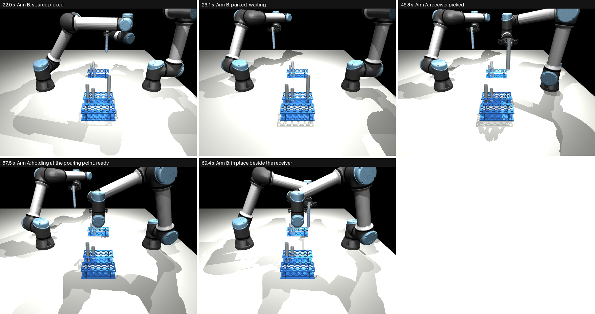

# Step 1b Results: Both Arms Pick and Meet at the Pouring Point

How it works is in [approach.md](approach.md). This page is only about how well it works.

**30 runs:** 10 task scenes (seeds 0 to 9), each run three times, asking first for small, medium or
large tubes. Every run starts from the overhead picture, with the arms knowing nothing else about the
table. Both tubes are held **from the side** (Step 1's side-grasp network), so their openings are free
for the pour.

---

## What the words mean

| Word | Meaning |
|---|---|
| **Run** | one full go: perceive, choose a pair, Arm B picks the source and parks it, Arm A picks the receiver and holds it at the pouring point, Arm B comes in beside it |
| **Success** | both tubes in place, same size, from the right racks, each rim within 5 mm of where it should be, both within 5 degrees of upright, no liquid lost, and neither arm touched anything but its own tube |
| **Fell back** | the size asked for could not be taken safely, so the coordinator chose another size before anything moved |
| **Rim error** | the distance between where a tube's rim ended up and where the coordinator wanted it |

---

## The result in one table

The current version (version 2 of the coordinator, with Step 1's side-grasp version 3), next to the
first one. What changed is in [approach.md](approach.md), "Version 2".

| | Version 1 | **Version 2 (now)** |
|---|---|---|
| Successes | 14 of 30 | **21 of 30** |
| Successes, medium tubes | 13 of 17 | 13 of 17 |
| Successes, large tubes | 0 of 12 | **7 of 12** |
| Successes, small tubes | 1 of 1 (9 of 10 fell back) | 1 of 1 (9 of 10 fell back) |
| Runs where liquid was lost | none | 2 (one scene, asked twice: both tubes fell over) |
| Runs where an arm touched anything but its own tube | 4 of 30 | **none** |
| In the successful runs: receiver's rim from the pouring point | median 0.8 mm, at most 1.4 mm | median 1.1 mm, at most 1.9 mm |
| In the successful runs: source's rim from its meeting place | median 3.6 mm, at most 4.1 mm | median 3.6 mm, at most 4.6 mm |
| In the successful runs: lean | at most 3.5 degrees | at most 4.4 degrees |
| Time until Arm B is in place | about 67 s | about 68 s |



*A large-tube run (scene 0), which never got through in version 1: Arm B picks the tall source and parks
it; Arm A picks the tall receiver and holds it at the pouring point; Arm B comes in beside it.*

**What fixed the large tubes:** the coordinator now **plans the whole carry before choosing a grasp**
(lift, carry, turn, park, and in to the meeting place), and takes the first grasp whose pick *and* carry
both pass. Before, it checked only the pick, and the carry failed halfway with the tube already in the
fingers. Every success gripped 3 cm below the rim (2.6 cm for small tubes, the lowest allowed): the lower
grip heights that Step 1's version 3 offers were a fallback these scenes did not need. Run on their own,
without planning ahead, a 5 cm grip fixed 7 of 10 large runs (Step 1's
[version3.md](../../step-1-grasp/docs/side/version3.md)).

### What still fails (9 of 30)

| What happened | Runs |
|---|---|
| The source slipped out of the fingers while being lifted (scene 9 medium, asked twice; scene 3 large) | 3 |
| Both tubes fell over at the meeting, the source's liquid spilled (scene 6 medium, asked twice) | 2 |
| The receiver fell over at the pouring point (scene 5 large) | 1 |
| The source ended 5.1 mm from its place (the limit is 5) (scene 4 large) | 1 |
| Small tubes: no side grasp the whole arm can follow, so the medium pair was taken | (9 runs fell back; counted under medium) |

**New in this version: tubes coming out of the fingers or falling (6 runs).** Version 1 had none (2 runs
ended tilted). In scene 9, the fingers closed in the right place (1.5 mm off, as in successful runs), the
passive finger joint then sprang back as the lift began, and the tube stayed in the rack. The likely
cause is the new way in: the fingers now arrive already opened only 35 mm and close the last few
millimetres, which changes how the Robotiq linkage wraps round the tube. Not yet confirmed.

**Small tubes** are not a grip-height problem: gripping a short tube level, 8 cm above the table, puts
the arm's wrist down among the tall neighbours (it touches them), and reaching that low with level
fingers needs big wrist swings. Step 1's network finds clear directions for 38% of short tubes, but the
whole arm can follow almost none of them.

---

## Version 1 in detail

The sections below are about version 1 (14 of 30), kept as they were.

| | Version 1 |
|---|---|
| Successes | **14 of 30** |
| Successes, medium tubes | **13 of 17** |
| Successes, large tubes | **0 of 12** |
| Successes, small tubes | 1 of 1 (9 of 10 runs asking for small fell back to medium) |
| Runs where liquid was lost | **none** |
| Runs where an arm touched anything but its own tube | 4 of 30 |
| In the successful runs: receiver's rim from the pouring point | median **0.8 mm**, at most 1.4 mm |
| In the successful runs: source's rim from its meeting place | median 3.6 mm, at most 4.1 mm |
| In the successful runs: lean | at most 3.5 degrees |
| Distance between the two tubes' axes at the meeting | 85 mm |
| Time until Arm B is in place | about 67 s (simulated); about 100 s of computer time per run |

**In short: the medium pair works, the large pair does not yet.** When a run completes, both tubes are
placed within a few millimetres, upright, with no liquid lost. Every large-tube run stopped because one
of the arms could not find a route it could follow, not because of the grasp.

---

## 1. Why the large tubes fail

| What stopped the run | Runs |
|---|---|
| Arm 2, carrying the tall receiver, would have to swing a joint by about 2.7 rad on the way (near an awkward pose of the arm) | 6 |
| Arm 2 cannot reach the pouring point with the fingers level from the direction it needs | 2 |
| Arm 1, carrying the tall source, would hit its own forearm with the tube | 2 |
| Arm 1 would have to swing a joint while lifting the tall source | 2 |

A tall tube has to be held high to clear the rims of the others (its bottom 4 cm above the tallest rim,
so the fingers about 42 cm up), and held from the side, 17 cm of tube hangs below the fingers. At those
heights, and with the fingers level, the arms are near the edge of what they can do smoothly. The
planner refuses such moves before the arm makes them, so none of these runs spilled; in 4 of them an
arm had brushed a rack or a tube earlier on the way.

## 2. The 4 medium runs that were not a success

- 2 runs (scene 2): the route check refused the lift, because a finger pad would brush the tall
  neighbour in the next row.
- 2 runs (scene 1): the source ended tilted 8.7 degrees, far from its place.

## 3. Small tubes

A short tube is gripped only 2 cm above the rack's top plate, with tall neighbours beside it. In 9 of 10
runs asking for small tubes, no side direction passed the arm's check, and the coordinator took the
medium pair instead, before anything moved.

---

## How it got here

| Version | Successes | What changed |
|---|---|---|
| Top-down grasps (Step 1's first network) | 24 of 30 | the first version; **but a top-down grasp leaves the tube's opening under the gripper's base, so it cannot pour**: replaced |
| Side grasps, both arms moving at once | 9 of 30 | the arms actually touched each other: each move was checked at its start, but the other arm kept moving into its way |
| One arm at a time, Arm A first | 4 of 30 | Arm B could not get past Arm A in the middle; and the tubes sat about 4 mm further back in the fingers than aimed for |
| Arm B first and parked on its own side, arms swapped to their own sides, aim corrected | 14 of 30 | each arm takes the tube on its own side; the held tube is now also checked against its own arm |
| Side grasps version 3 (grip heights), fingers opened 35 mm, carry **not** planned ahead, heights tried 5, 3, 7 cm | 15 of 30 | large 7 of 12, but medium fell to 7 of 17: a lower grip leaves more tube above the fingers, and the rims missed the 5 mm limit |
| The same, heights tried 3, 5, 7 cm, the carry planned ahead (to the waiting place) | 19 of 30 | medium back to 13 of 17; large 5 of 12: the source parked at a different spot than the one planned |
| **The source parks where its carry was planned, and the plan goes in to the meeting place** | **21 of 30** | large 7 of 12, medium 13 of 17 |

All of these were tried on the same 10 scenes, which are also the scenes graded: there is no separate
set of scenes held back for Step 1b, so the later versions were chosen knowing these results.

Along the way, the side-grasp arm needed: the closing fingers checked with 2 cm of room (the passive
finger linkage swings out under a full tube's load), the pick planned once and followed exactly, the
fingers aimed 15 mm past where the tube's axis should be (where the pads hold it), the pouring point
raised from 25 to 35 cm (the wrists reach out over the racks), and the source held from +y and the
receiver from -y.

## Open problems and suggested fixes

Three problems are open. The first two lose runs; the third is about how far the 21 of 30 can be trusted.

### Problem 1: a tube comes out of the fingers or falls over (6 runs)

**What happens.** Three kinds of run, all new in version 2 (version 1 had none):

| Kind | Scene, size | What was seen |
|---|---|---|
| The source stays behind when the arm lifts | 9 medium (x2), 3 large | the fingers closed in the right place (1.5 mm off, like the successes), then the passive finger joint sprang back open as the lift began; the tube stayed in the rack |
| Both tubes fall at the meeting | 6 medium (x2) | all 104 balls spilled; the source came in to 80 mm from the receiver (most runs: 85 mm) |
| The receiver falls at the pouring point | 5 large | the receiver ended 36 cm away, on its side |

A near miss also belongs here: in scene 4 large the source ended 5.1 mm from its place (the limit is 5 mm).

**What was measured (2026-10-30).** Each failing run was played again, recording the fingers and both
tubes the whole way:

| Run | When the tube came loose | The grip right after closing |
|---|---|---|
| 9 medium, 3 large | at the lift: the tube rose 4 to 14 mm, then dropped back into the rack | one fingertip pad tipped far over: the tube was held on the pad's edge |
| 6 medium | the source slipped 2.6 cm and tipped 14 degrees during its lift but stayed in the fingers; 35 s later, coming in to meet, it fell out; the receiver (also held on a tipped pad) fell 0.2 s after | source even, receiver tipped |
| 5 large | the receiver dropped out while being carried, 5 s after its lift | both even |
| 4 large | did not come loose: a near miss (5.1 mm) | even |

The tube is **not too heavy**: a medium tube with its liquid weighs about 65 g, and the pads press with about
6 N, many times what friction needs. It **swings out**: two fingers squeezing a round tube touch it on one
line (pad to pad), and the tube can turn about that line like a door on its hinges. Pads lying flat give
several contact points and resist the turn; a pad tipped onto its edge gives one, and the tube turns, tips
and works its way out. In the simulation the pads' contacts also have no grip against twisting
(`condim=3`), which real rubber pads do have.

**What was tried, on the 5 failing runs and 3 that passed (8 runs):**

| Change | Successes of 8 | Notes |
|---|---|---|
| None (version 2) | 3 (scenes 0, 1, 7) | |
| Squeeze harder (close 8 mm past the tube's width instead of 4 mm) | **0** | the tube is pushed sideways in the fingers: every rim 5 to 9 mm off, and liquid still lost twice |
| Close, open back to 35 mm, close again | 3 (scenes 5, 7, 9) | fixed scenes 9 and 5, but scenes 0 and 3 now lost their liquid, scene 3 with both pads flat |
| Contacts that grip against twisting (`condim=4` on the pads) | not finished | stopped to free the laptop |

**So the grip is on the edge in every run:** small changes move which runs fail, not how many. Neither
change is kept (the close-open-close is in the code as `REGRIP`, off). Each run now records how differently
the two pads are tipped (`pad_tilt_difference`).

**Suggested next steps:**

1. **Finish the `condim=4` test.** If it holds the tubes, it is a modelling fix (real pads resist
   twisting) and belongs in the scene, for both Step 1 and Step 1b. Run it 2 or 3 at a time.
2. **Move more gently while holding:** a slower start to the lift and to each carry, so the tube is not
   set swinging.
3. **Check the grip before the real lift:** lift 1 cm slowly; a real gripper reports how far its fingers
   closed, and if the tube dropped out they close a few millimetres further. Open, close again, retry once.

### Problem 2: small tubes cannot be taken from the side (9 of 10 runs fall back to medium)

**What happens.** A small tube is 10 cm tall and stands in a rack whose top is 6 cm up, so only about 4 cm
of it shows, and the fingers must grip it about 8 cm above the table. To do that with the fingers level,
the arm's wrist, which sits right behind the gripper, comes down to the same height, among the 15 and
20 cm tubes around it. It touches them, or the arm needs a big wrist swing to get there. Step 1's network
finds a clear direction for the **fingers** on 38% of small tubes, but the **whole arm** can follow almost
none of them. It is not a grip-height problem: there is no lower or higher grip to choose.

**Suggested fixes:**

1. **Pick from above, put it down in the open, take it again from the side (suggested).** A grasp from above
   keeps the arm above everything; Step 1's top-down network already does this (24 of 30 in Step 1b's first
   version). The arm lifts the tube clear, stands it in an empty spot on the table, and lets go; then it takes
   it from the side, with no neighbours around and at a comfortable height. Both networks exist already. Cost:
   about 20 seconds more per small tube, and an empty spot must be found (from the overhead picture).
2. **Hand it over between the arms:** one arm picks from above, the other takes it from the side in mid-air.
   No spot needed, but both arms must work close together, which is harder to make safe.
3. **Tilt the gripper** so it points down at an angle and the wrist stays above the neighbours. The fingers
   would then hold the tube at an angle too, which matters for a tube full of liquid; this needs the fast
   check and the network to learn tilted grasps. The most work of the three.

### Problem 3: no scenes held back for grading

**What it means.** Every change in version 2 (which height to try first, where to park, how close to meet)
was chosen by running the same 10 scenes that are then graded. Some of the gain from 14 to 21 may be
tuning to these 10 scenes, the same way a model looks better on its training data than on new data.

**Suggested fix:** make **20 new scenes** (seeds 10 to 29) that are never used while changing anything, and
grade on them only at the end, next to the 10 old ones. That is 60 runs, about 15 minutes. If the new scenes
come out close to 21 of 30, the result holds.

### Then

**Step 2, the pour.**

## How to repeat this

From `step-1b-pick-and-carry/` (needs Step 0's detector and Step 1's side-grasp network next door):

```
make run SEED=0 SIZE=0.15   # one run, about 1.5 minutes
make evaluate               # the 30 runs, about 7 minutes on 8 cores (into runs/v3)
make test                   # the tests
```
