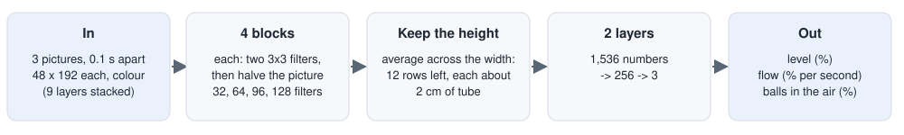

# Step 2 Approach: Pour Until the Receiver Is 50% Full

This page has the exact settings, and why each was chosen. The overview is in
[step-2-pour.md](../../docs/solutions/step-2-pour.md); how well it works is in [results.md](results.md).

---

## The whole pipeline

```
 STARTS (pour/start.py)          Step 1b on scenes 100-159, medium and large;
                                 the simulation saved where each ends (both tubes at the pouring point)
        │
 PROGRAMMED POUR (pour/pour.py)  Arm B tips the source, watching the true ball count;
                                 the pour camera's picture saved every 0.1 s with the true answers
        │
 DATA (pour/data.py)             2 pours from every start, each to a different target and speed
        │
 LEVEL NETWORK (level/)          3 pictures in -> level, flow, balls in the air out
                                 custom CNN, ResNet-18 and a programmed rule, graded the same way
        │
 POUR WITH THE NETWORK           the same pour, reading the custom CNN instead of the true count
 (pour/closed_loop.py)           on the 17 test starts, against the true count
```

---

## 1. Starting points

Every pour starts from a **real Step 1b run**, so the tubes sit in the fingers the way a real pick leaves them.

| Setting | Value | Why |
|---|---|---|
| Scenes | seeds 100 to 159, asking for medium and for large | new scenes: Step 1b was tuned on 0 to 9 and graded on 10 to 29 |
| Saved | the whole simulation state when Arm B says "in place" | each pour can start there without running Step 1b again |
| Result | 118 of 120 reached the pouring point | the other 2: a finger would touch a neighbouring tube |

Step 1b often falls back from medium to large, so 35 of the 118 are medium.

---

## 2. The pour camera

A fixed camera 1.2 m from the pouring point, level with the receiver, with a 14.3 degree lens (about 0.6 mm per
pixel). Chosen by testing 576 places: [step-2-pour-camera.md](../../docs/solutions/step-2-pour-camera.md). Each
picture is cut down to a strip around the receiver, 96 x 384 pixels, from 3 cm above its rim to 21 cm below it.

---

## 3. The programmed pour

### How the source is tipped

Arm B holds the source from the side, so tipping it towards the receiver is a turn of its wrist. The pour is
planned for **the tube**, not the gripper: for a tilt and a lip position, the tube's pose follows, then the
gripper's pose (from where the tube sits in the fingers), then Arm B's joints (by inverse kinematics: working
back from where the gripper must be to the joint angles).

| Setting | Value | Why |
|---|---|---|
| Lip position | 15 mm from the receiver's **rim** centre towards the source, 20 mm above the rim | from the bench tests: 15 mm spills about 1%; lower, the two grippers collide |
| Aim at | the rim, not the base | the receiver leans a few degrees in Arm A's fingers; aimed at the base, the lip was 5.4 mm to the side and 15 of 90 balls missed |
| Where the tube sits in the fingers | measured every 10 ms, 10% of each change taken in | a full large tube turns up to 19 degrees in the fingers; without this, 106 of 146 balls missed. Taking only 10% at a time stops the arm chasing the balls' shaking |

### The steps

| Step | What Arm B does | Setting |
|---|---|---|
| Move in | up and over while tipping to 78 degrees, then straight down to the lip position | 78 degrees: no balls leave yet (they start at 81 to 88). The path is checked for collisions before moving |
| Find the flow | tip on until the first ball lands | 2 degrees per second |
| Pour | tip on slowly | 0.7 degrees per second |
| Stop early | tip back when count + flow x 0.6 s reaches the target | the balls already falling still land. Flow measured over the last 0.5 s |
| Tip back | to 70 degrees | 40 degrees per second |
| Settle | wait, count again | 1 s |
| Top up | if short by more than 2 points: tip back to 2 degrees before where it stopped, and pour again | at most 3 times |

It stops with a reason if Arm B cannot reach a pose, if the move-in path would touch Arm A, or after 90 s.

### What it measures

Every ball is tracked by the simulator. The pour counts the balls **in the receiver, in the source, in the air,
and spilled** (fallen below 12 cm), and only those that started in the source. The level (%) comes from the
count, with the same table that filled the tubes ([`liquid.ball_count`](../../simulation-environment/lab_scene/liquid.py)).

---

## 4. Training data

| Setting | Value | Why |
|---|---|---|
| Pours per start | 2 | twice the pictures from the same Step 1b runs |
| Target | drawn between 35 and 65% | pictures at every level up to 65%, not only around 50% |
| Finding and pouring speed | drawn: 1.5 to 3, and 0.5 to 1.2 degrees per second | different flows |
| Picture every | 0.1 s | |
| Saved with each picture | time, balls in the receiver / source / air / spilled, level, tilt, phase, lip position | |
| Split | train seeds 100 to 139, validation 140 to 149, test 150 to 159 | no scene in two sets |

---

## 5. The level network

### Input and output

| | |
|---|---|
| In | **3 pictures, 0.1 s apart** (the newest last), each the 96 x 384 strip shrunk by half to 48 x 192: 1.25 mm per pixel, still 3 pixels for 2 points |
| Out | **level** (%), **flow** (how fast the level rose over the last 0.3 s, % per second), **balls in the air** (in the same % as the level) |

Why three pictures: one picture shows the level; the change between them shows the flow, and the falling balls
show what is still to come.

### The custom CNN



A **convolution** slides small 3 x 3 filters over the picture to find patterns (edges, balls). After each block
the picture is halved, so later filters see bigger areas. At the end the network averages **across the width
only**: the height in the picture is the level, so it must still know which row is which. 0.86 million weights.

### ResNet-18

A well-known 18-layer network, **pretrained** on ImageNet (1.2 million photos of everyday things). Three changes:

- its first layer takes one colour picture; here it takes three, so those weights are copied to each and divided
  by three;
- its last stage does not halve the picture, so it ends at the same 12 rows as the custom CNN;
- the same ending: average across the width, then two layers.

12.8 million weights.

### Training (the same for both)

| Setting | Value | Why |
|---|---|---|
| Time | **15 minutes** on the Mac's GPU: 19 epochs (custom), 16 (ResNet-18) | the project's training budget; the same time for both |
| Choosing pictures | every 5-point band of level equally often | half the pictures show an empty receiver (every pour before its first ball lands) |
| Changes to pictures | a little light and contrast change, a shift sideways of up to 3 pixels | never up or down: the height is the level |
| Loss | smooth L1 (like the average error, gentler on big misses), each output divided by its usual size (10, 5, 2) | so the three outputs count about equally |
| Optimiser | AdamW, weight decay 0.0001, batch 64, learning rate lowered smoothly to zero | |
| Learning rate | 0.001 (custom), **0.0003** (ResNet-18) | a pretrained network is usually trained more gently, so it keeps what it learned |
| Kept | the epoch with the smallest **validation** level error, 20 to 65% full | test pictures used once, at the end |

### The programmed rule

1. A pixel is a ball if blue is more than 22 above red (empty glass: at most about 15).
2. A row of the tube's middle is **full** if 30% of it is ball. Only rows below Arm A's fingers count.
3. From the bottom of the tube up, follow the full rows (gaps of 3 rows allowed). Where they stop is the top of
   the liquid. Nothing counts unless it starts at the tube's bottom.
4. Turn that row into a level with a straight line, one per tube size, fitted on the training pictures.
5. Flow: the change in level over the 0.2 s of the three pictures. It cannot tell the balls in the air.

Steps 2 and 3 have their limits because the first version was fooled: it read the source's balls above the rim
as a full tube (100% in every test pour), and single falling balls as a level. Both were fixed before grading.

---

## 6. Grading

All three methods on the **7,696 test pictures**, by the same script:

| Measure | Why |
|---|---|
| Level error, 20 to 65% full | where the stop and top-up decisions are made |
| Within 2 points | the size of the target window |
| Settled / while pouring | the settled reading decides the top-up; the moving one, when to tip back |
| Flow error, while the level rises over 2% per second | the stop decision uses it |
| Error in the balls in the air | the network's estimate of what is still to land |

---

## 7. Pouring with the network

The pour of section 3, unchanged, except where it reads the receiver (`level/reader.py`, `pour.run(reader=...)`):

| Setting | Value | Why |
|---|---|---|
| Network | the custom CNN (`runs/custom/best.pt`) | as good as ResNet-18 on the test pictures, 15 times smaller |
| Pictures | every 0.1 s, the 96 x 384 strip of the receiver, shrunk to 48 x 192; the newest and the two before it | exactly as in training (the first repeated until there are three) |
| Readings into balls | level (%) through the receiver's own count table; flow and balls in the air divided by the % per ball | the pour decides in balls, as with the true count; only the receiver's size is needed (Step 0.1) |
| First balls landed | the reading reaches **2%** | it reads an empty receiver as about 0.8% (at most 1.5% in 99 of 100 test pictures); at 2% it was early in 8 of 40 test pours and late in none (median delay 0 s) |
| Tip back when | reading + flow x 0.6 s reaches the mark | the programmed pour's rule. The other rule tried, reading + balls in the air, overshoots ([results.md](results.md)) |
| Settled reading | the average of the last 5 readings (0.5 s) | decides the top-up |
| Starts | the test scenes, seeds 150 to 159 (17 different starts) | never used to train or choose the network |

---

## Running it

From `step-2-pour/`:

```
make starts        # Step 1b on 60 scenes x 2 sizes (about 1 hour)
make data          # 2 pours from each start (about 20 minutes)
make level-data    # shrink and cache the pictures (under a minute)
make rule          # fit the rule
make train         # custom CNN (15 minutes)
make train-resnet  # ResNet-18 (15 minutes)
make evaluate      # grade all three on the test pictures
make pour START=data/starts/seed150_size200.npy TARGET=50   # one pour
make closed-loop   # pour to 50% on the test starts: true count, CNN, CNN "in the air" (about 12 minutes)
```

| File | What it does |
|---|---|
| `pour/start.py` | runs Step 1b and saves where it ends |
| `pour/tilt.py` | the tube's pose for a tilt and lip position, and Arm B's joints for it |
| `pour/pour.py` | the programmed pour, and the pictures with their labels |
| `pour/data.py` | the training pours |
| `pour/summary.py`, `pour/figures.py` | what is in the data; pictures of a pour |
| `level/data.py` | the pictures and labels for training |
| `level/net.py` | the custom CNN and ResNet-18 |
| `level/train.py`, `level/evaluate.py` | training, and grading on the test pictures |
| `level/rule.py` | the programmed rule |
| `level/reader.py` | the custom CNN as the pour's eyes: pictures in, level, flow and balls in the air out |
| `pour/closed_loop.py` | the pour with the network reading, against the true count |
| `camera_study/` | the camera study ([step-2-pour-camera.md](../../docs/solutions/step-2-pour-camera.md)) |
