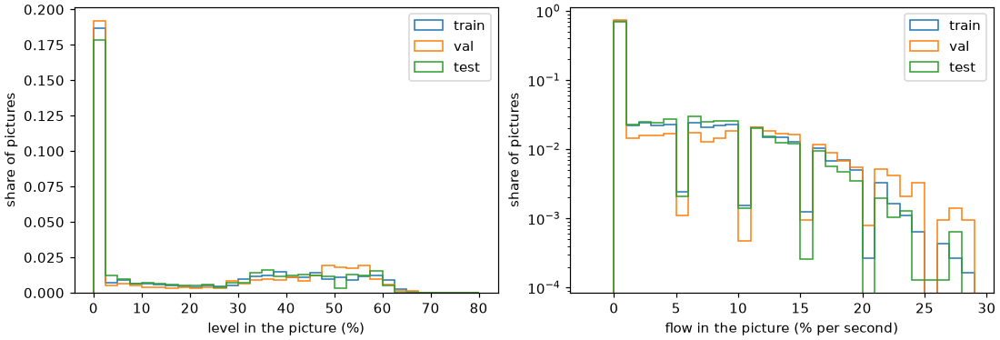
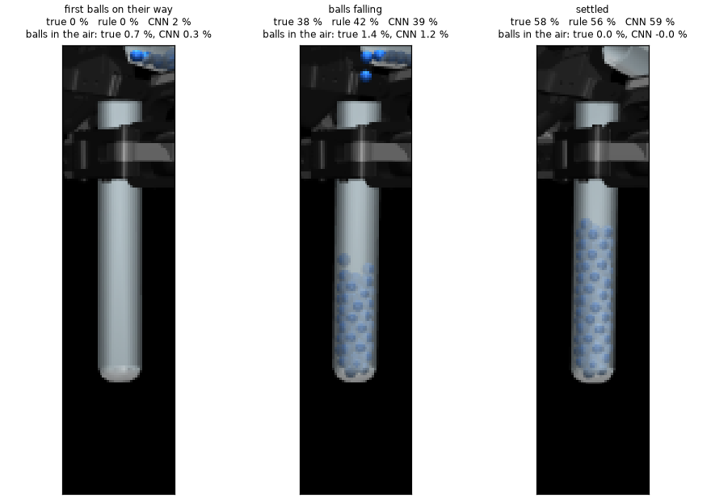
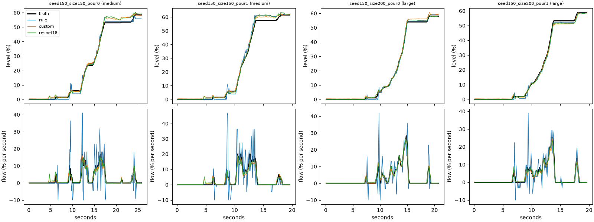
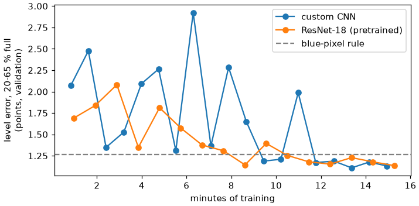

# Step 2 Results: Pour Until the Receiver Is 50% Full

How it works is in [approach.md](approach.md). This page is only about how well it works, in two parts: the
programmed pour that made the training data, and the level network trained on it.

---

## What the words mean

| Word | Meaning |
|---|---|
| **Within 2 points** | the reading (or the final level) is no more than 2 points from the truth (or the target): the size of the 48 to 52% window |
| **Settled** | after tipping back, when nothing is falling: the reading that decides a top-up |
| **While pouring** | balls are falling: the reading that decides when to tip back |
| **Top-up** | a second short pour when the first one stopped too early |

---

## 1. The programmed pour

**236 pours** from 118 Step 1b runs (scenes 100 to 159), each to a target between 35 and 65%. It reads the true
ball count, like a perfect scale.

| | |
|---|---|
| Ended within 2 points of the target | **227 of 236** (medium 66 of 70, large 161 of 166) |
| Final count against the target | median 1 ball short; from 4 short to 5 over |
| Balls spilled | **nothing in 217 pours**; 48 balls in all, 21 of them in one pour that stopped early |
| Top-ups | none in 51 pours, one in 178, two in 7 |
| First flow | at 81 to 89 degrees (median 87), as the bench tests found |
| Time | median 19 s from the start of the move to settled; about 40 s on the computer |

### The 9 that missed

| What happened | Pours |
|---|---|
| Overshot after a top-up, by 4 or 5 balls (1 more than the window) | 6 |
| Never moved: Arm B's fingers would touch Arm A's on the way in (scene 149, medium, both pours) | 2 |
| Stopped part way: Arm B could not reach 90 degrees of tilt (scene 107, large); 21 balls spilled | 1 |

The overshoots come from the top-up: it restarts close to where the flow was strong, and the stop rule's 0.6 s
of balls still falling is tuned for the first pour, not for a short top-up. None of the 9 is a problem for the
pictures: they are still right, only the target was missed.

### Two fixes found while building it

| | Before | After |
|---|---|---|
| **Aim at the receiver's rim**, not its base (medium, scene 102) | lip 5.4 mm to the side, 15 of 90 balls spilled | lip 0.6 mm, **0 spilled** |
| **Follow the tube in the fingers** (large, scene 100) | tube 7 to 11 degrees behind the gripper, lip 14 mm to the side, 106 of 146 spilled | lip within 0.1 mm, **0 spilled** |

---

## 2. The data

*Left: half of the pictures show an empty or almost empty receiver (every pour before its first ball lands); the
rest go up to 65%, most between 30 and 60%. Right: about a quarter show a flow above 2% per second.*

| | Train | Validation | Test |
|---|---|---|---|
| Pours (medium / large) | 160 (44 / 116) | 34 (10 / 24) | 40 (14 / 26) |
| Pictures | 30,014 | 6,288 | 7,696 |

Training draws every 5-point band of level equally often, so the empty pictures do not crowd out the rest. Only
30% of the pours are medium: Step 1b often falls back to the large pair.

---

## 3. The level network

All three methods on the same **7,696 test pictures** (scenes 150 to 159), never seen in training.

| | Rule | **Custom CNN** | ResNet-18 |
|---|---|---|---|
| Level error, 20 to 65% full | 1.17 points | **1.06** | **1.06** |
| Within 2 points | 83.1% | 86.0% | **87.7%** |
| Worst | 29 points | **4.1** | 4.9 |
| Medium tubes | 1.43 | **1.23** | 1.35 |
| Large tubes | 1.01 | 0.95 | **0.89** |
| Settled | 1.29 | **1.15** | 1.22 |
| While pouring | 1.12 | 1.02 | **1.00** |
| Empty receiver | **0.0** | 0.8 | 0.3 |
| Flow error (% per second) | 6.4 | **1.10** | 1.13 |
| Balls in the air, error | cannot tell | 0.08 | **0.075** |
| Weights | none | **0.86 million** | 12.8 million |
| Time per picture (Mac GPU) | | **0.43 ms** | 0.57 ms |

*Three moments of one test pour: the first balls on their way, balls falling, settled. Each picture is the
newest of the three the networks see.*

*Four test pours (two medium, two large). Top: the level; all three follow the truth (black). Bottom: the flow;
the rule's (blue) jumps, the networks' follow the truth.*

### What it shows

- **On the level alone, all three are close**: about 1 point, about the size of one or two balls. The rule is a
  strong baseline here, because the simulated pictures are clean.
- **The networks are much better where the stop is decided.** Their flow is about 6 times more accurate, they
  estimate the balls still falling (which the rule cannot), and their worst reading is 4 to 5 points against
  the rule's 29.
- **Pretraining did not help.** ResNet-18 ties the custom CNN on level and flow. It is better on large tubes and
  the empty receiver; the custom CNN is better on medium tubes and on the settled reading. With simple, clean
  pictures, a small network trained from scratch learns as much in the same 15 minutes.
- **We keep the custom CNN**: as accurate, 15 times smaller, faster, and better on the settled reading.

### Training

*Both networks swung from epoch to epoch at first, the custom CNN between 1.1 and 2.9 points, and settled as the
learning rate came down. The kept weights are the best on validation: epoch 17 (custom) and 16 (ResNet-18).*

### The rule was fixed before grading

The first version of the rule read the whole picture. It was fooled twice: by the source's own balls above the
rim (it read **100% in every test pour** while the source swung in), and by single balls falling through the
empty tube. Limited to the tube below Arm A's fingers, and starting from the tube's bottom, it makes neither
mistake, and its flow error fell from 29 to 6.4. Its level error barely changed.

---

## 4. The pour with the network reading

The same pour, with the custom CNN reading the receiver instead of the true count (`pour/closed_loop.py`,
`level/reader.py`). Every 0.1 s the pour camera's picture goes to the network with the two before it; its level,
flow and balls in the air are turned into balls with the receiver's own table, and the pour works on those
exactly as it does on the true count.

| Setting | Value | Why |
|---|---|---|
| Starts | the saved Step 1b runs of the **test scenes** (seeds 150 to 159): 20 files, **17 different** (in scenes 155, 157 and 159 Step 1b fell back to the large pair both times, so the medium and large files are the same run) | never used to train the network or choose it; Step 1b's scenes 10 to 29 would first need about an hour of new Step 1b runs |
| Target | 50% | |
| First balls landed | when the network reads 2% | it reads an empty receiver as about 0.8% (at most 1.5% in 99 of 100 test pictures); at 2% it notices the first balls with no delay in the median test pour |
| Settled reading (for the top-up) | the network's last 5 readings (0.5 s) averaged | |

Three ways on the same 17 starts, each graded by the true count:

| | True count (programmed pour) | **CNN, flow rule** | CNN, "in the air" rule |
|---|---|---|---|
| Tip back when | count + flow x 0.6 s reaches the mark | the same, with the CNN's reading | reading + the CNN's balls in the air reaches the mark |
| **Within 48 to 52%** | **17 of 17** | **12 of 17** | 4 of 17 |
| medium / large | 7 of 7 / 10 of 10 | 4 of 7 / 8 of 10 | 4 of 7 / 0 of 10 |
| Error, mean / worst (points) | 0.9 / 2.0 | 1.4 / 3.5 | 3.3 / 6.0 |
| Over 50% | 4 of 17 | 5 of 17 | 15 of 17 |
| Balls spilled | 0 | 2 | 2 |
| Top-ups | 11 | 13 | 0 |

- **The CNN pours, but less exactly than a perfect scale.** It ends within the window 12 times in 17. The 5
  misses are all 0.5 to 1.5 points outside, on both sides (46.5 to 53.5%).
- **The cause is the final reading, not the stopping.** At the end the CNN's settled reading was off by 1.1
  points on average (up to 2.4), as much high as low. Its top-up then aims at the wrong level: in scene 152 it read
  49.5% for a true 47.5%, and so did not top up again.
- **The "in the air" rule overshoots** (15 of 17 above 50%): it counts the balls already falling, but not those
  that still leave while the source tips back (the flow rule's 0.6 s covers both). The flow rule is kept.
- **Medium tubes are harder** (4 of 7), as the network's own test showed: they are read less well.

A whole run, from Step 1b's end to both tubes back in racks, used this pour on 6 of these scenes:
[step-3-put-back results](../../step-3-put-back/docs/results.md).

---

## Open problems

- **The pour misses the window 5 times in 17 with the CNN** (a perfect scale: never). The final reading is off by
  about 1 point on average and up to 2.4, more for medium tubes. Possible next steps: more medium pours in the
  training data; a longer settle, with more readings averaged, before deciding on a top-up; stopping a little
  short and topping up in smaller steps.
- **With medium tubes the two grippers touch** at the end of the pour (less than 0.1 mm deep; found in Step 3).
  The checks cover the way in, not the tipping.
- **Medium tubes read 0.6 points high** on average (large: 0.2). Medium is only 30% of the data.
- **The top-up overshoots** 6 times in 236. A shorter wait for the top-up's falling balls would likely fix it.
- **Simulator truth in two places**: the receiver's rim and the tube's place in Arm B's fingers.
- **Small tubes** are not covered.
