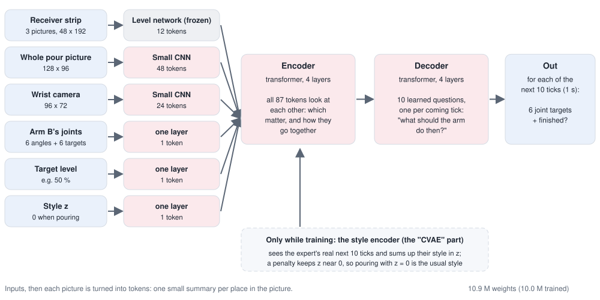
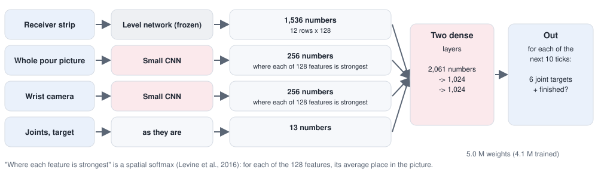

# Step 2b Approach: A Learned Pour (ACT)

This page has the exact settings, and why each was chosen. The overview is in
[step-2b-pour-act.md](../../docs/solutions/step-2b-pour-act.md); how well it works is in
[results.md](results.md).

Step 2's code is only **read** from here, never changed: the saved starts, the programmed pour's steps and
settings, the pour camera, and the trained level network all come from
[`step-2-pour/`](../../step-2-pour/).

---

## The whole pipeline

```
 STARTS (Step 2's)            118 Step 1b runs, saved where both tubes reach the pouring point
        │
 DEMONSTRATIONS (demos/)      Step 2's programmed pour, recorded every 0.1 s: pictures, joints, and the
                              joint targets the expert means; half of them nudged (DART)
        │
 EXAMPLES (act/data.py)       one tick -> what is seen, and the next 1 s of joint targets to copy
        │
 TWO POLICIES (act/model.py)  ACT, and a CNN + MLP; the same eyes, the same data, 30 minutes each
        │
 OFFLINE GRADING (act/analyse.py)   every validation and test tick: what would it command?
        │
 CLOSED LOOP (act/rollout.py, act/evaluate.py)   the policy drives Arm B; built, not yet run
```

| Word | What it means |
|---|---|
| **Tick** | 0.1 s, the policy's rhythm. Step 2's arm updates are every 0.01 s; the policy decides 10 times less often |
| **Joint target** | the angle Arm B's motor for one joint is told to reach. Six joints, so six targets |
| **Intent** | the joint targets the expert means at a tick, without the nudge: the action to copy |
| **Chunk** | the joint targets for the next 10 ticks, predicted at once |
| **Token** | one small summary (here 256 numbers) of one part of the input, such as one place in a picture |
| **Frozen** | kept exactly as trained before; not changed by this training |
| **Validation, test** | pours never trained on. Validation is used to choose the kept weights; test is only for reporting |

---

## 1. Starting points

The same **118 saved starts** as Step 2 (`step-2-pour/data/starts`): Step 1b run on scenes 100 to 159,
asking for the medium and for the large pair, saved when Arm B reports "in place". Every pour starts
from a real pick and carry, with the tubes sitting in the fingers the way Step 1b left them. One start
(scene 149, medium) never pours: Arm B's fingers would touch Arm A's on the way in, as in Step 2.

---

## 2. The eyes: what the policy sees

The same code makes the pictures when recording and when the policy pours (`demos/eyes.py`), so the policy
is always shown exactly what it was trained on.

| Input | Size | Why |
|---|---|---|
| **Receiver strip** | 48 x 192, colour; the newest and the two before (0.1 and 0.2 s earlier) | Step 2's crop of the pour camera, shrunk by half: 1.25 mm per pixel, the level network's own input. It reaches 30 mm above the rim, so it also shows the lip and the falling balls. Three pictures show movement: the level rising, balls falling |
| **Whole pour picture** | 128 x 96 | the pour camera's whole 640 x 480 picture, shrunk 5 times (about 3 mm per pixel): both tubes, both grippers, the tilt |
| **Wrist camera, Arm B** | 96 x 72 | drawn at twice the size and averaged, so thin edges do not flicker. It shows the source lying in the fingers: how the tube sits there, which the programmed pour measured from the simulator |
| **Arm B's joints** | 12 numbers | its six joint angles now, and the six targets it is being given now |
| **Target level** | 1 number | (target - 50) / 10: the policy must stop at the level it is asked for |

**Which cameras.** The front and overhead cameras were looked at first. Mid-pour, the front camera sees the
pouring point small and far away, and the overhead camera is blocked by the arms. The pour camera sees
everything that matters, and the wrist camera adds a second side, so the policy is not judging depth from
one view only. One main camera plus a wrist camera is also what ACT was designed with.

**Where the strip is cut from** is found once, from the receiver's rim at the start (simulator truth), as
in Step 2.

---

## 3. The demonstrations

### The expert

Step 2's programmed pour (`step-2-pour/pour/pour.py`), reading the true ball count. Its steps and every
setting are imported from there, so the two stay the same:

| Step | What Arm B does |
|---|---|
| Move in | up and over while tipping to 78 degrees (no flow yet), then down to the lip position: 15 mm out from the receiver's rim centre, 20 mm above it |
| Find the flow | tip on at 2 degrees a second until the first ball lands |
| Pour | tip on at 0.7 degrees a second |
| Stop early | tip back when count + flow x 0.6 s reaches the target |
| Tip back | to 70 degrees, at 40 degrees a second |
| Settle | wait 1 s, count |
| Top up | if short by more than the window: tip back to 2 degrees below where it stopped, and pour again (at most 3 times) |
| Finished | **held still for 1 s** (Step 2: 0.5 s), so the policy sees what "finished" looks like |

`demos/record.py` runs these steps itself, with Step 2's pieces (the tilt planner, the move-in path, the
ball counter), because it must save more than Step 2 does. Recorded without a nudge, it pours exactly as
Step 2's pour: on scene 150, large, both ended at 48.5 % with one top-up.

### What is saved, every tick (0.1 s)

| Saved | For |
|---|---|
| strip, whole picture, wrist picture | what the policy sees |
| Arm B's joint angles, and the targets it is being given | what the policy sees |
| **intent**: the joint targets the expert means, without the nudge | what the policy must do |
| balls in the receiver / source / air / spilled, level, tilt, phase, lip position | grading and the docs only |

### The nudge (DART)

A policy that copies makes small mistakes, which take the arm where the expert never went; there it has no
example, and the mistakes grow ("compounding errors"). Two standard remedies:

- **DAgger**: let the policy pour, ask the expert what it should have done, train on that, repeat;
- **DART** (Laskey et al., 2017): add small mistakes **while recording**, and save what the expert meant to
  do without them. The examples then show how to get back on course. It needs no extra rounds.

DART is used here. The nudge is a slowly wandering error (an Ornstein-Uhlenbeck process: each 0.01 s it
drifts back towards zero and takes a small random step):

| Setting | Value | Why |
|---|---|---|
| Tilt | about 0.5 degrees (one standard deviation) | small next to the pour's 81 to 88 degree flow range, big enough to change the flow |
| Lip | about 1 mm, towards or away from the receiver and sideways. **Never up or down** | 4 mm sideways spills about 5 % (Step 2), so 1 mm keeps pours clean |
| Memory | 0.5 s | slow, like an arm's real drift, not a jitter |
| When | once the lip is in place | moving in is not nudged |
| Out of reach | if a nudged pose cannot be reached, that step goes un-nudged and the nudge restarts from zero | so that a nudge alone does not stop a pour |
| Stuck | Arm B more than 0.3 rad from its targets for 1 s: the pour is stopped and left out | a clean pour lags by up to 0.4 rad when tipping back fast, but only for a moment |

Every start is poured twice: once as programmed, once nudged. Each pour gets its own target, drawn evenly
between 40 and 60 %, so the policy learns to stop at the level it is told rather than always at 50 %.

**The first nudge was too strong.** It was 0.75 degrees and 1.5 mm in every direction, up and down too.
With the lip pushed down, Arm B's gripper met Arm A's (about 20 mm apart at this tilt), the arm jammed,
and Step 2's in-finger correction chased the jammed tube. 20 of 118 pours stopped; of the 98 that
finished, only 76 ended in the window, 43 spilled (663 balls in all), and in some the joints were 2.8 rad
from their targets. All 118 were thrown away and recorded again with the settings above. Of those, 7
stopped part way (Arm B could not reach its next pose) and one more was removed by hand: scene 134,
medium, jammed briefly while settling (under the 1 s limit) and spilled 60 balls.

### The data

| | Train | Validation | Test |
|---|---|---|---|
| Scenes (seeds) | 100 to 139 | 140 to 149 | 150 to 159 |
| Pours: as programmed + nudged | 80 + 78 | 17 + 16 | 20 + 16 |
| Of them medium tubes | 43 | 10 | 14 |
| Ticks | 32,447 | 6,532 | 7,198 |

Split by scene, as in Step 2 (the same seeds), so no scene is in two sets and the level network never saw
a validation or test scene either. 798 MB on disk.

Recording: about 40 s of computer time per pour, 4 at a time (one finished every 12 s or so); 49 minutes
for the first 236, then 21 minutes for the 118 nudged pours again.

---

## 4. Examples

`act/data.py` turns every tick of every pour into one example:

| | |
|---|---|
| **Seen** | the strip now and 0.1 and 0.2 s before (the first picture repeated at a pour's start), the whole picture and the wrist picture now, the 12 joint numbers, the target |
| **To copy** | the expert's intent for the next 10 ticks, **each as a change from the targets being given now**. Past the end of a pour, the last one is repeated: hold still |
| **Finished** | for each of the 10 ticks: has the expert finished by then? |
| **The level network's numbers** | the true level, flow and balls in the air now (used only if the strip's eye is trained, below) |

**Why changes, not angles.** The arm's joint angles differ from pour to pour by far more than one tick's
movement. As changes from now, the numbers to predict are small and alike across pours, and an error is
an error in the movement itself.

**Scaling.** Every input number and every action is scaled by its mean and spread over the training
examples, separately for each joint and each of the 10 ticks ahead. Moving in, the joints move fast; while
pouring, a hundred times slower. Without scaling, the slow moves would count for almost nothing.

**Changes to the pictures** while training, so the policy does not lean on exact pixel values: light up to
5 % and contrast up to 10 % either way, and a shift of up to 3 pixels. The strip is shifted only sideways,
never up or down: the camera does not move, and the height in the strip is the level.

Failed pours (stopped part way) are left out.

---

## 5. The two policies

### The eyes, shared

| Picture | Network | Out |
|---|---|---|
| Receiver strip | **Step 2's custom level network, frozen** (`step-2-pour/runs/custom`): four blocks of convolutions, then averaged across the tube's width | 12 rows x 128 numbers (each row about 2 cm of tube), and its own three numbers: level, flow, balls in the air |
| Whole picture | small CNN, trained from nothing: a 5 x 5 convolution that halves the picture, then three of the level network's blocks (two 3 x 3 convolutions, then halve) | 6 x 8 places x 128 numbers |
| Wrist picture | another of the same | 4 x 6 places x 128 numbers |

**Why the level network is frozen.** It was trained on exactly these strips, and it is the part that has
been tested (Step 2: about 1 point of error). Kept as it is, the policy reads the receiver the way the
tested network does, and training is faster. The first version trained it along, kept all 36 of its
places (12 rows x 3 across) as tokens, and had no halving first layer in the small CNNs: one ACT step took
about 700 ms. With the level network frozen, 12 row tokens and the halving first layer, about 390 ms
(both measured while the recording used the processor). `--tune-strip` trains it along again, at a tenth
of the learning rate. Only the CNNs that are new learn from nothing.

### ACT



ACT (Action Chunking with Transformers; Zhao et al., 2023) was made for robot arms learning fine,
two-handed tasks from about 50 demonstrations each. Here:

| Setting | Value | Why |
|---|---|---|
| Tokens | 87: 12 strip rows, 48 whole-picture places, 24 wrist places, joints, target, style z | every place in every picture becomes a token, as in ACT |
| Where each token comes from | a learned position value added to each | so it knows which picture and which place |
| Width | 256 numbers per token, 8 attention heads | ACT uses 512; halved to fit the training time |
| Encoder | 4 transformer layers (each: attention, then two dense layers of 1,024) | as ACT |
| Decoder | 4 layers, 10 learned queries (one per tick ahead) | ACT uses 7; 4 to fit the time |
| Out | per tick ahead: 6 joint-target changes and "finished" | |
| Style encoder (CVAE) | 2 layers; sees the joints and the expert's next 10 ticks, gives z (32 numbers) | ACT's way to keep varied examples from being averaged into a blur. When pouring, z = 0 |
| KL weight | 10 | as ACT: keeps z close to zero, so that z = 0 is the usual style |
| Dropout | 0.1 | |
| Weights | 10.9 million, 10.0 million trained | |

**What a transformer adds.** Each token can "attend" to every other: the token for the receiver's level row
can be combined with the tokens for the lip and the target. The decoder's 10 queries each gather what they
need for their own tick. This is why ACT can plan a whole second consistently.

### CNN + MLP



The standard simple baseline for learning from demonstrations ("behaviour cloning", as in the robomimic
benchmark). The pictures are boiled down to lists of numbers and joined:

| Part | Value |
|---|---|
| Strip | the 12 rows x 128 numbers, flattened: 1,536 |
| Whole picture, wrist | **spatial softmax** (Levine et al., 2016): for each of the 128 features, its average place in the picture (x, y), weighted by how strongly it shows: 256 numbers each |
| Then | joined with the joints and target (2,061 numbers), two dense layers of 1,024, dropout 0.1 |
| Out | all 10 ticks at once: 10 x (6 changes + "finished") |
| Weights | 5.0 million, 4.1 million trained |

---

## 6. Training (the same for both)

| Setting | Value | Why |
|---|---|---|
| Time | **30 minutes** on the Mac's GPU | longer than Step 2's 15, as ACT is the larger model; the same for both, as in Step 2's comparison |
| Steps in that time | ACT 6,892 (about 260 ms each), CNN + MLP 13,474 (about 130 ms) | 14 and 27 passes over the training ticks |
| Batch | 64 ticks, drawn at random from all training ticks | |
| Loss | L1 on the scaled actions (all 10 ticks), plus 0.1 x "finished" (binary cross-entropy), plus ACT's KL x 10 | L1, as ACT: the average error, less pulled by rare big ones |
| Optimiser | AdamW, learning rate 0.0003, weight decay 0.0001; gradients clipped at 1 | |
| Learning rate | warmed up over the first 300 steps, then lowered smoothly to zero as the 30 minutes run out | by the clock, so it ends on time whatever the speed |
| Scored | every 500 steps, on 3,000 fixed validation ticks | |
| Kept | the weights with the smallest validation action error | the test pours are used once, at the end |

---

## 7. Offline grading

`act/analyse.py` shows each policy every tick of the validation and test pours, as recorded, and compares
what it would command with what the expert commanded. Nothing moves, so mistakes cannot build up. It is a
test of **copying**, not of **pouring**.

| Measure | Why |
|---|---|
| Next tick's error (degrees, mean over the 6 joints) | the targets actually sent to the arm |
| Worst joint, next tick | one badly wrong joint can matter more than a small error in all six |
| Whole second's error | how well the chunk plans ahead |
| "Finished" right, especially once the expert has finished | "never finished" is right on 94 % of ticks, because finished ticks are few |
| By phase (move in, find flow, pour, tip back, settle, top up, done), and as programmed against nudged | where the errors are |
| **Hold still**, the same way | the simplest guess (keep every joint where it is told now, never say finished), so the numbers have something to compare with |

The pictures replay one validation pour: for each tick, the tilt that each policy's joint targets aim for,
worked out from the joints with the tube where Step 1b left it in the fingers. That is not the tube's true
tilt (the tube turns a little while pouring), but it is the same measure for the expert and the policies,
and easier to read than six joint angles.

---

## 8. The closed loop (built, not yet run)

`act/rollout.py` lets a policy pour on its own from a saved start:

| Setting | Value | Why |
|---|---|---|
| Every tick | look, ask the policy, check, then slide Arm B's targets to the new ones over the next 0.1 s, updated every 0.01 s | smooth, like the expert's |
| Used from each chunk | the first tick only; asked again next tick | quick to react. `--ensemble m` uses ACT's "temporal ensembling" instead: the average of every prediction made for that tick, newest weighted most |
| Safety check | a move that would put Arm B or its tube into Arm A or the receiver (deeper than 0.5 mm) is refused, and Arm B holds; no joint may move more than 0.1 rad in one tick | as a real robot's protective stop. The expert moves up to about 0.08 rad a tick, moving in |
| Finished | "finished" said 3 ticks running | one tick could be a fluke |
| Time limit | 60 s | the expert takes about 21 s |
| Then | 1 s to settle, and the balls are counted | for grading only: the policy never sees the count |

It was checked end to end, with a policy trained for one minute on two pours: the loop runs, the safety
check refuses moves, and the policy takes about 37 ms to decide on the computer's processor. That run
was not a test of pouring and is not reported. `act/evaluate.py` grades every method the same way: from
the 20 test starts, to 50 %, by the same ball count.

---

## Running it

From `step-2b-pour-act/`:

```
make demos        # record the demonstrations (about 50 minutes, 4 workers)
make train        # ACT (30 minutes on the Mac's GPU)
make train-mlp    # CNN + MLP (30 minutes)
make analyse      # offline grading of both, and its pictures (about 2 minutes)
make figures      # the demonstrations' pictures, and the diagrams
make evaluate     # the closed loop: every method from the 20 test starts (about 25 minutes)
make pour START=../step-2-pour/data/starts/seed150_size200.npy POLICY=act TARGET=50   # one pour
```

| File | What it does |
|---|---|
| `demos/eyes.py` | the three pictures and the joints, the same when recording and pouring |
| `demos/record.py` | Step 2's programmed pour, recorded every tick, with the nudge |
| `demos/collect.py` | every start, twice, 4 at a time; split by scene |
| `demos/figures.py` | pictures of the demonstrations |
| `act/data.py` | the examples, scaling, and the changes to the pictures |
| `act/model.py` | the eyes, ACT and the CNN + MLP |
| `act/train.py` | training for a fixed time |
| `act/analyse.py` | offline grading and its pictures |
| `act/policy.py`, `act/rollout.py` | a trained policy driving Arm B, with the safety check |
| `act/evaluate.py`, `act/figures.py` | the closed-loop grading and its pictures |
| `act/diagrams.py` | the diagrams |
