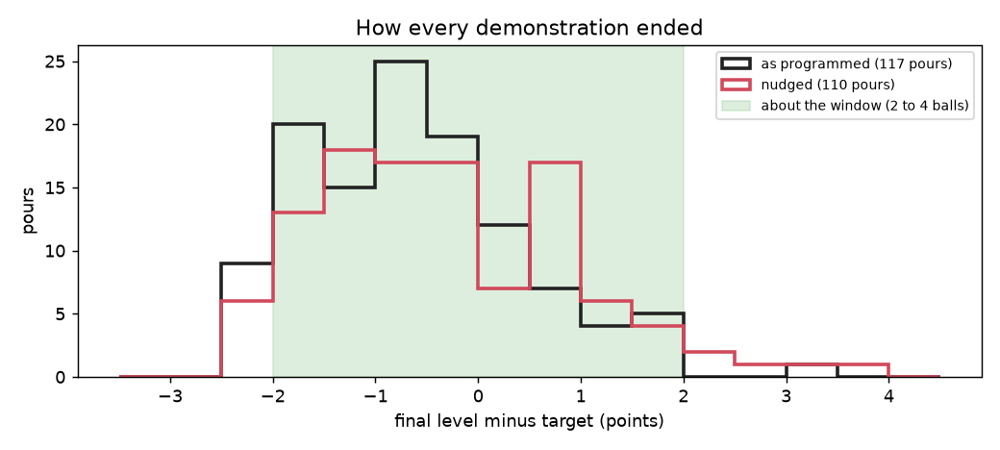
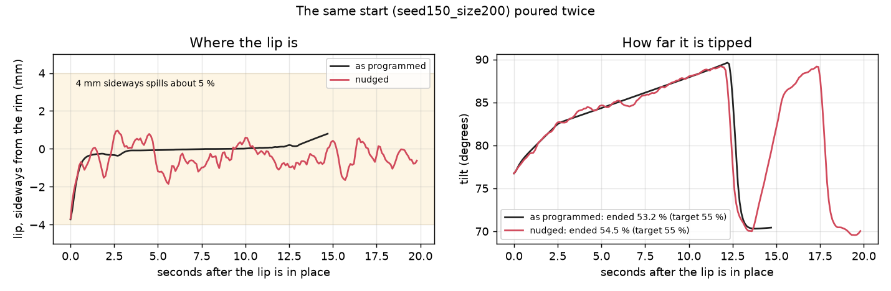
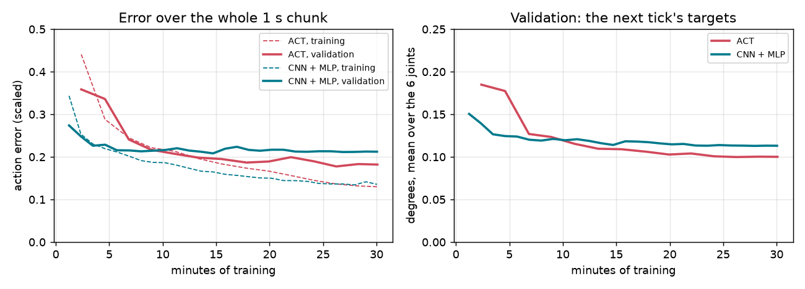
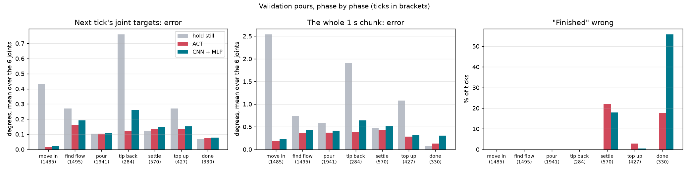
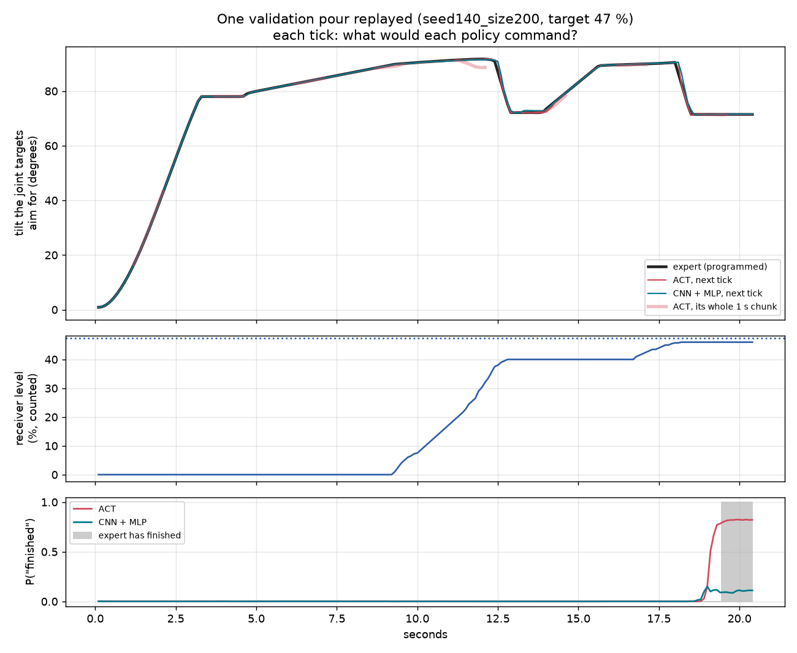

# Step 2b Results: A Learned Pour (ACT)

How it works is in [approach.md](approach.md). This page is only about how well it works, in three parts:
the demonstrations, the training, and how closely each policy copies the expert.

**Not on this page yet: the closed loop**, where the policy drives Arm B and pours on its own. It is built
but not run. Everything below is **offline**: the policy is shown recorded moments and asked what it would
do, but never moves the arm.

| Word | What it means |
|---|---|
| **Expert** | Step 2's programmed pour, reading the true ball count |
| **Window** | within 2 points of the target: 2 to 4 balls, depending on the tube |
| **Next tick's error** | how far the joint targets the policy would send next are from the expert's, in degrees, averaged over the 6 joints |
| **Whole second's error** | the same, over all 10 ticks of the chunk |
| **Hold still** | the simplest guess: keep every joint where it is told now, and never say finished |
| **Validation, test** | pours never trained on (scenes 140 to 149, and 150 to 159). Validation chose the kept weights; test is only reported |

---

## 1. The demonstrations

| | Pours kept | Ended in the window | Pours with any spill | Balls spilled | Top-ups | Time (median) |
|---|---|---|---|---|---|---|
| As programmed | 117 | **116** | 6 | 12 | 91 | 20.9 s |
| Nudged | 110 | **105** | 22 | 35 | 82 | 21.2 s |
| *First nudge (thrown away)* | *98 of 118* | *76* | *43* | *663* | | |

- **The expert pours well, nudged or not.** 116 of 117 as programmed, 105 of 110 nudged ended in the
  window. The nudged pours spill a little more (35 balls over 110 pours), from the lip wandering.
- **The first nudge broke the pours.** Pushing the lip up and down by 1.5 mm brought the two grippers
  together: 20 pours stopped, and the 98 that finished spilled 663 balls between them, with Arm B's joints
  as much as 2.8 rad from their targets (jammed). None of them were used.
- **Not kept, with the final nudge:** 7 pours stopped part way (Arm B could not reach its next pose), and
  one was removed by hand (jammed for under a second while settling; 60 balls spilled). Scene 149, medium,
  never pours, as in Step 2.

| | Train | Validation | Test |
|---|---|---|---|
| Pours (nudged) | 158 (78) | 33 (16) | 36 (16) |
| Medium tubes | 43 | 10 | 14 |
| Ticks | 32,447 | 6,532 | 7,198 |

---

## 2. Training

| | ACT | CNN + MLP |
|---|---|---|
| Weights (trained) | 10.9 M (10.0 M) | 5.0 M (4.1 M) |
| Steps in 30 minutes | 6,892 | 13,474 |
| **Best validation error** (whole second, scaled) | **0.178**, at step 6,000 (26 min) | 0.208, at step 6,500 (15 min) |
| Training error at the end | 0.130 | 0.135 |

Validation error (whole second, scaled), and the next tick's error, by minute:

| Minutes | about 2 | 7 | 11 | 15 | 20 | 24 | 30 |
|---|---|---|---|---|---|---|---|
| ACT | 0.359 / 0.185 deg | 0.241 / 0.127 | 0.207 / 0.115 | 0.195 / 0.109 | 0.189 / 0.103 | 0.189 / 0.101 | **0.182 / 0.100** |
| CNN + MLP | 0.274 / 0.150 | 0.229 / 0.124 | 0.220 / 0.121 | **0.208 / 0.114** | 0.216 / 0.117 | 0.213 / 0.114 | 0.212 / 0.113 |

- **The CNN + MLP learns fastest, then stops.** It leads for the first 10 minutes, is at its best after
  15, and after that only gets better on the training pours.
- **ACT keeps improving for the whole 30 minutes** and ends 15 % lower on the whole second.
- **Both learn the training pours better than new ones** (0.13 against 0.18 to 0.21). More pours would
  likely help more than more time.

---

## 3. How closely they copy

### Overall

| | Validation | | | Test | | |
|---|---|---|---|---|---|---|
| | **Hold still** | **ACT** | **CNN + MLP** | **Hold still** | **ACT** | **CNN + MLP** |
| Next tick (degrees) | 0.256 | **0.102** | 0.119 | 0.247 | **0.106** | 0.117 |
| Next tick, worst joint | 0.814 | **0.243** | 0.289 | 0.814 | **0.266** | 0.294 |
| Whole second | 1.120 | **0.312** | 0.380 | 1.062 | **0.327** | 0.367 |
| "Finished" right, all ticks | 94.4 % | **97.0 %** | 95.6 % | 94.5 % | **96.8 %** | 95.8 % |
| "Finished" right, once the expert has finished | 0 % | **82.4 %** | 44.2 % | 0 % | **72.2 %** | 48.6 % |

The test pours give the same picture as validation, so the kept weights were not just lucky on
validation.

### Phase by phase

Validation, next tick (degrees) / whole second (degrees):

| Phase | Ticks | Hold still | ACT | CNN + MLP |
|---|---|---|---|---|
| Move in | 1,485 | 0.431 / 2.54 | **0.015 / 0.18** | 0.022 / 0.23 |
| Find the flow | 1,495 | 0.269 / 0.74 | **0.164 / 0.35** | 0.191 / 0.42 |
| Pour | 1,941 | 0.105 / 0.58 | **0.105 / 0.37** | 0.108 / 0.41 |
| Tip back | 284 | 0.760 / 1.91 | **0.125 / 0.38** | 0.260 / 0.64 |
| Settle | 570 | **0.125** / 0.48 | 0.132 / **0.43** | 0.148 / 0.52 |
| Top up | 427 | 0.270 / 1.08 | **0.136 / 0.29** | 0.152 / 0.31 |
| Finished | 330 | **0.067 / 0.08** | 0.073 / 0.13 | 0.078 / 0.31 |

"Finished" right, validation: settle 78 % (ACT) and 82 % (CNN + MLP); top up 97 % and 99.5 %; after
finishing 82 % and 44 %; in every other phase 100 % for both.

### As programmed against nudged

Validation, next tick (degrees): hold still / ACT / CNN + MLP

| Phase | As programmed | Nudged |
|---|---|---|
| All | 0.221 / **0.064** / 0.083 | 0.294 / **0.142** / 0.158 |
| Move in | 0.431 / **0.015** / 0.022 | 0.432 / **0.015** / 0.022 |
| Find the flow | 0.224 / **0.110** / 0.137 | 0.319 / **0.224** / 0.249 |
| Pour | **0.049** / 0.057 / 0.061 | 0.160 / **0.152** / 0.155 |
| Tip back | 0.735 / **0.087** / 0.253 | 0.788 / **0.169** / 0.268 |
| Settle | **0.035** / 0.055 / 0.071 | 0.232 / **0.224** / 0.240 |

### One pour, replayed

*A large tube, target 47 %, with one top-up. Both policies' targets follow the expert's tilt through every
phase. ACT's whole-second predictions (pale red) bend down before the tip-back happens. ACT says
"finished" (0.8) when the expert finishes; the CNN + MLP stays near 0.1.*

---

## What it shows

- **Both policies have learned the pour's movement.** Moving in, both are within 0.02 degrees a tick of the
  expert (holding still: 0.43). Over a whole second they are about 3 times closer to the expert than
  holding still (ACT 0.31 degrees, CNN + MLP 0.38, holding still 1.12).
- **ACT is the better copy, most of all where the pour is decided.** Tipping back, its error is half the
  CNN + MLP's (0.13 against 0.26 degrees). It says "finished" on 82 % of the ticks after the expert
  finishes; the CNN + MLP on 44 %, so driving the arm it would likely never stop.
- **While pouring slowly, the next tick is hard to beat.** The expert moves the tilt only 0.07 degrees a
  tick, and holding still is already about as close as either policy. ACT does better over the whole
  second (0.37 against 0.58), so it does know where the pour is heading.
- **Neither has learned to undo the nudge.** On the nudged pours, while pouring and settling, both are no
  better than holding still (0.15 against 0.16; 0.22 against 0.23). A nudge of 1 mm or half a degree is
  hard to see in pictures at 1.25 to 3 mm per pixel. So the nudge did not yet do its job, and the policies
  may not recover from their own small mistakes.
- **Settling is ambiguous by nature.** After tipping back, the expert waits exactly 1 s, then tops up or
  finishes. Nothing in one picture says how long it has waited, so "finished" is wrong on about a fifth of
  the settle ticks for both.

## Open problems

- **The closed loop is the real test.** These numbers grade one tick at a time. Pouring on its own, small
  errors build up, and the window is only 3 balls on a medium tube. `make evaluate` runs it from the 20
  test starts against the programmed pour (true count, and level network).
- **Recovering from mistakes.** The nudge was not learned. Options: a larger nudge that cannot jam (only
  sideways and in the tilt), or DAgger: let the policy pour, ask the expert what it should have done, and
  train on that. The expert can answer for any moment, because it is a program.
- **No memory of time.** The policy cannot tell how long it has waited while settling, or at which tilt the
  flow started (a top-up restarts just below it). Giving it a few past joint positions, or the time since
  it tipped back, would remove that guess.
- **More data.** Both learn the training pours better than new ones. 158 pours from 40 scenes is few for
  a 10 million weight model.
