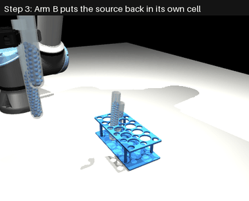
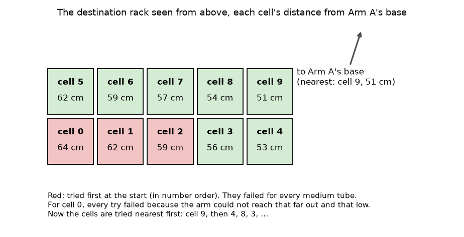
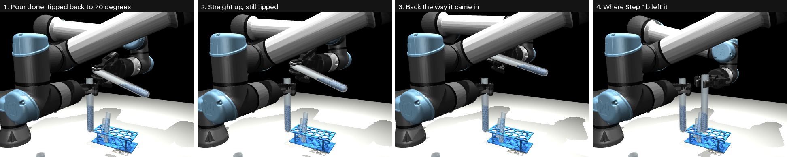
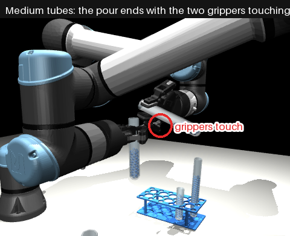
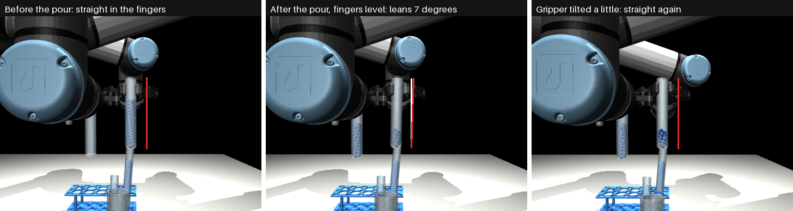
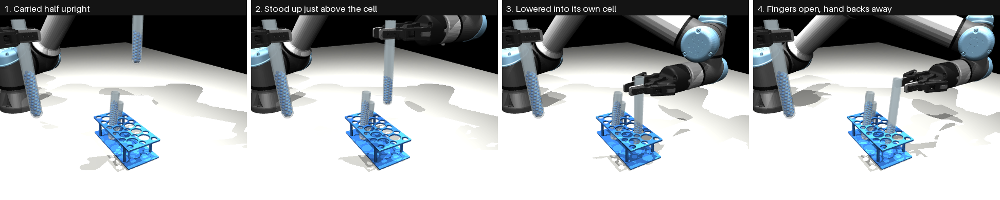
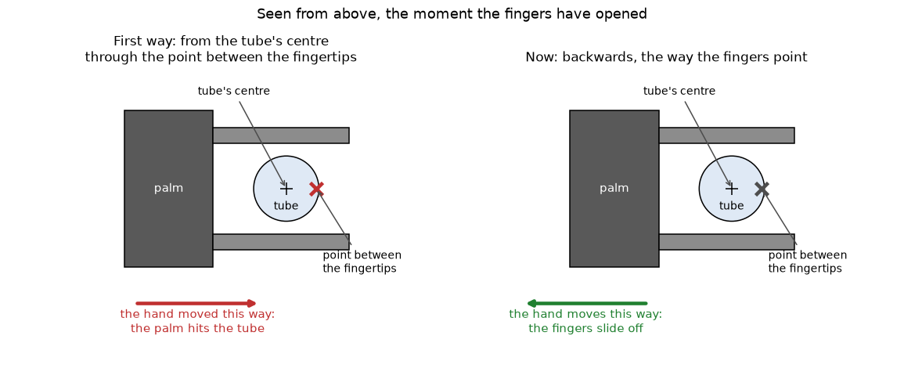

# Steps 3 to 5: How the Tubes Are Put Back

This page explains, step by step, how the program puts the two tubes back after the pour, the numbers it uses,
and why. The short story is in [step-3-put-back.md](../../docs/solutions/step-3-put-back.md); how well it works
is in [results.md](results.md).



*Close up, test scene 150. First Arm B puts the source back in its own cell, then Arm A puts the filled receiver
in the destination rack.*

---

## A few words first

| Word | In plain words |
|---|---|
| **Source** | the full tube that pours. Arm B holds it |
| **Receiver** | the empty tube that is filled to 50%. Arm A holds it |
| **Cell** | one hole of a rack. A rack has 10 cells (2 rows of 5). A cell is 30 mm wide; a tube is 25 mm wide, so there are only 2.5 mm to spare on each side |
| **Own cell** | the cell the source stood in before Step 1b picked it up |
| **Lean** | how far a tube is from standing straight up, in degrees. 0 is straight up |
| **Pinch point** | the point between the two fingertips, where the gripper holds a tube |
| **Planning a move** | before the arm moves, the program works out the angles of the arm's 6 joints for every 5 mm of the way (this is called *inverse kinematics*), and checks on a copy of the scene that nothing would touch. Only then does the arm move |

---

## The order of things

1. **Find where each tube goes.** The racks' places come from Step 0 (the overhead camera). The cells follow
   from the rack's place, because the rack is a known part.
2. **Arm B tips the source back up** and takes it away from the receiver (Part 1).
3. **Arm B puts the source in its own cell** and lets go, then goes home (Part 2 and Part 3).
4. **Arm A puts the receiver in the destination rack** the same way, then goes home.
5. **The check** (Step 5).

Only one arm moves at a time, as in Step 1b.

---

## Where each tube goes

**The source** goes back to **its own cell**: the cell nearest to where Step 0 saw it before Step 1b picked it.
If that cell cannot be reached, the program tries the free cells next to it.

**The receiver** goes to a free cell of the **destination rack**. The cells **nearest to Arm A's base are tried
first**.



**Why nearest first:** at first the cells were tried in number order, 0 first. Cell 0 is the furthest corner,
64 cm from Arm A's base. A medium tube is short, so the hand has to go low to put it in a cell, and that far
out and that low the arm cannot reach. The program spent 8 to 11 minutes trying cells 0, 1 and 2 before cell 3
worked. Starting with the nearest cell (cell 9, 51 cm away), planning takes about 1 second.

---

## Part 1: Arm B tips the source back up

When the pour ends, the source is still tipped over the receiver at 70 degrees (no balls leave a tube until about
81 degrees, so nothing pours). Arm B must bring it back upright and away from the receiver.



**How it is done now:**

1. **Straight up 6 cm**, without changing the angle of the hand. The tube stays tipped at 70 degrees, so nothing
   pours, and it moves away from the receiver and Arm A's hand.
2. **Back the same way it came in.** Before the pour, the program planned how Arm B moved the source in, over
   the receiver. Now Arm B follows that same path backwards, joint for joint, until it is where Step 1b left it.

If going straight up would make Arm B's wrist press on its own arm, it tries going up less (4 or 3 cm) or a
little to the side (3 or 5 cm). In one of the six test scenes (152) this was needed.

**What went wrong first, and why.** The first version turned the tube upright *directly* from where it was,
working out the hand's new angle from where the tube sits in the fingers *now*. But during the pour the tube
twists a little in the fingers (below). So the "new" hand angle was different from the old one, and the hand
**jumped** a few millimetres at the start of the move. With medium tubes the two hands are very close at the end
of the pour, and the jump pushed Arm B's hand into Arm A's hand. In one scene the source was knocked out of the
fingers.



**The two hands already touch.** With medium tubes, when the pour ends, Arm B's hand is already touching Arm A's
hand, very lightly (less than 0.1 mm). This comes from Step 2. So the first move (straight up) is allowed to
start touching, but only if the touch never gets harder and is gone by the end of that move. In all 3 medium
scenes it was gone after the lift, and nothing was touched afterwards.

---

## Part 2: Carrying a tube and putting it in its cell

### Why the tube is not quite straight after the pour

While the source is tipped during the pour, the weight of the balls twists the tube a little between the finger
pads, and it stays twisted. So after the pour, if the hand is held the way Step 1b holds it (fingers level), the
tube does not stand straight up: in our 6 scenes it leaned **1 to 8 degrees**.



*Test scene 154. White line: straight up. Red line: the tube. Left: before the pour, the tube is straight. Middle:
after the pour, with the fingers level, it leans 7 degrees. Right: the hand tilted a little, and the tube is
straight again.*

A cell has only 2.5 mm to spare on each side. A tube leaning 7 degrees would hit the edge of the cell. So the
program **plans every move for the tube itself, not for the hand**: it says where the tube's bottom must be and
that the tube must be straight, and the hand takes whatever angle that needs.

### The moves, one by one



| # | Move | Speed | Why |
|---|---|---|---|
| 1 | **Away**: one move of all the joints to a clean pose, the tube 5 cm higher | 4 cm/s | the arm may have to change its pose a lot after the pour; a straight line would not work |
| 2 | **Up** until the tube's bottom is 4 cm above the tallest tube on the table | 10 cm/s | so it passes over every tube, as Step 1b does |
| 3 | **Across** to above the cell | 10 cm/s | |
| 4 | **Down** until the tube's bottom is 1 cm above the top of the rack | 4 cm/s | |
| 5 | **Stand it up**: turn the tube until it is perfectly straight, in place | 4 cm/s | so it fits in the cell |
| 6 | **Into the cell**: down until the bottom is 4 mm above the cell's floor | 4 cm/s | slowly; it should just drop the last 4 mm |
| 7 | **Let go**: open the fingers to 35 mm | 0.8 s | see Part 3 |
| 8 | **Back away**: the open hand 7 cm back, then 10 cm up | 4, then 10 cm/s | see Part 3 |
| 9 | **Home**: the arm back to where it started | 10 cm/s | only tidying; if the way is blocked, the arm stays |

**Carried "half upright".** During moves 1 to 4 the tube is held halfway between how the level fingers would
hold it and straight up. This was added because the first way of tipping back (Part 1) left the hand tilted,
and holding the tube *fully* straight near the pouring point then made **Arm B's wrist press on its own forearm**.
A real arm cannot do that: its wrist motors would stall. With today's way of tipping back, this no longer
happens even fully straight, at least where the tipping back ends (checked in 4 scenes), so carrying it half upright is probably no longer needed. It
is kept because it was tested this way on all 6 scenes.

### If the way is blocked

Before moving, the program plans **all nine moves** and checks them. If any of them would touch something, it
changes one thing and tries again, in this order:

1. **Turn the hand around the tube** by 15 degrees, then 30, and so on up to 180 (the tube can be held from
   another side).
2. **Move the tube to another place** in move 1: 10 cm to a side, towards the arm's base first (9 places in all).
3. **Carry it a quarter upright** instead of half.
4. **Use another cell.**

The first way that passes is used. In the 6 test scenes, the very first way passed every time but once.

---

## Part 3: Letting go and backing away

After the tube is in its cell, the fingers open to 35 mm (10 mm wider than the tube) and the hand backs away
7 cm, then goes up.



**What went wrong first.** The hand backed away in the wrong direction. The program moved it "away from the
tube's centre, through the pinch point". But the pinch point is not between the tube and the hand: the fingers
reach past the tube, so the pinch point is 11.5 mm on the *far* side of the tube's centre (left drawing). Moving
that way pushed the **palm of the hand into the tube**. In the test where this was found (scene 154), the receiver
tipped over in its cell and dragged the whole rack 19 mm.

**First guess, and why it was wrong.** It looked like the fingers were rubbing the tube, so the fingers were
opened wider (45, 50 and 60 mm). That did not help, and at 60 mm the fingertips swung down into the rack. Then
the program listed exactly which part of the hand touched the tube: the palm, not the fingers.

**The fix.** The hand now backs away **the way the fingers point, backwards** (right drawing): the fingers slide
straight off the tube, and nothing pushes it. Picture 4 of "How a tube goes into its cell" (Part 2) shows it.

---

## How every move is checked

Before any move, on a copy of the scene, the program checks every 5 mm of it:

| Check | In plain words | Why |
|---|---|---|
| Nothing touched | the arm and the tube it holds must not touch anything else | as in Step 1b |
| No folding | the hand must not touch the rest of its own arm, and the arm must not touch the table | a real arm's wrist motors would stall |
| No big swings | no joint may turn more than 0.5 rad (about 29 degrees) between two points 5 mm apart | a big swing means the arm is near an awkward pose |
| Reachable | the hand must get within 3 mm of where it is sent | |
| Not tipped too far | during move 1, the tube may lean at most 45 degrees | balls only start to leave a tube tipped past about 81 degrees |

Each move is planned again just before it is made, from where the tube really is at that moment.

---

## Step 5: The check

| Measure | How | Passes when |
|---|---|---|
| Level | the balls in the receiver, counted by the simulator, as % of its height | 48 to 52% |
| Spill | balls in neither tube | (reported) |
| Tube in a cell | the bottom within 5 mm of a cell's centre, on the cell's floor (within 4 mm), leaning at most 8 degrees | a 25 mm tube in a 30 mm cell can lean about 5 to 7 degrees against the cell's wall |
| Source in its own cell | the cell it is in is the one it started in | |
| Nothing touched | neither arm touched anything but its own tube after the first lift away from the pour | the first lift starts in the pour's own light touch (Part 1) |

A run **passes** when all of these pass.

---

## Running it

From `step-3-put-back/`:

```
make run       # the whole task on the 6 test scenes, 4 at a time (about 8 minutes)
make figures   # the pictures of one whole run (about 3 minutes)
make test
```

The explaining pictures on this page come from `python -m putback.explain --out ../docs/solutions/images/step-3-put-back`
(about 6 minutes).

| File | What it does |
|---|---|
| `putback/workflow.py` | one whole run: Step 0, the pour, Steps 3 and 4, the check; and several runs at once |
| `putback/place.py` | tipping back, planning the moves, making them, and the checks |
| `putback/upright.py` | the arithmetic for holding a tube straight: joint angles, straight lines |
| `putback/figures.py`, `putback/explain.py` | the pictures |
| `../step-2-pour/level/reader.py` | the custom CNN reading the level during the pour |
