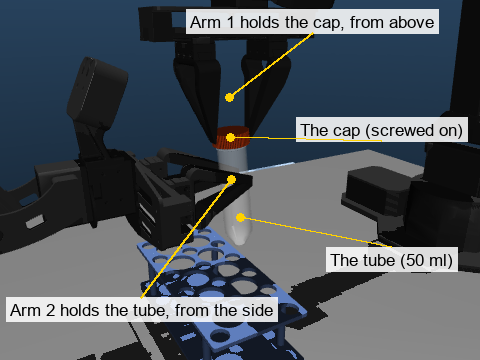
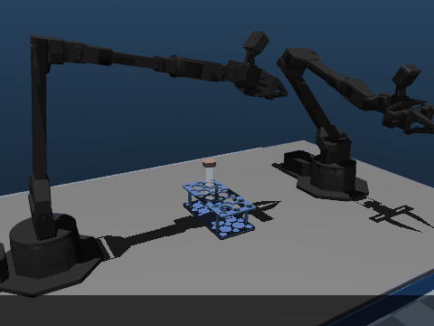
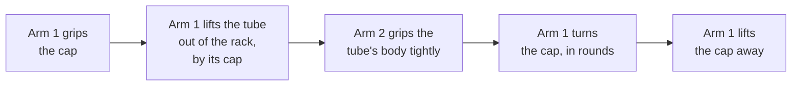
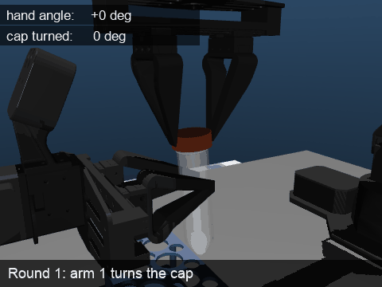
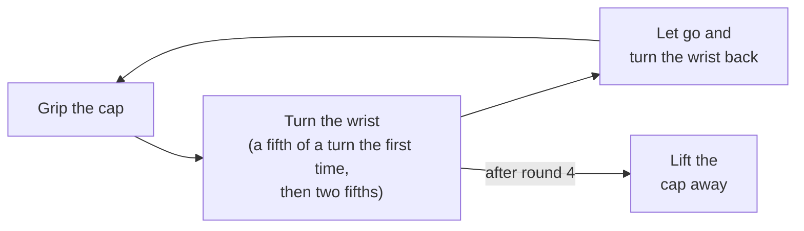
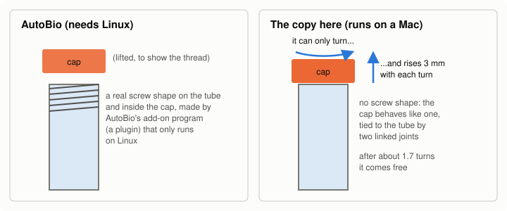
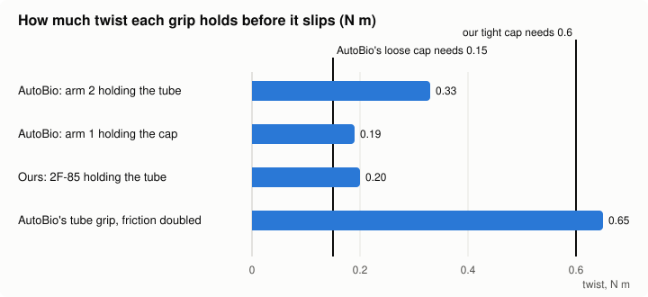
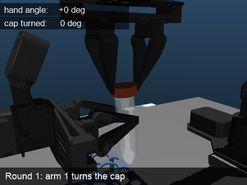
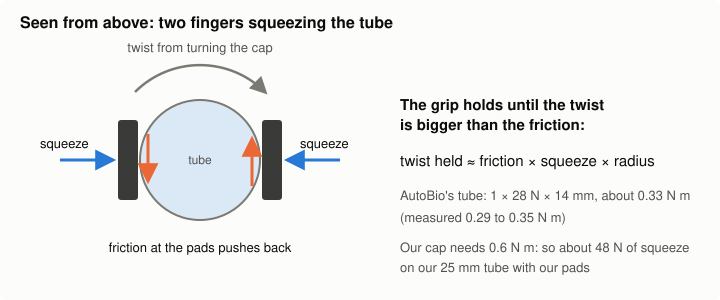
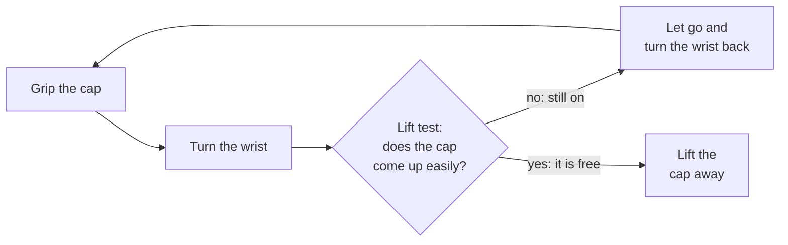

# How AutoBio takes a cap off a tube, and what we can learn from it

AutoBio is a public robot lab project ([github.com/autobio-bench/AutoBio](https://github.com/autobio-bench/AutoBio)).
One of its tasks is **uncapping**: two robot arms unscrew the cap of a 50 ml tube. Their task works.
Ours (`uncap/`, UR5e arms with Robotiq 2F-85 grippers) struggles to hold the tube still while the cap
turns.

So we rebuilt their task here, with their robots, tube, cap and moves, and asked three questions:

1. **How do they do it?**
2. **Why does it work for them?**
3. **What can we copy?**

Short answers: they do it in simple rounds of "grip, turn, let go, turn back". It works mainly because
**their cap is loose**. What we can copy is **a much harder squeeze on the tube**, one physics setting,
and **checking whether the cap is free** instead of counting turns.

---

## 1. The setup



- **Arm 1** holds the **cap** from above. It is the arm that turns.
- **Arm 2** holds the **tube** from the side. Its only job is to stop the tube from turning.
- The arms are small ALOHA arms. Their gripper has two flat fingers that slide straight towards each
  other and squeeze, like a vice. (Our 2F-85's fingers curl round the object instead.)

## 2. How AutoBio does it, step by step





1. Arm 1 comes down over the tube in the rack and grips its cap.
2. It lifts the whole tube out of the rack, by the cap, and holds it up in the air.
3. Arm 2 comes in from the side and grips the tube's body tightly.
4. Arm 1 turns the cap off, in rounds (next section).
5. Arm 1 lifts the cap away. Arm 2 is still holding the open tube.

### Turning the cap, in rounds

A wrist cannot spin round and round forever. So arm 1 turns a little, lets go, turns its wrist back,
grips again and turns again, the way you open a jar with one hand.



*Watch the counters: while arm 1 grips, the cap turns with the hand. While it turns back, the cap stays
where it is.*



**It never checks anything.** It always does exactly 4 rounds (1.4 turns in all) and then lifts. The
simulator, not the robot, then decides whether it worked: the cap must be well above the tube, still in
arm 1's fingers.

## 3. The one part that only runs on Linux: the thread



The screw thread is what makes a cap a screw cap: turning it makes it rise, and pulling alone cannot
take it off. AutoBio makes its thread a real 3D screw shape. That shape comes from a small add-on program
of theirs (a *plugin*) that is built for **Linux only**, so a Mac cannot load it.

MuJoCo, our simulator, has screw shapes of its own, but they are fixed at 1 metre across and cannot be
made tube-sized. So the thread here is copied **by its behaviour** instead, the same way our own caps
work: the cap may only turn, rises 3 mm with each turn (AutoBio's number), and comes free at the end.

This has one effect to keep in mind. AutoBio's settings make their thread about **1.7 turns** long. But
their robot only turns **1.4 turns** and then pulls. In their simulator the last bit of thread probably
lets go when pulled, which a copy made of joints cannot show. So the results below are given both ways:

- **thread ends at 1.35 turns**: what their fixed 1.4 turns expect;
- **thread ends at 1.7 turns**: what their thread's size says.

## 4. Does it work?

Ten runs each, every run with a different arm start pose and tube position:

| What was run | Cap off, nothing dropped |
|---|---|
| Their robot, thread ends at 1.35 turns | **10 of 10** |
| Their robot, thread ends at 1.7 turns | **0 of 10**: 1.4 turns is not enough, and it never checks |

So it works, but only when the thread is exactly as long as the script expects. Nothing is ever dropped.

## 5. Why does it work? Their cap is loose

This is the main finding. Their cap is not screwed tight. Turning it never needed more than **0.15 N m**
of twist. (N m, newton metres, is the unit of twist: 1 N m is a push of 1 newton on a lever 1 metre
long.) Our cap is tight: it needs **0.6 N m** to start turning, four times more.

To measure each grip, we twisted the held part harder and harder until it slipped in the fingers:



- Both of their grips hold more than their loose cap needs. That is why their task works.
- **None of the grips, theirs or ours, holds the 0.6 N m our cap needs.** Their tube grip is better than
  our 2F-85's, but not enough.

With our tight cap, their task fails 10 of 10. The hand turns, but the cap does not move at all: arm 1's
fingers slip round it. In half the runs the tube also twists in arm 2's hand.



### What makes a grip hold



A grip is just friction. The fingers squeeze the tube, and friction at the finger pads stops it from
turning. **The harder the squeeze and the higher the friction, the more twist it holds.** We checked this:

- doubling the friction doubled the grip (0.33 to 0.65 N m);
- squeezing harder held more, squeezing less held less, in proportion.

Their squeeze is strong (28 N) because of how their gripper is told to close. It is told to close much
further than the tube allows, so its motor keeps pushing hard. Our 2F-85 model reaches the position it
is told without pressing hard (`docs/uncapping.md`: its motor at 0.2 of its 5 limit).

We also switched off, one at a time, each special physics setting AutoBio uses, to see which ones help:

| AutoBio setting | Does it help the grip? |
|---|---|
| **"No-slip" pass**: an extra calculation that stops held things slowly creeping | **Yes**: without it the tube grip drops from 0.33 to 0.21 N m |
| **Round friction model** ("elliptic cone"; we already use it) | **Yes**: the simpler model drops it to 0.12-0.23 |
| Special contact rules between fingers and tube | No difference |
| Extra twisting friction at the fingertips | No difference |

## 6. Moving it towards our case

Then we changed their task one step at a time towards ours, and ran each change 10 times:

| Change | Cap off, nothing dropped |
|---|---|
| Tight cap (like ours) | 0 of 10: the cap never turns |
| Tight cap, grips made strong enough (friction doubled, both grippers closing as hard as they can) | 0 of 10: the cap turns now, but the fingers slip a little each round, so 4 fixed rounds fall short |
| Tight cap, strong grips, and **our lift test** instead of a fixed count | **10 of 10**, thread at its full 1.7 turns |

Our **lift test** is how our robot checks whether the cap is free. After each round it lifts the cap a
little (6 mm) and feels the pull. If the cap comes up easily, it is off. If it pulls back hard, it is
still on, so the robot does another round.



One thing had to be adjusted. Their arms are soft and give way when pulled, so even a cap that is still
screwed on only pulled back about 2 N. That is below the 5 N line our robot uses, so the test said "off"
too early every time. With the line at 1 N (on: 1.1 to 2.0 N, off: 0.2 to 0.6 N) it worked every time.

## 7. What we can use in our setup

1. **Squeeze the tube much harder.** This is the real gap. Their grip holds because their gripper keeps
   pushing hard, and ours barely presses. For our tube and finger pads, holding 0.6 N m needs about
   **48 N** of squeeze, and about 70 N to be safe. A real 2F-85 can squeeze from 20 to 235 N.
2. **Turn on the "no-slip" setting** while the cap is turned. It gave their grip 60% more hold for free.
   (Our other session's `uncap/grip.py` already does this.)
3. **Keep the lift test; do not count turns.** Counting failed whenever the thread was longer or the
   fingers slipped a little. The lift test worked in both cases.
4. **Set the lift-test line to suit the arms.** Measure the pull with the cap on and with it off, and put
   the line in between (ours: 12 N on, 0.04 N off, so 5 N is fine; theirs needed 1 N).
5. **Before trusting "the cap is off", check the tube has not turned in the holding hand.** When the tube
   was slipping out of arm 2's grip, the pull also dropped, and the test wrongly said "off".
6. **Not worth copying:** their gripper itself (even closed as hard as it can, it holds only about
   0.4 N m), their special contact rules, and their extra fingertip friction. None made a difference.

## 8. Things to keep in mind

- The thread is copied by behaviour, not shape. Whether their thread really lets go after 1.4 turns
  cannot be checked on a Mac, so both lengths are shown.
- How hard their loose cap is to turn is our estimate of their thread's friction. It stayed small (under
  0.15 N m), so it does not change the conclusions.
- Only the 50 ml tube was tried, as in their task.

## How to run it

The code is in `autobio_uncap/`. Results go to `runs/autobio/`, and AutoBio's own files are downloaded
into `assets/autobio-full/`. Neither folder is committed: AutoBio has no licence file.

```
pixi run python -m autobio_uncap.fetch                 download AutoBio (pinned to the commit v1 uses)
pixi run python -m autobio_uncap.expert --seed 0       one run, printed
pixi run python -m autobio_uncap.evaluate --workers 2  every change in section 6, 10 runs each (3.5 min)
pixi run python -m autobio_uncap.grip_test --workers 2 the grip measurements in section 5 (20 s)
pixi run python -m autobio_uncap.media                 the pictures and clips on this page
```

<details>
<summary><b>All the numbers</b> (for checking; not needed to follow the page)</summary>

### Every run variant (10 seeds each, `evaluate.py`)

| Variant | Their check | Cap off and nothing dropped | Detail |
|---|---|---|---|
| Their expert, thread to 1.68 turns | 0/10 | 0/10 (nothing dropped 10/10) | cap undone 1.375-1.388 of the 1.4 turns asked |
| Their expert, thread lets go at 1.35 turns | 10/10 | 10/10 | cap ends 15.16-15.22 cm above the tube's bottom, their line is 15 cm; tube turned at most 0.4 degrees in arm 2's hand |
| + tight cap (0.6 N m) | 0/10 | 0/10 (nothing dropped 5/10) | cap undone 0.002 turns; tube twisted up to 14 degrees |
| tight + lift test at 5 N | 0/10 | 0/10 | false "off" on round 1 (pull 1.8-2.0 N) |
| loose cap + lift test at 1 N, thread 1.68 | 10/10 | 10/10 | 5 rounds; pulls 1.1-2.0 N on, 0.2-0.56 N off |
| tight + lift test at 1 N | 0/10 | 0/10 (nothing dropped 0/10) | cap never turns; pull fell to 0.03 N as the tube grip failed |
| tight + strong grips, fixed 4 rounds, thread 1.35 | 0/10 | 0/10 | cap undone 1.24-1.29 turns: slip 25-32% in round 1, 6-8% later |
| tight + strong grips + lift test at 1 N, thread 1.68 | 10/10 | 10/10 | 6 rounds; tube turned at most 4.4 degrees |

"Strong grips" means friction 2 where the fingers touch and both grippers told to close fully (0.002).
In the lift test with their arms, told to rise 6 mm, arm 1's hand rose 4.1-4.7 mm and arm 2's hand was
pulled up 2.9-3.9 mm. The tube slid at most 0.2 mm in the fingers.

### The grip twist test (5 seeds, `grip_test.py`)

The twist rises at 0.3 N m per second until the part has turned 2 degrees in the hand. Tube test: arm 1
lets go and moves away. Cap test: the thread is made frictionless.

| Setting | Tube holds (N m) | Squeeze on tube | Cap holds (N m) | Squeeze on cap |
|---|---|---|---|---|
| AutoBio's | 0.29-0.35 | 28 N | 0.17-0.20 | 10 N |
| no noslip pass | 0.21 | 28 N | 0.18-0.19 | 10 N |
| impratio 1 | 0.35-0.36 | 28 N | 0.08-0.10 | 10 N |
| pyramidal friction cone | 0.12-0.23 | 29 N | 0.05-0.06 | 11 N |
| no contact pairs | 0.29-0.35 | 28 N | 0.17-0.20 | 10 N |
| only contact pairs | 0.20-0.30 | 27 N | 0.16 | 10 N |
| fingers condim 3 | 0.33 | 28 N | 0.19-0.21 | 10 N |
| pairs condim 6 | 0.28-0.35 | 28 N | 0.18-0.20 | 10 N |
| friction 0.5 | 0.17 | 28 N | 0.11 | 10 N |
| friction 2 | 0.62-0.66 | 28 N | 0.16-0.26 | 10 N |
| gripper command 0.010 | 0.20-0.24 | 19 N | 0.25-0.31 | 28 N |
| gripper command 0.002 (fully closed) | 0.34-0.42 | 33 N | 0.26-0.32 | 35 N |

On the tube the hold is 0.83 × friction × squeeze × 13.9 mm (the radius where the fingers touch),
across every squeeze and friction tried. The squeeze is the gripper's stiffness, 2000 N/m, times how far
short of its target the fingers stop: 14 mm on the tube (28 N), 5 mm on the cap (10 N). On the cap,
squeezing 3.5 times harder raised the hold only 1.5 times; this was not looked into further. Our 0.6 N m
figure: 0.6 / (0.83 × 1.2 pad friction × 12.5 mm radius) = 48 N.

### From AutoBio's files

- Their thread's contact friction is 1. The tube file says 0.1, but that setting is dropped when the
  tube is put into the scene.
- Physics: 2 ms step, impratio 10, elliptic cone, noslip 2. The cap weighs 20.8 g and the tube 14.7 g.
- Their thread: pitch 3 mm, tube thread from -1.0 to +1.2 pitches, cap from -1.2 to +1.0. Screwed down,
  they overlap 5.05 mm, which is 1.68 turns.
- Their robot's moves, path timing (3 rad/s, 2.5 rad/s²) and random seeds are copied exactly. Seed *n*
  here is their seed *n*.

</details>
