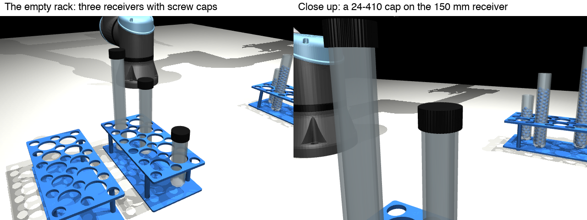
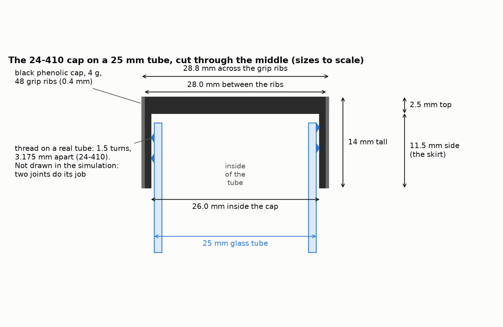
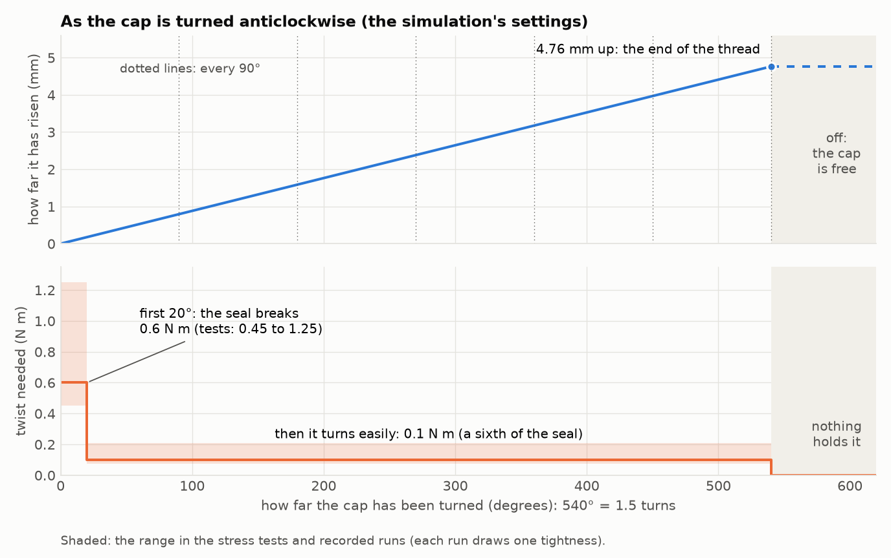
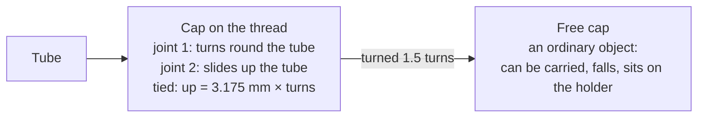

# Screw caps on the tubes

v2 puts a **screw cap** on each empty tube (the "receivers"). In a real lab a cap must be unscrewed
before anything can be poured in, so the robot now has to take it off first. This page explains the
cap and the physics of how it comes off, in the simulation and in real life.



**Where it stands (2026-11-06):**

| Part | State | Page |
|---|---|---|
| The cap and its physics | done, checked with the real arm and gripper | this page |
| Taking the cap off, programmed | done, 200 mm tube: 233 of 240 runs right | [uncapping-programmed.md](uncapping-programmed.md) |
| Taking the cap off, learned (ACT) | done: 29 of 30 test runs right | [uncapping-learning.md](uncapping-learning.md) |
| Caps on the full source tubes, screwing caps back on | not started | section 7 |

v1 (the pouring task with open tubes) is not changed by any of this. Exact settings, code names and the
history of fixes are in [capping-details.md](capping-details.md).

---

## 1. The cap

The receivers are 25 mm glass test tubes. Real 25 mm screw-cap tubes (Kimble, Pyrex, Fisherbrand) use a
thread called **24-410**:

- **24**: the thread is 24 mm across;
- **410**: the thread goes round **1.5 times**;
- it rises **3.175 mm per turn** (8 threads per inch).

So the cap comes off after **1.5 turns anticlockwise** (seen from above), rising 4.76 mm on the way.



| Part | Size | What it means |
|---|---|---|
| Outside | 28.0 mm across, 28.8 mm over the grip ribs | what the gripper's fingers close on |
| Grip ribs | 48 ribs, each 0.4 mm | small ridges round the side, for a better grip |
| Inside | 26.0 mm across | 0.5 mm of room round the 25 mm tube |
| Height | 14 mm: an 11.5 mm side and a 2.5 mm top | the side is called the "skirt" |
| Weight | 4 g | very light: this matters for the simulation (section 3) |
| Material | black phenolic plastic, friction 0.8 | the rubber finger pads (1.2) are grippier, and MuJoCo uses the grippier of the two |

No free 3D model of this cap was found, so its shape is made in code from these numbers. The tube is not
changed: the thread under the cap is not drawn (on a real tube the cap hides it).

### How tight

| | Twist (torque) | Source |
|---|---|---|
| Screwing a 24 mm cap on | 1.1 to 2.0 N m | capping torque guides |
| Starting to undo it | 40 to 60 % of that: **0.45 to 1.25 N m** | the same guides |
| Keeping it turning once it has started | **a sixth of that** (0.1 N m for a 0.6 N m cap) | **assumed**: no published figure was found |

A **N m** (newton metre) is a measure of twist: 1 N m is pushing with 10 N (the weight of 1 kg) on a
lever 10 cm long.

## 2. The physics: what happens as the cap turns



**Top: it rises as it turns.** A thread is a ramp wound round the tube. Each full turn lifts the cap one
"pitch", 3.175 mm. After 1.5 turns (540°) the ramp ends, and the cap is free.

**Bottom: how hard it is to turn.** Three stages:

1. **The seal (first 20°).** A tight cap sticks to the tube's rim. Breaking it takes the most twist:
   0.6 N m here, 0.45 to 1.25 N m in the tests (each run draws a different tightness).
2. **Turning easily (20° to 540°).** Once the seal has broken, only the thread's friction remains, a sixth
   of the seal.
3. **Free (after 540°).** Off the thread, nothing holds the cap. It lifts away with the hand.

**What can and can't move it:**

| You do this | The cap |
|---|---|
| turn it anticlockwise | turns and rises, 3.175 mm per turn |
| turn it clockwise | nothing: it is already tight |
| pull it straight up | **nothing**: a thread only lets it rise by turning. The arm feels it pull back (about 9 to 36 N in a 6 mm lift, depending on the grip) |
| pull it up after 1.5 turns | it comes away: only its 4 g weight |

The last two rows are what the robot uses to know the cap is off (the **lift test**, section 4).

**The fingers slip a little.** The robot's wrist can turn only so far, so it turns 90° at a time, lets go,
turns back and grips again. Each 90° of the wrist turns the cap only about 69°: the rubber pads give a
little as they start to twist it. So 1.5 turns take 7 or 8 wrist turns, not 6.

## 3. How the simulation makes a thread

A real thread is a spiral shape. The physics engine, MuJoCo, can't simulate a fine spiral shape on this
Mac (AutoBio's thread plugin only runs on Linux; MuJoCo's own bolt is fixed at 1 m long). So the thread is
made from **two joints tied together**, the way MuJoCo's documentation suggests for a screw:



- **On the thread**, the cap is attached to the tube by a **turning joint** and a **sliding joint**. A
  tie between them says "rise 3.175 mm for every turn". So the only way up is to turn; a straight pull
  can't slide it.
- **Friction on the turning joint** gives the twist of section 2: high for the first 20°, then low.
- **At the end of the thread** (1.5 turns), the threaded cap is swapped for a **free cap**, at exactly the
  same place and moving the same way, so fingers holding it go on holding it. The swap is invisible.

**Two rules for any code using a capped scene:** step it with `caps.step(model, data)` (it sets the
friction and does the swap; MuJoCo's own `mj_step` would never let a cap come off), and reset it with
`capping.scene.reset`.

**The light cap needed care.** MuJoCo's joints and contacts are a little "soft": they give way in
proportion to force over weight. A 4 g cap squeezed with 90 N takes forces thousands of times its weight,
so with the default settings a 2 N pull lifted it 12 mm off its thread. The thread's settings were made
nearly hard, the cap's touch was made one solid cylinder, and a few other settings were tuned; each was
measured ([capping-details.md](capping-details.md#4-settings-that-had-to-be-chosen-with-care)).

## 4. Proof with the real arm and gripper

Before building the full task, a trial (`make cap-trial`) checked that the simulated cap behaves like a
real one when the real arm (UR5e) and gripper (Robotiq 2F-85) open it. The tube was held still; the arm
gripped the cap from above, pulled without turning, then opened it in quarter turns with a lift test after
each. 6 caps (all three tube sizes, two scenes).

| | Quarter 1 | Quarters 2 to 6 | Quarter 7 |
|---|---|---|---|
| Twist at the wrist, peak | **0.61 N m**: the seal breaking | 0.21 N m | |
| Twist while turning | | **0.115 N m** | |
| Pull to lift it 6 mm and hold | 16 to 29 N | **15 to 36 N**: still on | **0.04 N**: only the cap's weight |
| The arm says | still on | still on | **off**, and it was, 6 of 6 |

What it showed:

- **Pulling without turning, the cap stays on.** The arm felt 13 to 39 N holding it back. All 6 stayed on.
- **The lift test works.** On the thread, lifting 6 mm takes tens of newtons; off it, 0.04 N. A limit of
  5 N tells them apart with room to spare, even for a real wrist sensor (good to about 4 N). Right after
  all 42 quarter turns, never "off" too early.
- **Twist alone can't say "off".** Machines that uncap stop when the twist drops to nothing. On a UR5e that
  is not reliable: 0.1 N m (a loose cap turning) and 0 are both inside its sensor's error (about 0.3 N m).
  The seal breaking (0.6 N m) can be seen, and shows the fingers really have the cap.

This trial is where the uncapping loop came from: grip, quarter turn, lift test, let go, turn back, grip
again, until the lift test says "off". The full task is in [uncapping-programmed.md](uncapping-programmed.md).

## 5. What is simplified

- **The thread is a little springy.** A 30 N pull lifts the cap about 1.5 mm, which springs back. A real
  thread gives almost nothing. The cap still stays on.
- **The easy-turning twist (a sixth of the seal) is assumed.** The seal's twist is from published figures.
- **Pulling doesn't make it harder to turn.** A real thread's friction grows with the load on it.
- **The thread and the cap's liner are not drawn.**
- **The cap never touches its own tube**, on or off: a cap dropped onto its tube would pass into it.
  Screwing a cap back on is not built yet.
- **Only one simulation of a model may run at a time**, because the friction and the swap are written into
  the model.

## 6. What v1's other steps don't know about caps yet

Caps change things v1's steps rely on. Not changed yet, on purpose:

- **Step 0's camera model** was trained on open tubes; from above, a capped tube looks different.
- **Tube sizes** are read from the rim's height; a capped tube's top is 4 mm higher and 28.8 mm wide.
- **The liquid check** looks down into each tube; a cap blocks it, and it reads a cap as "full".
- **Step 1b's side grasp** works on capped tubes only with the changes made for uncapping (a lower, centred,
  tighter grip: [uncapping-programmed.md](uncapping-programmed.md#3-the-main-decisions)).

## 7. Next

1. **Caps screwed on by different amounts** (half a turn, or just resting): the case where a learned model
   can beat the program ([uncapping-learning.md](uncapping-learning.md#8-next)).
2. **Caps on the source tubes**, which hold the liquid: opening them must not spill.
3. **Screwing caps back on** after the pour: turning clockwise until the twist reaches a set value, as
   capping machines do (the swap the other way, free cap to threaded).
4. The 150 mm tube in the uncapping task (only 200 mm for now), then the v1 points in section 6.

## Run it

```
make setup in ../v1-liquid-pouring/simulation-environment first (v1's models), then here:

make view        the capped scene in MuJoCo's window
make render      pictures of it from every camera
make cap-trial   the trial of section 4 (about 30 s); SEED=153 TUBE=receiver_100 for another cap
make test        the tests (a few seconds)
python -m capping.diagrams   the two diagrams on this page
```
