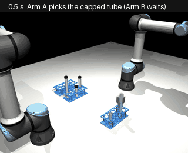
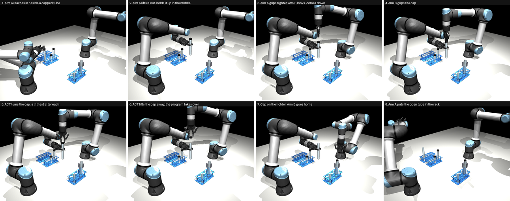
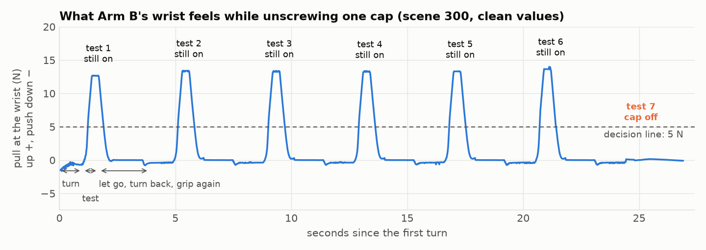
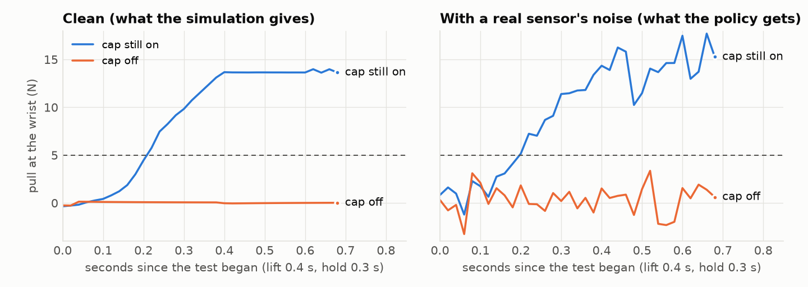
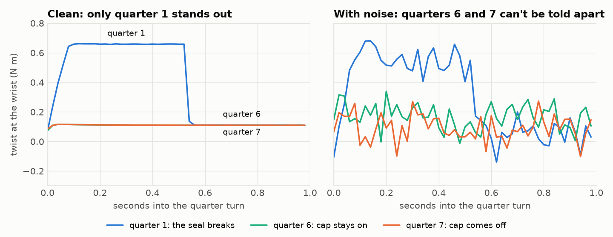
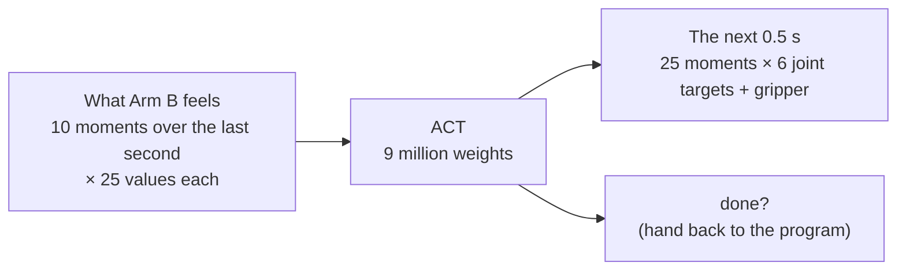

# Uncapping, learned

A learned model (**ACT**) unscrews the cap in place of the hand-written program. It learned only from
watching the program do it, and it uses only what the arm can feel: no camera.

**Where it stands (2026-11-06):** on 30 test scenes it never saw, the whole task went right in
**29 of 30** (the program: 30 of 30). It takes 30.2 s from the first turn to the cap lifted (the program
28.1 s).



*One full run, scene 203. Arm A and the steps around the unscrewing are programmed; Arm B's unscrewing is
ACT.*

---

## 1. The programmed way, in short

The full story is in [uncapping-programmed.md](uncapping-programmed.md). In short: Arm A holds the tube
up, Arm B grips the cap from above and repeats one loop until the cap is free:

1. **Turn** the wrist a quarter turn (90°), anticlockwise.
2. **Lift test**: pull up 6 mm and hold still. If the arm feels the cap pull back, it is still on.
3. **Let go, turn back, grip again**, and start the next quarter.

When a lift test feels no pull, the cap is off: Arm B lifts it away and puts it on the holder. A cap
needs 1.5 turns, so this takes 7 or 8 quarters.



*The same eight moments as the programmed run. Pictures 5 and 6 are now ACT; the rest is programmed.*

## 2. What the arm can feel (the key idea)

Everything the learned model decides comes from these sensors. Understanding them explains why it works.

| Sensor | What it measures | Like |
|---|---|---|
| **Wrist force** | the push or pull between the arm and its gripper, in 3 directions | holding a bag: you feel its weight pull down |
| **Wrist twist** | the turning force at the wrist (torque) | the effort in your wrist when opening a jar |
| **Joint angles and speeds** | where each of the arm's 6 joints is, and how fast it moves | knowing where your arm is with your eyes closed |
| **Motor torques** | how hard each of the 6 joint motors works | how tired each muscle is |
| **Gripper opening** | how far the fingers are open | |

A real UR5e arm has all of these. **Tare** (zeroing): the gripper itself weighs 10.3 N, so at the start of
each run the wrist reading in free air is taken off, like the tare button on a kitchen scale.

### The lift test: clear

While the cap is on its thread, it can't be pulled straight up (a thread only lets it rise by turning).
So when the arm lifts 6 mm, the cap holds it back and the wrist feels **about 9 to 15 N of pull**. Once the
cap is off the thread, nothing holds it, and the pull is **0** (only the cap's 4 g).



*Each spike is a lift test with the cap still on. At test 7 the cap is off: no spike. The program's rule is
"under 5 N means off".*



*Left: the clean values from the simulation. Right: the same with a real sensor's noise added. Even with
noise, "on" (about 13 N) and "off" (about 0) are far apart.*

### Turning: can't tell

Can the arm feel the cap coming off while it turns, and skip the test? No. The **first** quarter turn is
hard (the cap's seal has to break: 0.47 to 1.28 N m); after that every quarter feels the same, about
0.11 N m, including the one where the cap comes off.



*Left: clean. Quarters 6 and 7 lie on top of each other. Right: with a real sensor's noise (about 0.1 N m),
they are lost in it. So the lift test can't be skipped by feel.*

### Noise: why we add it

A real sensor never gives the exact value: each reading wobbles a little (**noise**), and after zeroing it
slowly wanders off (**drift**). The simulation gives perfect values, so a model trained on them could rely
on tiny differences no real sensor shows. So every time the model sees an example, we add random noise:

- wrist force: wobble of about **1.5 N** per reading, plus a drift of about **1 N** per run;
- wrist twist: about **0.1 N m** per reading, plus **0.05 N m** per run;
- small wobbles on the joints, motors and gripper too.

The data is saved clean, and the noise is new each time, so the model can't learn the noise by heart.
A UR5e's sensor is rated to about 4 N and 0.3 N m overall. We assume most of that is slow drift, which
zeroing removes, so the wobble per reading is set below it (an assumption, not a measured figure).

## 3. From program to learning

**What is learned:** only Arm B's unscrewing, from the cap gripped to the cap lifted 6 cm. Everything
around it stays programmed: picking and holding the tube, finding the cap with the camera, gripping it,
carrying it to the holder, putting the tube back. The unscrewing is the part where feel matters; the rest
is moving between known places, which a program already does well.

**How:** imitation learning. We recorded the program unscrewing 200 caps (the "teacher"), and trained a
model to do what the teacher did in each moment, from what the arm felt in that moment.

### Ways to learn it, and why ACT

| Way | What it is | For this task |
|---|---|---|
| **Program** (no learning) | every move written by hand | the teacher, 30 of 30. The baseline to compare with |
| **Simple imitation** (a plain network, "behaviour cloning") | one network: what the arm feels now → its next move | simple, but at a moment with two possible next moves (go down, or lift away) it tends to average them into a wrong in-between move |
| **ACT** (Action Chunking with Transformers) | a transformer that predicts the next 0.5 s of moves at once, and blends its predictions smoothly | **chosen** |
| **Diffusion Policy** | builds the moves by cleaning up random noise step by step | strong with several ways of doing a task, but slower to train and to run; more than this task needs |
| **Reinforcement learning** | trial and error with a reward (fast and right is good) | the only way to do *better* than the teacher on its own, but needs thousands of tries (each about 25 s of simulation: days on this Mac), and a reward that is hard to get right |

**Why ACT:** it was built for fine two-handed tasks learned from few recordings (its paper used about 50
per task). Predicting a chunk of moves makes it smooth and decisive at a switch like "down or lift away".
It trains in 20 minutes here, and v1's Step 2b (the pour) already used it, so the tools are tested.

## 4. What the model gets, and what it gives



**In: 10 × 25 = 250 numbers.** The 25 values of one moment:

| Values | How many |
|---|---|
| joint angles | 6 |
| joint speeds | 6 |
| gripper opening | 1 |
| wrist force (zeroed) | 3 |
| wrist twist (zeroed) | 3 |
| motor torques | 6 |

10 moments, 0.1 s apart, the newest now. The history matters: a lift test's pull builds up over 0.4 s,
and the model has to see that build-up.

**Out:** for each of the next 25 moments (0.5 s, 50 a second): 6 joint targets (where each joint should
be), 1 gripper command (open or squeeze), and 1 "done" value. When "done" is on for 3 moments in a row,
the program takes over.

**No camera.** The original ACT takes pictures from 4 cameras plus the joint angles. Here the camera can't
help: a cap half a turn looser looks the same, and "on or off" is only felt (section 2). Pictures would
also make training many times slower. The camera is still used before the unscrewing, by the program, to
find the cap. In place of pictures, we added what the original lacks: the wrist force and twist, and a
short history.

**The data:**

| | |
|---|---|
| Recorded | 200 runs of the teacher, scenes 300 to 499 (tube up to 2 mm off-centre, caps 0.46 to 1.25 N m tight) |
| Used | the 193 that went right |
| Training | 165 runs, 236,663 moments (scenes 300 to 469) |
| Checking during training | 28 runs (scenes 470 to 499) |
| Test | 30 new scenes, 200 to 229, in the full task (never used in training) |

## 5. How ACT works, in short

1. Each of the 10 moments becomes one "token" (a list of 256 numbers). A **transformer** (the same kind
   of network as in language models) lets the tokens look at each other, so the model reads the
   moments together: for example, the pull rising over the last 0.4 s.
2. It then answers 25 questions, one per future moment: "what should the joints and gripper do then?"
3. **Style:** while training, a small extra network looks at the teacher's real next moves and sums up
   their "style" in 32 numbers; the model learns to use them. When running, the style is set to "usual".
   This helps the model pick one clear way instead of averaging two.
4. **Blending:** it predicts the next 0.5 s at every moment, so each moment gets 25 predictions made at
   different times. The command sent to the arm is their average (older ones counted a little more).
   This keeps the moves smooth.

Training: 20 minutes on the Mac's GPU, 22,000 steps of 64 examples. The model's next joint targets ended
within 0.2° of the teacher's on the checking runs.

## 6. Results

On the 30 test scenes, ACT drives Arm B with sensor noise on, and everything else is programmed. Both
are measured the same way, from their recordings, from the first turn to the cap lifted:

| | Program | ACT |
|---|---|---|
| Whole task right | 30 of 30 | **29 of 30** |
| First turn to cap lifted | 28.1 s | 30.2 s |
| Quarter turns | 7.3 | 7.8 |
| Lift tests | 7.3 | 7.8 |
| Touched something it shouldn't | 0 | 0 |

"Right" means: the cap off and on the holder, the open tube in its rack cell, nothing touched, and the
tube turned less than 5° in Arm A's hand.

- **It learned to read the lift test.** 203 times it felt the pull and went on to another quarter; the
  cap really was still on every time.
- **It is a little slower.** It turns the cap 3 % less per quarter than the teacher, so it needs an 8th
  quarter more often (23 of 30 scenes, the teacher 9).
- **The one failure (scene 220).** On its 7th grip it didn't turn, and lifted straight away. The fingers
  slipped off the cap, still on its thread, and came up empty. Empty fingers feel no pull, just as when
  the cap is off, so it said "done". Most training runs end at quarter 7, so it seems to have partly
  learned "the 7th grip ends with lifting away" from where the arm is, not only from the pull.
- **It tests after every quarter, as its teacher does.** Imitation copies the teacher's habits.

## 7. Why not teach it to test less (yet)

The program could test only from quarter 6 on (a cap can't come off sooner): 30 of 30, 2.3 tests instead
of 7.3, 2 s faster ("teacher B"). We chose **not** to train ACT on it: that is a fixed rule, not a decision
from feel, and the same rule in the program works just as well. With every cap screwed fully down, a fixed
count is the best possible, so a learned model can't beat a good program there.

Learning beats a program when **the right moment to test changes from cap to cap, and the sensors show
it**. How tight a cap is doesn't change the turns it needs; how far it is screwed on does. A cap screwed
on half a turn, or just resting on the tube, comes off after 1 to 4 quarters.

## 8. Next

1. **Caps screwed on by different amounts.** Find which feelings show how much thread is left (how hard
   the first turn is; how high the cap sits when gripped), build a teacher that decides from them, record
   it, and train the same ACT. This is where learning can beat the program.
2. **Small fixes for this model:** more training runs that need 8 quarters, or a check after the handover
   that the cap is really in the fingers (likely to have caught scene 220; not yet tried).

Still open: the cap holder's place, (0.25, 0.12), never confirmed; when to bring back the 150 mm tube.

## Run it

```
make act-train          train ACT on runs/demos (20 min on the GPU)
make act-one SEED=203   one full run with ACT unscrewing (about 45 s)
make act-eval           ACT on the 30 test scenes, beside the program (about 10 min)
make act-figures        the pictures and animations of one run (about 1 min)
python -m learn.figures the charts in section 2
```

The code is in `learn/`: `data.py` (the examples, the noise), `model.py` (ACT), `train.py`, `rollout.py`
(ACT inside the full run), `measure.py` and `evaluate.py` (the test), `figures.py` (the charts). Exact
settings, numbers and the history of decisions: [uncapping-learning-details.md](uncapping-learning-details.md).
