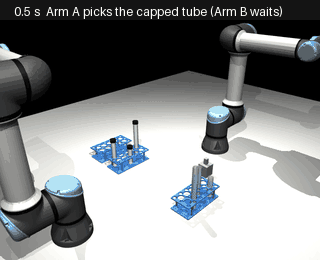
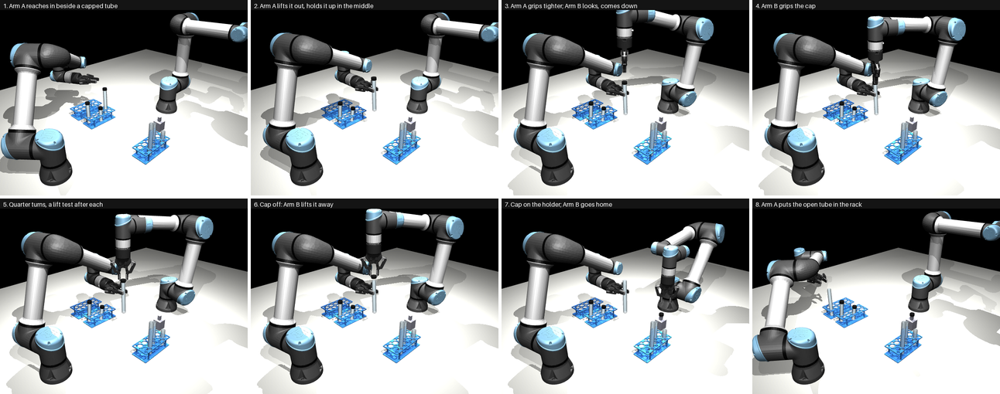
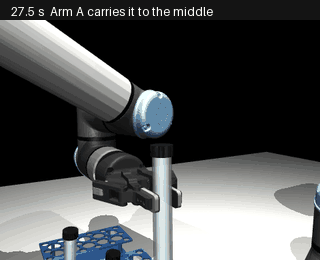
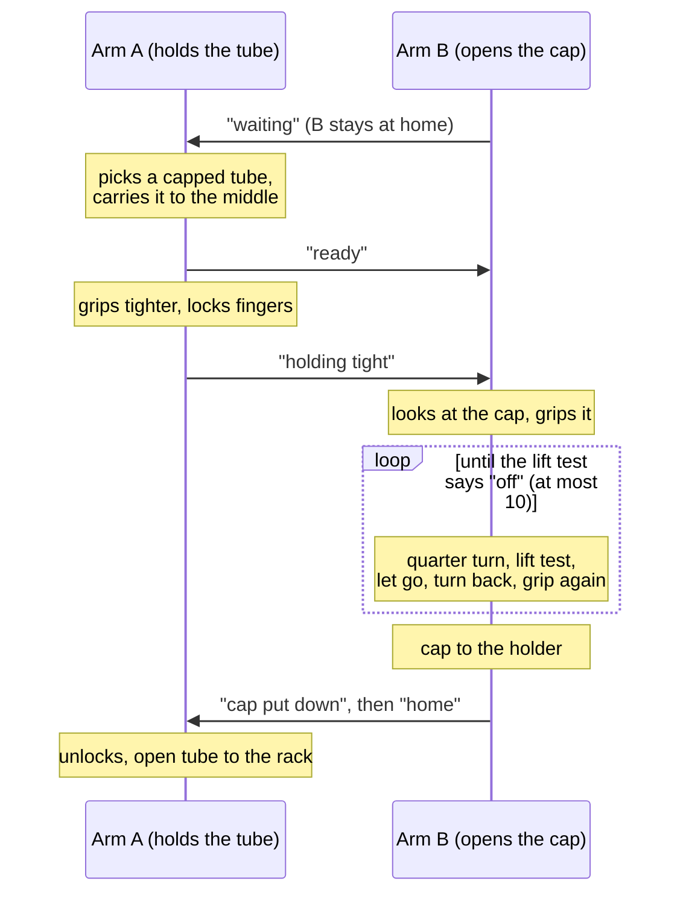
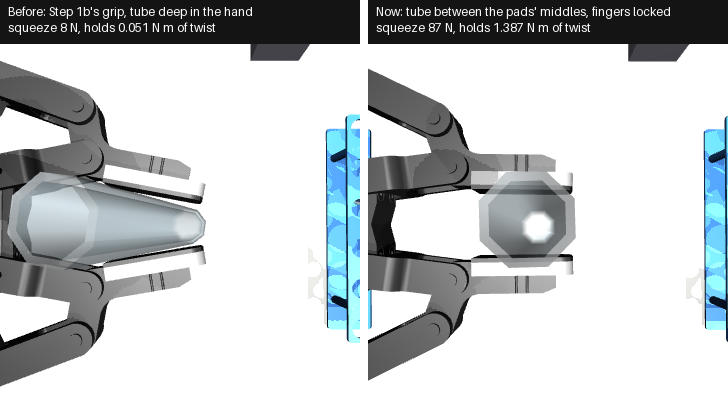

# Uncapping, programmed

Two arms take the screw cap off a tube. Every move is written by hand (no learning yet). This is the
**baseline** a learned version will be compared with, and the teacher it will learn from.

**Where it stands (2026-11-05; the learned version: [uncapping-learning.md](uncapping-learning.md)):** with the 200 mm tube, **233 of 240 runs right (97 %)**: 10 of 10
scenes, 30 of 30 in a stress test, and 193 of 200 in the runs recorded as demonstrations for learning
(the tube off-centre in its cell, caps of different tightness). The cap came off in 238 of the 240.



*One run, scene 150, 200 mm tube, sped up about 7 times (119 s simulated in 18 s).*

---

## 1. The workflow



| | Arm A (holds the tube) | Arm B (opens the cap) |
|---|---|---|
| 1 | Finds the capped tubes with the overhead camera and picks one from the side | waits at home |
| 2 | Lifts it out and holds it up above the middle of the table | |
| 3 | Grips tighter and locks its fingers | looks down at the cap with its wrist camera, comes down over it |
| 4 | holds | grips the cap from above |
| 5 | holds | **quarter turn, then lift test**, again and again: turn the wrist 90°, pull up 6 mm; if it pulls back (12 N), the cap is still on: let go, turn back, grip again |
| 6 | holds | the pull is gone (0.04 N, the cap's own weight): **cap off**. Lifts it away |
| 7 | holds | puts the cap on the holder (a post beside it), goes home |
| 8 | Unlocks its fingers, puts the open tube in the destination rack, goes home | |

The unscrewing up close, sped up about 4 times. The cap comes off after 1.5 turns; the fingers slip a
little on each quarter turn, so it takes 7 of them:



## 2. How the two arms work together

Each arm runs its own script. They run side by side, one simulation step at a time, and talk through
short messages on a shared board: an arm waits until the message it needs appears.



**They never collide:** before any move, the arm checks the whole path against everything, the other
arm included. If only the other arm is in the way, it waits and checks again (every 0.2 s, for up to
8 s); anything else in the way stops the run. A run also fails if either arm touches anything it should
not (a neighbouring tube, the other arm).

## 3. The main decisions

| Decision | Why |
|---|---|
| **Decide only from what a real robot can sense** | the overhead camera (where the tubes are, which are capped), the wrist camera's depth picture (where the cap is), the force on Arm B's wrist (is the cap off). The simulator's own knowledge is used only to grade the run |
| **"Cap off" is felt, not counted** | a lift test after each quarter turn. Counting a fixed number of turns (AutoBio's way) fails when the thread is a bit longer or the fingers slip a little each time: 0 of 10 in our copy of AutoBio's task |
| **Second look before "off"** | once the pull is gone, Arm B must be carrying only the cap's weight. More would mean the tube is coming up with it (Arm A losing it). Then the run stops instead |
| **Arm A's grip: centred, tight, locked** | see the picture below. Step 1b's grip held only 0.05 N m of twist; the cap needs 0.6 to 1.25 N m to start turning. Now it holds 1.4 N m |
| **Arm B grips the cap high** | 18 mm above the middle of its side. Lower, the tips of its fingers touched the tube as the cap came off |
| **Capped tubes stand further apart** | v1's rack layout put two caps side by side, and they blocked Arm A's fingers |
| **Only the 200 mm tube, for now** | 100 mm tubes are left out (as in v1): Arm A must hold them right under the cap. The 150 mm tube is sometimes held only 3 cm under its top, close under the cap |
| **Cap holder: a post** beside Arm B, at (0.25, 0.12) | a tray would catch the fingertips (they reach below the cap); the cap sits on the post the right way up, ready to be screwed back on |

**Arm A's grip, before and after** (seen from above, cap hidden):



Before, the tube sat deep in the hand, where this gripper wraps round it loosely and its fingertips give
way. Now Arm A grips with the tube between the middles of its pads, squeezes harder (87 N, inside the
real gripper's 20 to 235 N), and locks its fingers once closed, as the real gripper does (it is
self-locking). The details, and the AutoBio comparison, are in the
[details](uncapping-programmed-details.md#arm-as-grip-firm-enough-for-the-cap-grippy).

## 4. How sure we are

| Test | Runs | Right |
|---|---|---|
| Scenes 150 to 159 (all 6 places the tube can stand) | 10 | **10** |
| Stress test: new scenes 200 to 229, tube up to 2 mm off-centre and turned, cap 0.45 to 1.25 N m tight | 30 | **30** |
| The same, with the arms also starting 2° away from home | 30 | 24 |
| The same scenes, lift tests only from quarter 6 on (teacher B, below) | 30 | **30** |
| Demonstrations for learning: new scenes 300 to 499, varied as the stress test | 200 | **193** |

"Right" means: the cap off and on the holder, the open tube standing in its rack cell, nothing touched,
and the tube turned less than 5° in Arm A's hand.

**In the 200 demonstration runs**, 7 were not right: twice the tube turned 5 to 7° in Arm A's hand (the
two tightest caps, 1.09 and 1.13 N m, near what its grip holds), twice the put-back set the tube down
badly, once the cap fell from Arm B onto Arm A's fingers as it came off, and twice Arm A bumped a
neighbouring tube while picking and Arm B then found no way to the cap.

**The arms' starting pose** is the other weakness (the third row). The cap still came off every time, but in 6 runs the steps after
it failed (Step 3's put-back found no way to put the tube down 4 times; the tube landed 16 mm off its
cell once; the cap was dropped once). A real arm starts at home exactly, so the programmed version is not
affected, but a learned version will not repeat the same poses.

**Fewer lift tests (teacher B).** The cap cannot come off before the 6th quarter turn (1.5 turns of thread at
most a quarter each), so testing earlier only costs time. Teacher B tests from quarter 6 on, and after each
earlier quarter just holds still 0.7 s: the fingers' wound-up twist turns the cap a few more degrees then,
which is what the test's pause did. On the 30 stress scenes it needs the same quarters in every scene, 2.3
lift tests in place of 7.3, and 24.3 s in place of 26.3 s from gripping the cap to "off". The bigger cost is
letting go and gripping again after every quarter (about 11.6 s of each unscrewing).

## 5. What is simplified

- **The thread is not a real thread shape.** The cap turns and rises on two joints, 3.175 mm per turn,
  and comes free after 1.5 turns; it cannot be pulled off. Nothing is drawn on the tube under the cap.
  ([capping.md](capping.md), section 3.)
- **The finger lock** stands for the real gripper's self-locking, which the simulation model lacks.
- **noslip**, a simulator setting, is on while the cap turns: without it, held objects creep slowly.

## 6. Next: the learned version

**ACT now does the unscrewing** in place of this program, learned from 193 of its recorded runs, from
what the arm feels only: 29 of 30 on the same test scenes. How it works, why ACT, what it is given, and
what is next: [uncapping-learning.md](uncapping-learning.md).

Still to decide here: whether the cap holder stays where it is; when to bring back the 150 mm tube; making
the steps after the cap is off sure from any starting pose (the weakness above).

## Run it

```
make uncap SEED=150 SIZE=0.2         one run (about 50 s), printed as JSON
make uncap-eval SEEDS=150-159        many scenes, 200 mm (10 runs: about 3 min); SIZES="0.15 0.2" for both
make uncap-stress                    the stress test (30 runs: about 7 min)
make grip-test SEED=150 SIZE=0.2     how much twist Arm A's grip holds (about 1 min)
python -m uncap.figures              the pictures and animations on this page (about 4 min)
```

The code is in `uncap/`: `episode.py` (both arms' scripts and the grading), `grip.py` (Arm A's grip),
`perceive.py` (finding the capped tubes), `holder.py` (the cap holder), `evaluate.py` (many runs).
