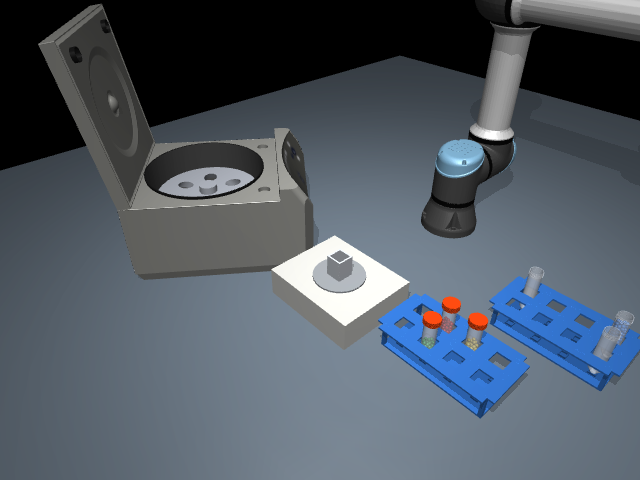

# v3: Loading a Centrifuge Safely

One robot arm weighs sample tubes, works out how to place them so a centrifuge's rotor is balanced, fills a
balance tube with water when a sample has no partner, loads the tubes into the rotor's slanted holes and
closes the lid. It uses two AI models from the big robotics labs: **Google's Gemini Robotics-ER 2** to see,
decide and check, and **Physical Intelligence's π0.5** to move the arm.



**Status:** the simulation is built and tested. The grips are checked against the whole job before building
([grip plan](grasp-plan/docs/results.md)). Step 2's solver is built ([results](step-2-plan/docs/results.md)). Step 1's programmed arm weighs and puts
back 60 of 60 tubes on 20 seeds ([results](step-1-weigh/docs/results.md)).
Step 0 is measured ([results](step-0-find/docs/results.md)):
with the high rack camera, Gemini (4 seeds) and SAM 3 (20 seeds) find every tube and say what it is. SAM 3's outlines with the depth picture also give each tube's 3D place and direction, even knocked over
(a point cloud and a fitted cylinder). The other steps are planned (each has an `approach.md`).

## Where to read

| Page | What it covers |
|---|---|
| [Problem statement](docs/problem-statement/problem-statement.md) | the task, the cameras (where each stands, what it sees, why not just overhead), what the arm knows, what counts as success, why we picked it |
| [Steps](docs/solutions/steps.md) | the whole job step by step, and how each step will be built |
| [Models](docs/libraries/models.md) | which AI model is used at which step, and why; open decisions (GPU, credits) |
| [Simulation environment](simulation-environment/README.md) | the scene, how to run it, the four jobs |

## Folders

| Folder | What |
|---|---|
| `simulation-environment/` | the MuJoCo scene (code, tests, docs) |
| `grasp-plan/` | every grip checked against every move of the job, before any step is built |
| `step-0-find/` | find which cells hold which tubes, from three cameras (Gemini Robotics-ER 2) |
| `step-1-weigh/` | weigh each sample (programmed; π0.5) |
| `step-2-plan/` | plan the load (solver; Gemini Robotics-ER 2 with the solver as a tool) |
| `step-3-fill-balance-tube/` | pour water into a balance tube, watching the balance |
| `step-4-load-rotor/` | load each tube into its hole, guided by the wrist force sensor |
| `step-5-close-and-report/` | close the lid, report the balance |
| `step-6-whole-run/` | the whole job, with Gemini Robotics-ER 2 as the coordinator |

Each step folder holds its code and a `docs/` folder with `approach.md` (how it is done) and, once built,
`results.md` (how well it works).

## Quick start

```bash
cd simulation-environment
make setup     # once: installs the environment and downloads the models
make view      # opens the scene (SEED=1 for another job)
make test
```
