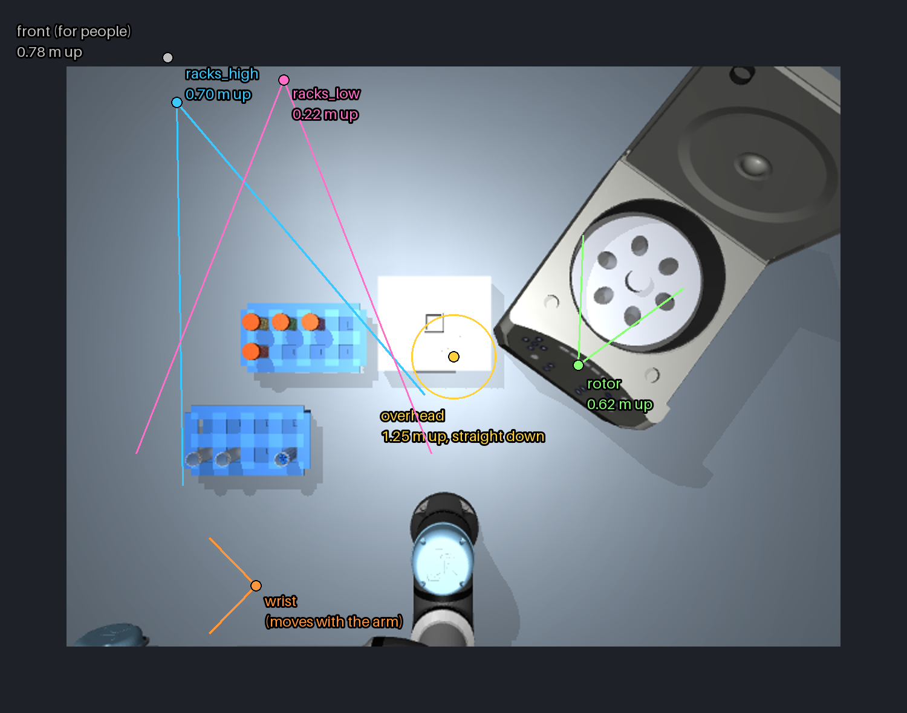
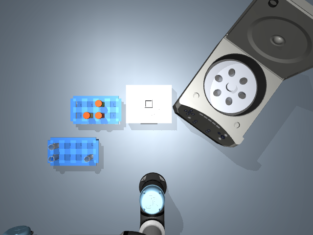
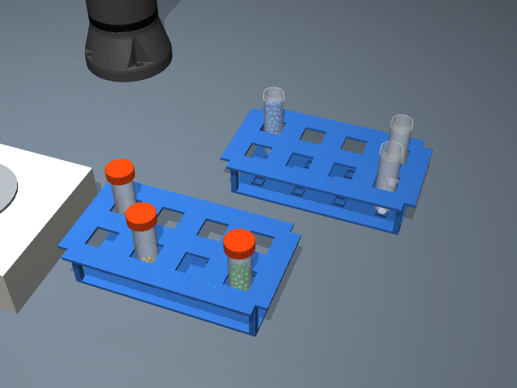
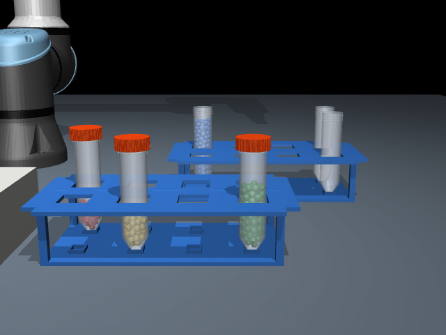
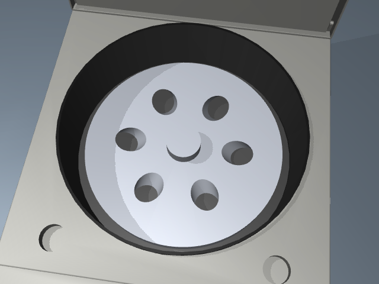
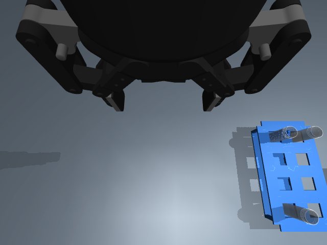
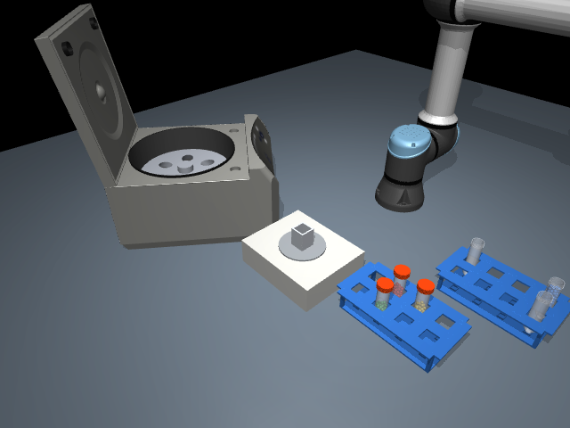
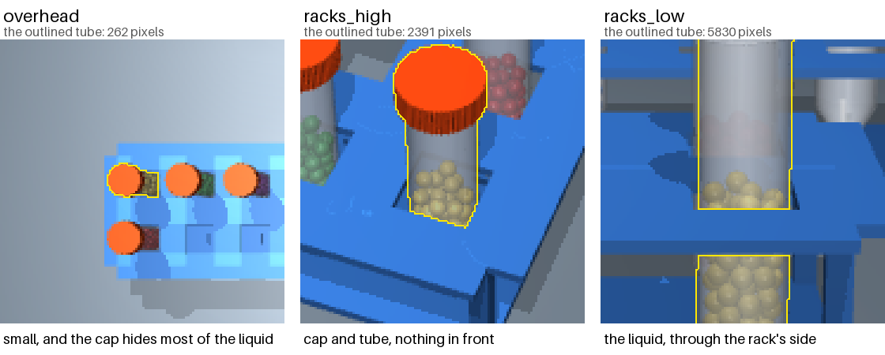
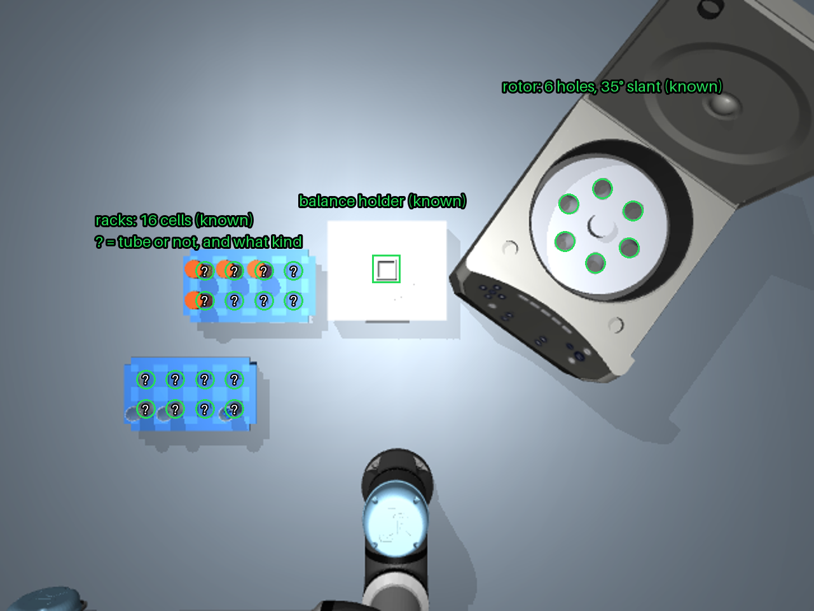

# Problem Statement: Loading a Centrifuge Safely

## Where this is used

A centrifuge spins tubes very fast to separate blood, cells or chemicals. Hospitals, research labs and
universities run one many times a day. Before every run, a person has to weigh the tubes and place them so
the rotor is balanced. If they get it wrong, the machine shakes, can break, and can hurt someone.

## Setup

- **Sample rack:** 2 to 4 capped 50 ml sample tubes, each holding a different liquid. The amounts differ,
  sometimes by less than you can see.
- **Supply rack:** 2 empty open 50 ml tubes (to become balance tubes) and 1 open tube of water, always in
  the same corner cell with the cells beside it empty (the arm holds it from the side to pour).
- **A lab balance** that reads to 0.01 g, with a holder a tube stands in.
- **A benchtop centrifuge**, lid open, with a fixed-angle rotor: six holes leaning 35°.
- **One arm** (UR5e with a two-finger gripper, a wrist camera and a wrist force/torque sensor).
- The liquid is small balls, so weights, pouring and spills are real and can be measured.

The scene is described in the [simulation environment](../../simulation-environment/README.md).

## The cameras

Six cameras. Five give the arm pictures (colour, and depth as from a depth camera). The sixth, `front`, is
only for people watching and for videos.

*The bench from above. Each dot is a camera, shown at the spot on the bench right below it, with its height.
The two lines from a camera show how wide it sees, flattened onto the bench. The `overhead` camera hangs
1.25 m above the yellow dot and looks straight down (the circle). The `front` camera stands just outside the
top-left corner.*

| Camera | Where it is | What it is for | Used in |
|---|---|---|---|
| `overhead` | 1.25 m above the bench, straight down | the whole bench at once: racks, balance, centrifuge, anything knocked over | Step 0; Step 1 (the learned arm's input) |
| `racks_high` | on a post at the far edge of the bench, 0.70 m up, looking down at the racks at about 45° | every tube and cap, big and with nothing in front | Step 0 |
| `racks_low` | on a post at the far edge, 0.22 m up, looking almost level at the racks | the liquid inside the tubes, through the racks' open sides | Step 0 |
| `rotor` | 0.62 m up, beside the centrifuge, looking down into it | the six holes; is each tube fully in? | Steps 4 and 5 |
| `wrist` | on the arm's wrist, looking along the fingers; moves with the arm | close-up while picking and placing | Step 1 (the learned arm's input) |
| `front` | 0.78 m up at the far corner | the scene for people; the demo video | videos only |

The two rack cameras stand beyond the arm's reach, so the arm never blocks them or hits them.

**What each camera sees:**

| | | |
|---|---|---|
|  |  |  |
| `overhead` | `racks_high` | `racks_low` |
|  |  |  |
| `rotor` | `wrist` (arm at its start pose) | `front` |

### Why not just the overhead camera?

The first plan used only the overhead camera, and in the full picture it looks fine. But here is one sample
tube as each Step 0 camera sees it: the same 120 x 120 pixel window round the tube in
each picture, enlarged three times, so each pixel is as big as the camera gives it. The yellow line is the
tube's true outline.

- **From overhead the tube is tiny:** about 260 pixels in all, about 10 pixels across. And the cap, seen
  from above, hides most of the liquid. Yet the liquid's colour is what tells the samples apart.
- **`racks_high` sees about 9 times more of it** (about 2,400 pixels), the cap and the tube side by side.
  Nothing stands in front, because it looks down over the front row.
- **`racks_low` sees the liquid itself**, through the rack's open side. A tube only a third full keeps its
  liquid below the rack's top plate, so only a low camera can see it.

**Measured, not guessed** ([Step 0 results](../../step-0-find/docs/results.md)):

| | Overhead alone | With `racks_high` |
|---|---|---|
| Gemini Robotics-ER 2: colours right | 11 of 24 (it read the orange caps, not the liquid) | 24 of 24 |
| SAM 3: tubes found | 33 of 120 | 120 of 120 |
| 3D direction of a standing tube | can't be measured: from above it is just a cap | about 1 to 3° |

**Where the rack cameras went** was also measured, not guessed. Five candidate places were tried on 12
seeds, counting how many pixels of each tube, and of the liquid in it, each place sees. The high one sees
every tube well, and the low one is the only low place that sees every tube's liquid well
([Step 0 approach](../../step-0-find/docs/approach.md#the-pictures)).

**The overhead camera still earns its place.** It is the only one that sees the whole bench: the balance,
the centrifuge, and a tube that has fallen over (from above, a lying tube is seen whole; its 3D pose comes
out within about 2 mm). It is just the wrong camera for reading tubes standing in a rack.

## What the arm knows at the start

A real robot work cell is set up once: the racks, the balance and the centrifuge are screwed to the bench in
measured places, and the cameras are mounted and **calibrated** (we measure where each camera is and how wide
its lens is, so a pixel can be turned into a direction in the room). What changes every run is **the job**:
which tubes are put in the racks, and what is in them. We copy that split.

*The overhead picture. Marked in green: what the arm knows before it looks (the 16 rack cells, the balance's
holder, the rotor's six holes). The question marks: what it must find out (is there a tube in this cell, and
what is it?).*

| Known before it starts (set up once) | Not known: the job (found by the arm) |
|---|---|
| Where the two racks stand, so where all 16 cells are | Which cells hold a tube, and how many samples there are (2 to 4) |
| Where the balance and its tube holder stand | What each tube is: a **sample** (capped), the **water** tube, or an **empty** tube |
| Where the centrifuge stands, where its six holes are and their 35° slant, where the lid's hinge is | Each sample's colour (so a plan can say "the red sample") |
| Where each camera is and its lens (calibration) | How much each sample weighs (two can look the same but weigh differently) |
| The arm's own shape (joint angles give where the gripper is) | Which holes to use, and whether a balance tube is needed |
| The kind of tube: a 50 ml conical tube, its size and its cap | |

All the "known" numbers are in one file, `simulation-environment/centrifuge_scene/settings.py` (`LAYOUT`,
the cameras, `TUBE`).

**What the arm senses while it works:** colour and depth pictures from the cameras (`overhead`, `racks_high`,
`racks_low`, `rotor`, and the `wrist` camera), its own joint readings, its wrist force sensor, and the
balance's display. It never reads the simulator's own record of where things are; that is kept for grading.

### How a picture becomes a place

The vision models don't only say *what* is in a picture. They say *where* in the picture it is, as pixels:

| Model | What it answers |
|---|---|
| Gemini Robotics-ER 2 | a **point** (one pixel) on each object, with a label ("sample, red") |
| SAM 3 | an **outline** (every pixel of the object), for a word like "test tube"; no label |
| YOLO or our own network (trained, as in v1) | outlines or boxes, with labels |

A pixel becomes a place in the room in two steps:

1. **The camera's calibration** turns the pixel into a line from the camera out into the room: the object is
   somewhere on that line.
2. **The depth picture** says how far along the line it is. A depth camera (in the simulator, the renderer;
   on a real robot, a camera like an Intel RealSense) stores at each pixel the distance to the surface seen
   there. Pixel + distance = one 3D point (x, y, z in metres).

From there, two ways to use it:

- **Snap to a known cell (what Step 0 does).** The racks are known, so a tube can only stand upright in one
  of 16 cells. The 3D point only has to say *which cell*, and the cell's known centre is the tube's exact
  place. This is the most accurate when the layout is known.
- **A point cloud, for objects that could be anywhere.** Do step 2 for *every* pixel of an outline: the result
  is a few hundred to a few thousand 3D points on the object's visible surface, a **point cloud**. Fitting a
  shape to it gives the object's place, which way it points (standing or lying, and at what angle) and its
  size, with no layout needed. We measured this for tubes knocked over onto the bench: with SAM 3's outlines
  and our three cameras, each tube's axis comes out within a few millimetres and degrees
  ([Step 0 results, section 6](../../step-0-find/docs/results.md#6-a-tubes-place-direction-and-size-from-its-outline-point-cloud)).

## Task sequence

1. **Find** every tube, the balance and the centrifuge's holes.
2. **Weigh** each sample: pick it up, stand it in the balance's holder, read the weight, take it out.
3. **Plan** the load: which tube goes in which hole so the rotor is balanced. Tubes of equal weight go in
   opposite holes; three equal tubes can go 120° apart.
4. **Fill a balance tube** for any sample with no partner: pour water into an empty tube standing on the
   balance until it weighs the same as that sample.
5. **Load** each tube into its hole, sliding it in along the hole's 35° slant, feeling with the wrist
   sensor that it goes in straight.
6. **Close the lid** until the latch catches, and **report** the result, for example
   "Balanced: 0.08 g out ✓".

## What counts as success

All four, checked by the examiner (`centrifuge_scene/grading.py`):

- every sample tube is in the rotor;
- the rotor is balanced: the tubes' outward pulls add up to at most **1.0 g**;
- the lid is latched;
- no liquid spilled.

## What makes it hard

- **Decisions, not fixed steps.** Earlier projects followed a set order. Here the right plan depends on the
  weights: pairs, a triangle, or balance tubes. The arm has to weigh, decide, and fix the odd tube itself.
- **You cannot see the difference.** Tubes meant to pair differ by up to about half a gram; tubes that
  must not pair differ by 3 g or more. Only the balance tells.
- **Pouring to a weight.** One ball is 0.33 g; balls already in the air keep falling after the tilt stops.
- **A slanted, tight hole.** The holes lean 35° and leave 0.9 mm all round. The tube must go in along the
  hole's axis, and neighbouring caps are only 13 mm apart.

## Why we picked it

- The robot **makes decisions**: it weighs, plans and fixes the odd-tube problem by itself.
- It is a **safety task**, so the value is easy to explain: "the robot never forgets the balance rule".
- It fits the AI models we want to learn: a planning and perception model (Google's Gemini Robotics-ER) to
  find, decide and check, and a model that moves the arm (Physical Intelligence's π0.5) for picking and
  placing. See [models.md](../libraries/models.md).

## Related work

**AutoBio** (2025), whose centrifuge model we use, includes a simulated "load the centrifuge rotor" task:
a UR5e places 1.5 ml tubes in an Eppendorf 5430 rotor, with demonstrations and results for π0. Its task
does not weigh, balance, or fill balance tubes. That decision-making is what is new here. Big hospital
analysers load centrifuges automatically, but they are machines built for that one job.
