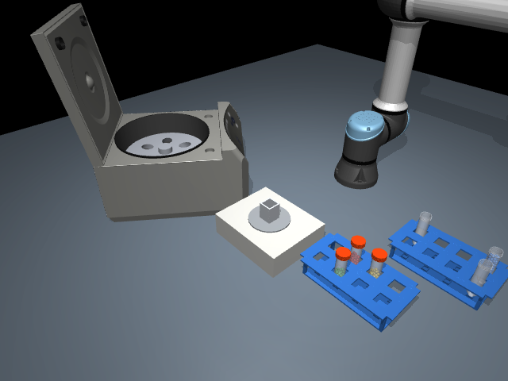
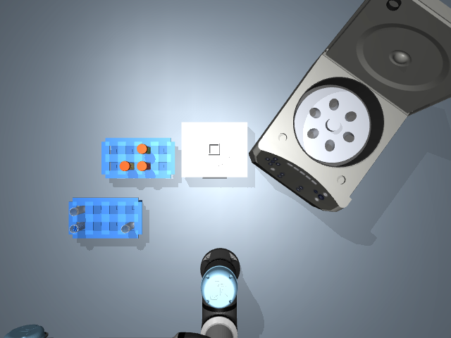
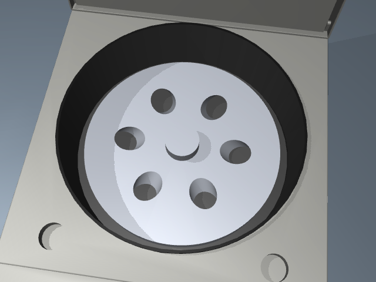
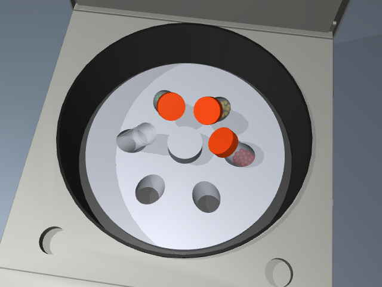
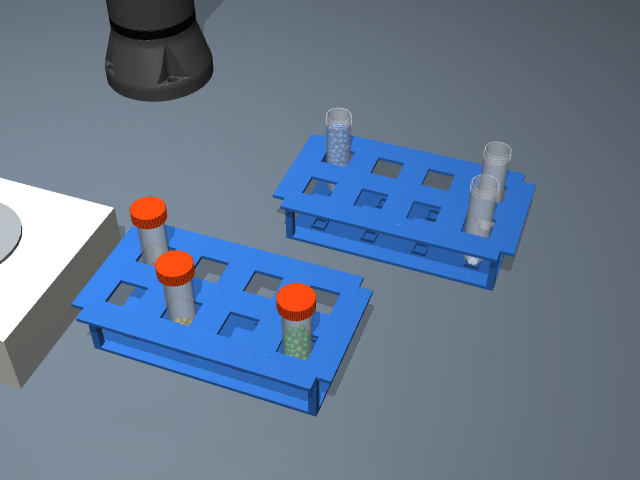
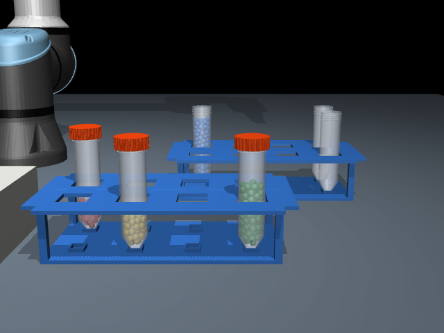

# Simulation Environment

The MuJoCo lab scene for the [centrifuge loading task](../docs/problem-statement/problem-statement.md):
one UR5e arm with a Robotiq 2F-85 gripper, a benchtop centrifuge with a six-place rotor, a lab balance,
two racks of 50 ml tubes, and liquid made of small balls.



## Run it

Everything installs into this folder (`.pixi/` and `assets/`), nothing outside it.

```bash
make setup    # install the environment, download the models (once)
make view     # open the scene in MuJoCo's window
make render   # save a picture from each camera into figures/
make info     # print the job, every tube's weight, and how fast it runs
make test     # run the tests (about 15 s)
```

`SEED=1` picks a different job and different rack cells, for example `make view SEED=1`. The job goes in
turn: seed 0 **pairs**, 1 **odd one**, 2 **triangle**, 3 **mismatch**, 4 pairs again, and so on (below).
In the window, press Tab and turn on geom group 3 to see the collision walls.

## What is in the scene

| Group | Objects |
|---|---|
| Arm | 1 x UR5e with a Robotiq 2F-85 gripper, a wrist camera and a wrist force/torque sensor |
| Centrifuge | AutoBio's Eppendorf 5430 housing and lid, with our six-place rotor: holes leaning 35° |
| Balance | A lab balance reading to 0.01 g, with a holder a tube stands in, and two pegs on its base holding spare caps for the balance tubes |
| Sample rack | 2 to 4 capped 50 ml sample tubes, each with a different coloured liquid |
| Supply rack | 2 open tubes of water, always in the corner cells 0 and 3 with the cells beside them empty, and 2 empty open tubes (for balance tubes) in cells 5 and 6 |
| Cameras | `overhead`, `racks_high` and `racks_low` (on the racks, for Step 0), `front`, `rotor` (looks into the open centrifuge), `arm/wrist` |

| | | |
|---|---|---|
|  |  |  |
| `overhead` | `rotor`, empty | `rotor`, four tubes in (put there by hand for the picture) |

| | |
|---|---|
|  |  |
| `racks_high`: every tube and cap, nothing in front | `racks_low`: the liquid, even in a tube a third full (left) |

From straight above, the caps hide the samples' liquid and a tube is about 10 pixels wide, so Step 0 also
gets two cameras on posts at the far edge of the bench, out of the arm's reach. Their places were chosen by
counting the pixels of each tube and of its liquid each candidate camera sees, over 12 seeds
([Step 0's approach](../step-0-find/docs/approach.md)). A map of where every camera stands, and the same tube as each
Step 0 camera sees it: [the cameras](../docs/problem-statement/problem-statement.md#the-cameras).

Sizes, weights, pictures and where each model comes from: [`docs/objects.md`](docs/objects.md).

## The jobs

The seed decides how the samples' weights relate, so the right way to load them differs:

| Job | Samples | What a correct load looks like |
|---|---|---|
| **pairs** | 2 or 4, in pairs of nearly equal weight | Each pair in opposite holes. No balance tube. |
| **odd one** | 3: a pair, plus one with no partner | Pairs opposite; the odd one opposite a balance tube filled to its weight. |
| **triangle** | 3 of nearly equal weight | All three 120° apart (holes 0, 2, 4). No balance tube. |
| **mismatch** | 2, far apart in weight | Each opposite its own balance tube. |

"Nearly equal" is within 1 ball (0.33 g) of liquid and the tubes' own small differences (±0.15 g), so
weighing is the only way to tell: by eye, the levels look the same. The limit for "balanced" is 1.0 g
(`BALANCE_TOLERANCE`, see [`docs/simulation-environment.md`](docs/simulation-environment.md)).

## How it is built

| File | What it does |
|---|---|
| `centrifuge_scene/settings.py` | every number: sizes, weights, friction, rotor geometry, layout, cameras, the jobs |
| `centrifuge_scene/tubes.py` | a 50 ml tube: AutoBio's mesh for looks, a ring of thin boxes for collision, a cap |
| `centrifuge_scene/liquid.py` | the balls: settling them in a tube, counting them for grading |
| `centrifuge_scene/racks.py` | the 2 x 4 rack for 50 ml tubes, with a seat under each hole for the tube's tip |
| `centrifuge_scene/centrifuge.py` | the centrifuge: AutoBio's housing and lid, our rotor, the lid latch |
| `centrifuge_scene/scale.py` | the balance: a pan on a stiff spring, a force sensor, the reading in grams |
| `centrifuge_scene/scene.py` | puts it all together for one seed; the arm; the job; joints, actuators, gripper command |
| `centrifuge_scene/grading.py` | which tube is in which hole, and how far out of balance the rotor is (for grading) |
| `centrifuge_scene/kinematics.py` | moves the gripper to a point, fingers pointing a given way (for tests; from v1) |
| `centrifuge_scene/view.py`, `render.py`, `info.py` | the `make` commands |

Why each part is built the way it is: [`docs/simulation-environment.md`](docs/simulation-environment.md).

## The rule that matters

The arm must not read the simulator's answers. `scene.Truth`, body positions, `liquid.balls_in` and
everything in `grading.py` are for tests and grading only.

The arm gets what a real robot would have: **camera images** (colour, and depth as from a depth camera),
**its own joint readings**, its **wrist force/torque sensor**, and the **balance's display**
(`scale.Balance.grams()`, which a real balance shows on its screen).
