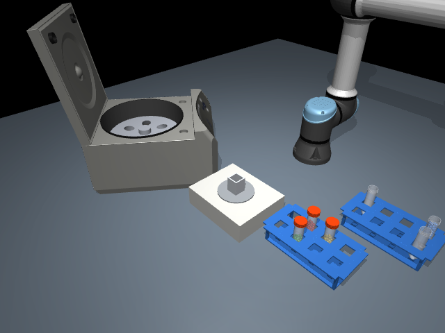
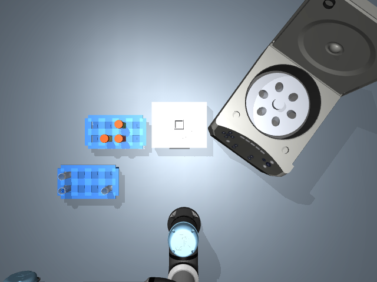
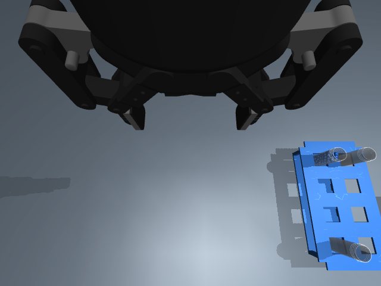
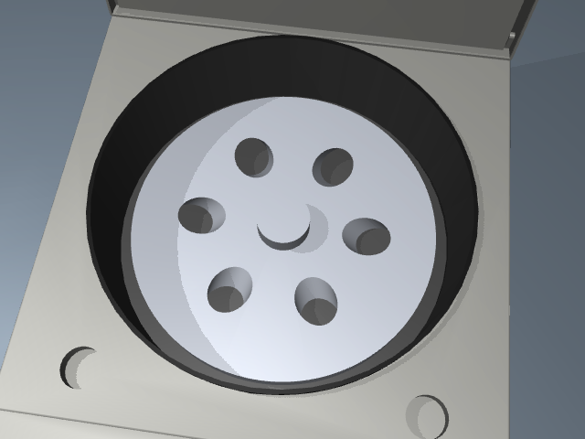
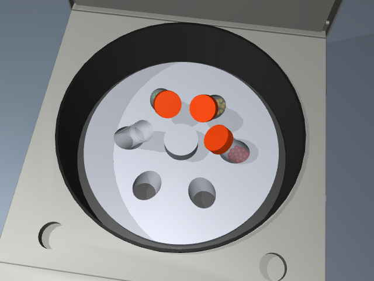

# Objects in the Scene

Everything on the table, what it is for, and how big and heavy it is. Sizes and weights are like the real
lab objects. Every number is in `centrifuge_scene/settings.py`.



## The layout

One arm, bolted to the table at the origin. Everything it works on is 0.35 to 0.65 m from its base, inside
the UR5e's 0.85 m reach:

```
      supply rack (0.20, 0.42)      sample rack (0.42, 0.30)

                                    balance (0.45, 0.02)

   arm (0, 0)                                 centrifuge (0.50, -0.36),
                                              lid hinge facing away from the arm
```

(x points away from the arm, y to its left. Lengths in metres.) The centrifuge is turned so its lid opens
away from the arm and the arm reaches in from the front, as a person would stand. The tests check that the
arm reaches every rack cell, the balance's holder, and every rotor hole along the hole's own axis.



## The arm

| Object | What it is | Where from |
|---|---|---|
| **Arm** | UR5e robot arm (6 joints, reach 850 mm, payload 5 kg) | MuJoCo Menagerie |
| **Gripper** | Robotiq 2F-85: two fingers that open up to 85 mm | MuJoCo Menagerie |
| **Wrist camera** | On the side of the wrist, looking along the fingers (as in v1) | ours |
| **Wrist force/torque sensor** | Between the wrist and the gripper: the UR5e's own built-in sensor (as in v2) | ours |

Names in the code start with `arm/`: `arm/shoulder_pan_joint`, `arm/gripper/pinch` (the point halfway
between the fingertips), `arm/wrist_force`.



## The tubes

All tubes are 50 ml conical centrifuge tubes ("Falcon" tubes), drawn with AutoBio's mesh.

| | Value | Note |
|---|---|---|
| Length | 114.6 mm without cap, 119.6 mm with | measured from AutoBio's mesh |
| Width | 29.2 mm (body), 35 mm (cap) | |
| Bottom | a cone, 15 mm tall | so it cannot stand on a flat surface: racks and the balance hold it |
| Inside | 50.1 ml | holds 148 balls |
| Weight | 11.5 g (± 0.15 g, each tube different), cap 2.0 g | typical for a polypropylene 50 ml tube |

| Tubes | How many | Cap | Inside |
|---|---|---|---|
| **Samples** `sample0`... | 2 to 4 | yes (orange screw cap) | 30 to 100 balls (about 10 to 33 ml), each its own colour |
| **Empty tubes** `blank0`, `blank1` | 2 | no | nothing: these become balance tubes |
| **Water** `water0`, `water1` | 2 | no | 126 balls each (85 % full, about 41 ml), blue. One per balance tube: two balance tubes can need up to 198 balls together, more than one tube holds |

Sample colours: dark red (blood), yellow (plasma), green, purple, orange.

## The liquid

The same balls as v1: **7 mm, frictionless**, made denser than water so that **1 ml weighs 1 g** once they
have settled (they fill about 55 % of the space). **One ball weighs 0.327 g.** So the balance reads real
weights, and the smallest amount of water that can be poured is one ball, a third of a gram.

## The racks

Ours, built from boxes (drawn and collided the same): a floor plate, a top plate with 31 mm square holes,
four legs. **2 rows x 4 holes, 60 mm apart**, 60 mm tall, 250 g. Under each hole is a small seat for the
tube's tip, so a heavy tube cannot slide and lean.

Why not v1's AutoBio rack: its cells are 30 mm, 36 mm apart, built for 25 mm tubes. A 50 ml tube's cap is
35 mm wide; neighbouring caps would touch, and the fingers would have no room to go in between.

Cells are numbered 0 to 3 along the row nearer the arm, 4 to 7 along the far row.

## The balance

| | Value |
|---|---|
| Base | 200 x 240 x 70 mm, fixed to the table |
| Pan | 120 mm round, with a square holder (31 mm hole, 50 mm tall) and a tip seat |
| Reads | to 0.01 g, zeroed with the empty holder on it (tared) |
| How | the pan sits on a stiff spring (20 kN/m); a force sensor under it feels everything on it |

`scale.Balance(model, data)`: `tare()`, then `grams()`. The tests check it reads every tube to within
0.05 g of its true weight (a real precision balance repeats to about 0.02 g).

## The centrifuge



| Part | What it is | Where from |
|---|---|---|
| **Housing** | A benchtop centrifuge, 340 x 430 x 236 mm | AutoBio's model of the Eppendorf 5430 (looks, most collision boxes) |
| **Lid** | Hinged at the back, held open by a gas spring | AutoBio (hinge, spring); our latch and damping |
| **Rotor** | Six holes for 15/50 ml tubes, leaning 35°, like Eppendorf's F-35-6-30 | ours |

| Rotor | Value |
|---|---|
| Holes | 6, 60° apart, numbered 0 to 5 anticlockwise seen from above |
| Hole lean | 35° from vertical, the top leaning in towards the middle |
| Hole centre at the rotor's top | 70 mm from the axis |
| How deep a tube goes in | 75 mm along its axis; 45 mm (with the cap) sticks out to be held |
| Width | shaped like the tube, 1.8 mm wider all round: 30.5 mm across the body, a cone at the bottom; widening to 36.5 mm over the top 6 mm (a lead-in) |
| Rotor | 256 mm across, its top 148 mm above the table |

| Lid | Value |
|---|---|
| Open | 1.72 rad (99°) from shut: where it rests, held by the gas spring |
| Shutting | push down at the front edge: 20 N shuts it in about 1.3 s, 10 N in about 2.6 s |
| Latch | catches the lid when it is pushed within 0.03 rad (1.7°) of shut, and holds it |
| Clearance | capped tubes in every hole stay 18 mm below the shut lid's underside |

The rotor never spins in the simulation: the task ends when the lid is latched. Whether the load would
spin smoothly is worked out from the tube weights (`grading.imbalance`, see
[simulation-environment.md](simulation-environment.md)).



## Where each model comes from

| Model | Source | Licence |
|---|---|---|
| UR5e, Robotiq 2F-85 | [MuJoCo Menagerie](https://github.com/google-deepmind/mujoco_menagerie), pinned | BSD-style (a LICENSE file in each folder) |
| Centrifuge housing and lid, 50 ml tube mesh | [AutoBio](https://github.com/autobio-bench/AutoBio), pinned (same commit as v1 and v2) | no licence file in the repository; fine for our learning use |
| Rotor, racks, balance, liquid | ours | |
