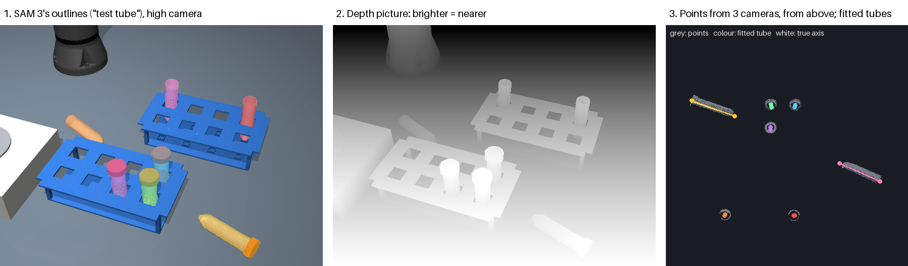

# Step 0 Approach: Find Everything

**Status: built and measured ([results.md](results.md)): Gemini Robotics-ER 2 on 4 seeds (then the key hit its
quota), SAM 3 on all 20.** The overview is in [steps.md](../../docs/solutions/steps.md#step-0-find-everything).

## What the arm knows, and what it finds

| Known (set up once, like a real robot work cell) | Unknown (the job): what Step 0 finds |
|---|---|
| Where the two racks stand, so where their 16 cells are | Which cells hold a tube |
| Where the balance, its holder and the centrifuge stand, and the rotor's six holes | For each tube: **sample** (capped), **water** (open, blue) or **empty** (open) |
| Where each camera is, and its lens | Each sample's liquid colour (so plans can say "the red sample") |

Nothing is trained. Gemini Robotics-ER 2 is asked in words and answers with points; our code turns the points
into cells.

## The pictures

Where each camera stands (a map) and the same tube as each camera sees it:
[problem statement, the cameras](../../docs/problem-statement/problem-statement.md#the-cameras).

| Camera | What it is for |
|---|---|
| `overhead` (1.25 m up, straight down) | the whole bench; which cells hold a tube |
| `racks_high` (a post at the far edge, about 45° down) | every tube and cap, nothing in front of another |
| `racks_low` (a post at the far edge, 22 cm up) | the liquid, even in a tube a third full |
| `rotor` | the holes (later: is each tube seated) |

**Why more than the overhead picture.** From straight above a tube is about 10 pixels wide, and the caps hide
the samples' liquid. A tube a third full keeps its liquid below the rack's top plate, which only a low camera
sees through the rack's open sides. No single camera sees everything.

**How the two rack cameras were placed.** Candidate places were tried on 12 seeds (72 tubes, 48 with liquid),
counting from the renderer's picture of which object is at each pixel how much of each tube, and of the liquid
in it, each camera sees:

| Camera | Tube pixels: fewest / median | Liquid pixels: fewest / median |
|---|---|---|
| overhead | 152 / 233 | 28 / 51 |
| **high, far edge (0.95, 0.60, 0.70)** | **462 / 603** | 19 / 219 |
| high, left (0.55, 0.95, 0.60) | 461 / 807 | 13 / 242 |
| low, far corner (0.85, 0.95, 0.25) | 555 / 1293 | 27 / 456 |
| low, left (0.25, 1.00, 0.25) | 452 / 1247 | 2 / 525 |
| **low, far edge, straight (1.00, 0.36, 0.22)** | 365 / 1151 | **102 / 657** |

The low straight camera is the only low one that sees every tube's liquid well. Both chosen cameras are beyond
the arm's reach. Their lenses were then narrowed (30° and 33°) so the racks fill the picture, and a test checks
that both see every tube (over 300 pixels each) on four seeds.

## How an answer becomes a cell

1. Gemini gets a picture and the question (in `find.py`): point to the top of every tube, and say its kind
   and colour, as JSON. Points come back as [y, x] on a 0 to 1000 scale (Google's format).
2. The pixel gives a line from the camera into the scene. The depth picture says how far along it the nearest
   surface is (the smallest depth in a 9 x 9 patch, because the tubes are clear plastic).
3. The point belongs to the known cell whose upright axis the line passes within 30 mm of, and if several do
   (cells one behind another), the one at the depth seen.

## Using several pictures: two ways, both measured

- **Our vote** (`separate`): one question per picture. A cell holds a tube if at least half the pictures saw
  one there. Its kind is the most common answer (ties: the high camera); its colour likewise (ties: the low
  camera, which sees liquid best).
- **One question** (`together`): all three pictures in one question; Gemini combines them and points in the
  high picture.

## Beyond cells: a tube's pose from its outline (`pose.py`)

Step 0 snaps every tube to a known cell, so it needs only one point per tube. That works because a tube in a
rack can only stand upright in one of 16 places. A tube knocked over onto the bench could be anywhere, lying
any way. For that, `pose.py` measures the tube itself from SAM 3's outline and the depth picture, using no
layout:



1. **Outline to point cloud.** Each pixel inside the outline, plus the depth picture's distance at that pixel,
   gives one 3D point on the tube's surface. The outline's edge is shaved by 2 pixels first, because there an
   outline often spills onto the background.
2. **First guess at the direction.** The direction the points spread out most is the tube's axis. (This is
   PCA, principal component analysis: it finds the directions in which a cloud of points is longest and
   thinnest.)
3. **Fit a cylinder.** The axis is tilted and slid, and the radius changed, until the points lie as close to
   the cylinder's surface as they can (least squares). Points still far off the surface are dropped (the
   wider cap, the cap's top, background) and the fit repeated, 4 rounds. A camera sees only the near half of
   a tube, but half a cylinder still fixes the whole cylinder.
4. **The ends** are where the points near the axis stop, measured on the unshaved outline. Only what a camera
   sees counts: a rack hides the bottom of a tube standing in it.
5. **A tube seen end-on** (an upright tube from straight above shows mostly its cap's top, about 140 points)
   is too little to fit a cylinder to. Under 200 points, or a cloud that isn't long, the arm instead finds
   the flat patch most points lie on (RANSAC: try many planes through 3 random points, keep the one most
   points lie on). The direction that patch faces is the axis. The 200 was set on seeds 100 to 105 (from
   overhead: upright at most 153 points, lying at least 232).
6. **Joining cameras.** Two cameras' fits are the same tube if each centre lies within 20 mm of the other's
   axis, the centres are within 80 mm, and (both seen from the side) the directions agree within 20°. A
   group holds at most one fit per camera. The group's points are fitted together. Then the fit kept,
   joined or one camera's own, is the one the most points of the group lie on, because one bad view can
   spoil a joined fit.

**Measured** (`evaluate_pose.py`) on the 20 test seeds, twice each: as built (every tube upright in its cell),
and with one sample and one empty tube taken out and laid on the bench at a random place and angle, then left
to roll to rest. Only layouts where the overhead and high cameras see both lying tubes whole are used. Two
kinds of outline: the simulator's own (`perfect`, which measures `pose.py` alone) and SAM 3's. For each tube:
found or not, standing or lying right, how far the axis direction and place are off, the diameter, and the
top (upright) or both ends (lying). Results: [results.md, section 6](results.md#6-a-tubes-place-direction-and-size-from-its-outline-point-cloud).

## How it is measured (`results.md`, once there is a key)

`evaluate.py` on 20 seeds (5 per job), for: overhead only; high only; overhead + high; all three with our
vote; all three in one question. For each: tubes found, missed and made up; kind right; colour right; how far
the depth puts each tube from its true top; seconds and dollars per seed.

**Checked without Gemini:** `--model oracle` answers from the simulator (every point exactly on its tube).
On 20 seeds every set of pictures finds 120 of 120 tubes, makes up none, and gets every kind and colour right.
So the pictures, geometry, cell matching and scoring are right, and whatever Gemini gets wrong is Gemini's.
(The angled cameras put the tube 6 mm off its centre, median: the depth picture sees the front of the cap, not
its middle. The cell, not this point, is what the arm uses.)

## Run it

1. Make a key at [aistudio.google.com](https://aistudio.google.com) (API keys) and **restrict it to the Gemini
   API**: Google refuses unrestricted keys with "403 Forbidden".
2. `cp v3-centrifuge-loading/.env.example v3-centrifuge-loading/.env` and paste the key after
   `GEMINI_API_KEY=`. `.env` is never committed.
3. Run:

```bash
cd v3-centrifuge-loading/step-0-find
PYTHONPATH=$PWD:$PWD/../simulation-environment pixi run --manifest-path ../simulation-environment/pixi.toml \
  python -m pytest -q tests                                   # no key needed
PYTHONPATH=$PWD:$PWD/../simulation-environment pixi run --manifest-path ../simulation-environment/pixi.toml \
  python evaluate.py --model gemini                           # 20 seeds, 80 questions
```

Each answer is saved in `results/raw/`, so re-running costs nothing. The 20-seed run asks 80 questions (3
pictures one at a time plus 1 with all three, per seed). Measured on seed 0: about **$0.045 and 47 s per seed**
(most of the tokens are Gemini's thinking, billed as output at $5 per million), so **about $0.90 and 15 minutes**
for 20 seeds.

The robotics models are previews: they are listed and served only under the API's `v1beta` version (the
default version answers 404 "model not found"). `gemini.py` sets it.

## Files

| File | What |
|---|---|
| `bench.py` | the known cells; the cameras (pixel to line, depth to point); taking colour and depth pictures |
| `gemini.py` | asking Gemini Robotics-ER 2 (model pinned to `gemini-robotics-er-2-preview`, thinking "medium"); the key; saved answers; cost |
| `find.py` | the questions, reading answers, points to cells, the vote |
| `evaluate.py` | the 20-seed measurement, and the perfect-answer check |
| `sam.py` | SAM 3's outlines, and our rules for what each tube is |
| `pose.py` | outline + depth to a point cloud, then a fitted cylinder: place, direction, size |
| `evaluate_pose.py` | measuring `pose.py`: upright and knocked-over scenes, perfect and SAM 3 outlines |
| `evaluate_masks.py` | SAM 3's outlines against the simulator's true outlines, pixel by pixel |
| `figures.py` | the pictures in these docs |

## Open questions

- Does Gemini point exactly enough at 640 x 480 to put each tube in the right cell (cells are 60 mm apart)?
- Is the orange sample's liquid confused with the orange caps?
- The holes and the lid: checked from the rotor picture in Step 4 and Step 5 (their places are known).
