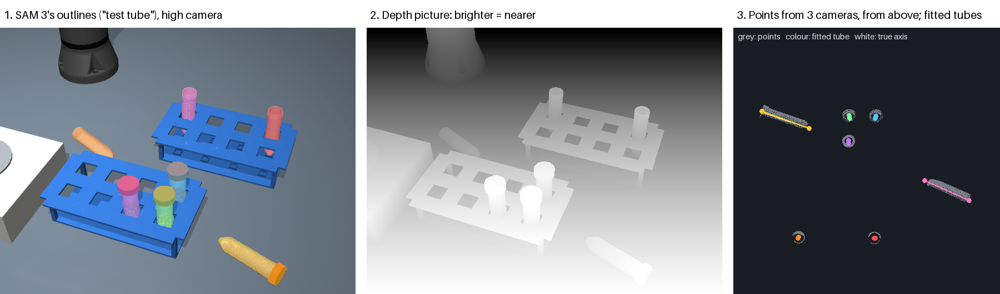

# Step 0 Results: Find Everything

How it works: [approach.md](approach.md). Measured 2026-11-17.

**What was measured:** Gemini Robotics-ER 2 on **seeds 0 to 3** (24 tubes). The run stopped at seed 4 when the
key hit Google's quota, and no more Gemini calls were made. SAM 3 on **all 20 test seeds** (120 tubes). Both
are compared on seeds 0 to 3, where both answered every question. Everything is scored against the
simulator's answers.

**2026-11-19, a second water tube in the scene** (for Step 3: two balance tubes can need more water than one
tube holds; the supply rack now has `water0`/`water1` in cells 0 and 3 and the empty tubes in 5 and 6). SAM 3
was run again on the 20 test seeds: with the high rack camera it still finds **140 of 140** tubes (7 a seed
now) with every kind and colour right; the overhead camera alone finds 100 of 140, as before
(`results/evaluation_sam3.json`; the old scene's run is `evaluation_sam3_one_water_tube.json`). Gemini was not
run again (no calls without asking); its numbers below are from the old scene.

## In short

| Question | Answer |
|---|---|
| Does one overhead picture work? | **No.** Gemini sees every tube but gets 13 of 24 colours wrong (it sees the orange caps, not the liquid). SAM 3 misses most tubes from overhead (33 of 120 found). |
| With the high camera on the racks? | **Both models are perfect** at what each tube is: every tube found, nothing made up, every kind and colour right (Gemini 24 of 24; SAM 3 120 of 120). |
| How exact are the positions? | A few pixels and millimetres: well inside the 30 mm a tube must be within to land in the right cell. Gemini points a little more exactly (3 against 4 px on the high camera). |
| Cost and speed | Gemini: 8 to 17 s and about $0.01 per picture. SAM 3: about 5 s per picture on this Mac's GPU, free. |
| Can the outlines also give a tube's 3D place, direction and size, with no layout? | **Yes** (section 6): SAM 3's outlines + the depth picture put every tube, standing or knocked over, on its true axis within about 1 to 2 mm and 2 to 3°. |

## 1. Gemini and SAM 3 side by side (seeds 0 to 3, 24 tubes)

**What each tube is**

| Pictures | Gemini: found / made up | Gemini: kind / colour right | SAM 3: found / made up | SAM 3: kind / colour right |
|---|---|---|---|---|
| overhead only | 24 / 0 | 24 / **11** | **13** / 0 | 13 / 13 |
| high camera only | 24 / 0 | 24 / 24 | 24 / 0 | 24 / 24 |
| overhead + high | 24 / 0 | 24 / 24 | 24 / 0 | 24 / 24 |
| all three, our vote | 24 / 0 | 24 / 24 | 24 / 0 | 24 / 24 |
| all three, one question (Gemini only) | 24 / 0 | 24 / 24 | | |

**Where each tube is** (median / 95 % under)

| Pictures | Point off in the picture, px: Gemini / SAM 3 | At the tube's known height, sideways mm: Gemini / SAM 3 | Within 10 mm without the cell layout: Gemini / SAM 3 |
|---|---|---|---|
| overhead only | 2 / 4 · 8 / 15 | 5 / 10 · 19 / 37 | 22 / 0 of 24 |
| high camera only | 3 / 5 · 4 / 8 | 4 / 7 · 6 / 9 | 18 / 24 of 24 |
| overhead + high | 2 / 5 · 7 / 14 | 5 / 10 · 9 / 35 | 23 / 24 of 24 |
| all three, our vote | 3 / 9 · 6 / 13 | 6 / 46 · 18 / 42 | 23 / 24 of 24 |

Within 20 mm, every set of pictures places all 24 tubes for both models, except SAM 3 from overhead alone (7 of
24).

What the position columns mean:
- **Point off in the picture:** the model's point against the true top of the tube drawn into the same
  picture. With perfect answers this is 0.
- **At the tube's known height:** the camera's line through the point, met at the height of a 50 ml tube's top
  (every tube is the same), against the true top. With perfect answers this is 0.
- (The 3D point from the depth picture alone is 6 to 17 mm off even with perfect answers, because the depth
  sees the front of the cap, not its middle. The full tables are printed by `compare.py`.)

## 2. SAM 3 on all 20 seeds (120 tubes)

| Pictures | Found | Missed | Made up | Kind right | Colour right | Point off, px | Known height, mm | Within 10 mm, no layout |
|---|---|---|---|---|---|---|---|---|
| overhead only | 33 | 87 | 0 | 33 of 33 | 33 of 33 | 7 / 15 | 18 / 37 | 0 of 120 |
| **high camera only** | **120** | 0 | 0 | **120 of 120** | **120 of 120** | 4 / 8 | 6 / 9 | **120 of 120** |
| overhead + high | 120 | 0 | 0 | 120 of 120 | 120 of 120 | 6 / 13 | 8 / 33 | 120 of 120 |
| all three, our vote | 116 | 4 | 0 | 116 of 116 | 116 of 116 | 6 / 13 | 18 / 42 | 120 of 120 |

The 4 tubes missed by "all three" were each seen by the high camera, but by neither of the other two, so they
lost the vote (2 of 3 pictures must agree). The overhead camera is what drags the three-picture vote down.

## 3. What we learned

- **The extra cameras were needed.** From straight above, the caps hide the liquid (Gemini guessed colours from
  the caps) and the tubes are tiny (SAM 3 missed most). The high camera on the racks fixes both, for both models.
- **A model that reasons and a model that only outlines.** Gemini says what a tube is. SAM 3 only draws
  outlines, so our own rules decide sample, water or empty and the colour. The first rules failed because the
  tubes are clear and **the blue rack shows through them**: every empty tube looked like water. Two plain facts
  fixed it (no sample is blue; a water tube shows much more blue than the rack behind an empty one), with the
  limits set on seeds 100 to 111, never tested on. Given perfect outlines from the simulator, the rules then got
  all 120 tubes, kinds and colours right on the 20 test seeds, so SAM 3's results above measure SAM 3.
- **The word matters for SAM 3.** "tube" gets low scores on these clear tubes; "test tube" works ("vial" and
  "centrifuge tube" about as well, chosen on seeds 100 to 103).
- **Gemini points slightly more exactly; SAM 3 is free, quicker and offline.** Part of SAM 3's larger offset may
  be our code, which takes its point from the top sixth of its outline.
- **More pictures is not always better with a simple vote.** The weak overhead camera costs SAM 3 four tubes and
  makes the worst position errors larger. Overhead + high, or high alone, is the better set.

## 4. Cost and the Gemini quota

| | |
|---|---|
| Gemini answers today | 19 (seeds 0 to 3 complete, 3 questions of seed 4) |
| Tokens | 32,346 in, 34,258 out (including thinking) |
| Cost | **about $0.20** at $1 / $5 per million tokens in / out (plus under a cent for two test calls; requests refused with "quota exceeded" are not billed) |
| SAM 3 | free; the model is a 3.4 GB download (about 27 minutes), then about 5 s per picture |

After seed 3 every request was refused: **"429: You exceeded your current quota, please check your plan and
billing details."** Google's library retried these silently, so they looked like requests hanging (once for 45
minutes). Now `gemini.py` turns those retries off and stops the run at once on a quota error. The cause of the
quota error is for the key's owner to check in AI Studio (usage, rate limits and billing for that project):
this project's own use was the 19 answers above.

## 5. Not done yet

- Gemini on seeds 4 to 19: `evaluate.py --model gemini` asks only the questions not already saved (about $0.70).
- SAM 3 fine-tuned, as a separate row: train on other seeds with the simulator's outlines as labels, perhaps
  with the words "sample tube", "water tube", "empty tube" so SAM 3 itself says what each tube is.

## 6. A tube's place, direction and size from its outline (point cloud)

Measured 2026-11-18. How it works: [approach.md](approach.md#beyond-cells-a-tubes-pose-from-its-outline-posepy).

**The question:** the vision models give pixels, not just labels. Can those pixels, with the depth picture,
tell the arm where a tube is, which way it points and how big it is, with no rack layout? This is what an
arm needs for an object that could be anywhere, like a tube knocked over onto the bench.

**The test:** the 20 test seeds as built (120 tubes, all upright in the racks), and the same 20 seeds with one
sample and one empty tube laid on the bench at a random place and angle (40 lying tubes, 80 still standing).
Every outline becomes a point cloud, then a fitted cylinder. The fit never sees the simulator's answers; they
are only used to grade.



*Seed 0, knocked over. Left: SAM 3's outlines. Middle: the depth picture. Right: every point from the three
cameras, seen from above, with each fitted tube (coloured line, its ends as dots) over the simulator's true
axis (white). The two lying tubes and the five standing ones all sit on their true axes.*

### In short (SAM 3's outlines, the three cameras joined)

| | Upright in the racks (120) | Lying on the bench (40) |
|---|---|---|
| Found | 120 | 39 |
| Made up | 4 (in 20 scenes) | 1 (in 20 scenes) |
| Standing or lying, right | 120 of 120 | 39 of 39 |
| Direction off, median / 95 % under | 0.4° / 3.2° | 1.0° / 1.9° |
| Axis place off, median / 95 % under | 0.6 / 1.4 mm | 0.5 / 1.9 mm |
| Diameter off (true 29.2 mm) | 2.2 / 4.1 mm | 2.0 / 4.4 mm |
| Top off (upright) or both ends off (lying) | 1.4 / 4.3 mm | 2.6 / 7.3 mm |

**Yes: SAM 3's outlines plus the depth picture put each tube on its true axis within about 1 to 2 mm and 2
to 3°, standing or lying, with no layout.** The simulator's own perfect outlines do about the same (below),
so SAM 3's outlines are not what limits it.

What the columns mean:
- **Axis place off:** how far the fitted centre is from the tube's true centre line, sideways. This is what
  matters for a grip.
- **Direction off:** the angle between the fitted axis and the true one.
- **Made up:** a fitted tube where there is none. Of the 5: 3 came from low-camera outlines that are mostly
  right (they match their tube at IoU 0.8 to 0.9, section 7) but spill 6 to 14 % of their pixels onto the
  neighbouring tube. Those pixels carry the neighbour's depth, 30 to 60 mm nearer or farther, and pull the
  3D fit about 30 mm off to the side. 1 was a 37 mm scrap of an outline, and 1 was a tube found twice (a
  half-hidden tube whose side view tilted 23°, so it did not join the overhead's view of the same tube).

### Camera by camera

**Lying tubes (40)**

| Pictures | Outlines | Found | Made up | Direction off (deg) | Place off (mm) | Both ends off (mm) |
|---|---|---|---|---|---|---|
| overhead only | perfect / SAM 3 | 40 / 39 | 0 / 0 | 0.8 / 1.3 | 0.4 / 0.4 | 2.0 / 2.6 |
| high only | perfect / SAM 3 | 40 / 38 | 0 / 0 | 1.1 / 1.6 | 0.4 / 0.5 | 2.5 / 2.7 |
| low only | perfect / SAM 3 | 40 / 36 | 0 / 1 | 1.1 / 0.7 | 0.5 / 0.5 | 14.2 / 10.6 |
| high + low, joined | perfect / SAM 3 | 40 / 38 | 1 / 2 | 1.4 / 1.4 | 0.4 / 0.5 | 2.8 / 3.2 |
| **all three, joined** | perfect / SAM 3 | **40 / 39** | 0 / 1 | 1.3 / 1.0 | 0.4 / 0.5 | 2.5 / 2.6 |

**Upright tubes in the racks (120)**

| Pictures | Outlines | Found | Made up | Standing right | Direction off (deg) | Place off (mm) | Top off (mm) |
|---|---|---|---|---|---|---|---|
| overhead only | perfect / SAM 3 | 120 / 33 | 0 / 0 | 60 / 18 | 45 / 3.5 | 2.5 / 2.6 | 15.3 / 2.5 |
| high only | perfect / SAM 3 | 120 / 119 | 0 / 1 | 119 / 119 | 2.9 / 2.9 | 2.1 / 2.0 | 4.0 / 4.0 |
| low only | perfect / SAM 3 | 120 / 117 | 0 / 3 | 118 / 117 | 1.7 / 0.6 | 0.4 / 0.4 | 2.5 / 0.6 |
| high + low, joined | perfect / SAM 3 | 120 / 120 | 0 / 4 | 120 / 120 | 1.1 / 1.1 | 0.7 / 0.6 | 1.6 / 1.5 |
| **all three, joined** | perfect / SAM 3 | **120 / 120** | 0 / 4 | 120 / 120 | 1.1 / 0.4 | 0.7 / 0.6 | 1.6 / 1.4 |

Medians. The full tables (with 95 % values, and the 80 tubes still standing in the knocked-over scenes, which
look like the upright ones) are printed by `evaluate_pose.py` and saved in `results/evaluation_pose_*.json`.

### What we learned

- **The models give places, not just names.** An outline (SAM 3) or a point (Gemini) is pixels. With the
  camera's calibration and a depth picture, every pixel becomes a 3D point, and a fitted shape gives the
  object's place, direction and size. That is what YOLO or our own network gave in v1, without training
  anything.
- **Half a tube is enough.** A camera sees only the near half of a tube, but a cylinder fitted to half its
  surface still finds the whole axis. A plain "long direction of the points" (PCA) was not enough: the cap's
  top tipped it about 12° on upright tubes. The cylinder fit brought that down to about 1 to 3°.
- **Straight down is the wrong view for a standing tube.** From overhead, an upright tube shows its cap's top
  and little else (about 140 points). Its direction comes from which way the cap's top faces. That works for
  capped tubes but not for open ones, where the camera looks down inside the tube. So overhead alone gets
  only 60 of 120 standing tubes right, even with perfect outlines. Lying tubes, seen whole from above, it
  measures best of all.
- **Hidden tubes are the hard case.** A tube standing behind another shows little more than its cap. A few
  of those fit badly: with all three cameras joined, 1 of 120 upright tubes is over 10° off with SAM 3's
  outlines (4 with perfect ones). A camera from another side is the fix.
- **Joining cameras needs care.** A plain "same place = same tube" rule let one bad view chain two tubes
  together. Requiring the directions to agree, allowing at most one view per camera, and keeping the fit the
  most points agree with fixed it.
- **For the job itself, cells still win.** In the racks the cell's known centre is exact. The point cloud is
  for when there is no layout to snap to: a tube knocked over, or an object never seen before.

### Limits

- **The simulator's depth is perfect.** A real depth camera on clear plastic is noisy, often sees through
  the tube, or returns nothing. These numbers are the best case. A real robot would need the depth camera
  tested on real tubes, or the known tube size used in the fit.
- **Only one kind of object.** The fit assumes a cylinder. Another shape needs its own model (a box, or
  matching a 3D model of the object).

### Not done yet

- The same test with noise and missing pixels added to the depth picture, as a real depth camera gives.
- Use the fitted pose to pick up a knocked-over tube and stand it back in a cell.

## 7. How exact are SAM 3's outlines?

Measured 2026-11-18 (`evaluate_masks.py`). SAM 3 only draws outlines; our rules then decide what each tube is
(section 3). So how close are the outlines themselves to the truth? The simulator can draw, for every pixel,
which object is seen there, so each tube's true outline is exact: the pixels where that tube (body or cap) is
what the camera sees. Each true outline is compared with the SAM 3 outline that overlaps it most. Same scenes
as section 6: 20 seeds upright and 20 knocked over, 3 cameras.

What the numbers mean:
- **IoU** (intersection over union): the pixels both outlines share, divided by the pixels either one
  covers. 1.0 is a perfect match. 0.5 is the usual bar for "the same object"; below it, the tube counts as
  missed.
- **Precision:** the share of SAM 3's outline that really is the tube. The rest spilled onto something else.
- **Recall:** the share of the tube that SAM 3's outline covers. The rest it missed.
- **Edge off:** wrong pixels (missed plus spilled) divided by the length of the tube's true edge. Roughly
  how far SAM 3's edge sits from the true edge, on average, in pixels.
- **Cap covered:** for capped tubes, the share of the cap's pixels inside the tube's outline. (SAM 3 is asked
  for "test tube"; does it count the cap as part of the tube?)

Medians, with the worst 5 % after the slash, over the tubes found (IoU at least 0.5):

| Camera | Tubes | Found | IoU | Precision | Recall | Edge off (px) | Cap covered |
|---|---|---|---|---|---|---|---|
| overhead | standing | 106 of 200 | 0.89 / 0.67 | 0.92 / 0.68 | 0.98 / 0.91 | 0.54 / 1.04 | 0.98 / 0.96 |
| overhead | lying | 39 of 40 | 0.92 / 0.88 | 0.97 / 0.93 | 0.95 / 0.92 | 0.45 / 0.62 | 0.97 / 0.92 |
| **racks_high** | standing | **200 of 200** | **0.96 / 0.94** | 0.98 / 0.97 | 0.98 / 0.95 | 0.42 / 0.53 | 0.99 / 0.98 |
| racks_high | lying | 38 of 40 | 0.96 / 0.96 | 0.99 / 0.98 | 0.97 / 0.96 | 0.48 / 0.61 | 0.99 / 0.97 |
| racks_low | standing | 199 of 200 | 0.95 / 0.86 | 0.98 / 0.92 | 0.97 / 0.91 | 0.48 / 0.69 | 0.98 / 0.96 |
| racks_low | lying | 36 of 40 | 0.96 / 0.95 | 1.00 / 0.99 | 0.96 / 0.95 | 0.61 / 0.85 | 0.98 / 0.93 |

("Tubes" counts every tube the camera sees at least 30 pixels of, so the 120 + 80 standing tubes of both
kinds of scene.) Only 1 outline in all the pictures matched no tube (low camera).

**What it shows:**
- **When SAM 3 finds a tube, its outline is nearly the true one.** On the two rack cameras the median IoU is
  0.95 to 0.96, and the edge sits about half a pixel from the true edge. That is about as close as an
  outline can get at this picture size: half a pixel is the rounding at the edge.
- **It counts the cap as part of the tube** (98 to 99 % of the cap's pixels are inside the outline). That is
  why our rule needs a separate "orange cap" outline to tell samples from open tubes.
- **Missing is the problem, not bad outlines.** From overhead SAM 3 finds 106 of 200 standing tubes. The ones
  it misses get no outline at all (best IoU 0). They are no smaller than the ones it finds (both about 230
  pixels), and capped and open tubes are missed alike: from straight above, SAM 3 is just unsure these are
  "test tubes", and about half fall under its 0.5 confidence cut-off.
- **A good outline in 2D can still mislead in 3D.** The worst 5 % on the low camera (IoU 0.86) are outlines
  that spill onto the tube behind or in front. In the picture that is a few percent of pixels. In depth those
  pixels are 30 to 60 mm away, which is what caused 3 of the made-up tubes in section 6. Dropping points
  whose depth jumps away from the rest of the outline would likely fix it (not tried yet).

## Reproduce

```bash
cd v3-centrifuge-loading/step-0-find
P="pixi run --manifest-path ../simulation-environment/pixi.toml"
PYTHONPATH=$PWD:$PWD/../simulation-environment $P python compare.py --seeds 4               # saved answers only
PYTHONPATH=$PWD:$PWD/../simulation-environment $P -e sam python evaluate.py --model sam3   # SAM 3, 20 seeds
PYTHONPATH=$PWD:$PWD/../simulation-environment $P python evaluate.py --model outlines       # our rules alone
PYTHONPATH=$PWD:$PWD/../simulation-environment $P python evaluate_pose.py --outlines perfect # pose, 2.5 min
PYTHONPATH=$PWD:$PWD/../simulation-environment $P -e sam python evaluate_pose.py --outlines sam3   # pose, SAM 3
PYTHONPATH=$PWD:$PWD/../simulation-environment $P -e sam python evaluate_masks.py          # outlines vs truth
PYTHONPATH=$PWD:$PWD/../simulation-environment $P -e sam python figures.py                 # the pictures
```
