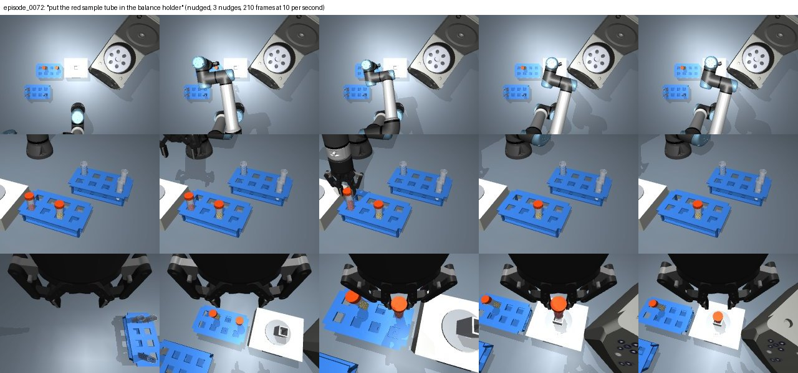

# Step 1 Dataset: Demonstrations for the Learned Models

Recorded 2026-11-18 from the programmed arm (the teacher), for SmolVLA first and later π0.5 (both read the
same data). The code is `record.py` (recording), `teacher.py` (the teacher) and `test_scenes.py` (the test
scenes).

## In short

| Part | Episodes | Seeds | What it is for |
|---|---|---|---|
| **Training** | **120**: 72 clean + 48 nudged | 100-112 (clean), 200-208 (nudged) | the model learns from these |
| **Validation** | 12: 6 clean + 6 nudged | 300-301, 400 | held out from training, to watch that the model is not just memorising |
| **Test A** (normal) | none recorded | 0-19 as built (60 tubes) | the trained model drives the arm; scored like the programmed arm |
| **Test B** (changed) | none recorded | 0-19 with the sample rack and the balance moved | where the programmed arm fails by design |

All 66 weighings tried were kept: none failed, so none had to be dropped. Recording took 9 minutes on 4
workers; the dataset is 700 MB (in `data/`, never committed).

**Recorded again 2026-11-19** after a second water tube was added to the supply rack (for Step 3), so the
pictures match the scene the models will be tested in: again 66 of 66 weighings kept (10 minutes), 120
training and 12 validation episodes, converted to LeRobot's format (21,085 training frames). The old
recording is in `data_one_water_tube/`. Nothing has been trained on either yet.



## What an episode is

One weighing gives **two episodes**, one sentence each:

| Part | Sentence (example) | From | To |
|---|---|---|---|
| to the holder | "put the red sample tube in the balance holder" | wherever the arm is (home, or above the last tube's cell) | the tube standing in the holder, fingers open above it |
| back | "put the red sample tube back in row 2, column 1 of the sample rack" | above the holder | the tube back in its cell, fingers open above it |

The balance reading in between stays programmed (wait for a steady display) and is not part of any episode.

Each episode is about 17 seconds: **151 to 218 frames** at 10 frames per second (21,081 training frames in
all). Every frame holds:

| Item | What |
|---|---|
| 3 pictures, 256 x 192 | `overhead` (the whole bench and the balance), `racks_high` (every tube and its liquid's colour, which the overhead camera cannot see because of the caps), `wrist` (the fingers and the cap) |
| state (7 numbers) | the 6 joint angles, and how closed the gripper is (0 open, 1 closed) |
| action (7 numbers) | the teacher's 6 joint targets for the next 0.1 s, and its gripper command (0 open, 1 closed) |

Saved as plain files per episode (`data/train/episode_0000/`: the JPEG pictures, `data.npz`, `meta.json`
with the sentence and where it came from). They are converted to LeRobot's format (the one SmolVLA and π0.5
read) when training starts.

## The teacher, and the nudges

The programmed arm plans a whole straight line and plays it back. A teacher for a learned model must instead
answer "from exactly here, what is the right move?". So `teacher.py` decides every 0.1 s: it moves a
reference point one step along the line to the next waypoint and sets the joint targets that put the fingers
there. The waypoints are the programmed arm's (the same cells, holder, heights and finger turns, which scored
60 of 60).

**Nudged episodes** push the arm 2 to 5 mm (and up to 3°) off the teacher's step for a few tenths of a second,
then let the teacher steer back. The recorded action is always the teacher's, never the push. So the model
sees, again and again, what to do when it is slightly off: the most common way a copied policy goes wrong.
The pushes happen only in the open, never within 8 cm above a cap, cell or holder (the open fingers pass the
caps with 5 mm to spare), and at most 4 per episode. In the training set: 48 nudged episodes with 1 to 4
pushes (2 had none, being short), 97 pushes in all.

**No failures are recorded.** A weighing whose tube did not end where it should, or that moved anything else
more than 2 mm, would have been dropped whole (both episodes). None was.

**Later, after the first training ("DAgger"):** the trained model drives and the teacher labels each moment
with the right move from where the model has got to. The teacher already works from any state, so this needs
only a loop that lets the model drive.

## What the training set covers

| | Count |
|---|---|
| Sample colours | red 44, yellow 44, green 26, purple 6 episodes (orange never occurs: no job has 5 samples) |
| Cells (of 8) | every cell: 4 (26), 1 (20), 3 (18), 6 (16), 2 (12), 0 (10), 7 (10), 5 (8) |
| Jobs | all four (the seeds cycle through pairs, odd one, triangle, mismatch) |

Purple is rare because only the 4-sample "pairs" jobs have a fourth sample. Worth knowing when reading the
results: a model may do worse on the purple tube.

## The test scenes

Test scenes are where the trained model drives the arm in the simulator; they are never recorded. The same
checks as for the programmed arm: the balance read within 0.05 g, the tube back in its cell (within 3 mm,
upright within 3°), nothing else moved more than 2 mm.

**Test B's changes** (`test_scenes.json`, drawn once from a fixed seed): the sample rack moved 1.6 to 3.0 cm
and the balance 1.0 to 1.9 cm, in random directions, never within 1.5 cm of anything else.

| On the test scenes | Test A (normal) | Test B (changed) |
|---|---|---|
| Programmed arm | **60 of 60** | **0 of 60**: it finds no tube where the layout says one stands, and refuses to move (nothing knocked) |
| SmolVLA (clean + nudged) | to measure | to measure |

The programmed arm is only blind to B because it uses the layout's numbers, not its cameras. Test B asks
whether a model that steers by its cameras can cope.

## Reproduce

```bash
cd v3-centrifuge-loading/step-1-weigh
P="pixi run --manifest-path ../simulation-environment/pixi.toml"
PYTHONPATH=$PWD:$PWD/../simulation-environment $P python record.py --workers 4             # about 9 min
PYTHONPATH=$PWD:$PWD/../simulation-environment $P python evaluate.py --changed --workers 4   # test B, programmed
```

The recording is repeatable: the same seeds give the same episodes.
