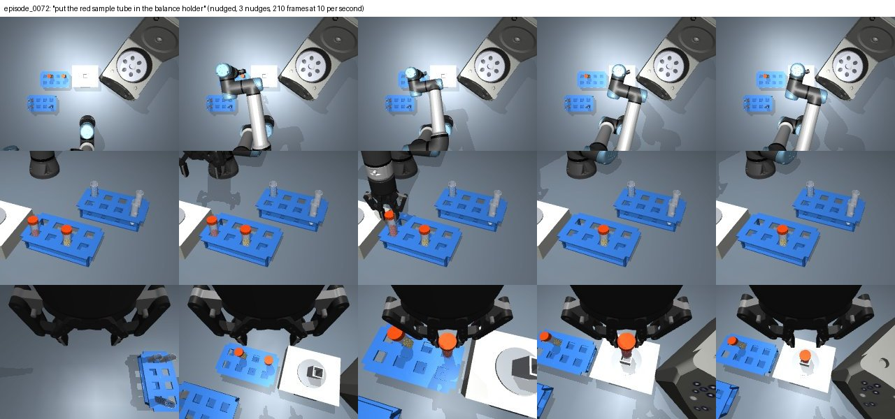
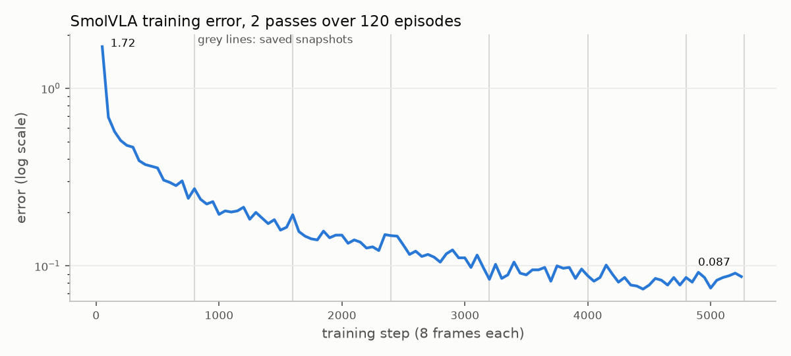
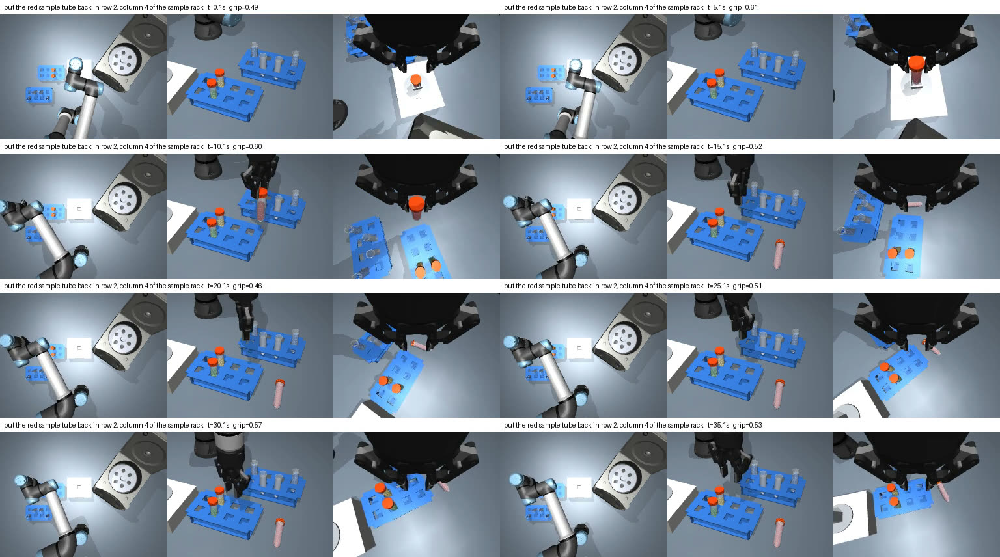
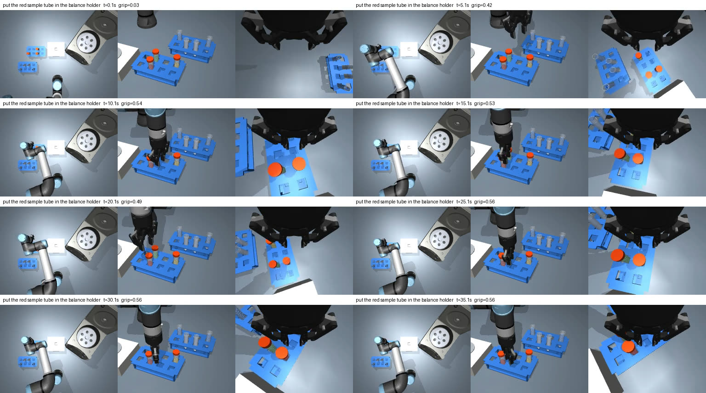

# Step 1: SmolVLA, First Training Run (2026-11-20)

The first learned model for Step 1. The goal of this run was to **learn how training works and what the
results look like**, not to get a good score. How the plan fits together: [approach.md](approach.md) (part B).
What the training data is: [dataset.md](dataset.md). The programmed arm's results: [results.md](results.md).

## Where we are (read this first)

- SmolVLA was trained **on this Mac** for 2 hours (2 passes over the data). Training worked: its error fell
  from 1.72 to 0.087.
- In the simulator it **fails every task: 0 of 6**. It knows *where to go* (it heads for the rack, then the
  holder) but not *how to grip*: it never closes the fingers firmly, bumps tubes, and twice knocked things over
  so hard that the simulation blew up.
- This is roughly what to expect after so little training. Nothing is broken; the pipeline (data → training →
  driving the arm in the simulator → videos) now works end to end, so the next runs are cheap to try.
- Nothing is running. The next choices are listed at the end ([What next](#what-next)).

## Words used here

- **SmolVLA**: a "vision-language-action" model from Hugging Face (450 million numbers inside; 100 million of
  them are trained here, the rest stay as downloaded). It looks at camera pictures, reads a sentence, and
  answers with the next arm moves.
- **Base model**: `lerobot/smolvla_base`, SmolVLA already trained by Hugging Face on many other robots. We
  start from it and adjust it to our arm (called **fine-tuning**).
- **Episode**: one recorded job from start to end, e.g. "put the red sample tube in the balance holder".
- **Frame**: one moment of an episode (every 0.1 s): 3 camera pictures + the arm's 7 numbers (6 joint angles
  and the gripper) + what the teacher did next.
- **Pass** (or *epoch*): the model has looked at every training frame once.
- **Step**: one small adjustment of the model, after looking at 8 frames.
- **Error** (or *loss*): how far the model's guess is from what the programmed arm really did. Lower is better.
- **Snapshot** (or *checkpoint*): a saved copy of the model partway through training.

## What it was trained on

| | |
|---|---|
| Training episodes | **120** (60 weighings × 2: to the holder, and back to its cell) |
| of which clean | 72: the programmed arm doing the job normally |
| of which nudged | 48: the arm is pushed 2 to 5 mm off course now and then, and shows how to get back |
| Training frames | **21,085** (10 per second, about 35 minutes of arm movement) |
| Validation episodes (kept apart) | 12 (2,137 frames); not used in this run |
| Cameras | overhead, high rack camera, wrist; 256 × 192 pixels each |
| Failures in the data | none (the arm never sees a failed job) |

A sample frame from the three cameras: 

## Training

| | |
|---|---|
| Where | this MacBook's GPU (Apple "MPS"); no internet needed while training |
| Length | 2 passes = 5,272 steps of 8 frames |
| Time | 15:42 to 17:58, **2 h 16 min** (about 1.45 s per step; ~5 frames per second) |
| Snapshots | 7: steps 800, 1600, 2400, 3200, 4000, 4800, 5272 (one every ~20 min, 1.25 GB each) |
| Error | 1.72 at the start → about 0.2 after 20 to 25 min → 0.10 after 1.5 h → **0.087** at the end |



The error drops fast in the first 20 minutes (the model learns the rough moves), then slowly. The slow part is
where the precise moves are learned, and it was still going down when training stopped.

For scale: one pass takes about 70 minutes on this Mac. Hugging Face's usual recipe for SmolVLA is about 60
passes (20,000 steps of 64 frames), which would take about **67 hours** here. Our run was about 1/30 of that.

## The test

The final snapshot (step 5272) drove the arm in **3 test scenes** (seeds 0, 1 and 2; never recorded for
training), on each of Step 1's two tasks, with the first sample tube of the scene (always the red one):

- **A, to the holder**: the arm starts at home; the model is told "put the red sample tube in the balance holder".
- **B, back to its cell**: the programmed arm first puts the tube in the holder; then the model is told
  "put the red sample tube back in row 1, column 4 of the sample rack".

Every 0.1 s the model gets what it got in training (the 3 pictures, the 7 numbers, the sentence) and answers
with 7 numbers: where the 6 joints should go next and the gripper command. It plans 5 s ahead and looks again
every 1 s. Each try has 40 s (the programmed arm needs about 20 s).

A try **succeeds** if the tube ends standing within 4 mm of its goal and within 3° of upright (the same check
the recordings used). We also note if the tube was **picked up** (rose more than 3 cm) at some point.

## Results: 0 of 6

| Scene | Task | Succeeded | Picked up | What happened |
|---|---|---|---|---|
| 0 | A, to holder | no | yes | Went to the right tube and fumbled around it for 25 s, finally closed and lifted it, then knocked the rack over; the simulation blew up |
| 1 | A, to holder | no | no | Went to the right tube and hovered over it for the whole 40 s, fingers half closed, never gripping |
| 2 | A, to holder | no | no | Went to the wrong end of the rack, knocked a tube over, then went to the holder with nothing in hand |
| 0 | B, back to cell | no | no | Went down onto the tube in the holder, did not close enough, rose without it, then went to the right cell empty-handed |
| 1 | B, back to cell | no | no | Went down to the holder, tipped the tube over in it, then went to the rack empty-handed |
| 2 | B, back to cell | no | yes | Picked the tube up from the holder and carried it, but to the wrong rack (the water rack behind), and dropped it on the bench |

Two tries picked a tube up (2 of 6); none put it down in the right place.

Scene 2, task B (every 5 s, left to right: overhead, high rack camera, wrist): picks up, carries, drops it in
the wrong place.



Scene 1, task A: hovers over the right tube for 40 s, never gripping.



## What it learned, and what not yet

**Learned:**
- The route: from home to the sample rack, from the rack to the holder, from the holder back to the rack.
- To read the sentence a little: in task B it usually went from the holder towards the rack, in task A from
  the rack towards the holder.
- Roughly where the red tube is (in 2 of 3 scenes it went to the right cell).

**Not learned yet:**
- **Gripping.** The recorded gripper command is 0.49 for "open" and 0.62 for "closed on the cap". The model
  mostly answers 0.51 to 0.58, in between, as if it cannot decide. So the fingers rarely hold the tube. This is
  typical after short training: it averages the two instead of picking one.
- **Millimetre precision.** The cap must be met within a few millimetres; the model is off by a centimetre or
  more, so it bumps tubes and racks.
- **Knowing when it is done.** It never stops; it keeps moving until the 40 s run out.

## Things worth knowing

- **The same scene does not give the same result twice.** SmolVLA starts each plan from random noise and
  shapes it into moves. In a first try of scene 0 (before this test) task A never lifted the tube and task B
  lifted it and jammed it into the rack; in the test, A lifted it and B did not. With so few tries, every
  number here is rough.
- **Simulation blow-ups.** When the arm pushes a tube hard into a rack, the physics can explode (tubes thrown
  metres away). The programmed arm never pushes, so it never happens to it. A blown-up try counts as failed.
- **Tests are slow.** One try takes 35 s to 5 min on this Mac (the model's thinking plus the physics).
  Testing all 7 snapshots on 10 scenes would take about 10 hours.
- The base model expects 6 arm numbers; ours has 7 (6 joints + gripper). `train.py` makes a local copy of the
  base model's settings saying 7. SmolVLA pads everything to 32 numbers inside, so the weights fit either way.

## Files

| What | Where |
|---|---|
| Training script | `learn/train.py` |
| Test script (model drives the simulated arm, saves videos) | `learn/rollout.py` |
| Error chart script | `learn/plot_training.py` |
| Snapshots (8.6 GB, not in git) | `learn/outputs/train/smolvla_2pass/checkpoints/` |
| Training log | `learn/outputs/train_smolvla_2pass.log` |
| Test results and 6 videos (not in git) | `learn/outputs/rollouts/final_3scenes/` |
| First 1-scene try and its 2 videos | `learn/outputs/rollouts/trial/` |

## Reproduce

```bash
cd v3-centrifuge-loading/step-1-weigh/learn
pixi run python convert.py                                   # recorded episodes -> LeRobot format (once)
caffeinate -i pixi run python train.py --epochs 2 --save-minutes 20 --name smolvla_2pass   # ~2 h 15 min
PYTHONPATH=$PWD/..:$PWD/../../simulation-environment pixi run python rollout.py \
    --checkpoints outputs/train/smolvla_2pass/checkpoints/005272 --seeds 3 --video --name final_3scenes   # ~25 min
pixi run python plot_training.py outputs/train_smolvla_2pass.log ../docs/figures/smolvla-training-loss.png
```

## What next

Pick one; none is started.

1. **Compare snapshots** (how behaviour changes as training goes on): 4 snapshots × 5 scenes × 2 tasks, about
   1.5 to 2 hours. Good for learning; it will not improve the model.
2. **Make the gripper decide**: treat the model's answer above 0.55 as "close" and below as "open". A
   10-minute change, then retest the 6 tries (~25 min). Probably the cheapest improvement.
3. **Train longer**: continue from the last snapshot for more passes (about 70 min per pass on this Mac,
   e.g. overnight for ~8 more), or rent a cloud GPU.
4. **Correction rounds (DAgger)**: let the model drive, record what the programmed arm would do in the places
   the model's mistakes lead to, add those to the data and train again. The teacher is already built for this.
5. Later, the same data trains **π0.5** (needs a 48 GB cloud GPU).
