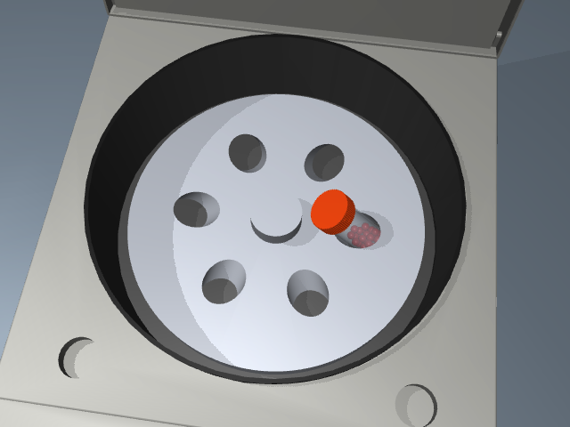

# Step 4: First Physics Test, One Tube Into One Hole (2026-11-23)

Before building all of Step 4, one question from [approach.md](approach.md#open-questions) had to be answered:
**does a sample tube held only by its 12 mm cap stay lined up when it is tilted to the hole's 35° and slid
into a hole with 0.9 mm to spare?** This page answers it. The script is `insert_test.py`; nothing here is a
learned model, it is the programmed arm of Steps 1 and 3.



## Where we are (read this first)

- **Answer: not as the gripper model was built.** Held by the cap and tilted, the tube slowly turns in the
  fingers, about 1.4° every second, however hard it is squeezed. It reaches 7 to 23° by the time it gets to
  the hole. It still went in on 6 of 8 scenes (the hole's funnel-shaped top pushed it straight), but twice
  it jammed or blew the simulation up.
- **The fix:** the simulated finger pads had no grip against twisting. Real rubber pads do. With that added
  (one number, explained below), the tube stays within 1.5° on arrival and **went in on 23 of 23 tries**: 8
  scenes covering all six holes, both ways of sliding, and the arm told the hole is up to 5 mm away from
  where it really is.
- **Now in the shared scene** (`settings.PAD_TORSION`, 2026-11-23). Steps 1 and 3 were rerun with it: Step 1
  the same 60 of 60; Step 3 needed one fix (feel for the seat when putting the water tube back) and then works
  as before ([Step 3 results](../../step-3-fill-balance-tube/docs/results.md)).
- **Not yet tested:** open balance tubes (no cap, held by their top, with water inside), holes with a full
  neighbour, and the full Step 4 run from Step 2's plan.

## Words used here

- **Pinch point**: the point between the two finger pads.
- **Cap grip**: the fingers close on the 35 mm orange cap, pointing along the tube (from above).
- **In the fingers (°)**: the angle between the tube and the fingers. 0° means the tube points exactly the way
  the hand thinks it does.
- **Lead-in**: the top 6 mm of each hole is wider (a small funnel). It catches a tube up to 3 mm off.
- **Wrist force sensor**: measures the push and pull between the arm's wrist and the gripper, like feeling
  through your fingers. The UR5e has one built in.
- **Twist friction** (MuJoCo calls it *torsional friction*): grip against something turning between your
  fingertips, the way a coin pinched between finger and thumb resists being spun.
- **Seated**: the grading code's check: tip within 6 mm of the hole's bottom, axis within 3° of the hole's.

## What one try does

```
pick the first sample from its rack cell (Step 1's cap grip, fingers pointing down)
──► up to the travel height (30 cm)
──► turn the joints so the hand is tilted to the hole's 35°, the tube 20 cm back along the hole's axis
    (10 cm for holes 4 and 5)
──► slide in along the axis: 3 cm/s, then 1 cm/s from 1.5 cm above the hole
      pushed back more than 4 N? ── wait (near the bottom: the tip is down, stop)
──► hold the arm where it is ──► open ──► back out 10 cm along the axis
──► the examiner checks: is the tube seated?
```

Two ways of sliding were compared:
- **plain**: straight down the hole's axis; the force sensor is only used to stop at the bottom.
- **force**: the hand also gives way sideways when the hole's wall pushes the tube (like a soft spring), as a
  person feels a peg into a hole.

## 1. The tube turns in the fingers

Seed 0, hole 0, the tube held by its cap. The angle in the fingers, measured by the simulator:

| Squeeze on the cap | After the pick | On arrival at the hole (tilted) | Then, every 0.5 s while held still |
|---|---|---|---|
| 2 mm (Step 1's) | 1.2° | 6.8° | 7.6, 8.3, 9.0, 9.7 … 13.3° after 5 s |
| 4 mm | 1.2° | 6.2° | 6.9, 7.6, 8.2 … 12.2° |
| 6 mm | 1.2° | 5.5° | 6.1, 6.7, 7.3 … 10.9° |

A harder squeeze hardly helps. The tube is not slipping because the grip is too weak. It **turns about
the line between the two pads**, like a door on its hinge, and the pads put up almost nothing against that
turn. (Step 3 met the same hinge with the water tube's side grip.)

Why: the gripper model's pads use MuJoCo's simplest contact, which grips against sliding but not against
twisting. With a small patch of contact, nothing stops the turn except gravity's slow pull, so it creeps. A
real rubber pad presses a whole patch of rubber on the cap and resists the twist. A real 2F-85 also presses
20 N or more, against about 3 N in the model.

The fingers' turn cannot avoid it. The hinge does nothing if the pads face along the tilt (fingers closing
towards the rotor's middle), but then the fingers hit the rotor's centre knob. The grip plan found the
same: only turns within 45° of "along the rim" are clear. Within those, 45° is the best, and the tests use
it.

## 2. The fix: twist friction on the pads

Giving the pads twist friction (`PAD_TORSION`, a length in metres in MuJoCo's units), same tube, 2 mm
squeeze:

| Twist friction | On arrival | Then, over 5 s held still |
|---|---|---|
| none (the model as built) | 6.8° | to 13.3° (+1.3° a second) |
| 0.005 m | 4.8° | to 9.5° |
| 0.01 m | 2.9° | to 5.4° |
| **0.02 m** (chosen) | **1.9°** | **to 2.8°** (+0.17° a second) |
| 0.03 m | 1.5° | to 1.9° |

0.02 m was chosen. For a sense of scale: a 20 × 20 mm rubber patch with friction 1.2 resists a twist of
about 0.01 m times the squeeze. The model's pads press about 7 times less than a real gripper's, so a
bigger number makes up for it. That is the same reason the pads' sliding friction was already raised from
0.7 to 1.2 (`settings.PAD_FRICTION`). With it, a 2 mm squeeze is enough, and the squeeze stays at Step 1's
value.

## 3. Results

All with the final code. Seeds 1 to 8 use hole `seed % 6`, so every hole is tried, each with the first
sample of the scene (fill levels differ by seed).

| | Tries | Seated | Simulation blew up |
|---|---|---|---|
| **With twist friction**, plain slide, seeds 1 to 8 | 8 | **8** | 0 |
| **With twist friction**, force slide, seeds 1 to 8 | 8 | **8** | 0 |
| **With twist friction**, hole 0 told to be 4, 5 or −5 mm off, both slides | 6 | **6** | 0 |
| With twist friction, the pictured try (seed 0, hole 0) | 1 | 1 | 0 |
| Without twist friction, plain slide, seeds 1 to 8 | 8 | 6 | 1 |

Without twist friction the tube was 7 to 23° off in the fingers when it met the hole. Seed 8 jammed half
way in at 23°. Seed 2 went in crooked and the simulation blew up.

The 23 tries with twist friction:

| | Smallest | Middle | Largest |
|---|---|---|---|
| Tip's distance from the hole's bottom | 0.36 mm | 0.61 mm | 0.74 mm |
| Tube's axis against the hole's | 0.06° | 0.75° | 0.99° |
| Angle in the fingers on arrival | 0.3° | 1.5° | 2.7° |
| Largest angle in the fingers while sliding | 0.9° | 2.9° | 5.4° |
| Largest sideways push felt | 8 N | 16 N | 28 N |
| Slide time (simulated) | 9 s | 13 s | 22 s |
| Wall-clock time for the whole try (pick, carry, slide, back out) | 21 s | 30 s | 46 s |

- **The funnel-shaped top does most of the work.** Even with the hole 5 mm from where the arm thinks it is,
  the tip finds the funnel, and the slightly loose grip (a degree or two) lets the tube straighten as it
  goes in.
- **Plain and force slides came out the same** here. The sideways give is not needed for these errors. What
  matters is the force sensor's **stop at the bottom**. On seed 1 the tube sat 6.8 mm lower in the fingers
  than the plan assumed, so it reached the bottom early. The push back told the arm to stop, and the slide
  did not drive the tube into the rotor.
- No balls spilled (the samples are capped).

## Problems met on the way, and what fixed them

| What happened | Why | Fix |
|---|---|---|
| Tube turned up to 16° in the fingers | No twist friction on the pads (section 1) | `PAD_TORSION` 0.02 m |
| Holes 4 and 5 refused: "the tube would come 22 mm into the centrifuge's body" | Those holes lean towards the arm, so the hand reaches past them and points back. The first pose the solver found reached over the arm's head, and the joint move there swept the tube through the housing | Find several poses (elbow up or down, the shoulder a turn round) and use the one whose joint move keeps the most room. For hole 4 that is elbow up, 3.9 mm to spare all the way |
| Simulation blew up just after a good slide (seed 1, force) | The arm trails its targets by about 0.2 s. After stopping at the bottom it kept chasing the last target, pressing the seated tube into the bottom and wall | On stopping, hold the arm where it **is**, not where it was last told to go |
| The same blow-up, made worse by the force slide | Its first version kept adding to the sideways shift while pushed, and sat at its 3 mm limit | The give is now a soft spring: proportional to the push, and it comes back when the push goes |
| Waiting at every push at the funnel (2 mm squeeze, no twist friction) blew up the simulation | The tilted tube waited, pressed against the funnel's edge, and kept turning in the fingers | With twist friction the tube arrives straight, and the waits are short (1 to 7) |

## What came next

The twist friction went into the shared scene, and Step 4 was built on this test: `rotor.py` (one tube into
one hole, both grips) and `load.py` (a whole job in Step 2's order). Results: [results.md](results.md).

## Files

| What | Where |
|---|---|
| The test script | `insert_test.py` |
| Every try (summary and slide log, every 0.1 s) | `results/insert_seed*_hole*_*.json` |
| Pictures of the pictured try | `results/seed0_hole0_plain_miss0_{rotor,front}.png` |

## Reproduce

```bash
cd v3-centrifuge-loading/step-4-load-rotor
export PYTHONPATH=$PWD:$PWD/../step-1-weigh:$PWD/../step-3-fill-balance-tube:$PWD/../simulation-environment
P="pixi run --manifest-path ../simulation-environment/pixi.toml"
$P python insert_test.py --seed 0 --hole 0 --pictures              # one try, ~25 s
$P python insert_test.py --seed 1 --hole 1 --mode force            # the force slide
$P python insert_test.py --seed 0 --hole 0 --miss-mm 5             # the hole 5 mm from where the arm thinks
$P python insert_test.py --seed 8 --hole 2 --pad-torsion 0         # the gripper model as built
```
