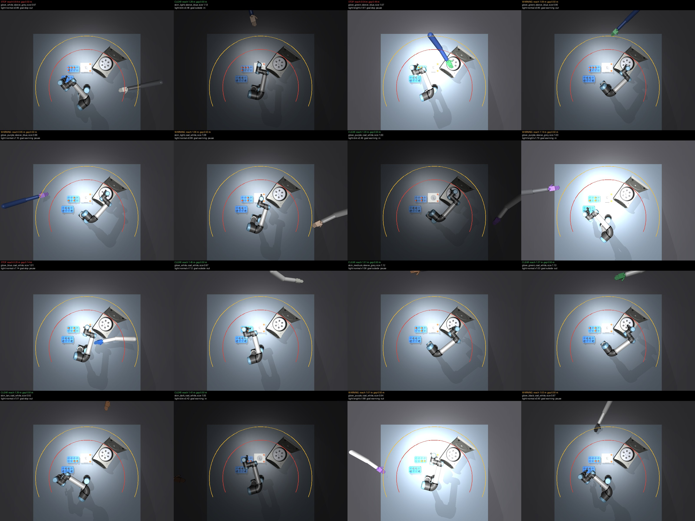

# Camera check: which camera the safety feature watches through

27 November 2026

**Result: a new safety camera, not v3's overhead camera.** The overhead camera misses most of the warning zone,
and up to a third of the stop zone when a hand is high up. The safety camera sees all of both zones at every hand
height. The price: a hand is about 20 pixels across in its picture instead of about 40.

## The two cameras

| | v3's `overhead` | the demo's `safety` |
|---|---|---|
| Where | 1.25 m above the bench, over x = 0.38 m | 1.9 m above the bench (about 2.8 m above the floor, a lab ceiling), over x = 0.50 m |
| Looking | straight down | straight down |
| Lens (vertical view) | 55° | 75° |
| Picture | 640 × 480 | 800 × 600 |
| Made for | finding the racks, tubes, balance and centrifuge | seeing people come into the zones |

Both pictures have the same orientation: the top is away from the arm (+x), the right is the arm's right (-y).

## How much of each zone each camera sees

Points every 1 cm over the zones (the arm's side of the bench, x from -0.1 m), at three hand heights; a point
counts as seen if it lands inside the picture. "Hand size" is how many pixels a 9 cm wide hand covers there.

| Camera | Hand height | Stop zone seen | Warning zone seen | Hand size |
|---|---|---|---|---|
| overhead | 10 cm | 97% | 42% | 36 px |
| overhead | 25 cm | 90% | 21% | 41 px |
| overhead | 45 cm | 68% | 3% | 52 px |
| **safety** | 10 cm | **100%** | **100%** | 20 px |
| **safety** | 25 cm | **100%** | **100%** | 21 px |
| **safety** | 45 cm | **100%** | **100%** | 24 px |

Why the overhead camera misses so much: it looks down from close above, so its view narrows quickly as you go up
from the table, and the warning zone (0.85 to 1.15 m from the arm's base) is mostly outside even the table-level
view at the sides.

20 pixels is small for a hand, but the person's forearm and sleeve come with it and are much larger: in the
pictures (below) the arm is always easy to see. Phase 2 will show whether the detector copes; if not, the first
fallback is a larger picture (1024 × 768).

## Go / no-go pictures

16 random frames (`python render.py --sheet docs/figures/go-no-go-sheet.jpg --n 16 --rng 1`). Each is labelled
with the truth from the simulation: the zone (green clear, orange warning, red stop), how close the person comes
to the arm's base, the gap to the robot, the hand and sleeve colours, the hand size, the lighting and the moment
in the reach. The red and orange lines are the zones' edges, drawn on the table.

What they show:

- The hand and sleeve stand out in every lighting level and with every glove colour, including the hard ones
  (a black glove; a dark hand over the dark floor in dim light).
- The person's shapes are simple (capsules and a box), but the hand reads as a hand: palm, four fingers, thumb.
- **A real limit of one camera looking straight down:** a hand high above the table looks further out than it is,
  because the zones' edges are drawn at table height. The truth labels are worked out in 3D, so the detector has
  to judge height from how big the hand looks. This belongs in the manufacturer file as a known limitation, and
  Package 2 should measure errors by hand height.

**Later (27 Nov):** the height problem turned out to be big (a cautious rule without height raised a false alarm
on 36% of clear pictures), so the safety camera became an RGB-D camera: it also gives depth. See
[detector.md](detector.md#why-the-camera-needs-depth).
