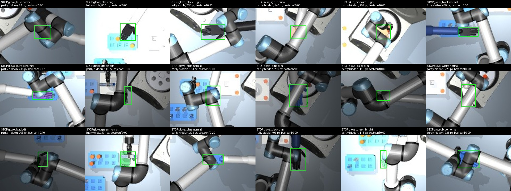

# The hand detector: results

27 November 2026. Approach and decisions: [detector.md](detector.md).

## Detector v1 in one line

**On 3,000 test pictures from jobs it never saw, the safety feature (YOLO11n v1 + depth + the fixed rule) missed
21 of 840 hands in the stop zone (2.5%, at most 3.6% at 95% confidence) and slowed or stopped the arm for nothing
on 42 of 1,572 clear pictures (2.7%).** Most misses are dark gloves partly hidden under the robot arm, which the
training pictures hardly had.

## Training

| | |
|---|---|
| Model | YOLO11n (Ultralytics 8.4), from its COCO weights, one class "hand" |
| Data | 1,200 training pictures (1,027 hand boxes), 300 validation |
| Settings | 640 pixels, batch 16, 20 epochs, up-down flips off, everything else Ultralytics' default |
| Time | 21.5 minutes on the Apple M5 GPU (18.6 pictures a second) |
| Validation, last epoch | precision 99.8%, recall 98.4%, mAP50 0.994, mAP50-95 0.907 |
| Confidence threshold | 0.2, chosen on validation (fewest missed hands with false alarms under 10%) |

## The test (3,000 pictures, seeds 4 to 7)

1,428 pictures have a person in a zone (840 in the stop zone, 588 in the warning zone); 1,572 are clear (459 with
nobody, the rest with a person outside the zones). Rates with their 95% upper bound (exact binomial).

| | Missed: hand in a zone, a safer zone chosen | Missed stop: hand in stop zone, arm not stopped | False alarm when clear |
|---|---|---|---|
| **v1: YOLO + depth + rule** | **28 of 1,428 (2.0%, ≤ 2.7%)** | **21 of 840 (2.5%, ≤ 3.6%)** | **42 of 1,572 (2.7%, ≤ 3.4%)** |
| Perfect boxes + depth + rule (the rule alone) | 10 of 1,428 (0.7%, ≤ 1.2%) | 3 of 840 (0.4%, ≤ 0.9%) | 42 of 1,572 (2.7%, ≤ 3.4%) |
| v1 YOLO, no depth (worst-case height rule) | 27 of 1,428 (1.9%, ≤ 2.6%) | 21 of 840 (2.5%, ≤ 3.6%) | 568 of 1,572 (36.1%, ≤ 38.2%) |

What the three rows say:

- **Depth is what makes the feature usable.** Without it, the arm would slow down for nothing on 36% of clear
  pictures; with it, 2.7%. Missed hands are about the same either way: they come from the detector, not the rule.
- **The rule alone misses 10**, all of them the known limitations ([detector.md](detector.md#known-limitations-found-while-building-keep-for-the-report)):
  3 hands hidden under the robot (1 to 4 pixels showing) and 7 pictures where only the person's arm, not the
  hand, is in the warning zone.
- **YOLO adds 18 misses**, all in the stop zone. The rule's 2.7% false alarms come from its 2 cm safety margin
  (hands hovering just outside the warning zone's edge); without the margin they were 0.2%, but 2 hands right on
  the edge were missed.

## Where v1 misses (per condition)

Hands in a zone, missed by v1 (all causes, including the 10 the rule alone misses):

| Condition | Missed |
|---|---|
| Hand partly hidden (fewer than 300 pixels show) | **14 of 30** |
| Hand fully visible | 11 of 1,395 (7 of them: only the arm in the zone) |
| Hand hidden (fewer than 12 pixels) | 3 of 3 |
| Black glove | **11 of 171** |
| Blue / green / purple glove | 6 of 152 / 4 of 191 / 4 of 177 |
| White glove; bare skin (4 tones) | 1 of 187; 2 of 550 |
| Small hand (size < 0.95) / medium / large (> 1.05) | 14 of 467 / 9 of 449 / 5 of 512 |
| Dim / normal / bright light | 8 of 372 / 11 of 716 / 9 of 340 |
| Hand low (< 20 cm) / middle / high (> 35 cm) | 10 of 415 / 18 of 971 / 0 of 42 |

Lighting barely matters. What matters is **how much of the hand shows** and **dark gloves**: the 18 hands YOLO
itself missed are all in the stop zone, next to or under the robot arm, most of them dark gloves against the
arm's dark links.

Green: the true hand box. Magenta: YOLO's boxes below the threshold, where there were any. 13 of the 18 are partly
hidden by the robot; 5 are fully visible (3 of them black gloves).

## What this means for v2

The training pictures had few hands near the robot: only 1% of them show a partly hidden hand. v2 should add
pictures of hands reaching in where the arm is working (so the arm partly covers them), with more dark gloves,
and be checked against the same frozen test set: released only if it is no worse than v1 on every condition
(plan.md, the update test).

Numbers: `results/evaluation_v1.json` (`python evaluate.py --weights runs/v1/weights/best.pt --name v1`).
