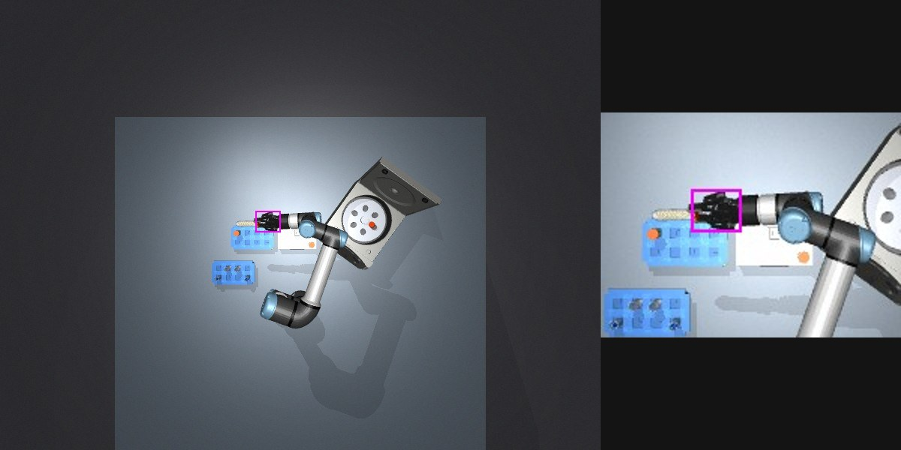
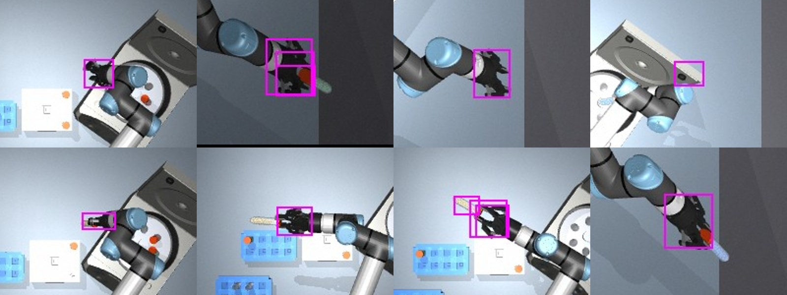

# Phase 3: the two tracks joined

27 November 2026. Track A built the person, the camera and the detector ([detector.md](detector.md)); Track B
built the safety layer ([safety-layer.md](safety-layer.md)). This page is how they were joined, what the joined
system does in real v3 jobs, and what the closed-loop runs found that the picture tests had not.

## In short

- **The joined system works in real jobs with the perfect detector:** on the 4 test jobs, a person reached in
  93 times (40 times into the stop zone); every job still loaded and balanced, the arm stopped within 0.20 s of a
  hand entering the stop zone, and **the person never touched the robot while it was moving** (the closest was
  13 cm).
- **With the trained detector, the closed loop found a failure the picture tests had missed:** YOLO v2 took the
  robot's own gripper, seen from the side, for a dark glove. The arm held, the scene stood still, the detector
  kept seeing the same "hand", and the job never finished. This is now a release test of its own (false alarms
  with nobody there, over every recorded moment of the test jobs), and v3 of the detector is trained on 472
  pictures mined for exactly this. Under the new test, v2 would not have been released.

## How they were joined

| What | How |
|---|---|
| Zones | Track A's fixed zones (stop closer than 0.85 m to the arm's base, warning to 1.15 m). Track B's distance-to-arm stand-in is now used only by its unit tests |
| Person | `sensing.Person`: Track A's hand, moved by Track B's `before_physics` hook before every physics step (also while the arm is held); a new reach every 6 to 20 s with a new look; the lighting drawn per job |
| Camera | `sensing.SafetyCamera`: the RGB-D safety camera, with sensor noise (colour 2 steps, depth 2 mm), so a still scene is never mistaken for a frozen camera |
| Detector | `sensing.YoloDetector`: YOLO + the depth rule, made only by `detector.load` from registry-approved bytes **and settings**; it logs each hand box with its decision. The perfect detector (the truth, the same zones) stays as the baseline |
| Runs | `run_guarded.py --hand person --detector perfect|yolo`: v3's whole job (Step 6's `run_seed`), unchanged |

Gaps Track B had listed as simplified, closed while joining:

- **Detection delay:** a frame's decision now takes effect 0.1 s after the frame was taken, with a start-up
  check before the job starts (a hand already in the cell keeps the arm from starting).
- **Measured speeds:** the normal layer now also checks the arm's actual joint and gripper speeds, not only the
  commands.
- **Signed log and registry:** the log's hashes are keyed with a secret (HMAC-SHA256), and the registry is
  signed; editing either by hand is caught. The registry also approves each model's threshold and picture size.

## Measuring contact

Every 10 ms while the person is near, the run measures the gap between the person's shapes and the robot's, and
the speed of the robot's fastest point (its links and the point between the fingers). A **contact while moving**
is a gap below zero with the robot faster than 10 mm/s; below that the robot is braking or settling by
millimetres. Every contact's robot speed is recorded too, so the line can be read either way.

(The first version of this measure called the robot "moving" when any joint turned faster than 0.01 rad/s. It
flagged one contact on seed 7 that was a hand arriving while the robot crept at 3 to 7 mm/s in its last 20 ms of
braking. The simulated hand does not collide, so it carried on into the robot; that is the "touching while held"
count below.)

## Results: the perfect detector (test jobs 4 to 7)

`results/person_perfect/`

| | Seed 4 (pairs) | Seed 5 (odd one) | Seed 6 (triangle) | Seed 7 (mismatch) | All |
|---|---|---|---|---|---|
| Reaches (clear / warning / stop zone) | 16 (3 / 5 / 8) | 28 (8 / 7 / 13) | 11 (1 / 4 / 6) | 38 (12 / 13 / 13) | **93 (24 / 29 / 40)** |
| Contact while the robot moved | 0 | 0 | 0 | 0 | **0** |
| Reaches that touched the held robot | 1 | 0 | 0 | 2 | 3 (robot at most 7 mm/s) |
| Time to stop after entering the stop zone, worst | | | | | **0.20 s** (median 0.14 s) |
| Smallest gap to the robot while it moved | | | | | **13 cm** |
| Arm held / slowed | 28.7 s / 17.2 s | 37.1 s / 27.1 s | 19.0 s / 13.4 s | 36.1 s / 39.5 s | |
| Job loaded and balanced | yes | yes | yes | yes | **4 of 4** |
| Normal layer tripped; log and replay | no; intact | no; intact | no; intact | no; intact | |

The fastest reach into the stop zone came in at 1.98 m/s.

## The closed-loop failure with YOLO v2

On seed 6 with YOLO v2 (`results/smoke/`, two runs): from 132.7 s on, the detector reported a hand in the stop
zone with nobody there, 1,712 frames in a row. The saved pictures (`disagreements_seed06/`) show the box on the
robot's gripper: its dark fingers around a tube, seen side-on, look like a dark glove. Once the arm held there,
nothing in the picture changed, so neither did the answer: the arm was held for 236 s of a 424 s job, and the job
did not finish (2 of 3 tubes seated). The same seed with the perfect detector finished and balanced.

The frame from 132.9 s: nobody in the cell, YOLO v2's box (magenta) on the gripper holding a tube over the
balance; enlarged on the right.

Why the picture test missed it: every training picture has the gripper in it, but side-on poses are rare, and
the test pictures drew random moments, so few caught the gripper that way. A detector that is right 99.7% of the
time on pictures can still lock up a job, because in the loop one wrong answer freezes the scene that produced it.

What was done about it:

1. **A new test, `nobody_scan.py`:** the detector over every other recorded moment of the 4 test jobs (2,570
   pictures), nobody there, random lighting, sensor noise. False alarms: **v1 3 (0.12%), v2 8 (0.31%)**. v2's
   extra training on dark gloves near the robot made it slightly worse at this. All but one are the gripper
   seen from the side (the other is a corner of the centrifuge):

   
2. **A fifth release rule** (`release_check.py`, committed before v3 was evaluated): a new version may raise no
   more false alarms with nobody there than the current one. Under it, v2 would not have replaced v1.
3. **Hard-negative mining** for v3: the same scan over every recorded moment of the 4 *training* jobs, two
   lighting levels each (10,390 pictures), keeping every picture where v2 saw even a weak "hand" (confidence 0.01
   or more): 472 pictures with no hand in them, all of the robot in awkward poses, as training pictures with no
   box.

v3: trained from v2 on the 1,800 pictures plus the 472, then the same update test, now with rule 5. (Results to
follow.)

## v3's cameras: a fault in the demo's own additions, found by the nobody run

All 20 v3 jobs with the guard on and nobody there: the guard never slowed or held the arm, the measured-speed
limits never tripped, but every job's Step 5 report said "tube not seated": its rotor-camera depth check read
every seated tube as 19 to 63 mm too high. The cause was the demo's scene, not the guard. MuJoCo places a
camera's near and far clipping planes from the scene's overall size, and the parked person (far away) and the
floor had made it 1.86 -> 51 m, so near objects fell inside the near plane. The physics was identical (tested);
the pictures were not. `scene_plus` now keeps v3's own scene statistics, and a new test renders v3's cameras
(colour and depth) in both scenes and requires them to match; it fails without the fix. The safety camera's own
depth moved by at most 0.1 mm either way, so the detector's evaluations stand.

## Still open

- **The zones are not sized for the worst case.** The stop zone's edge is the arm's reach. From a hand entering
  it to the arm standing still takes up to 0.20 s here (a frame every 0.1 s, the 0.1 s delay, about 20 ms of
  braking); a hand at 2 m/s covers 40 cm in that time. ISO 13855 sizes a protective field as S = K x T + C (hand
  speed times response time, plus an intrusion allowance): about 0.4 to 0.5 m beyond the arm's reach, which here
  would make the whole bench a stop zone. The runs above kept a 13 cm gap at the closest because the warning zone
  slows the arm first and the arm is rarely at its full reach where the person comes in. The alternative is speed
  and separation monitoring (ISO/TS 15066): stop by the distance from the hand to where the robot is now, which
  the depth camera makes possible. A design decision for the manufacturer file.
- **Holding at an awkward moment.** A hold mid-pour leaves the tube tilted (safety-layer.md); a long hold with a
  false "hand" stalled a job. Both are about availability, not safety: the arm was always held, never let move
  into the person.
- **v3 of the detector** and the closed-loop runs with it.
